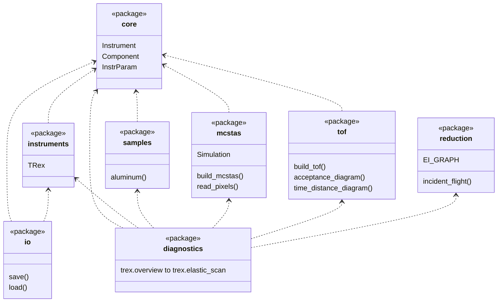

# Code layout

The code is the Python package `mcdgs`, in `src/mcdgs/`, one folder per layer.
[Core concepts](concepts.md) explains what the parts are.

## Layers

Dependencies point inwards, so an instrument never depends on how it is simulated:

| Package | Role |
| ------- | ---- |
| `core` | `Instrument`, the components, parameters and geometry. It imports nothing else from `mcdgs`. |
| `instruments`, `samples` | The instruments and ready-made crystals, built on `core`. |
| `mcstas` | An adapter that works with any instrument: builds it, runs it, reads the output. |
| `tof` | An adapter that works with any instrument: builds its chopper cascade as a tof model, gives its disks as scippneutron disk choppers, and draws its chopper acceptance diagram. |
| `io` | An adapter that saves any instrument to a YAML parameters file and loads it back. It imports `instruments` only to know every instrument class a file may name. |
| `reduction` | Data reduction with the kernels of scippneutron: the incident energy of a straight flight, the energy and momentum transfer of each neutron, the sub-pulse it belongs to, the solid angle of the pixels and bin edges. It imports nothing else from `mcdgs`. |
| `diagnostics` | Setups that study one part of an instrument, such as T-Rex up to guide 4, and what reads their McStas and tof results. One module per setup, in a package per instrument, such as `trex.source`, built on all the other packages; nothing else imports it. |

Each box is a package, with the main things it offers, and each dashed arrow points to a package it
imports from:

