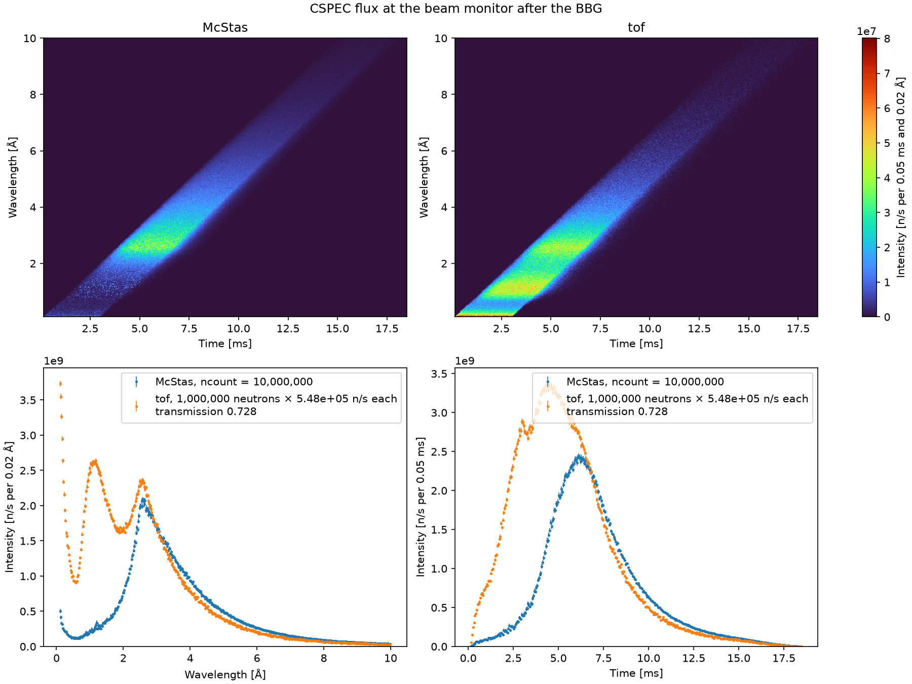

# Beam monitor

`CSPECBeamMonitor`, in
[`mcdgs.diagnostics.cspec.beam_monitor`](https://github.com/bingli621/mcdgs/blob/main/src/mcdgs/diagnostics/cspec/beam_monitor.py),
compares McStas and [tof](../../how-to/simulate-the-choppers-with-tof.md) at the beam monitor of
CSPEC, in the gap after the BBG. Between the source and that monitor are the first guides of the
S-bender, W03-01-011 to the BBG: McStas models them, tof does not. As on
[Beam monitor of T-Rex](../trex/beam-monitor.md), tof is brought to the level of McStas with a
scale and a transmission, and the map tells which real monitor can stand at that place.

## The setup

`CSPECBeamMonitor` is CSPEC up to its beam monitor. No chopper stands before it.

| Component | What it is |
| --------- | ---------- |
| `source` | The CSPEC source, `ESS_butterfly` on beam port W3, one pulse at 2 MW, with the widest band, 0.1 to 10 Å. |
| `arm_iscs` | The ISCS frame of CSPEC_nl-specs_1.E.xlsx, as in `CSPEC` (see [The ISCS frame](details.md#the-iscs-frame)). |
| `source_monitor` | The time and wavelength monitor at the entrance of W03-01-011, as on [Source](source.md). |
| `guide_01_011` to `guide_02_01` | The guides from W03-01-011 to the BBG, W03-02-01, rows 14 to 21, as in `CSPEC`. |
| `arm_gap_bbg` | The start of the gap after the BBG, row 22. |
| `beam_monitor` | `beam_monitor()` of [`mcdgs.instruments.cspec.monitors`](../../reference/cspec.md), a `Monitor_nD` in the middle of that gap, at 5.915 m, 70 mm wide and 55 mm high (see [Monitors](details.md#monitors)). |

The beam monitor records one 2D map of time against wavelength:

| Axis | Range | Bins | Bin width |
| ---- | ----- | ---- | --------- |
| Time | 0.15 to 18.5 ms | 367 | 0.05 ms |
| Wavelength | 0.1 to 10 Å | 495 | 0.02 Å |

The time runs from the fastest neutron of the band, 0.1 Å leaving at the start of the pulse, to
the slowest, 10 Å leaving at its end. In `CSPEC` the source and the beam monitor follow the band
of `lambda0`; here they keep the widest band, so the page covers every wavelength the source
sends. Both monitors have `restore_neutron=1`, so they do not change the beam.

`CSPECBeamMonitor` has no control parameters and no McStas parameters:

<!-- fmt:off -->
```python
--8<-- "src/mcdgs/diagnostics/cspec/beam_monitor.py:instrument"
```
<!-- fmt:on -->

## Running both models

As on [Source](source.md#running-both-models), the same object runs in McStas and in tof, and
each monitor of both models is read on the bins of the McStas map:

<!-- fmt:off -->
```python
--8<-- "src/mcdgs/diagnostics/cspec/beam_monitor.py:run_mcstas"
```
<!-- fmt:on -->

<!-- fmt:off -->
```python
--8<-- "src/mcdgs/diagnostics/cspec/beam_monitor.py:run_tof"
```
<!-- fmt:on -->

tof has no guides and no apertures: every neutron of its pulse reaches the beam monitor, at the
time of its straight flight from the source.

## Scale and transmission

As for T-Rex (see [Scale and transmission](../trex/beam-monitor.md#scale-and-transmission)), the
scale is set at the source monitor, where both models see the same beam, and the transmission $T$
on top of it stands for what the guides take out:

$$
\text{tof intensity at the beam monitor} = \text{tof counts} \times \text{scale} \times T
$$

By default, `transmission=None`, $T$ is tuned so that both have the same intensity at 3 Å, the
default `lambda0` of `CSPEC`, the middle of the band the instrument uses. `intensity_near` sums a
map over time, in the wavelength bins whose centers are within 0.05 Å of 3 Å, five bins of
0.02 Å:

$$
T = \frac{\text{McStas intensity near 3 Å}}{\text{tof counts near 3 Å} \times \text{scale}}
$$

<!-- fmt:off -->
```python
--8<-- "src/mcdgs/diagnostics/cspec/beam_monitor.py:transmission"
```
<!-- fmt:on -->

Every tof neutron counted at the source monitor is also counted at the beam monitor, and the two
models agree at the source monitor, so $T$ is the transmission of the guides at 3 Å in McStas, to
within the noise: the share of its beam near 3 Å at the source monitor that reaches the beam
monitor. At the defaults of `main` it is 0.7275, with a scale of 5.477e5 n/s
per tof neutron. Over the widest band the guides pass less, 0.4498 of the McStas total at the source
monitor, as they lose the thermal neutrons. Matched at 3 Å, tof and McStas agree where `CSPEC`
uses the beam, and away from 3 Å a difference is what the guides do to the beam there, relative
to what they do at 3 Å. Another wavelength is `main(match_wavelength=...)`; a value given by
hand, such as `main(transmission=0.5)`, skips the tuning.

## The figure

`main` runs both models with the same seed, prints the mean time and wavelength of each, the
McStas totals, the scale and the transmission, and saves `cspec_beam_monitor.png` to
`mcdgs_workspace/results/cspec_beam_monitor/`, or to the folder given with `--out`. The figure has
the layout of [Source](source.md#the-figure): the maps of both models on one color scale, then the
wavelength spectrum and the time profile of both, with their error bars.



This is `main` at its defaults: 1e7 McStas neutrons, 1e6 tof neutrons and seed 1.

| | McStas | tof |
| --- | --- | --- |
| Total | 2.463e11 n/s | 3.984e11 n/s |
| Mean time | 7.03 ms | 5.31 ms |
| Mean wavelength | 3.56 Å | 2.43 Å |

The two agree near 3 Å by construction. The guides reflect a long wavelength up to a larger
angle, so they pass the cold neutrons far better than the thermal ones, and McStas has its beam
shifted to longer wavelengths, and with them to later times:

- **Below about 2 Å McStas is far below tof.** At the thermal peak, 1.0 to 1.2 Å, it has 9 % of
  tof, and from 0.1 to 0.3 Å 11 %. On the map, the thermal neutrons are almost gone, and the total
  of McStas is 62 % of that of tof.
- **At the cold peak, 2.5 to 2.7 Å, McStas has 88 % of tof**, close to the match at 3 Å.
- **Above 3 Å McStas is above tof**, more so the longer the wavelength: 23 % higher from 4 to
  5 Å, and 34 % from 8 to 10 Å.
- **In time, McStas peaks later**, near 6.1 ms against 4.5 ms. After about 7 ms, where the
  neutrons of 3 Å and longer arrive, the two are close, McStas a little above.

## Count rate of a monitor

[Estimating the count rate of a monitor](../trex/beam-monitor.md#estimating-the-count-rate-of-a-monitor)
explains how the map gives the rate a real monitor at that place counts: `count_rate`, of
[`mcdgs.diagnostics.beam_monitor`](../../reference/diagnostics.md#mcdgs.diagnostics.beam_monitor),
shared by both instruments. `main` prints the rates of the flux and of a monitor with
$\varepsilon = C \lambda$, $C$ = 5e-5 per Å:

| Quantity | At the beam monitor |
| -------- | ------------------- |
| Total rate | 2.46e11 n/s |
| Per pulse, total / 14 Hz | 1.76e10 n per pulse |
| Per area, $\text{total} / (7\ \text{cm} \times 5.5\ \text{cm})$ | 6.4e9 n/s/cm² |
| Peak rate of the flux | 3.48e12 n/s at 6.12 ms, some 14 times the average |
| Average rate, $\varepsilon = C \lambda$ | 4.38e7 counts/s |
| Peak rate, $\varepsilon = C \lambda$ | 5.27e8 counts/s at 6.47 ms |

The average with $\varepsilon = C \lambda$ is $C \times \langle\lambda\rangle \times \text{total}$, with
$\langle\lambda\rangle$ = 3.56 Å the mean wavelength of McStas. With a dead time $\tau$ of 100 ns,
$\text{peak rate} \times \tau \approx 53$, far above the 0.1 a counting monitor should stay below:
that monitor is saturated. To bring it to 0.1, the peak must drop to 1e6 counts/s, some 530 times
lower: $C$ of about 1e-7 per Å, $\varepsilon$ of 2e-7 at 2 Å, below the usual range of beam
monitors. A monitor of the usual $\varepsilon$ needs a smaller opening as well.

These rates are for the widest band. In `CSPEC` the source sends only the band of `lambda0`, 1.853 Å
wide, so the beam monitor there counts less: run `CSPEC` itself for the rate at a given `lambda0`.

## Making the figure

The figure needs McStas, so it is not made with the site: `pixi run docs-diagnostics` makes it
again, with the other files of the CSPEC pages. To make it yourself, run:

```bash
pixi run python -m mcdgs.diagnostics.cspec.beam_monitor
```

Call `main` with other numbers for a finer or a faster figure, with another wavelength to match at, or with a
transmission of your own:

```bash
pixi run python -c "from mcdgs.diagnostics.cspec.beam_monitor import main; main(ncount=1e6, transmission=0.5)"
```
