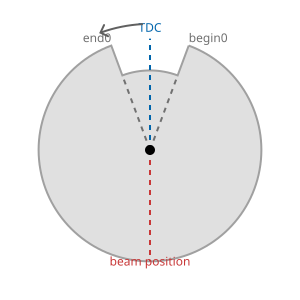
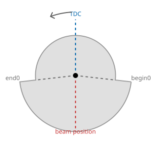
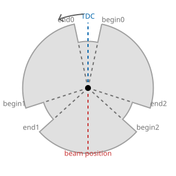
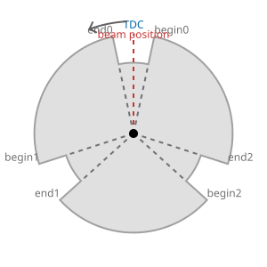
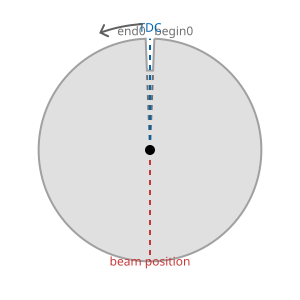
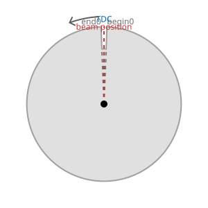
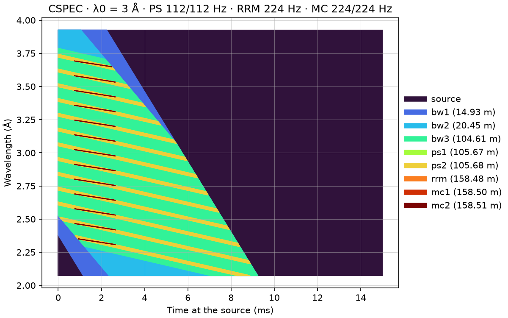

# Choppers

CSPEC has eight disk choppers: the bandwidth choppers `bw1`, `bw2` and `bw3`, the pulse-shaping
choppers `ps1` and `ps2`, the RRM chopper `rrm` and the monochromatic choppers `mc1` and `mc2`.
This page gives how their frequencies and delays follow from the
[control parameters](details.md#control-parameters), shows each disk as scippneutron draws it,
and what the cascade lets through, in a chopper acceptance diagram. Pictures and diagram are at
the default parameters: `lambda0` = 3 Å, `nu_mc` = 224 Hz, `n` = 1, `t0_offset` = 1.7 ms and
`bw3_delay` = 0.

## Frequencies

The frequencies depend only on the source frequency, 14 Hz, `nu_mc` and `n`; `lambda0` sets the
delays, below.

| Choppers | Frequency | At the defaults |
| -------- | --------- | --------------- |
| Bandwidth, `bw1`, `bw2` and `bw3` | 14 Hz, the source frequency | 14 Hz |
| Pulse-shaping, `ps1` and `ps2` | `nu_mc` / 2 (FIXME) | 112 Hz |
| RRM, `rrm` | `nu_mc` / `n` | 224 Hz |
| Monochromatic, `mc1` and `mc2` | `nu_mc` | 224 Hz |

- **Bandwidth choppers.** They turn once per pulse and open once, so they pass one band of
  wavelengths from each pulse: the band that reaches the sample within one source period.
- **Monochromatic choppers.** Each disk has one slit, so it opens once per turn, `nu_mc` / 14 Hz
  = 16 times per source period. Each opening picks one sub-pulse out of the band.
- **RRM chopper.** It turns at `nu_mc` / `n`, so it passes every `n`-th opening of the
  monochromatic choppers: `n` thins out the sub-pulses. At `n` = 1 it passes them all.
- **Pulse-shaping choppers.** They cut each sub-pulse short at the moderator end, and must open
  once for each sub-pulse that the monochromatic choppers pass. Two sub-pulses that leave the
  moderator together, one opening of the monochromatic choppers apart, differ in wavelength by a
  fixed step: $\Delta\lambda = 3956\ \text{m Å/s} / (\nu_\text{mc} L_\text{mc})$, with $\nu_\text{mc}$ = `nu_mc` and $L_\text{mc}$ = 158.5 m: 0.1114 Å at the defaults.
  The pulse-shaping choppers, at 105.7 m, must open 158.5 / 105.7 = 1.5 times as often. Their
  disks have three slits, 120° apart, so they open three times per turn and turn at
  $1.5 / 3 = 0.5$ times `nu_mc`. That gives them the same $\Delta\lambda$, to 1 part in $10^5$.

**Counter-rotation.** Both pairs are counter-rotating: the slit edges of the two disks of a pair
cross the beam in opposite directions, so a pair opens and closes the beam faster than one disk.
The second disk of each pair, `ps2` and `mc2`, has its axle below the beam (`beam_angle` 0°),
where those of `ps1` and `mc1` are above it (180°). All four turn the same way, with a positive
frequency: turning the same way from opposite sides, their edges cross the beam in opposite
directions, as the monochromatic choppers of [T-Rex](../trex/choppers.md#frequencies) do.

## Delays

`lambda0` sets the delay of each disk, the time its zero mark is on the beam. Each disk is phased
so that its first slit is centered on the beam when a neutron of wavelength `lambda0`, leaving
the moderator at `t0_offset`, reaches it:

$$
\text{delay} = t_0 + \frac{L \lambda_0}{3956\ \text{m Å/s}} - \frac{\theta}{360° \times \nu},
$$

with $t_0$ = `t0_offset`, $\lambda_0$ = `lambda0`, $L$ the flight path to the disk, $\nu$ its frequency and $\theta$ the angle the disk turns from its
zero mark to put its first slit on the beam: 180° with the axle above the beam, 0° below, as the
first slit is centered on the zero mark. `bw3` turns `bw3_delay` later still.

| Chopper | Flight path $L$ | λ0 arrives at | $\theta$ | Delay |
| ------- | --------------- | ------------- | -------- | ----- |
| `bw1` | 14.93342 m | 13.025 ms | 180° | −22.690 ms |
| `bw2` | 20.45545 m | 17.212 ms | 180° | −18.502 ms |
| `bw3` | 104.61213 m | 81.031 ms | 180° | 45.317 ms |
| `ps1` | 105.66872 m | 81.832 ms | 180° | 77.368 ms |
| `ps2` | 105.67872 m | 81.840 ms | 0° | 81.840 ms |
| `rrm` | 158.47993 m | 121.881 ms | 0° | 121.881 ms |
| `mc1` | 158.50404 m | 121.899 ms | 180° | 119.667 ms |
| `mc2` | 158.51404 m | 121.907 ms | 0° | 121.907 ms |

A bandwidth chopper turns half a turn, 35.7 ms at 14 Hz, from its zero mark to its slit, so the
delays of `bw1` and `bw2` are before the start of the pulse. [Chopper timing](details.md#chopper-timing)
gives where the flight paths come from.

## The disks

[`get_choppers`](../../reference/tof.md) turns each `NXdisk_chopper` of an instrument into a
scippneutron `DiskChopper`, by name and in beam order, with the same slits, frequency, phase,
radius and slit height. scippneutron draws it with `make_svg`:

<!-- fmt:off -->
```python
from pathlib import Path

from mcdgs.instruments.cspec.model import CSPEC
from mcdgs.tof import get_choppers

folder = Path(".")  # where the pictures go
--8<-- "src/mcdgs/diagnostics/cspec/choppers.py:draw_choppers"
```
<!-- fmt:on -->

In Jupyter, `get_choppers(cspec)["ps1"]` shows the same drawing with a table of the disk.

| Chopper | Frequency | Beam crosses the disk | Slits |
| ------- | --------- | --------------------- | ----- |
| `bw1` | 14 Hz | at the bottom | one of 40.7° |
| `bw2` | 14 Hz | at the bottom | one of 41.7° |
| `bw3` | 14 Hz | at the bottom | one of 193° |
| `ps1` | 112 Hz | at the bottom | three of 24.23°, 120° apart |
| `ps2` | 112 Hz | at the top | three of 24.23°, 120° apart |
| `rrm` | 224 Hz | at the top | one of 4.45° |
| `mc1` | 224 Hz | at the bottom | one of 4.45° |
| `mc2` | 224 Hz | at the top | one of 4.45° |

| `bw1` | `bw2` | `bw3` |
| :---: | :---: | :---: |
|  |  |  |

| `ps1` | `ps2` |
| :---: | :---: |
|  |  |

| `rrm` | `mc1` | `mc2` |
| :---: | :---: | :---: |
|  |  |  |

Each disk is seen from the source, with its zero mark at the top (`TDC`, blue). The slits are
cut out of the gray disk, with their edges labeled `begin` and `end`; the red line is where the
beam crosses the disk, and the arrow the sense of rotation. The arrows of all the disks point the
same way; those of `ps1` and `ps2`, and of `mc1` and `mc2`, have the beam on opposite sides,
which is their counter-rotation. The drawing does not turn the disk by its phase: it is the disk
as built, not at any moment of the pulse.

The slits, the axles and the sizes of the disks are not in CSPEC_nl-specs_1.E.xlsx: the slits and
the axles are those of drcspec, and the disks are 0.35 m in radius with slits 0.1 m high
(FIXME).

The beam crosses each disk through a window as wide as the exit of the guide in front of it, on
the source side: 70 mm for `bw1` and `bw2`, 114.66 mm for `bw3` and the pulse-shaping choppers,
and 22.43 mm for the RRM and monochromatic choppers, after the taper of the straight guide. In
McStas, this is `xwidth` of `NXdisk_chopper`, which hangs the window from the rim at its sides,
so the slit height holds across the whole window: see
[The disks of T-Rex](../trex/choppers.md#the-disks). The rim is lower at the sides than on the
beam axis by 1.8 mm for a 70 mm window and 4.7 mm for a 114.66 mm one. The drawings above, the
acceptance diagram and tof follow the beam axis only and do not use the window.

## Acceptance diagram

The acceptance diagram follows the pulse, a rectangle in time and wavelength, through the
choppers with scippneutron's chopper cascade. After each chopper, what is left is moved back to
the source, so the diagram shows which times and wavelengths leaving the moderator each chopper
accepts. See [Acceptance diagram of T-Rex](../trex/choppers.md#acceptance-diagram) for more.

<!-- fmt:off -->
```python
from mcdgs.tof import acceptance_diagram

--8<-- "src/mcdgs/diagnostics/cspec/choppers.py:acceptance"
```
<!-- fmt:on -->



The diagram starts from a rectangle 15 ms long, over the band of the source, 2.074 to 3.926 Å,
much longer than the 2.86 ms proton pulse, so that it also shows what the choppers would let
through from neutrons that leave the moderator late. Each chopper is drawn over the ones before
it, in turbo from the source to the last chopper:

- `bw1` and `bw2` cut the corners of the rectangle: the short wavelengths that leave early,
  which would arrive before they open, and everything that leaves late, which would arrive after
  they close: at 2.2 Å, `bw1` passes only what leaves from 0.68 to 8.75 ms. `bw3`, at 104.6 m,
  trims the left side further, the shortest and the longest wavelengths that leave at the start
  of the pulse.
- The pulse-shaping choppers cut the band into slanted stripes, one per opening, about 0.11 Å
  apart.
- The monochromatic choppers keep a short piece of each stripe, from about 0.75 to 2.65 ms,
  around `t0_offset`: 13 sub-pulses, 0.111 Å apart, centered from 2.33 to 3.67 Å, one of them
  at `lambda0`, that reach the sample. `rrm` and `mc1` lie under `mc2`, which accepts almost the same.
- No later row appears. The pulse-shaping and monochromatic choppers alone would pass the same
  rows again 8.93 ms later, from about 10 to 12 ms: two openings of the monochromatic choppers,
  and three of the pulse-shaping choppers. By then `bw1` and `bw2` have closed.

The title is `cspec.running_conditions()`: `lambda0` and the signed frequencies of the
pulse-shaping (PS), RRM and monochromatic (MC) choppers. The band, the times and the number of
pulses can be changed, all in Å and s:

```python
acceptance_diagram(cspec, wavelength_min=0.1, wavelength_max=10)  # the widest band
acceptance_diagram(cspec, time_min=0, time_max=0.005, n_pulses=2)  # two pulses, 5 ms long
```

Unlike [tof](../../how-to/simulate-the-choppers-with-tof.md), the diagram follows no neutrons:
it is exact and fast, but the pulse is a rectangle, not the shape of the ESS pulse.

[`mcdgs.diagnostics.cspec.choppers`](../../reference/diagnostics.md) makes the pictures and
the diagram, and `pixi run docs-diagnostics` runs it.
