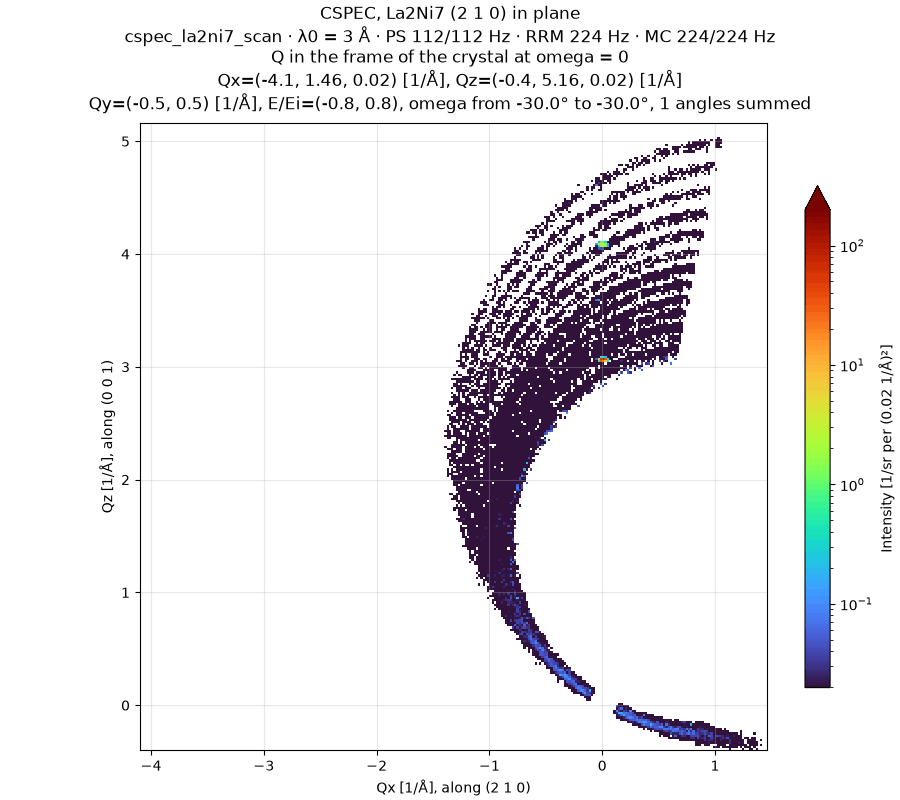
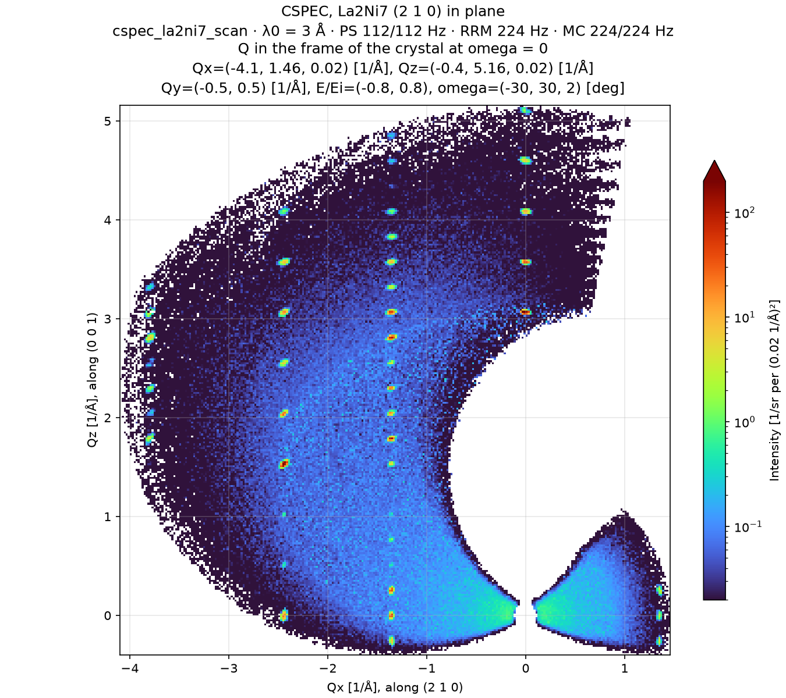

# Diffraction scan

`CSPECWithRotatingLa2Ni7`, in
[`mcdgs.diagnostics.cspec.diffraction_scan`](https://github.com/bingli621/mcdgs/blob/main/src/mcdgs/diagnostics/cspec/diffraction_scan.py),
turns the La2Ni7 crystal about the vertical, one angle at a time, and maps the horizontal plane
of its reciprocal space. Each angle is reduced as on [Diffraction (single-crystal)](diffraction.md); turned
into the frame of the crystal, the angles add up to one map. It follows
[Diffraction scan of T-Rex](../trex/diffraction-scan.md), with the same crystal, orientation and
angles.

## The setup

`CSPECWithRotatingLa2Ni7` is `CSPEC` with the crystal of `la2ni7` on a goniometer: McStas
`ROTATED (0, omega, 0)`, with `omega` an instrument parameter. Its control parameters are the
defaults, as on [Diffraction (single-crystal)](diffraction.md#the-setup).

| | |
| - | - |
| Crystal | La2Ni7, as on [Diffraction (single-crystal)](diffraction.md#the-setup) |
| Orientation at omega = 0 | c* along the beam; (2 1 0) in the horizontal plane, to the left of the beam |
| omega | −30° to 30°, in 31 steps of 2° |
| `SPLIT` | 10, as for one angle on [Diffraction (single-crystal)](diffraction.md#the-setup) |

<!-- fmt:off -->
```python
--8<-- "src/mcdgs/diagnostics/cspec/diffraction_scan.py:instrument"
```
<!-- fmt:on -->

The orientation is that of T-Rex, not that of [Diffraction (single-crystal)](diffraction.md#the-setup), which
has (1.357 1 0) in the horizontal plane. With (2 1 0) in the horizontal plane, 2a* + b* and c*
span it, so turning the crystal about the vertical keeps that plane of reciprocal space
horizontal. Each angle brings other reflections of it onto the Ewald spheres of the sub-pulses.

## The scan

`simulate` runs only the part from `sample_pos` to the panels, with `scan_from_sample` of
[`Simulation`](../../how-to/run-a-simulation.md), once per angle and in parallel. Each angle
starts from the beam file of [Diffraction (single-crystal)](diffraction.md#two-runs-split-at-the-sample), the
8,412,531 neutrons at `sample_pos` from 1e9 rays of the masked source: the beam before the
sample does not depend on the crystal. The 31 angles take about a minute, and about 180 MB, in
one file with one entry per angle.

## The reduction

`reduce_angles` takes the 14 sub-pulses from the run to the sample of
[Diffraction (single-crystal)](diffraction.md#the-reduction), the same for every angle, and reads the angles
one at a time, with `read_detector`. Each is reduced and normalized as there, per incident neutron
and per steradian. Then `crystal_frame` turns its Q by the angle of the crystal, with the McStas
rotation matrix of `ROTATED (0, omega, 0)`: Q is then in the frame of the crystal as it stands at
omega = 0, and a reflection has the same Q at every angle. The neutrons with |Qy| < 0.5 Å⁻¹ in
that frame go into one (Qx, Qz) map per angle, 56,000 to 98,000 neutrons each, and the maps of
all angles add up.

## The map



`animate` builds the map up one angle per frame, with the angles summed so far in the title;
the last frame is the whole scan. Qx is along (2 1 0) and Qz along (0 0 1). The crystal frame is
fixed, so the region the panels cover turns about the origin with omega, and each reflection
appears as that region passes it. The color scale is that of
[Diffraction (single-crystal)](diffraction.md#the-plane), logarithmic, in turbo, below the highest bin beyond the
direct beam, here of the whole scan for every frame, so the map grows brighter as the angles add
up. It is four decades deep, as on T-Rex, and two more than for one angle: the top of the scale
is now a Bragg peak, about 200 per (0.02 Å⁻¹)², not the meeting of the arcs, about 0.5. Two
decades below a Bragg peak would leave all the incoherent scattering at the bottom of the
scale.

`plot_scan` draws the whole scan, the last frame of the GIF, as a figure of its own:



The Bragg peaks line up in rows along c*, as on
[T-Rex](../trex/diffraction-scan.md#the-map). Each row is the reflections (h k l) of one h and
k, all l, whose in-plane part lies within the slice of Qy. CSPEC reaches five of the seven rows
of T-Rex:

| Row | Qx | Qy |
| --- | -- | -- |
| (1 0 l) | +1.36 Å⁻¹ | −0.47 Å⁻¹ |
| (0 0 l) | 0 | 0 |
| (−1 0 l) | −1.36 Å⁻¹ | +0.47 Å⁻¹ |
| (−1 −1 l) | −2.44 Å⁻¹ | −0.47 Å⁻¹ |
| (−2 −1 l) | −3.80 Å⁻¹ | 0 |

- **A smaller map than on T-Rex.** The largest ki on CSPEC is 2.69 Å⁻¹, against 4.77 Å⁻¹ on T-Rex,
  so |Q| is at most 2 ki = 5.4 Å⁻¹, and the rows (−3 −1 l) and (−3 −2 l), beyond −5 Å⁻¹ in Qx, are
  out of reach.
- **(−2 −1 l) comes into reach.** At a single angle, |Qx| is at most ki, so on
  [Diffraction (single-crystal)](diffraction.md#the-plane) this row is out of reach. Turning the crystal turns Q
  in its frame, and from omega = 24° to 30° the row reaches the panels.
- **(1 0 l), at the edge.** On the other side of the beam the panels reach only from −31.5° to
  −4°, so only the few reflections of this row near Qz = 0 show, at the right edge of the map.
- **The incoherent scattering.** Between the peaks is the incoherent scattering of the crystal,
  which follows the panels around as the crystal turns. It is brightest near the origin, where
  the arcs of all the sub-pulses meet, as on [Diffraction (single-crystal)](diffraction.md#the-plane).
- **The empty region.** An elastic neutron has its Q on the circle of its sub-pulse, of radius
  ki through the origin, and the smallest ki is 1.66 Å⁻¹. The region that lies inside that circle
  at every angle of the scan, near the origin and along c*, is out of reach of elastic neutrons.
  Only neutrons that lost energy, with kf < ki, land inside it, and 6 % of its bins hold any.

## Making the figures

The GIF and the figure need McStas, so they are not made with the site: `pixi run
docs-diagnostics` makes them again, with the other files of the CSPEC pages. The scan starts
from the beam file of [Diffraction (single-crystal)](diffraction.md), so run that first. Then:

```bash
pixi run python -m mcdgs.diagnostics.cspec.diffraction_scan
```

`main` runs the 31 angles, then saves the GIF and the figure to
`mcdgs_workspace/results/cspec_diffraction_scan/`, or to the folder given with `--out`. To reduce
the scan again without McStas:

```bash
pixi run python -c "from mcdgs.diagnostics.cspec.diffraction_scan import analyze; analyze()"
```
