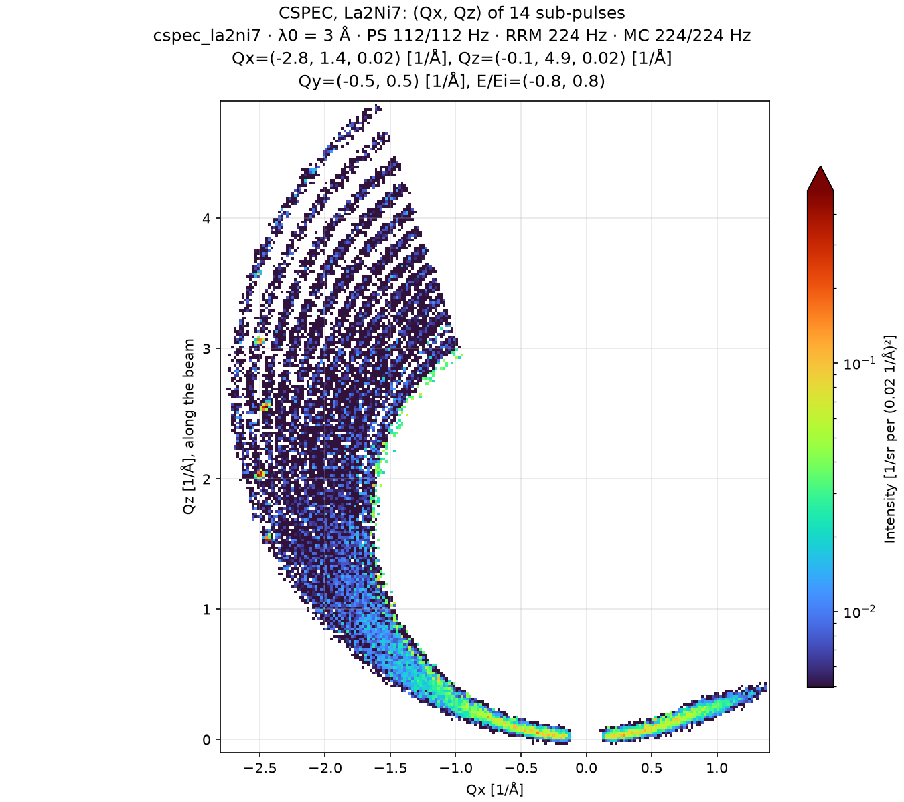

# Diffraction

`CSPECWithLa2Ni7`, in
[`mcdgs.diagnostics.cspec.diffraction`](https://github.com/bingli621/mcdgs/blob/main/src/mcdgs/diagnostics/cspec/diffraction.py),
puts the La2Ni7 crystal on `sample_pos` and reduces every neutron that reaches the detector
panels to its momentum transfer Q. It keeps every neutron in the arrival window of its
sub-pulse, whatever its energy transfer: the inelastic scattering is weak next to the Bragg
peaks, so the plane is a diffraction pattern. The result is the horizontal plane of Q, where
each of the 14 sub-pulses draws its own arc. It follows
[Diffraction of T-Rex](../trex/diffraction.md), with the same crystal in the same orientation,
and uses the sub-pulses and incident energies of [Incident energy](incident-energy.md) and the
[reduction package](../../reference/reduction.md) throughout.

## The setup

`CSPECWithLa2Ni7` is `CSPEC` with the crystal of `la2ni7` on `sample_pos` and the detector
panels. Its control parameters are the defaults: `lambda0` = 3 Å, `nu_mc` = 224 Hz, `n` = 1 and
`t0_offset` = 1.7 ms. It has the [masked source](masked-source.md), and `mc_monitor` has time
bins of 5 µs, as on [Incident energy](incident-energy.md#the-setup), to time each sub-pulse.

| | |
| - | - |
| Crystal | La2Ni7, P6₃/mmc, a = 5.0556 Å, c = 24.598 Å, a 5 mm cube with a 30′ mosaic |
| Orientation | c* along the beam; (1.357 1 0) in the horizontal plane, to the left of the beam |
| Scattering | Bragg reflections from the CIF, and incoherent scattering, single scattering only |
| `SPLIT` | 10: few neutrons reach a 5 mm crystal, so McStas repeats each one that does |
| Detector | the twelve flat panels, 3.5 m from the sample, from −31.5° to 143.8° from the beam and 1.75 m above and below it |

<!-- fmt:off -->
```python
--8<-- "src/mcdgs/diagnostics/cspec/diffraction.py:instrument"
```
<!-- fmt:on -->

## Two runs, split at the sample

As on [T-Rex](../trex/diffraction.md#two-runs-split-at-the-sample), `simulate` runs McStas in two
parts, with `run_to_sample` and `run_from_sample` of
[`Simulation`](../../how-to/run-a-simulation.md):

1. **From the source to `sample_pos`**, with 1e9 rays from the masked source. Its folder holds
   `mc_monitor` and the beam at `sample_pos`.
2. **From that beam through the crystal to the panels.** 101,192 neutrons reach them, on 65,481
   pixels. It can run again, with another crystal or orientation, from the same beam.

The second part runs in the frame of `sample_pos`: the sample is the origin, z is along the
beam, y is up and x to the left of the beam. `reduce_runs` and `analyze` read the two runs again
without McStas.

## The reduction

The reduction is shared with the [elastic resolution](elastic-resolution-incoherent.md), in
`cspec.sample_runs`:

1. **The sub-pulses.** `subpulse_timing` finds the 14 sub-pulses at `mc_monitor` of the first
   part. CSPEC has no beamstop monitor, so each gets its Ei from its flight from the source to
   `mc_monitor` alone, leaving the source at `t0_offset`, as on
   [Incident energy](incident-energy.md#how-ei-is-calculated), and the time it reaches the
   sample from the flight on, with `time_at_sample`.
2. **The neutrons.** `read_detector` reads the neutrons of the twelve panels of the second part,
   by pixel. Every pixel is kept: CSPEC has no beamstop, and the direct beam passes between the
   two panels nearest to it.
3. **The windows.** `events_to_q_and_energy` gives each pixel and sub-pulse the arrival window
   of `arrival_window`, for an energy transfer from −0.8 Ei to 0.8 Ei, as on
   [Neutrons on sample](neutrons-on-sample.md#arrival-windows-at-the-detector). A neutron inside
   the window of a sub-pulse takes its Ei and its time at the sample, whatever its energy
   transfer within the window, and `QE_GRAPH` gives its Q = ki − kf, as (Qx, Qy, Qz).
4. **The normalization.** `normalized_events` divides each neutron by the solid angle of its
   pixel, from `pixel_solid_angle`, and by the intensity of its sub-pulse at `mc_monitor`, its
   incoming flux. The intensity is then per incident neutron and per steradian, in 1/sr.

## The plane



`plot_plane` keeps the neutrons near the horizontal plane, |Qy| < 0.5 Å⁻¹, sums them over Qy and
draws them in (Qx, Qz), as on [T-Rex](../trex/diffraction.md#the-plane): a log scale in turbo,
below the highest bin beyond |Q| = 0.2 Å⁻¹. The scale is two decades deep, two fewer than on
T-Rex: the beamstop leaves no direct beam above the arcs, so the highest bins, where the arcs of
all the sub-pulses meet near the origin, are only about two decades above the incoherent arcs,
and a deeper scale lifts those into cyan and green. With two they are dark blue, as on T-Rex, and
the Bragg peaks and the meeting of the arcs stand out above them. A bin below the bottom of the
scale takes its color.

- **The arcs.** Each sub-pulse has its own ki, from 1.66 to 2.69 Å⁻¹. Its elastic neutrons lie
  on a circle of radius ki through the origin, centered on ki along the beam, and the panels
  cover part of it: 14 arcs, one per sub-pulse, the incoherent scattering of the crystal. Most
  of the panels are on one side of the beam, at x > 0, which gives Qx < 0. On the other side,
  from −31.5° to −4°, the arcs reach Qx up to 1.4 Å⁻¹. No pixel lies within 4° of the beam, so
  the arcs stop short of the origin.
- **Brightest near the origin, but not more intense.** All the arcs meet at the origin, so a bin
  of Q at small |Q| sums the pixels of many sub-pulses. Per steradian, the incoherent
  scattering is the same at every angle, about 1.2 × 10⁴ n/s per steradian from 5° to 145°,
  away from the Bragg peaks.
- **The Bragg peaks.** The strongest in the plane lie in one column at Qx ≈ −2.5 Å⁻¹, at
  Qz ≈ 1.5, 2.0 and 2.55 Å⁻¹: the reflections (−1 −1 l), as on T-Rex, with l = 6, 8 and 10, which
  are 2c* = 0.51 Å⁻¹ apart. Each lights up where the Ewald sphere of one sub-pulse crosses it.
  The column (−2 −1 l) of T-Rex, at Qx ≈ −3.8 Å⁻¹, is out of reach: |Qx| = kf sin 2θ is at most ki,
  and no sub-pulse has ki above 2.7 Å⁻¹.
- **Nothing inside the arcs.** No neutron arrives
  [between the sub-pulses](neutrons-on-sample.md#between-the-sub-pulses), so every neutron on
  the panels belongs to the window of its own sub-pulse.

## The sub-pulses

`analyze` prints each sub-pulse: its Ei, its flux at `mc_monitor` and the fraction of its
neutrons that the crystal scatters into the panels within its window. Some of them:

| Sub-pulse | λi | Ei | Flux | Scattered |
| --------- | -- | -- | ---- | --------- |
| 0 | 2.332 Å | 15.05 meV | 2.7e6 n/s | 0.028 % |
| 6 | 3.000 Å | 9.09 meV | 7.1e6 n/s | 0.021 % |
| 11 | 3.557 Å | 6.46 meV | 5.4e6 n/s | 0.072 % |
| 12 | 3.669 Å | 6.08 meV | 4.0e6 n/s | 0.018 % |
| 13 | 3.780 Å | 5.73 meV | 1.9e5 n/s | 0.027 % |

The crystal scatters 0.016 to 0.028 % of each sub-pulse into the panels, except sub-pulse 11,
0.072 %: 85 % of what it scatters goes into one Bragg reflection above the plane, at
(Qx, Qy, Qz) ≈ (−1.30, 0.58, 2.80) Å⁻¹ and 2θ ≈ 126°, which the slice of the plane leaves out.
On T-Rex the crystal scatters 0.03 to 0.5 % of each sub-pulse. One likely reason is the beam:
at the sample of CSPEC it is about 45 mm wide and high, against 21 mm by 26 mm on T-Rex, so the
5 mm cube catches a smaller part of it. This has not been checked.

## Making the figures

The figure needs McStas, so it is not made with the site. To run McStas and make it, run:

```bash
pixi run python -c "from mcdgs.diagnostics.cspec.diffraction import main; main()"
```

At its defaults, `main` runs both parts, 1e9 rays from the masked source with seed 1, as for the
figure here. It prints the sub-pulses and saves the figure to
`mcdgs_workspace/results/cspec_diffraction/`, or to the folder given as `out`. Running the
module, as `pixi run docs-diagnostics` does, only reduces the runs again, without McStas:

```bash
pixi run python -m mcdgs.diagnostics.cspec.diffraction
```
