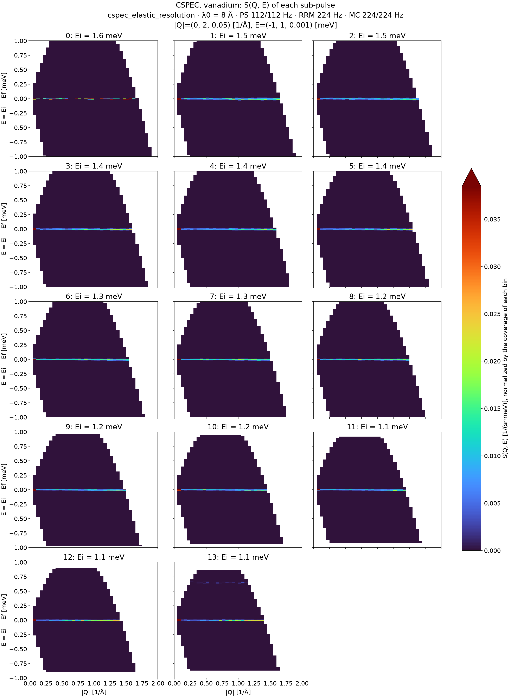
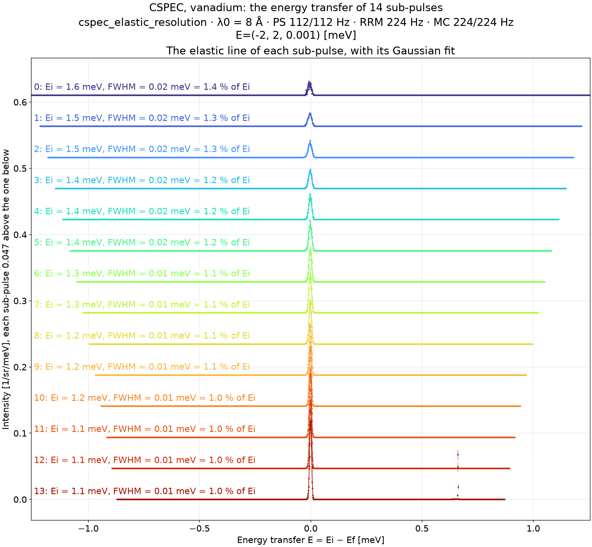
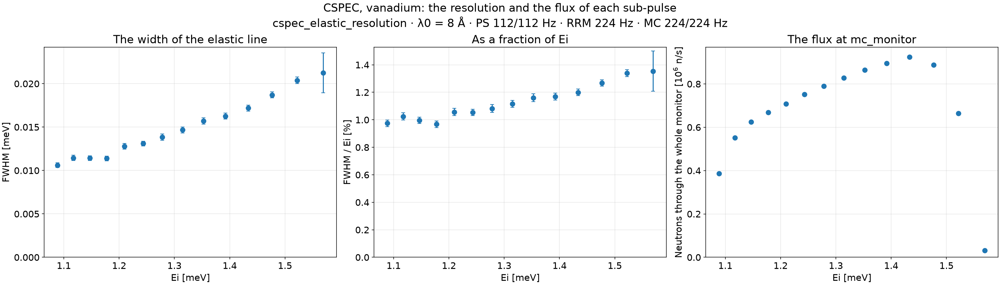

# Elastic resolution (long wavelength)

[`mcdgs.diagnostics.cspec.elastic_resolution_incoherent_long`](https://github.com/bingli621/mcdgs/blob/main/src/mcdgs/diagnostics/cspec/elastic_resolution_incoherent_long.py)
measures the energy resolution of CSPEC from vanadium at `lambda0` = 8 Å. Everything else is as
on [Elastic resolution (short wavelength)](elastic-resolution-incoherent-short.md), at 3 Å: the
same vanadium cylinder, the same chopper frequencies, the same two runs and the same reduction.
Only `lambda0` changes. The choppers are phased to it, and the masked source simulates its band.

The beam on the sample is again a train of 14 sub-pulses, now from 7.22 to 8.67 Å, with Ei from
1.57 to 1.09 meV, about a seventh of the Ei at 3 Å. Their elastic lines are 0.011 to 0.021 meV
wide, 1.0 to 1.4 % of Ei, against 1.8 to 3.9 % at 3 Å. Three settings of the reduction differ
from 3 Å to follow such narrow lines. They are listed under [The reduction](#the-reduction).

## The setup

`CSPECElasticResolution` is the instrument of the short-wavelength page, with `lambda0` = 8 Å and
the other control parameters at their defaults: `nu_mc` = 224 Hz, `n` = 1 and
`t0_offset` = 1.7 ms. The sample, its focusing window and the detector panels are those of
[the setup at 3 Å](elastic-resolution-incoherent-short.md#the-setup).

<!-- fmt:off -->
```python
--8<-- "src/mcdgs/diagnostics/cspec/elastic_resolution_incoherent_long.py:instrument"
```
<!-- fmt:on -->

## Two runs, split at the sample

As at 3 Å, `simulate` runs McStas in two parts, with `run_to_sample` and `run_from_sample` of
[`Simulation`](../../how-to/run-a-simulation.md):

1. **From the source to `sample_pos`**, with 1e9 rays from the masked source, in 3.2 minutes.
2. **From that beam through the vanadium to the panels**, in 12 seconds. 684,896 neutrons reach
   them, on 108,495 pixels: 81 % of the 134,400 pixels of the panels, against 96 % at 3 Å. The
   pixels left empty are spread over all twelve panels alike. With some 6 neutrons per pixel,
   many pixels simply receive none.

The 14 sub-pulses bring 9.6 × 10⁶ n/s to `mc_monitor`, an eighth of the 7.9 × 10⁷ n/s at 3 Å.

## The reduction

The reduction is that of [3 Å](elastic-resolution-incoherent-short.md#the-reduction). The pixels
with neutrons are at $2\theta$ from 4.2° to 143.6°, as at 3 Å, and cover 2.03 sr. Three settings
of `elastic_resolution_incoherent_long` differ:

| | 3 Å | 8 Å | Why |
| - | - | - | - |
| Bins of E, spectra | 0.05 meV | 0.001 meV (`ENERGY_STEP`) | the lines are some 0.01 meV wide |
| Bins of E, S(Q, E) maps | 0.05 meV | 0.001 meV (`ENERGY_STEP`) | as for the spectra |
| Bins fitted | all | $\lvert E \rvert \le$ 0.5 meV (`FIT_RANGE`) | keeps out [a 15th sub-pulse](#a-15th-sub-pulse) |

Two things of the reduction behave differently at 8 Å:

- **The arrival windows overlap far more.** Each window runs from −0.8 Ei to 0.8 Ei, as at 3 Å,
  and lasts about 10 ms at the 3.5 m of the panels. The sub-pulses are 4.5 ms apart, so each
  window overlaps the next one by 4.9 to 6.7 ms, more than half its length. At 3 Å only the last
  two overlap, by about 0.1 ms. A neutron in two windows goes to the later sub-pulse. Elastic
  neutrons of one sub-pulse arrive before the window of the next one opens, so the overlap does
  not move them. Every neutron on the panels falls inside a window.
- **One sub-pulse is not found.** See below.

### A 15th sub-pulse

`subpulse_timing` keeps the patches of `mc_monitor` with at least 2 % (`MIN_FRACTION`) of the
intensity of the strongest. At 8 Å, one more patch follows the 14: at 8.780 Å, 1.06 meV, with
1.8 × 10⁴ n/s, 1.9 % of the strongest. It is left out. Its elastic neutrons reach the panels at
364.5 to 365.5 ms, inside the window of the last sub-pulse found, which gives them that
sub-pulse's Ei and so E = 0.63 to 0.67 meV. They are 3,832 neutrons, 6.8 % of the intensity
of the last sub-pulse, at |Q| from 0.27 to 1.12 Å⁻¹. They show as a faint line on the
[S(Q, E) map](#sq-e) of the last sub-pulse, and as a few points on its [spectrum](#the-spectra).
Left in the fit, they pulled its Gaussian to an FWHM of 1.2 meV. With `FIT_RANGE` they are
kept out of the fit, but they remain in the maps, the spectra and the intensity.

## S(Q, E)



`q_e_maps` histograms the neutrons of each sub-pulse in |Q| and E, in bins of 0.001 meV and
0.05 Å⁻¹, and divides each bin by its coverage, as at 3 Å. The maps are drawn for E from −1 to
1 meV only (`MAP_RANGE`), around the lines; the arrival windows reach ±1.3 meV at the highest Ei.

- **The color scale is lower than at 3 Å.** Its top is the 97th percentile (`MAP_PERCENTILE`)
  of the bins with neutrons, about 0.04, against the 99.9th at 3 Å. In every map the lowest
  |Q| bin, 0.05 to 0.1 Å⁻¹, is about a hundred times brighter than the line elsewhere: 6.7 per
  steradian and meV for sub-pulse 7, against about 0.015 at higher |Q|. With the 99.9th
  percentile, the line showed in that bin only. That bin now saturates. Why it is so bright has
  not been studied.
- **Only the elastic line, and the 15th sub-pulse.** Each map holds one band at E = 0, from the
  smallest |Q| to the largest the panels reach at E = 0: 1.65 Å⁻¹ at 1.57 meV, 1.38 Å⁻¹ at
  1.09 meV. The rest of the coverage is reached but empty, except in the last map: the line of
  the [15th sub-pulse](#a-15th-sub-pulse) at E ≈ 0.66 meV.
- **The line rises a little toward high |Q|**, as at 3 Å. Summed over E, the line of
  sub-pulse 7, at `lambda0`, is about 0.00020 per steradian from 0.4 to 0.6 Å⁻¹ and 0.00028 near
  1.1 Å⁻¹.
- **The line bends below E = 0 at high |Q|.** For sub-pulse 7, the mean E of its neutrons is
  −0.002 meV below 40° of $2\theta$ and −0.007 meV from 120° to 144°, and the spread grows from
  0.005 to 0.008 meV. The other sub-pulses do the same. The neutrons at high angle seem to gain a
  little energy. This has not been studied.

## The spectra



As at 3 Å, the figure is linear and draws each sub-pulse over its whole arrival window, −0.8 Ei to
0.8 Ei, with each bin a point with its error and the Gaussian fitted to it.

- **One narrow line per sub-pulse.** On the scale of the windows, each line is a spike at
  E = 0: no sub-pulse has neutrons beyond 0.1 meV, except the last.
- **The last sub-pulse has a few more points**, at E ≈ 0.66 meV: the
  [15th sub-pulse](#a-15th-sub-pulse).
- **The first sub-pulse is noisy.** It brings 3.2 × 10⁴ n/s to `mc_monitor`, 3.4 % of the
  strongest, and 1,435 neutrons to the panels, against 27,554 to 63,672 for the others. At the
  high-Ei end of the band, the bandwidth choppers most likely cut it short, as the last
  sub-pulse at 3 Å; this has not been checked.

## The Gaussian fits

`fit_elastic_lines` fits a Gaussian to the line of each sub-pulse against Ef, as at
[3 Å](elastic-resolution-incoherent-short.md#the-gaussian-fits), over the bins of at least 20 % of
the highest, now only within ±0.5 meV of E = 0. $\chi^2$ per degree of freedom is 0.4 to 1.8.
`analyze` prints the table:

--8<-- "docs/instruments/cspec/figures/elastic-resolution-incoherent-long/cspec_elastic_resolution_incoherent_long_lines.txt"

At three decimals of a meV, the errors of the centers and widths round to 0.000 meV. Every
center lies above its Ei, from 0.0055 meV, 0.35 %, at 1.57 meV down to 0.0008 meV, 0.07 %, at
1.09 meV; in the middle of the band, at about 0.18 %. These fractions are close to those at 3 Å:
0.38 % at the highest Ei, 0.08 % at the lowest and about 0.17 % in the middle. The
[bend toward high |Q|](#sq-e) adds to the shift, but it is not the whole of it: below 40° of
$2\theta$, where most of the neutrons land, the line of sub-pulse 7 is already 0.0017 meV above
its Ei. Where the rest comes from has not been studied yet.

## The resolution against Ei



`plot_resolution` draws the same three panels as at
[3 Å](elastic-resolution-incoherent-short.md#the-resolution-against-ei).

- **The width grows with Ei**, from 0.0106 meV at 1.09 meV to 0.0212 meV at 1.57 meV, and faster
  than Ei: as a fraction of Ei it goes from 0.97 % to 1.35 %. At 3 Å it goes from 2.6 % to 3.9 %
  over the band, so at 8 Å the resolution is two to three times finer as a fraction of Ei.
- **The flux peaks in the upper half of the band.** It is highest at 1.43 meV, 9.3 × 10⁵ n/s,
  and falls slowly to 3.9 × 10⁵ n/s at 1.09 meV, and quickly at the high-Ei end: 6.6 × 10⁵ n/s
  at 1.52 meV, and 3.2 × 10⁴ n/s for the [first sub-pulse](#the-spectra), whose width has the
  largest error.

## Making the figures

The figures need McStas, so they are not made with the site. To run McStas and make them, run:

```bash
pixi run python -c "from mcdgs.diagnostics.cspec.elastic_resolution_incoherent_long import main; main()"
```

At its defaults, `main` runs both parts, 1e9 rays from the masked source with seed 1, as for the
figures here. It prints the table and saves the three figures and the table to
`mcdgs_workspace/results/cspec_elastic_resolution_incoherent_long/`, or to the folder given as
`out`. Running the module, as `pixi run docs-diagnostics` does, only reduces the runs again,
without McStas:

```bash
pixi run python -m mcdgs.diagnostics.cspec.elastic_resolution_incoherent_long
```
