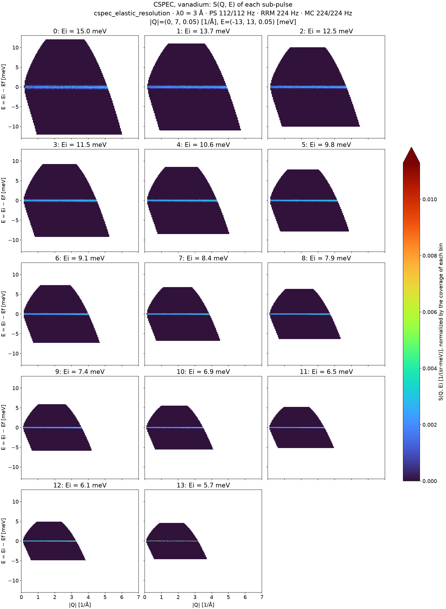
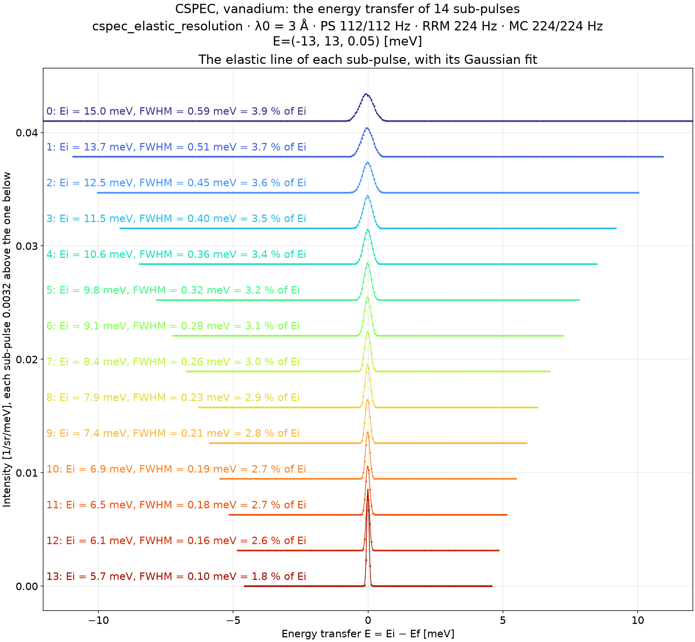
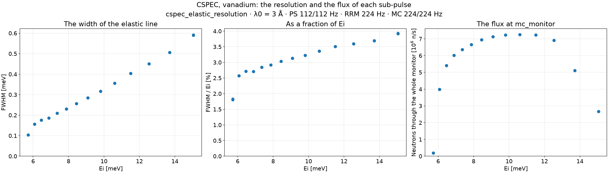

# Elastic resolution (short wavelength)

`CSPECElasticResolution`, in
[`mcdgs.diagnostics.cspec.elastic_resolution_incoherent_short`](https://github.com/bingli621/mcdgs/blob/main/src/mcdgs/diagnostics/cspec/elastic_resolution_incoherent_short.py),
puts a vanadium cylinder on `sample_pos` and reduces every neutron that reaches the detector
panels to its energy transfer E = Ei − Ef. Vanadium scatters incoherently and elastically, so
every neutron it scatters has E = 0. The width of the line it gives is the energy resolution of
CSPEC, one value for each of the 14 sub-pulses. Anything away from the line would come from the
instrument or the reduction, not from the sample. It follows
[Elastic resolution of T-Rex](../trex/elastic-resolution-incoherent-short.md), at the default
settings of the choppers only. [Elastic resolution (long wavelength)](elastic-resolution-incoherent-long.md)
does the same at `lambda0` = 8 Å.

The reduction is that of T-Rex, with the sub-pulses and incident energies of
[Incident energy](incident-energy.md) and the
[reduction package](../../reference/reduction.md). The parts both instruments share are in
[`mcdgs.diagnostics.elastic_resolution`](../../reference/diagnostics.md).

## The setup

`CSPECElasticResolution` is `CSPEC` with the vanadium of `vanadium` on `sample_pos` and the
detector panels. Its control parameters are the defaults: `lambda0` = 3 Å, `nu_mc` = 224 Hz,
`n` = 1 and `t0_offset` = 1.7 ms. The choppers turn, so the beam on the sample is a train of
sub-pulses. It has the [masked source](masked-source.md), and `mc_monitor` has time bins of
5 µs, as on [Incident energy](incident-energy.md#the-setup), to time each sub-pulse.

| | |
| - | - |
| Sample | vanadium, a solid cylinder 20 mm across and 10 mm high, `Incoherent` |
| Cross-sections | 5.08 b absorption at 2200 m/s, 5.08 b incoherent, 13.827 ų per atom |
| Scattering | elastic, single scattering only (`order=1`) |
| Focusing | the window of `detector_window`: 177.3° by 55.1°, centered on the panels in the horizontal plane |
| Detector | the twelve flat panels, 3.5 m from the sample, each 32 tubes of 350 pixels, 25.7 mm by 10 mm |

Vanadium scatters in every direction, so without a window few neutrons would reach the detector.
The panels run from −31.5° to 143.8° from the beam in the horizontal plane, and 1.75 m above and
below it. The window covers them with a 1° margin on every side. It is centered in the
horizontal plane, which makes McStas span it exactly in height: it reaches the top and the bottom
of the panels at their centers, where they are nearest the sample and so the highest in angle.

<!-- fmt:off -->
```python
--8<-- "src/mcdgs/diagnostics/cspec/elastic_resolution_incoherent_short.py:instrument"
```
<!-- fmt:on -->

## Two runs, split at the sample

As on T-Rex, `simulate` runs McStas in two parts, with `run_to_sample` and `run_from_sample` of
[`Simulation`](../../how-to/run-a-simulation.md):

1. **From the source to `sample_pos`**, with 1e9 rays from the masked source. Its folder holds
   `mc_monitor` and the beam at `sample_pos`.
2. **From that beam through the vanadium to the panels.** 427,108 neutrons reach them, on
   128,574 pixels.

Both parts, with the reduction, take three and a half minutes. The sub-pulses bring
7.9 × 10⁷ n/s to `mc_monitor`. `reduce_runs` and `analyze` read the runs again without McStas.

## The reduction

1. **The sub-pulses.** `subpulse_timing` finds the 14 sub-pulses at `mc_monitor`, the monitor
   after the monochromatic choppers, of the first part. CSPEC has no beamstop monitor, so the Ei
   of each comes from its flight from the source to `mc_monitor` alone, leaving the source at
   `t0_offset`, as on [Incident energy](incident-energy.md#how-ei-is-calculated). The time it
   reaches the sample follows from the flight on from `mc_monitor`, 1.48 m, at that Ei, with
   `time_at_sample`.
2. **The pixels.** `read_detector` reads the neutrons of the twelve panels, by pixel, one panel
   after the other. Every pixel is kept: CSPEC has no beamstop, and the direct beam passes
   between the two panels nearest to it, so no pixel sees it. The pixels hit are at $2\theta$ from
   4.2° to 143.6°. `pixel_solid_angle` gives the solid angle of each, a flat rectangle with the
   normal of its panel, not of the direction to the sample; they cover 2.40 sr.
3. **The windows.** `events_to_q_and_energy` gives each pixel and sub-pulse the arrival window
   of `arrival_window`, from −0.8 Ei to 0.8 Ei, as on
   [Neutrons on sample](neutrons-on-sample.md#arrival-windows-at-the-detector). A neutron inside
   the window of a sub-pulse takes its Ei and its time at the sample, and `QE_GRAPH` gives its
   energy transfer. The windows of the last two sub-pulses overlap, by about 0.1 ms; a neutron
   in both goes to the later one. Only neutrons far from E = 0 arrive there, and vanadium
   scatters none.
4. **The normalization.** `normalized_events` divides each neutron by the solid angle of its
   pixel and by the intensity of its sub-pulse at `mc_monitor`.
5. **The spectra.** `energy_spectra` sums the neutrons of each sub-pulse into 0.05 meV bins of E.
   It weights each one by the solid angle of its pixel and divides by the 2.40 sr of all the
   pixels. It divides each neutron by its $k_f/k_i = \sqrt{E_f/E_i}$, with the Ei of its sub-pulse,
   as `q_e_maps` does for S(Q, E): the cross section holds that factor on top of S(Q, E), below 1
   where the neutron loses energy and above where it gains it. Across a line as wide as 7 % of Ei
   it runs from 0.98 to 1.02, so left in, it would lift the gain side of the line, tilt its shape
   and pull its center towards a higher Ef. The result is S(E) averaged over the detector, per
   neutron at `mc_monitor`, per steradian and per meV. Each neutron of weight $w$ counts with the
   variance $w^2$, so a bin has the error $\sqrt{\sum w^2}$.

## S(Q, E)



`q_e_maps` histograms the neutrons of each sub-pulse in |Q| and E, in bins of 0.05 meV and
0.05 Å⁻¹, and divides each bin by its coverage, as on
[T-Rex](../trex/elastic-resolution-incoherent-short.md#sq-e): S(Q, E) per steradian and per meV.
Every map spans the same range: E from −13 to 13 meV, the arrival window of the highest Ei, and |Q|
from 0 to 7 Å⁻¹. A bin the sub-pulse reaches has the color of its value; a bin it cannot reach
is white.

- **Only the elastic line.** Each map holds one band at E = 0, as wide as the resolution of its
  sub-pulse, from the smallest |Q| to the largest the panels reach: 5.2 Å⁻¹ at 15.0 meV, 3.4 Å⁻¹
  at 5.7 meV. The rest of the coverage is reached but empty: vanadium scatters nothing
  inelastically here, and the sample scatters only once.
- **The line rises a little toward high |Q|.** Summed over E, the line of sub-pulse 6, at
  `lambda0`, is about 0.00088 per steradian at the smallest |Q| and 0.0012 near the largest. On
  T-Rex the same rise is absorption: the cylinder absorbs less of what it scatters backward than
  of what it scatters forward. With some 3 neutrons per pixel, the line is noisy from bin to bin.

## The spectra



As on T-Rex, the figure is linear and spans the whole energy coverage: each sub-pulse is drawn
over its arrival window, −0.8 Ei to 0.8 Ei, empty bins included. Each bin is a point with its
error, and each line is the Gaussian fitted to a sub-pulse, labeled with its Ei, its FWHM and the
FWHM as a fraction of Ei. The sub-pulses are stacked from the highest Ei at the top to the lowest
at the bottom.

- **One line per sub-pulse, and nothing else.** No sub-pulse has neutrons beyond about
  ±0.1 Ei. Of the 427,108 neutrons on the panels, 1,047 fall outside every window.
- **The width grows with Ei**, from 0.16 meV at 6.1 meV to 0.59 meV at 15.0 meV. As a fraction of
  Ei it goes from 2.6 % to 3.9 %.
- **The last sub-pulse is narrower**, 0.10 meV at 5.7 meV, 1.8 % of Ei, below the trend of the
  others. It is the weakest at `mc_monitor`, 1.9 × 10⁵ n/s against 2.7 × 10⁶ n/s for the first:
  at the end of the band, the bandwidth choppers most likely cut it short, as at the
  [band edges](neutrons-on-sample.md#the-sub-pulses-at-the-band-edges), which also narrows its spread of Ei.
  This has not been checked.

## The Gaussian fits

`fit_elastic_lines` fits a Gaussian to the line of each sub-pulse against Ef, over the bins of at
least 20 % of the highest, weighting each bin by its error, as on
[T-Rex](../trex/elastic-resolution-incoherent-short.md#the-gaussian-fits):

$$
I(E_f) = h \exp\left(-\frac{(E_f - E_c)^2}{2\sigma^2}\right), \qquad \text{FWHM} = 2\sqrt{2 \ln 2}\,\sigma \approx 2.355\,\sigma.
$$

$\chi^2$ per degree of freedom is 0.4 to 2.6. The intensity is that of the whole spectrum, summed
over E. `analyze` prints the table:

--8<-- "docs/instruments/cspec/figures/elastic-resolution-incoherent-short/cspec_elastic_resolution_incoherent_short_lines.txt"

Every center lies above its Ei, from 0.06 meV, 0.38 %, at 15.0 meV down to 0.004 meV, 0.08 %, at
5.7 meV; in the middle of the band, at about 0.17 %. On T-Rex the centers are also above Ei, by
0.01 to 0.07 meV. At the short wavelengths, part of it is the Ei of the single monitor:
[Incident energy](incident-energy.md#the-incident-energy-of-each-sub-pulse) finds it 0.17 % below
the Ei of the mean wavelength at 2.33 Å, as these sub-pulses most likely leave the moderator a
little before `t0_offset`. The rest has not been studied yet. It is small next to the width of
each line, 2.6 to 3.9 % of Ei.

## The resolution against Ei



`plot_resolution` draws, against Ei, the FWHM of each sub-pulse, the FWHM as a fraction of Ei,
and the flux of each sub-pulse at `mc_monitor`, as the first three panels of
[T-Rex](../trex/elastic-resolution-incoherent-short.md#all-four-modes). CSPEC runs at the default
settings of the choppers only, so there is one point per sub-pulse and no ratio between modes.
The FWHM has the error of its fit; the flux has no error bars, since the sub-pulses are found
from the intensity of the monitor alone.

- **The width grows almost linearly with Ei**, from 0.16 meV at 6.1 meV to 0.59 meV at
  15.0 meV, and faster than Ei: as a fraction of Ei it goes from 2.6 % to 3.9 %.
- **The flux is flat in the middle of the band and falls at both ends.** From 7.9 to 12.5 meV
  each sub-pulse brings 6.7 to 7.3 × 10⁶ n/s to `mc_monitor`. It falls to 2.7 × 10⁶ n/s at
  15.0 meV and to 4.0 × 10⁶ n/s at 6.1 meV, at the edges of the band.
- **The last sub-pulse stands apart in all three panels.** At 5.7 meV it brings
  1.9 × 10⁵ n/s, a fortieth of the middle of the band, and its line is 0.10 meV wide, 1.8 % of
  Ei, below the trend of the others. As on [the spectra](#the-spectra), the bandwidth choppers
  most likely cut it short; this has not been checked.

## Making the figures

The figures need McStas, so they are not made with the site. To run McStas and make them, run:

```bash
pixi run python -c "from mcdgs.diagnostics.cspec.elastic_resolution_incoherent_short import main; main()"
```

At its defaults, `main` runs both parts, 1e9 rays from the masked source with seed 1, as for the
figures here. It prints the table and saves the three figures and the table to
`mcdgs_workspace/results/cspec_elastic_resolution_incoherent_short/`, or to the folder given as `out`.
Running the module, as `pixi run docs-diagnostics` does, only reduces the runs again, without
McStas:

```bash
pixi run python -m mcdgs.diagnostics.cspec.elastic_resolution_incoherent_short
```
