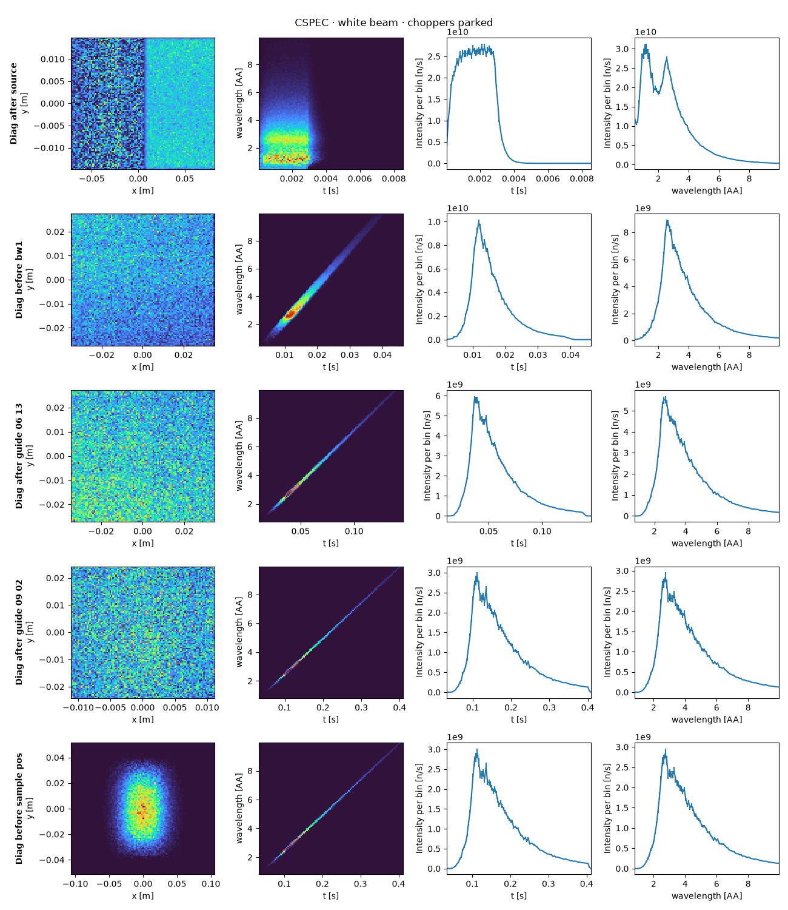
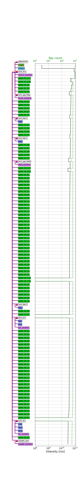
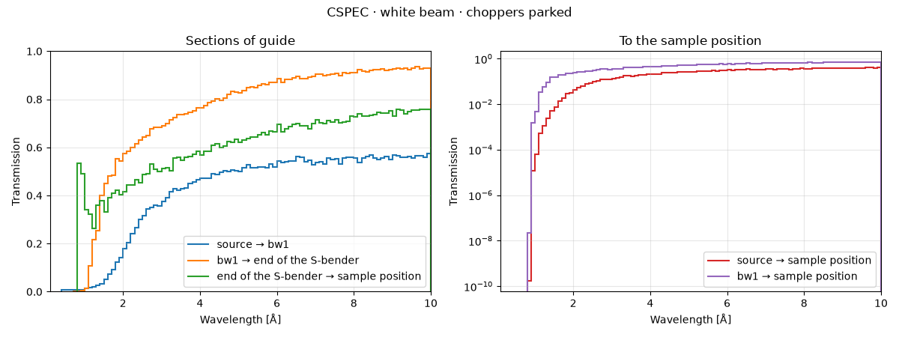

# Guide transmission

[`mcdgs.diagnostics.cspec.guides_diagnostics`](https://github.com/bingli621/mcdgs/blob/main/src/mcdgs/diagnostics/cspec/guides_diagnostics.py)
follows the beam of CSPEC through all its guides, from the source to the sample position. It
runs `CSPEC` in the white beam, 0.1 to 10 Å (`lambda0` `None`), with every chopper parked on its
first slit (`nu_mc` 0), so the beam is not chopped: what it loses on the way is what the guides
take out, and the little the parked disks block.

It uses McStasScript's two tools: its beam diagnostics, the beam at five points along the
instrument, and its diagram of the intensity before every component. From the rays of the
diagnostics it also draws the transmission of the guides by wavelength.
[Run McStasScript's diagnostics](../../how-to/run-mcstasscript-diagnostics.md) has the code and
explains both tools, with T-Rex; the code for CSPEC is the same but for its points. The guides
themselves are listed in [Technical details](details.md#guides).

<!-- fmt:off -->
```python
--8<-- "src/mcdgs/diagnostics/cspec/guides_diagnostics.py:instrument"

--8<-- "src/mcdgs/diagnostics/cspec/guides_diagnostics.py:diagnostics"
```
<!-- fmt:on -->

## The beam along the guides

The points are after the source, before the first bandwidth chopper `bw1` (14.9 m), after
W03-06-13 at the end of the S-bender (54.4 m), after W03-09-02 at the end of the straight guide
(158.8 m) and before `sample_pos` (160.0 m). Each row is one point; the columns are the beam
profile, wavelength against time, and the spectra in time and in wavelength, in n/s per bin. At
1e6 neutrons and seed 1:



After the source, the beam leaves the two moderators side by side, within the pulse, about
3 ms long. The cold moderator, at x above 0, sends 90 % of the rays, so its side looks smoother.
The spectrum has two peaks, at about 1.1 and 2.5 Å, and a long tail to 10 Å. Further along, a
neutron arrives later the longer its wavelength, so wavelength against time is a band, thinner
at every point. Before the first bandwidth chopper, the beam fills the guide, 70 by 55 mm, and
has 4.1 times less intensity than after the source. From there on the thermal peak is gone, and
the spectrum peaks at 2.6 Å. At the end of the straight guide the beam fills its exit, 22.6 by
49 mm. It then flies free for 1.2 m, without loss, and spreads to a spot about 0.1 m wide and
0.08 m high at the sample position. 340124 of the 1e6 rays reach it.

## The intensity before each component

McStasScript's diagram lists the components in beam order, with the intensity just before each,
in n/s, and the number of rays, on a log scale. Each step of the line is what one component
loses. At 1e7 neutrons and seed 1:

??? abstract "The diagram of the intensity before each component"

    

The intensity falls from 9.5e11 n/s at the entrance of W03-01-011 to 8.6e10 n/s at the sample
position. Most of it is lost in the first 4 m; the parked choppers take little. At some
components the line drops and comes back at the next one: to 0 before `guide_06_332`, `arm_psc`
and `arm_mc`, and to about half at the other arms and before `guide_01_012` and `guide_06_012`.
Those are how the diagram's monitor reads there, not losses: the component after has the beam
back. `guide_01_012`, `guide_06_012` and `guide_06_332` are the second halves of elements the
model splits in two, which start where the first halves end.

## Transmission of the guides

### Along the beam

The transmission of a section is the intensity at its exit over that at its entrance, read from
the diagram's run, at 1e7 neutrons. The sections follow the tables of
[Technical details](details.md#guides):

| Guides | From → to, m | In, n/s | Out, n/s | Transmission |
| ------ | ------------ | ------- | -------- | ------------ |
| W03-01-01 to 02-01, to the BBG | 1.9 → 5.9 | 9.456e11 | 2.470e11 | 0.261 |
| W03-03-01 to 05-10, with `bw1` and `bw2` | 5.9 → 27.9 | 2.470e11 | 1.886e11 | 0.764 |
| W03-06-011 to 06-13, end of the S-bender | 27.9 → 54.4 | 1.886e11 | 1.529e11 | 0.811 |
| W03-06-14 to 06-39, widening | 54.4 → 104.6 | 1.529e11 | 1.449e11 | 0.948 |
| `bw3`, W03-06-40 and 07-01, `ps1` and `ps2` | 104.6 → 105.8 | 1.449e11 | 1.440e11 | 0.994 |
| W03-08-01 to 09-01, narrowing | 105.8 → 158.5 | 1.440e11 | 9.366e10 | 0.650 |
| `rrm`, `mc1`, `mc2`, W03-09-02, to the sample | 158.5 → 160.0 | 9.366e10 | 8.603e10 | 0.919 |
| All | 1.9 → 160.0 | 9.456e11 | 8.603e10 | 0.091 |

From the [beam monitor](beam-monitor.md) after the BBG, the guides pass 0.348 of the beam to the
sample position. The losses are not spread evenly:

- **The first 4 m take most.** They pass a quarter of the beam: W03-01-01, which widens from
  45 × 43 mm to 61.7 × 51 mm, passes 0.40 of what enters it, W03-01-02 0.80 and W03-01-03 0.84.
  Most likely, the source sends more divergence into the guide than its m 3 to 4 carries.
- **The S-bender takes the short wavelengths.** From `bw1` to its end it passes 0.72 of the
  beam, and almost nothing below 1 Å (see [By wavelength](#by-wavelength)).
- **The widening guides after the S-bender lose little**, 5 % over 50 m.
- **The narrowing end takes 35 %**, most of it in its last 10 m, W03-08-22 to 09-01, which
  pass 0.71: the guide narrows from 114.66 × 73.89 mm to 27.44 × 49.84 mm, which raises the
  divergence of the beam.
- **The parked choppers take about 4 % together**: about 0.1 % each for `bw1`, `bw2` and `bw3`,
  0.35 % for the pulse-shaping pair, and 3.4 % for `rrm`, `mc1` and `mc2`, whose slits are
  4.45° wide.

### By wavelength

The rays of the beam diagnostics give the transmission by wavelength, as the ratio of the
intensities at two points, in bins of 0.1 Å, at 1e6 neutrons. On the left are the sections
between the points, on the right the whole way to the sample position, on a log scale. A bin
that fewer than 20 rays reach has no value:



The end of the straight guide, after W03-09-02, is left out: the beam reaches the sample
position from there unchanged. In wider bands, from the same rays:

| From → to | 0.5–1 Å | 1–1.5 Å | 1.5–2 Å | 2–3 Å | 3–4 Å | 4–6 Å | 6–8 Å | 8–10 Å |
| --------- | ------- | ------- | ------- | ----- | ----- | ----- | ----- | ------ |
| Source → `bw1` | 0.008 | 0.021 | 0.094 | 0.295 | 0.420 | 0.497 | 0.545 | 0.558 |
| `bw1` → end of the S-bender | 0.001 | 0.232 | 0.513 | 0.643 | 0.727 | 0.815 | 0.893 | 0.923 |
| End of the S-bender → sample | 0.491 | 0.348 | 0.400 | 0.483 | 0.544 | 0.618 | 0.695 | 0.743 |
| `bw1` → sample | 0.000 | 0.081 | 0.205 | 0.311 | 0.396 | 0.504 | 0.620 | 0.685 |

No ray below 0.5 Å reaches `bw1` in numbers enough to read, and the value from the end of the
S-bender at 0.5 to 1 Å rests on 325 rays of very small weight. Here the source is the beam just
after it, all the source sends toward the guide system. The mean wavelength is 2.61 Å after the
source, 3.76 Å before `bw1`, 4.00 Å at the end of the S-bender and 4.24 Å at the sample position.

- **Every section passes the long wavelengths best.** A supermirror of a given m reflects up to
  an angle in proportion to the wavelength, so the guides carry the long wavelengths at much
  larger angles than the short ones.
- **Up to `bw1`, the thermal neutrons are lost**: under 3 % pass below 1.5 Å, against 56 % at 8
  to 10 Å.
- **The S-bender takes what is left of them.** Its vertical curve of 1600 m leaves no line of
  sight through the 55 mm high guide, so a neutron must reflect off its walls to pass. The angle
  that needs, about $\sqrt{2 \times 55\ \text{mm} / 1600\ \text{m}} = 0.48°$, is the critical
  angle of m 3 at about 1.6 Å: below it the transmission falls, to 0.1 % at 0.5 to 1 Å.
- **After the S-bender, too, the long wavelengths pass best**, from 35 % at 1 to 1.5 Å to 74 %
  at 8 to 10 Å.

Overall, from the source to the sample position, 9 % pass at 2 to 3 Å, 17 % at 3 to 4 Å and
38 % at 8 to 10 Å, and almost nothing below 1.5 Å: the mean wavelength rises from 2.61 Å to
4.24 Å.

## Making the figures

The figures need McStas, so they are not made with the site: `pixi run docs-diagnostics` makes
them again, with the other files of the CSPEC pages. To make them yourself, run:

```bash
pixi run python -m mcdgs.diagnostics.cspec.guides_diagnostics
```

It saves the three figures to `mcdgs_workspace/results/cspec_guides_diagnostics/`, or to the
folder given with `--out`. The transmissions of the tables are read from the run folders it
writes, `cspec_guides_diagnostics` and `cspec_guides_diagnostics_analysis` in the workspace.
