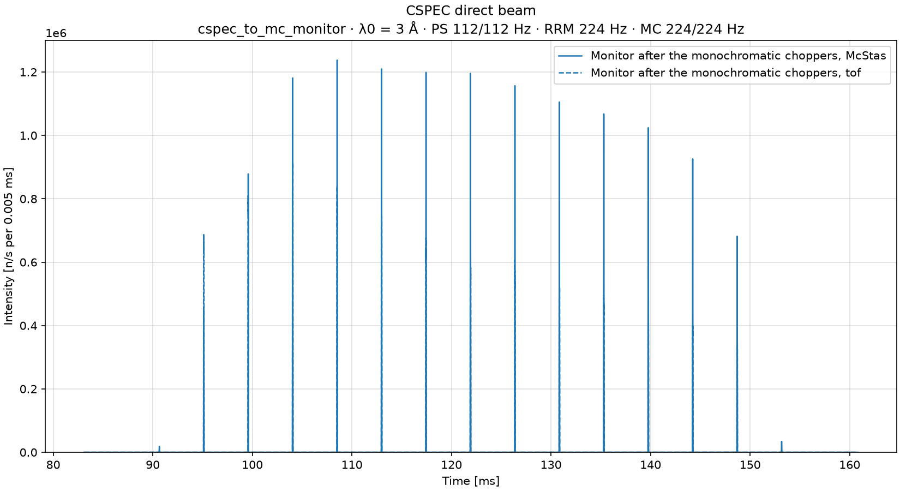
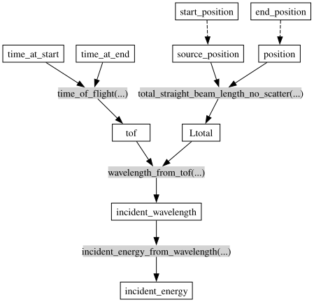
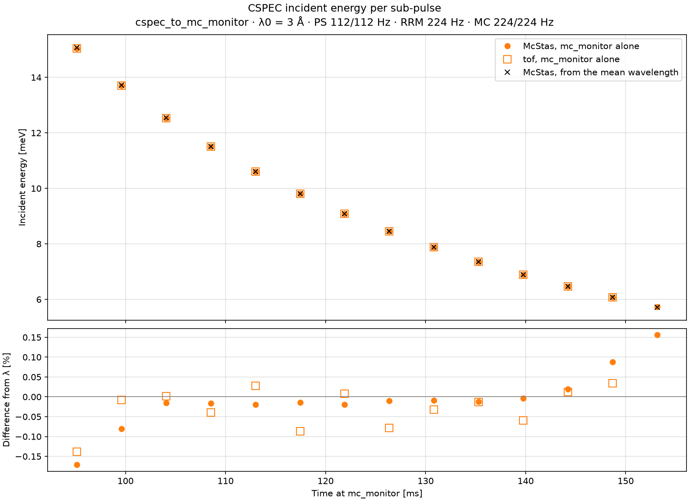

# Incident energy

`CSPECToMcMonitor`, in
[`mcdgs.diagnostics.cspec.incident_energy`](https://github.com/bingli621/mcdgs/blob/main/src/mcdgs/diagnostics/cspec/incident_energy.py),
finds the incident energy Ei of each sub-pulse of CSPEC from when it reaches `mc_monitor`, the
monitor after the monochromatic choppers, taking every sub-pulse to leave the source at
`t0_offset`. Ei follows from the length of the flight and the time it takes. The calculation is
the graph of [scippneutron](https://scipp.github.io/scippneutron/) functions of
[Incident energy of T-Rex](../trex/incident-energy.md#the-scippneutron-graph), and it runs on
McStas and on [tof](../../how-to/simulate-the-choppers-with-tof.md) alike.

CSPEC has no pre-sample or beamstop monitor yet, so Ei comes from one monitor alone: the second
of the two methods of T-Rex, which takes the time the sub-pulse leaves the moderator from the
settings of the choppers rather than measuring it.

## The setup

`CSPECToMcMonitor` is `CSPEC` up to `mc_monitor`, without W03-09-02, `sample_pos` and the sample
monitor after it: `mc_monitor` is the last monitor that counts. Its control parameters are those
of `CSPEC`, here the defaults: `lambda0` = 3 Å, `nu_mc` = 224 Hz, `n` = 1 and `t0_offset` =
1.7 ms. It has the [masked source](masked-source.md), which spends the rays where the choppers
let neutrons through, so every sub-pulse is well filled.

<!-- fmt:off -->
```python
--8<-- "src/mcdgs/diagnostics/cspec/incident_energy.py:instrument"
```
<!-- fmt:on -->

`mc_monitor` has time bins of 5 µs, as the pre-sample monitor of T-Rex, a tenth of those of
`CSPEC`:

| Monitor | Along the beam | Size | Time | Time bins | Wavelength |
| ------- | -------------- | ---- | ---- | --------- | ---------- |
| `mc_monitor` | 158.521 m, after `mc2` | 22.58 mm × 49 mm | 83.1 to 160.8 ms | 15547 of 5 µs | 2.074 to 3.934 Å, in 93 bins of 0.02 Å |

tof is scaled to McStas with `rescale_tof_to_mcstas`, as on [Beam monitor](beam-monitor.md): a
scale set at the source monitor, and a factor on top of it, tuned so that tof has the total of
McStas at `mc_monitor`. With the masked source, the source monitor sees only the neutrons the
choppers will let through, so that factor, 1.51 here, is not the transmission of the guides: it
only brings tof to the intensity of McStas. Ei does not depend on it.

## The direct beam at the monitor



The intensity of `mc_monitor` against time, summed over wavelength: McStas as a solid line, tof as
a dashed one. The sub-pulses arrive 4.465 ms apart, one per opening of the monochromatic
choppers. Each has a standard deviation in time of about 11 µs, so it spans several bins of
5 µs, and its mean time is found to well within a bin. Both models total 7.904e7 n/s.

## How Ei is calculated

`subpulse_flights` finds the sub-pulses at `mc_monitor` with `find_patches`, of the reduction
package, [`mcdgs.reduction.patches`](../../reference/reduction.md): a patch is a run of time bins
with neutrons, and its time is the mean time of its neutrons, weighted by the intensity. Patches
with less than 2 % of the intensity of the strongest are left out.

`incident_flight` then follows `EI_GRAPH`, of
[`mcdgs.reduction.incident_energy`](../../reference/reduction.md), once for every sub-pulse:

<!-- fmt:off -->
```python
--8<-- "src/mcdgs/diagnostics/cspec/incident_energy.py:one_flight"
```
<!-- fmt:on -->



| | From the source to `mc_monitor` |
| - | ------------------------------- |
| `start_position` | the source, at the origin |
| `end_position` | `mc_monitor` |
| `time_at_start` | `t0_offset`, 1.7 ms, for every sub-pulse |
| `time_at_end` | the mean time of the sub-pulse at `mc_monitor` |
| `Ltotal` | 158.518 m |
| `tof` | 93 to 151 ms |

`Ltotal` is the straight line from the source to the monitor. The flight path along the guide,
through the S-bender and the horizontal curve, is 2.7 mm longer, which changes Ei by $3 \times 10^{-5}$.

The monitor also records the wavelength of each neutron. The mean wavelength of a sub-pulse at
`mc_monitor` gives the Ei it should have, through scippneutron's `energy_from_wavelength`: the
reference each Ei is checked against.

## The incident energy of each sub-pulse



The top panel has Ei of each sub-pulse against its time at `mc_monitor`, McStas as filled circles
and tof as hollow squares, and the reference of McStas as black crosses. The bottom panel has the
difference of each from the reference of its own model.

McStas finds 14 sub-pulses, from 15.05 meV (2.33 Å) to 5.73 meV (3.78 Å); tof finds 13,
without the last, which is weak in tof. The first sub-pulse at the monitor, at 90.7 ms, has less than 2 %
of the intensity of the strongest in both, and is left out. Some values, in McStas:

| Sub-pulse | At `mc_monitor` | Flight | λi | Ei | Ei from the mean λ |
| --------- | --------------- | ------ | -- | -- | ------------------ |
| 0 | 95.123 ms | 93.423 ms | 2.3315 Å | 15.049 meV (−0.17 %) | 15.075 meV |
| 6 | 121.912 ms | 120.212 ms | 3.0001 Å | 9.089 meV (−0.02 %) | 9.091 meV |
| 13 | 153.167 ms | 151.467 ms | 3.7801 Å | 5.725 meV (+0.16 %) | 5.716 meV |

Sub-pulse 6 is the one the choppers are phased to: its wavelength is `lambda0`, 3 Å. Over all
sub-pulses, the difference from the reference is −0.17 to +0.16 % in McStas and −0.14 to +0.03 %
in tof. In the middle of the band it is within 0.02 % in McStas. It grows toward both ends of the
band, negative for the fastest sub-pulses and positive for the slowest: the method takes every
sub-pulse to leave the moderator at 1.7 ms, and most likely those at the ends of the band leave a
little earlier or later.

This is better than the same method on T-Rex, −0.87 to +0.24 % in McStas, as the flights of CSPEC
are longer, 93 to 151 ms against 55 to 111 ms: an error $\delta t$ in the time the sub-pulse leaves
gives an error of $2\,\delta t / t$ in Ei, smaller the longer the flight. See
[Why the time bins matter](../trex/incident-energy.md#why-the-time-bins-matter).

## Making the figures

The figures need McStas, so they are not made with the site: `pixi run docs-diagnostics` makes
them again, with the other files of the CSPEC pages. To make them yourself, run:

```bash
pixi run python -m mcdgs.diagnostics.cspec.incident_energy
```

At its defaults, `main` runs 1e8 McStas rays from the masked source and 1e7 tof neutrons, with
seed 1, prints the table of each model, and saves the two figures and the graph to
`mcdgs_workspace/results/cspec_incident_energy/`, or to the folder given with `--out`.
`sc.show_graph` needs graphviz, which the default pixi environment has.
