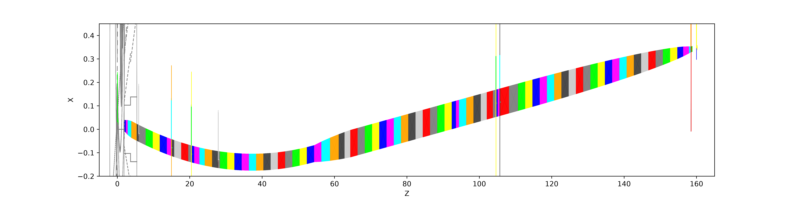
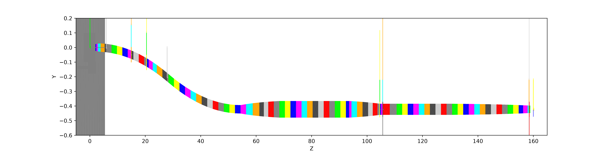
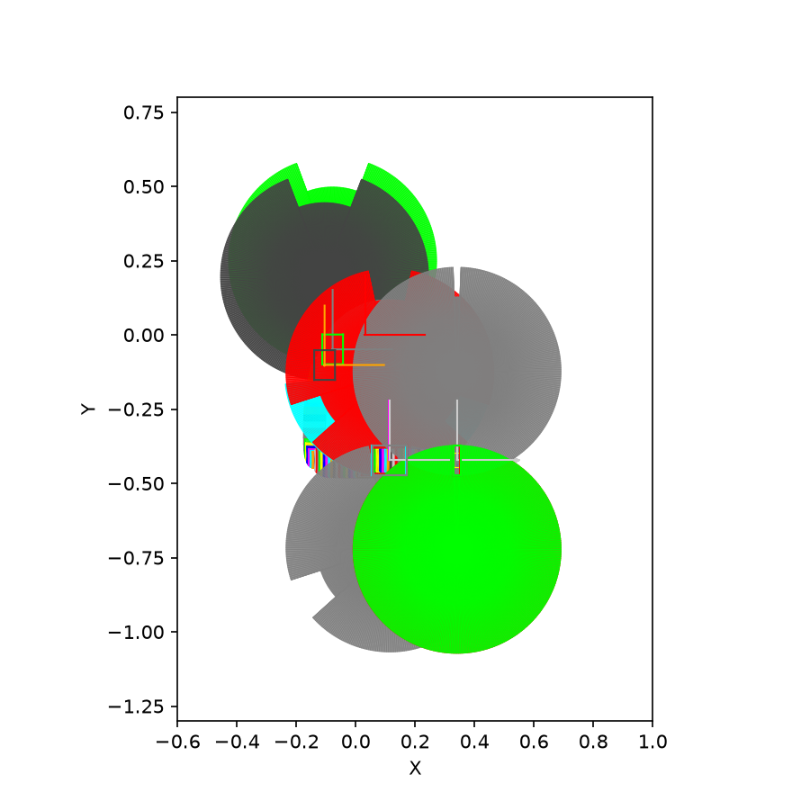

# CSPEC

The CSPEC model at the default [control parameters](details.md#control-parameters), as McStas
draws it: from above, from the side and along the beam, in m. The first view from above and the
view along the beam have the same scale on their two axes; the second view from above and the
view from the side are stretched across the beam.
[Technical details](details.md) lists every
component, with its position, and describes each part.

## Seen from above

First, the whole instrument from the source to the sample, at the same scale on both axes: x
from −10 to 8 m over 175 m in z. This is its true shape. The guide is a few cm wide, so it is a thin
line, and its curve is barely visible. Each guide segment is a rectangle with its ends square to
the beam, turned a little from the one before it to follow the curve. The next view stretches x
so that the curve and the width of the guide show.

!!! note "The guide segments are rectangles, not parallelograms"
    x is stretched about 65 times more than z in this view. A stretch along one axis does not
    keep angles: the slanted long sides of a turned segment slant about 65 times more, while
    its ends, almost parallel to x, stay almost vertical. So each rectangle is drawn as a
    parallelogram, and the more the segment is turned, the more it leans. The view above
    shows the true shape. Where the guide widens or narrows, the segments are tapered: that
    change of width is real, only exaggerated.

z is along the beam and x across it (projection `zx`). x is stretched: the view runs from −0.2 to
0.45 m in x over 170 m in z, so that the curve shows. The gray lines at the origin are the drawing
of the source. The guides follow it in alternating colors up to `sample_pos`, 160.0 m along the
beam, and drawn as wide as they are. The horizontal curve takes the beam axis to x ≈ −0.13 m in the
S-bender, and the straight guides on to x ≈ 0.35 m at the sample. The guide widens from 70 to 115
mm after 54 m and narrows to 23 mm toward the sample. The thin lines across the beam are the
chopper disks, seen edge on: `bw1` near 15 m, `bw2` near 20 m, `bw3` and the pulse-shaping choppers
near 105 m, and the RRM and monochromatic choppers near 158.5 m.

These figures need McStas, so they are not made with the site:
[`mcdgs.diagnostics.cspec.overview`](../../reference/diagnostics.md) draws them with
McStasScript's `show_instrument` (mcdisplay), and `pixi run docs-diagnostics` runs it. They show
the instrument as of that run.

## Seen from the side

!!! note "The guide segments of the S-bender are not parallelograms"
    y is stretched about 53 times more than z in this view, so the guide segments of the
    S-bender, turned to follow its vertical curve, look like parallelograms too, for the same
    reason as in the view from above.

z is along the beam and y up (projection `zy`). y is stretched: the view runs from −0.6 to 0.2 m in y over 170 m in z. The guide drops 0.422 m in the vertical
S-bender, from the entrance of the guide system at 1.9 m to 54.4 m, and is level after it.
The guide is drawn as wide as it is high: it widens from 55 to 111 mm from about 54 m, narrows
again from about 93 m, and narrows to 49 mm toward the sample. The gray block at the origin is
the drawing of the source, and the vertical lines are the chopper disks, seen edge on.

## From sample to source

x is across the beam and y up (projection `xy`), with the components drawn on top of each other
and the view limited to x from −0.6 to 1.0 m and y from −1.3 to 0.8 m. It leaves out the source,
which would cover the rest: it draws the components from `arm_iscs` to the last disk. The guides
run from y = 0 at the source down to y = −0.42 m after the S-bender, and from x ≈ 0.02 m at the
entrance of the guide system, through x ≈ −0.13 m in the S-bender, to x ≈ 0.35 m at the sample.

The chopper disks are 0.7 m across, each to one side of the beam. mcdisplay colors the
components in turn, in the order of the instrument, so tell the disks apart by where they are.

| Disks | Choppers | Position | Side of the beam |
| ----- | -------- | -------- | ---------------- |
| Upper left | `bw1`, `bw2` | x ≈ −0.08 to −0.10 m, y ≈ −0.05 to −0.10 m | Above |
| Middle | `bw3`, `ps1` | x ≈ 0.11 m, y = −0.42 m | Above |
| Lower left | `ps2` | x ≈ 0.12 m, y = −0.42 m | Below |
| Right, upper | `mc1` | x ≈ 0.34 m, y = −0.42 m | Above |
| Right, lower | `rrm`, `mc2` | x ≈ 0.34 m, y = −0.42 m | Below |

The notches at the edge of the disks are the slits. The axle of each disk, above or below the
beam, is not in CSPEC_nl-specs_1.E.xlsx: see [Choppers](details.md#choppers).
