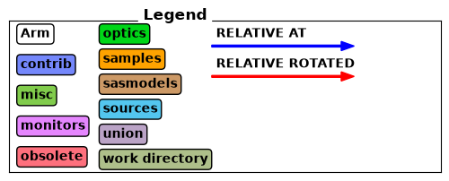
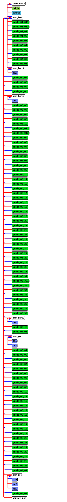

# McStas instrument file

This is the McStas instrument file the model generates, at the default
[control parameters](details.md#control-parameters). The chopper timings, `nu_<name>` and
`delay_<name>`, are the defaults of its instrument parameters.
[`mcdgs.diagnostics.cspec.overview`](../../reference/diagnostics.md) writes it to
`mcdgs_workspace/builds/CSPEC/` and copies it here; `pixi run docs-diagnostics` runs it. The
tests check that this copy matches the current code.
[Download it](figures/overview/CSPEC.instr), or expand it here:

??? abstract "CSPEC.instr"

    ```c
    --8<-- "docs/instruments/cspec/figures/overview/CSPEC.instr"
    ```

## How the components are placed

McStasScript's `show_diagram()` draws the components of the same file in beam order. Each blue
arrow points from a component to the one it is placed `AT ... RELATIVE` to, and each red arrow to
the one it is `ROTATED ... RELATIVE` to; `ABSOLUTE` is the lab frame. The color of a box is the
kind of McStas component. Every guide and every arm of a chopper gap is placed relative to
`arm_iscs`, the ISCS frame of CSPEC_nl-specs_1.E.xlsx, and each chopper relative to the arm of
its gap.
[`mcdgs.diagnostics.cspec.overview`](../../reference/diagnostics.md) draws it with the
instrument file.



??? abstract "show_diagram()"

    
