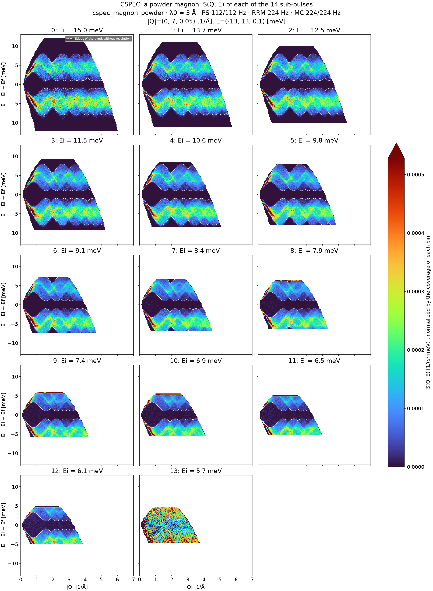

# Powder magnon

`CSPECMagnonPowder`, in
[`mcdgs.diagnostics.cspec.magnon_powder`](https://github.com/bingli621/mcdgs/blob/main/src/mcdgs/diagnostics/cspec/magnon_powder.py),
replaces the vanadium of [Elastic resolution](elastic-resolution-incoherent.md) with a powder
that scatters from one magnon branch. It draws S(Q, E) for each of the 14 sub-pulses in one
figure. Vanadium gives one line at E = 0, so it measures the resolution at a single energy
transfer. The magnon spreads intensity across E and |Q|, and its band has sharp edges, so the
figure shows how each sub-pulse blurs a dispersive excitation over its whole Q–E window. It
follows [Powder magnon of T-Rex](../trex/magnon-powder.md), with a magnon scaled to the incident
energies of CSPEC.

The reduction and the figure are those of T-Rex. The parts both instruments share are in
[`mcdgs.diagnostics.magnon_powder`](../../reference/diagnostics.md).

## The sample

The powder is `magnon_powder`, an `Isotropic_Sqw`, in `samples/inelastic/powder.py`, as on T-Rex.
It reads a table of S(|Q|, E) that `write_magnon_sqw` writes. The magnon is that of a
simple-cubic ferromagnet with exchange $J$ between nearest neighbors, spins $S$ and an anisotropy
gap $\Delta$:

$$
\hbar\omega(\mathbf{q}) = \Delta + 4JS\,(3 - \cos q_x a - \cos q_y a - \cos q_z a)
$$

The sub-pulses of CSPEC have Ei from 15.1 to 5.7 meV, and their arrival windows reach an energy
transfer of 0.8 Ei, from 12 to 4.6 meV. The magnon of T-Rex, from 5 to 20 meV, is mostly out of
that reach, so CSPEC has its own. It keeps the cell of T-Rex, $a$ = 4 Å, so the zone centers are
at the same |Q|. With $\Delta$ = 1 meV and $JS$ = 7/24 meV = 0.292 meV, the band runs from the
1 meV gap at the zone center to 8 meV at the zone corner, $(\pi/a)(1, 1, 1)$. A powder sees, at
each |Q|, every wavevector of that length. `write_magnon_sqw` averages the magnon over 20,000
directions on a Fibonacci lattice of the sphere and smooths each row with a Gaussian of
$\sigma$ = 0.01 meV, a quarter of the narrowest FWHM of CSPEC, 0.10 meV, from
[Elastic resolution](elastic-resolution-incoherent.md). At small |Q| the powder band is a narrow
dispersive line, $\Delta + 2JS\,(\lvert Q \rvert a)^2$. At larger |Q| it is a band between a
lowest and a highest energy, `magnon_band`, with sharp edges.

| | |
| - | - |
| Sample | a solid cylinder 20 mm across and 10 mm high, the size of the vanadium, `Isotropic_Sqw` |
| S(\|Q\|, E) | 0 to 6 Å⁻¹ in steps of 0.02 Å⁻¹, −8.06 to 8.06 meV in steps of 0.005 meV, symmetric in E, each side of each row normalized to one magnon |
| Cross-sections | 5 b coherent per 64 ų cell, only the scale of the intensity; no absorption, no incoherent scattering |
| Taken as it is | `T=-1`: no detailed balance; `classical=0`, `norm=1`; the table holds both sides, so the magnon is annihilated as often as it is created, a Bose factor of 1 |
| Scattering | single scattering only (`order=1`), within `d_phi` = 55.1° of the horizontal plane, the height of the window of the vanadium, 90% of the neutrons made to scatter (`p_interact=0.9`), each neutron sent through it 4 times (`SPLIT 4`) |
| Detector | the twelve detector panels, as for vanadium |

The magnetic form factor and the polarization factor are left out, so the intensity does not
fall with |Q|. `Isotropic_Sqw` has no horizontal focusing: it scatters over the whole horizontal
circle, and the panels catch the part of it between −31.5° and 143.8°.

`simulate` writes the table into the builds folder of the workspace, `sqw_path`, as
`cspec_magnon_powder.sqw`, apart from the table of T-Rex, before it runs McStas. McStas reads it
when the instrument starts, in both parts of the run, so the path is absolute.

<!-- fmt:off -->
```python
--8<-- "src/mcdgs/diagnostics/cspec/magnon_powder.py:instrument"
```
<!-- fmt:on -->

## Runs and reduction

`simulate` runs the default control parameters, `lambda0` = 3 Å, `nu_mc` = 224 Hz, with the
masked source, in the two parts of
[Elastic resolution](elastic-resolution-incoherent.md#two-runs-split-at-the-sample):

1. **From the source to `sample_pos`**, with 5e9 rays, in 17.5 minutes.
2. **From that beam through the powder to the panels**, in 22 seconds. Each neutron of the beam
   goes through the powder 4 times, which gives 3.9 million detector events.

`reduce_runs` is the reduction of the vanadium: the sub-pulses of `subpulse_timing` at
`mc_monitor`, every pixel of the panels, the neutrons of each sub-pulse divided by the solid
angle of their pixel and by its flux, and `q_e_maps`, S(Q, E) normalized by the coverage of each
bin, in bins of 0.1 meV and 0.05 Å⁻¹.

## S(Q, E)

`plot_magnon_maps` draws the 14 maps, from the highest Ei to the lowest, from −1 to 10 meV, with
`plot_q_e_maps` of the vanadium: one linear color scale for all of them, white where the
sub-pulse cannot reach. Over each map, dashed white lines show the lowest and the highest energy
of the magnon at each |Q|, without resolution. How far the intensity spreads past them is the
resolution of that sub-pulse.



The pattern is that of T-Rex, at the same |Q| and a smaller energy scale. At every zone center,
$\lvert Q \rvert = (2\pi/a)\sqrt{h^2 + k^2 + l^2}$ = 1.57, 2.22, 2.72, 3.14 Å⁻¹, ..., the lower
edge drops back to the gap, and a dark V of little intensity rises from it. Between the Vs,
bright arches run across the band. At small |Q| the steep dispersion, from 1 meV to about 3 meV
at 0.8 Å⁻¹, is the bright left edge of the intensity: there the whole band is one narrow line,
so its intensity per meV is the highest of the map.

- **Every sub-pulse draws the pattern sharply.** The FWHM of CSPEC, from 0.6 meV at 15 meV to
  0.1 meV at 5.7 meV, is small next to the 7 meV band, so even the highest Ei, 15 to 12.5 meV
  (0 to 2), keep the Vs, the arches and the gap apart. Their edges are the softest, and they
  sharpen as Ei falls.
- **The highest Ei, 15 to 12.5 meV (0 to 2), see the whole band**, up to |Q| of about 4 Å⁻¹.
  The lower the Ei, the less of it: sub-pulse 6, at 9.1 meV, reaches up to 7.3 meV, and
  sub-pulse 12, at 6.1 meV, up to 4.9 meV and 3 Å⁻¹.
- **From sub-pulse 7 on, frame overlap adds intensity that the model does not have.** Below the
  gap, where the model has none, sub-pulses 0 to 6 have 0.3% to 0.6% of the intensity of the band
  between 2 and 4 meV; sub-pulses 7 to 12 have 1% to 9%. A neutron that loses 5 to 8 meV in one
  sub-pulse is slow enough to reach the detector in the arrival window of a later one, so the
  reduction gives it the Ei of that one, and so a wrong energy transfer. The sub-pulses follow
  each other every 4.5 ms, and from sub-pulse 6 on, a loss of 7 to 8 meV, most of Ei, slows a
  neutron by that much. These neutrons spread over the
  whole window, but pile up at its end, near 0.8 Ei, where a millisecond of arrival time spans
  the fewest meV. That is the bright stripe along the top of the maps of 8 to 11, which has 2 to
  10 times the intensity of the bins just below it.
- **Sub-pulse 13, the last at 5.7 meV, is mostly frame overlap.** Below the gap it has 45% of
  the intensity of its band, which is itself three and a half times that of the others. Its arrival
  window overlaps that of sub-pulse 12, and a neutron in both goes to 13, so it also takes the
  neutrons of 12 that lose the most energy. Only the band edges near its small-|Q| dispersion
  stand out.

Fewer of the neutrons that should scatter are lost than on T-Rex: McStas reports that 3.4% of
them, 312,736 of 9.1 million, are transmitted instead, because it finds no (|Q|, E) of the table
that sends them towards the detector.

## Making the figure

```console
pixi run python -c "from mcdgs.diagnostics.cspec.magnon_powder import main; main()"
```

This runs McStas, then `analyze`, which writes `cspec_magnon_powder_sqe.png` into the results
folder. `pixi run python -m mcdgs.diagnostics.cspec.magnon_powder` only reduces the runs again,
without McStas.
