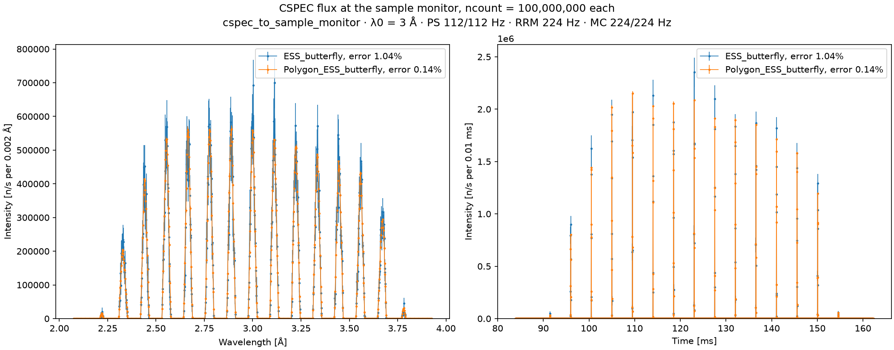
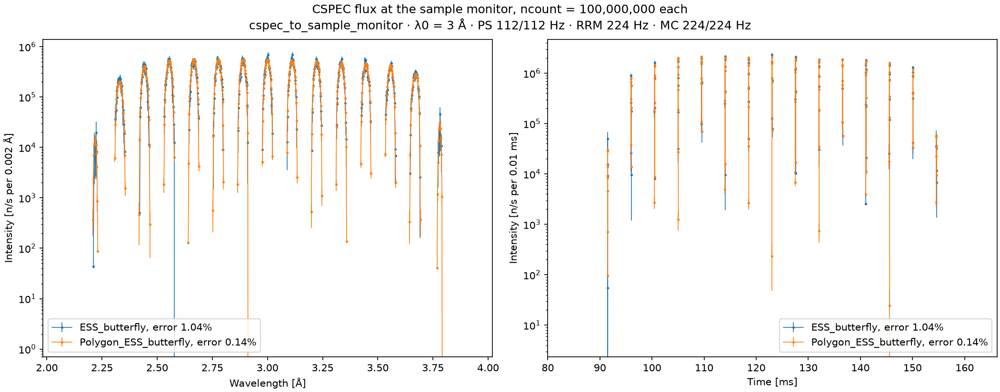
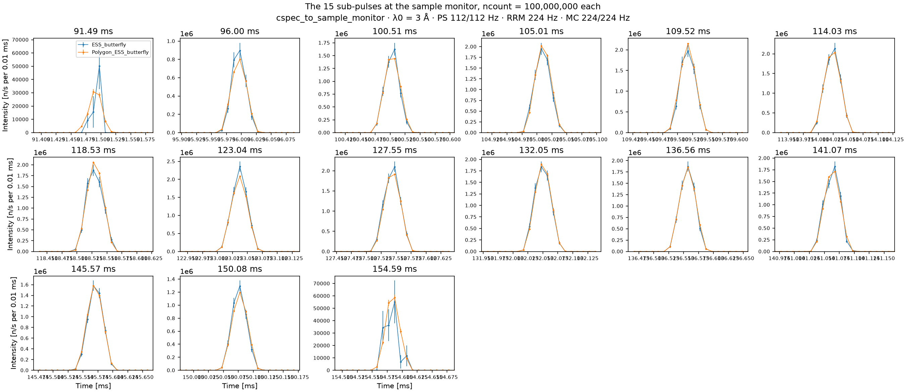

# Masked source

The choppers of CSPEC let through about 2 % of what the source emits. A McStas run with the plain
source, `ESS_butterfly`, spends the other 98 % of its rays on neutrons that a chopper stops long
before the sample. The masked source, `Polygon_ESS_butterfly`, emits only the neutrons the
choppers can let through, so nearly every ray it draws reaches the sample.

[`mcdgs.diagnostics.cspec.masked_source`](https://github.com/bingli621/mcdgs/blob/main/src/mcdgs/diagnostics/cspec/masked_source.py)
runs CSPEC with each source, with the same number of rays, and compares what reaches the sample.
Both give the same intensity, but the masked source's error is seven times smaller.

## How the masked source works

The masked source is the same as for T-Rex: see
[How the masked source works](../trex/masked-source.md#how-the-masked-source-works). Before the
run, the component computes which (1/v, t) pairs pass all the disks, a union of convex polygons,
and draws its rays inside that region only, each with its weight multiplied by the acceptance,
the share of the sampled plane the region covers.

For CSPEC at its defaults (`lambda0` = 3 Å, `nu_mc` = 224 Hz, `n` = 1), the region is 21
polygons in 15 bands of 1/v, over the band of `lambda0` and 8.571 ms of emission. Its acceptance
is 0.019: 1.9 % of the sampled plane can reach the sample.

`masked_source` in `mcdgs.instruments.cspec.sources` describes the eight disks to the component,
from the same values as the disks themselves: their frequencies and delays from the instrument
parameters `nu_<name>` and `delay_<name>`, their beam angles and slit edges, their flight paths,
as on [Choppers](choppers.md), and the angle their beam window subtends on the disk, which widens
each opening a little in time.

### Using it

`CSPEC` takes the masked source with `source_masked=True`:

```python
from mcdgs.instruments.cspec.model import CSPEC

cspec = CSPEC(source_masked=True)
```

The source stays masked when `update_params` changes `lambda0`, and when the instrument is saved
to a parameters file and loaded again. The masked source needs the choppers turning, so it does
not take `nu_mc` 0, which parks them: see [Chopper timing](details.md#chopper-timing).

Every component after the choppers sees the beam it would see with the plain source. The
components before them do not: the source monitor and the beam monitor see only the neutrons the
choppers will let through. For the beam the guides carry to the choppers, use the plain source.

## The setup

`main` runs `CSPECToSampleMonitor` twice, CSPEC up to its sample monitor at the defaults, without
a sample: once with each source, with 1e8 rays and seed 1. Its sample monitor has the bins of the
masked source diagnostic of T-Rex, finer than those of CSPEC, to show the shape of each
sub-pulse:

<!-- fmt:off -->
```python
--8<-- "src/mcdgs/diagnostics/cspec/masked_source.py:instrument"
```
<!-- fmt:on -->

| Axis | Range | Bins | Bin width |
| ---- | ----- | ---- | --------- |
| Time | 83.9 to 162.3 ms | 7843 | 0.01 ms, a fifth of that of CSPEC |
| Wavelength | 2.074 to 3.928 Å | 927 | 0.002 Å, a tenth of that of CSPEC |

## The result

--8<-- "docs/instruments/cspec/figures/masked-source/cspec_masked_source.txt"

- **The same intensity.** Both sources give the sample 7.7e7 n/s. The masked source gives 0.4 %
  less, 0.37 times the error of the plain source.
- **A seventh of the error.** From the same 1e8 rays, the plain source has an error of 1.04 % and
  the masked source 0.14 %. The plain source would need about 5.5e9 rays to do as well.
- **About as dear per ray.** The masked run takes 25 s, the plain one 19 s, which varies from
  run to run. The figure of merit, one over the relative error squared times the time, is about
  41 times higher with the masked source. The gain is smaller than for T-Rex, about 135 times,
  as the choppers of CSPEC pass more of the sampled plane, 1.9 % against 0.7 %.

## The figures

### Spectrum and time profile



The wavelength spectrum, summed over time, and the time profile, summed over wavelength, of both
sources, with error bars. The same 15 sub-pulses arrive with both, 4.51 ms apart: the 4.46 ms
between two openings of the monochromatic choppers, and the flight of the 0.111 Å between two
sub-pulses over the 1.5 m from those choppers to the sample. In the spectrum each is about
0.04 Å across. The masked source draws each shape smoothly, while the plain source scatters
about it by up to a quarter of its height.

### On a log scale



The same, on a log intensity axis six decades deep. With either source, nothing arrives between
the sub-pulses. The first and the last sub-pulses, at 2.22 and 3.78 Å, are much weaker than the
others, their highest bins 25 to 65 times lower. They are not on the [acceptance diagram](choppers.md#acceptance-diagram), which
shows 13 sub-pulses: it follows the beam axis only, while the masked source widens each opening
by the beam window of its disk, and has 15 bands. Most likely, these two pass only through the
side of a window.

### Every sub-pulse



The time profile around each sub-pulse, 0.1 ms on each side. `find_peaks` finds them in the
profile of the masked source: runs of bins above 1 % of the highest bin, a gap of more than
1 ms starting the next. Each sub-pulse is about 0.05 ms across, four to six bins. In every one,
the masked source follows the plain source within its error bars, with error bars too small to
see.

## Making the figures

The figures need McStas, so they are not made with the site: `pixi run docs-diagnostics` makes
them again, with the other files of the CSPEC pages. To make them yourself, run:

```bash
pixi run python -m mcdgs.diagnostics.cspec.masked_source
```

At its defaults, `main` runs 1e8 rays with each source, with seed 1, and saves the figures and
the table to `mcdgs_workspace/results/cspec_masked_source/`, or to the folder given with
`--out`. The masked source also writes its region, `source.json` in its run folder: the
polygons, their area and the acceptance.
