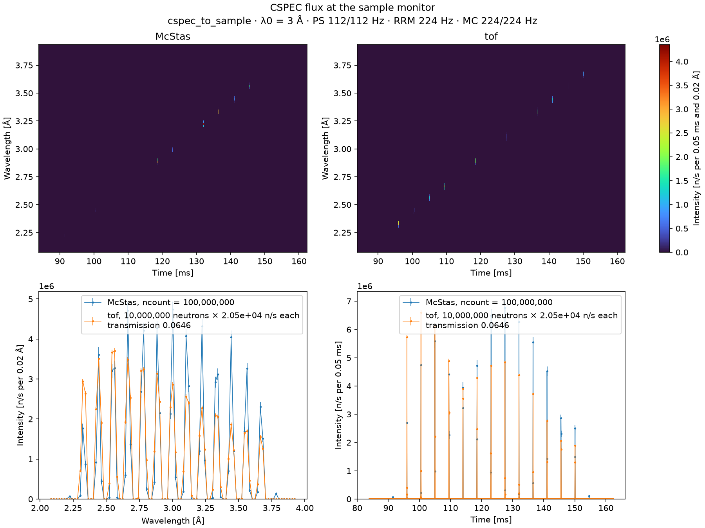
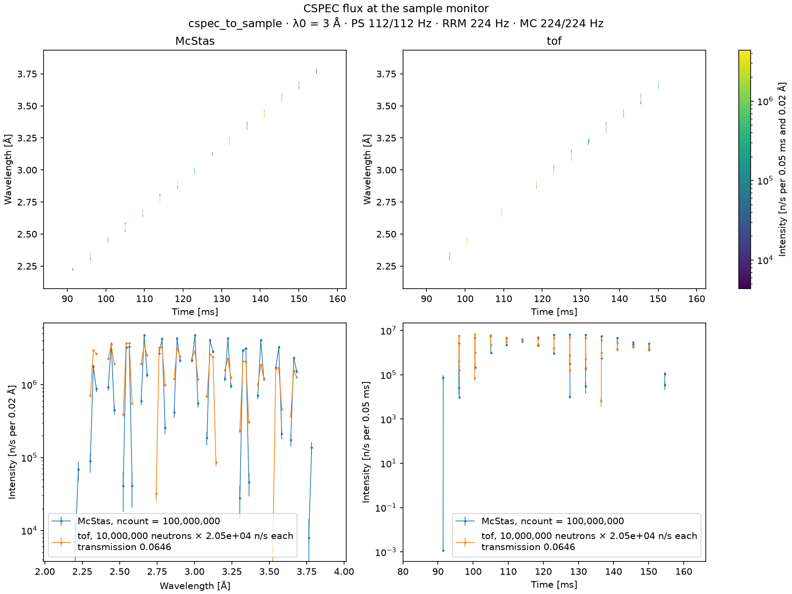
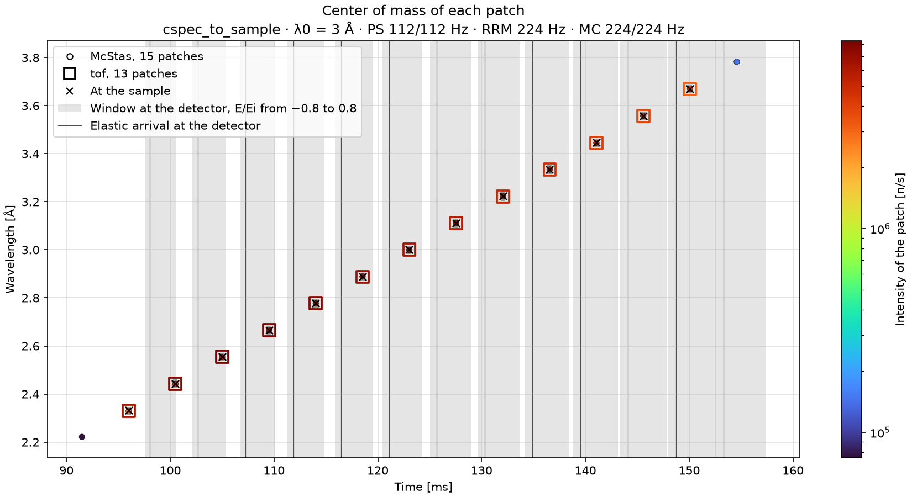
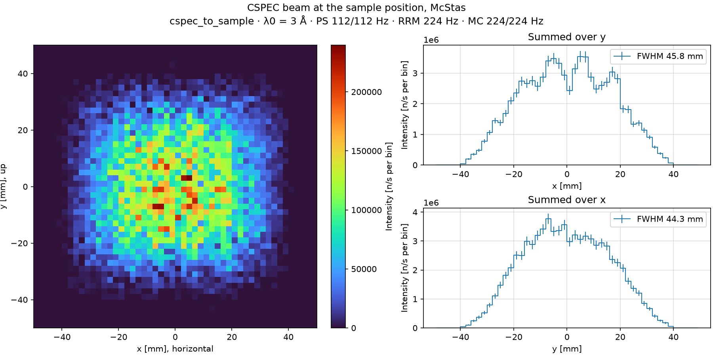

# Neutrons on sample

`CSPECToSample`, in
[`mcdgs.diagnostics.cspec.neutrons_on_sample`](https://github.com/bingli621/mcdgs/blob/main/src/mcdgs/diagnostics/cspec/neutrons_on_sample.py),
compares McStas and [tof](../../how-to/simulate-the-choppers-with-tof.md) at the sample monitor of
CSPEC, 160.0 m from the source. On the way are all the guides and all the
[choppers](choppers.md): McStas models both, tof only the choppers. The page shows what reaches
the sample, in time and wavelength, and where the two models differ; and, from McStas, where
the neutrons cross the sample position. It follows
[Neutrons on sample of T-Rex](../trex/neutrons-on-sample.md).

## The setup

`CSPECToSample` is `CSPEC` up to its sample monitor, at `sample_pos`: without a sample, and
without the detector panels after it. In their place is `sample_xy_monitor`, at `sample_pos` too.
Its control parameters are those of `CSPEC`, here the defaults: `lambda0` = 3 Å, `nu_mc` =
224 Hz, `n` = 1 and `t0_offset` = 1.7 ms. It has the plain source, not the
[masked source](masked-source.md), so that the transmission below is that of the guides.

<!-- fmt:off -->
```python
--8<-- "src/mcdgs/diagnostics/cspec/neutrons_on_sample.py:instrument"
```
<!-- fmt:on -->

The sample monitor records one 2D map of time against wavelength, on the band of `lambda0`:

| Axis | Range | Bins | Bin width |
| ---- | ----- | ---- | --------- |
| Time | 83.9 to 162.3 ms | 1569 | 0.05 ms |
| Wavelength | 2.074 to 3.934 Å | 93 | 0.02 Å |

`sample_xy_monitor` has the place and the opening of the sample monitor, 0.1 m × 0.1 m. It
records one 2D map of x against y, across the beam, summed over time and wavelength, and leaves
the neutrons unchanged:

| Axis | Range | Bins | Bin width |
| ---- | ----- | ---- | --------- |
| x, horizontal | −50 to 50 mm | 50 | 2 mm |
| y, up | −50 to 50 mm | 50 | 2 mm |

## Scale and transmission

tof is brought to n/s as on [Beam monitor](beam-monitor.md). The scale is set at the source
monitor, at the entrance of W03-01-011, where both models see the same beam: at the defaults of
`main`, 2.049e11 n/s in McStas over 1e7 tof neutrons, 2.049e4 n/s per tof neutron. At the sample
monitor a transmission $T$ on top of it stands for what the guides take out, tuned so that both
models have the same total there:

$$
\begin{aligned}
T &= \frac{\text{McStas total at the sample monitor}}{\text{tof neutrons at the sample monitor} \times \text{scale}} \\
  &= \frac{7.739 \times 10^{7}\ \text{n/s}}{58{,}478 \times 2.049 \times 10^{4}\ \text{n/s}} = 0.0646
\end{aligned}
$$

In McStas, 7.739e7 n/s reach the sample, 3.78e-4 of the beam that enters W03-01-011. In tof,
whose choppers are the only thing in the way, 58,478 of 1e7 neutrons do, 5.85e-3. The guides
from W03-01-011 to the sample thus pass 6.5 % of what the choppers let through, on average over
the band: the transmission depends on the wavelength, see
[McStas and tof](#mcstas-and-tof).

Each tof neutron at the sample stands for $2.049 \times 10^{4} \times 0.0646 = 1324$ n/s, so tof
cannot show anything weaker than that.

## The figures

`main` runs both models with the same seed and draws four figures.

### On linear scales



The maps of both models on one linear color scale, then the wavelength spectrum and the time
profile of both, with error bars and the points joined by lines. The neutrons arrive as a row of
sub-pulses, each a short streak on the maps and a spike in the time profile.

### On log scales



The same, on log scales: the maps three decades deep, in viridis with the empty bins in white,
and the spectrum and the profile on a log intensity axis. It shows what is too weak for the
linear figure: a weak sub-pulse of McStas at each end of the band, and that nothing arrives
between the sub-pulses.

### The patches



A patch is a run of time bins with neutrons; a gap of more than 1 ms starts the next one.
`find_patches` gives the center of mass of each, its mean time and wavelength weighted by the
intensity, its width and its intensity, and `plot_patches` draws them: McStas as filled circles,
tof as hollow squares, colored by intensity on one log scale. Where both models have a patch, the
square frames the circle. The width is drawn as error bars, smaller than the markers here.

Each sub-pulse of tof is also drawn: a black cross at its incident wavelength when it reaches the
sample, and its arrival window at the detector panels as a gray band across all wavelengths, from
the [table below](#arrival-windows-at-the-detector). A thin line in each band is when its
neutrons arrive if they fly through the sample without changing speed, the elastic neutrons. The
sample monitor is at the sample, so each cross falls on its patch. The bands of the last two
sub-pulses touch: see [below](#arrival-windows-at-the-detector).

### The beam across the sample position



The map of `sample_xy_monitor`, in n/s per bin, with both axes to the same scale, and its
profiles: the map summed over y, against x, and summed over x, against y, with the errors of
McStas. tof has no x and y, so this figure is of McStas alone.

The beam is centered on the axis, with a full width at half maximum of 45.8 mm in x and 44.3 mm
in y, and nothing beyond about 40 mm from the axis. CSPEC has no slit before the sample: the last
guide, W03-09-02, ends 1.175 m before it, 22.58 mm wide and 49 mm high, and the beam spreads from
there, twice as wide in x as the guide. The profile in x has dips at the axis and some 12 mm to
each side, larger than the errors of McStas, about 3 % per bin; they have not been studied yet.
With 1e8 McStas neutrons, a bin at the center of the map has an error of about 36 %, so the
structure within the map is noise.

## What reaches the sample

Every neutron's departure time from the moderator follows from its time of arrival $t$ and
wavelength $\lambda$: $t - \lambda L / (3956\ \text{m Å/s})$, with $L$ = 160.0 m. The patches fall
into two kinds:

| Kind | McStas | tof | Wavelength | Intensity of each | Left the moderator |
| ---- | ------ | --- | ---------- | ----------------- | ------------------ |
| Main sub-pulses | 13 | 13 | 2.33 to 3.67 Å | 2.7e6 to 7.4e6 n/s | at 1.6 to 1.8 ms |
| Sub-pulses at the band edges | 2 | 0 | 2.22 Å, 3.78 Å | 7.5e4 and 1.4e5 n/s | at about 1.6 ms |

### The main sub-pulses

They hold 99.7 % of the beam at the sample, 7.717e7 of the 7.739e7 n/s, or 5.5e6 neutrons per
pulse at 14 Hz.

- **4.50 to 4.51 ms and 0.112 Å apart.** The monochromatic choppers open every 1/224 Hz =
  4.46 ms, so the wavelengths that pass them, 158.5 m from the source, are 0.112 Å apart. Each
  wavelength then flies 1.5 m further to the sample, the longer ones more slowly, which spreads
  the arrivals to 4.50 ms.
- **Narrow.** Each is 0.014 to 0.029 ms (RMS) in time and 0.012 Å in wavelength in McStas, 0.3 to
  0.5 % of λ. That is a bin or less of the monitor in each, so the true widths may be smaller.
- **From the middle of the pulse.** They all left the moderator at about 1.7 ms, the
  `t0_offset` the choppers are phased to.

### McStas and tof

The two models agree in the time and the wavelength of every sub-pulse, but not in how the
intensity is spread over the band. tof peaks near the short end, at 8.3e6 n/s at 2.55 Å, and
falls to 3.2e6 n/s at 3.67 Å. McStas peaks in the middle of the band,
at 7.4e6 n/s at 3 Å, and falls to 2.7e6 n/s at 2.33 Å. The ratio of McStas to tof rises from
0.43 at 2.33 Å to 1.46 at 3.45 Å, and drops a little after it, 1.25 at 3.67 Å. McStas has an
error of 3 to 5 % per sub-pulse, so this is a firm result.

The single transmission of 0.0646 is thus an average: the guides pass more of the long
wavelengths than of the short ones. That is what guides do, since the largest angle a supermirror
reflects grows with the wavelength. Which of the guides of CSPEC cut the short wavelengths most
has not been studied yet. On T-Rex, the two models
agree within about 12 % from 1.4 to 2.2 Å.

### The sub-pulses at the band edges

McStas has one more sub-pulse at each end of the band, 7.5e4 n/s at 2.22 Å and 1.4e5 n/s at
3.78 Å, 0.3 % of the beam together, with errors of 28 % and 19 %. tof has none: a neutron of it
stands for 1324 n/s, and it has none there. They left the moderator at about 1.6 ms, as the main
ones did, so they are not a part of the pulse that tof leaves out. As on
[T-Rex](../trex/neutrons-on-sample.md#the-sub-pulses-at-the-band-edges), the bandwidth choppers
open and close gradually across the width of the beam in McStas, and in an instant in tof, which
is the most likely cause; it has not been confirmed for CSPEC.

### Between the sub-pulses

Nothing arrives between the sub-pulses: McStas has 15 patches and tof 13, all of them
sub-pulses.

## Arrival windows at the detector

Each sub-pulse reaches the sample with its own incident energy Ei, about 4.5 ms after the one
before. A neutron the sample scatters reaches the detector panels, 3.5 m further, sooner if it
gains energy and later if it loses it. `subpulse_windows` gives the window in which the neutrons
of each sub-pulse arrive, for an energy transfer E from −0.8 Ei to 0.8 Ei, with the functions of
the [reduction package](../../reference/reduction.md).

CSPEC has no pre-sample or beamstop monitor yet, so Ei comes from one monitor alone, as on
[Incident energy](incident-energy.md): the sample monitor, every sub-pulse leaving the source at
`t0_offset`.

1. `find_patches` finds the sub-pulses at the sample monitor, the patches with at least 2 % of
   the intensity of the strongest.
2. `incident_flight` gives each its Ei, from the flight from the source to the sample monitor.
3. The sample monitor is at the sample, so the time of a sub-pulse there is when it reaches the
   sample.
4. `arrival_window` gives when the neutrons of each reach the panels, with Ef = Ei − E:
   the window opens with the fastest, E = −0.8 Ei, and closes with the slowest, E = 0.8 Ei.
   The elastic neutrons, E = 0, fly through the sample without changing speed, and arrive in
   between.

--8<-- "docs/instruments/cspec/figures/neutrons-on-sample/cspec_neutrons_on_sample_windows.txt"

The times are from the start of the pulse. Sub-pulse 6 is the one the choppers are phased to:
its λi is `lambda0`, 3 Å. Each window is about 3.1 ms long for the shortest wavelength and 4.8 ms
for the longest, since slower neutrons spread more over the 3.5 m, while the sub-pulses stay
4.5 ms apart. So the gap from the close of one window to the opening of the next, the last
column, shrinks with the wavelength, from 1.5 ms to 0.04 ms, and the windows of the last two
sub-pulses, 11 and 12, overlap by 0.11 ms. There, a neutron of sub-pulse 11 that lost nearly
0.8 Ei arrives with one of sub-pulse 12 that gained nearly 0.8 Ei, and the time alone cannot tell
them apart. Every other neutron the detector counts within a window belongs to one sub-pulse.

## Making the figures

The figures need McStas, so they are not made with the site: `pixi run docs-diagnostics` makes
them again, with the other files of the CSPEC pages. To make them yourself, run:

```bash
pixi run python -m mcdgs.diagnostics.cspec.neutrons_on_sample
```

At its defaults, `main` runs 1e8 McStas neutrons and 1e7 tof neutrons, with seed 1, and saves the
figures to `mcdgs_workspace/results/cspec_neutrons_on_sample/`, or to the folder given with
`--out`. With fewer neutrons, the sub-pulses at the band edges fade into the noise.
