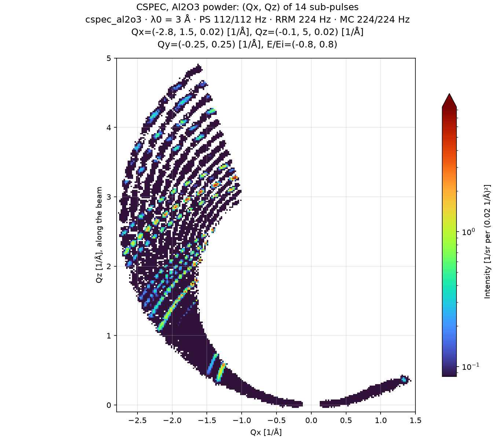
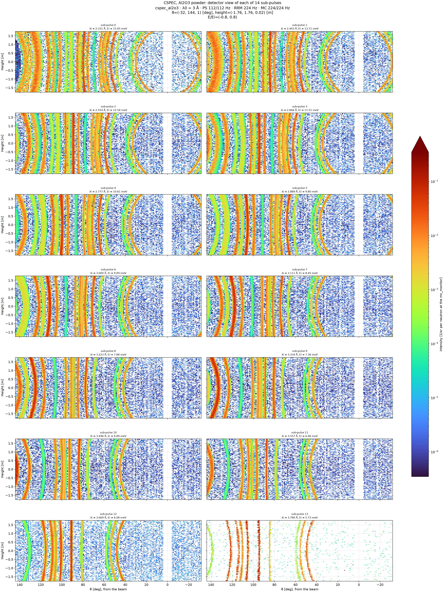
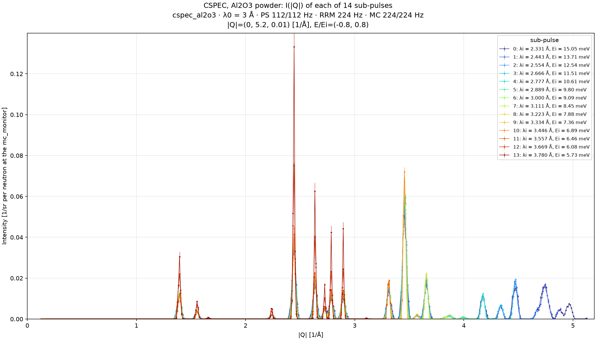

# Diffraction (powder)

`CSPECWithAl2O3`, in
[`mcdgs.diagnostics.cspec.powder_diffraction`](https://github.com/bingli621/mcdgs/blob/main/src/mcdgs/diagnostics/cspec/powder_diffraction.py),
puts an Al2O3 powder on `sample_pos` and reduces every neutron that reaches the detector panels
to its momentum transfer Q. It follows [Diffraction (powder) of T-Rex](../trex/powder-diffraction.md),
with the same powder and the same reduction: the horizontal plane of Q, and the intensity in |Q|
of each of the 14 sub-pulses, drawn over each other.

## The setup

`CSPECWithAl2O3` is `CSPEC` with the powder of `al2o3` on `sample_pos` and the detector panels.
Its control parameters are the defaults: `lambda0` = 3 Å, `nu_mc` = 224 Hz, `n` = 1 and
`t0_offset` = 1.7 ms. It has the [masked source](masked-source.md), and `mc_monitor` has time
bins of 5 µs, as on [Incident energy](incident-energy.md#the-setup), to time each sub-pulse.

| | |
| - | - |
| Powder | Al2O3, McStas `PowderN` with the McStas reflection list `Al2O3_sapphire.laz`, a solid cylinder 20 mm across and 10 mm high |
| Scattering | the Bragg cones of the list, ideal lines, and incoherent scattering, single scattering only |
| `d_phi` | 55.13°: each Bragg cone is spread only over the height of the panels, seen from the sample |
| `SPLIT` | 10 |
| Detector | the twelve flat panels, 3.5 m from the sample, from −31.5° to 143.8° from the beam and 1.75 m above and below it |

<!-- fmt:off -->
```python
--8<-- "src/mcdgs/diagnostics/cspec/powder_diffraction.py:instrument"
```
<!-- fmt:on -->

Unlike on T-Rex, no slit is closed to the size of the powder: the beam before the sample is that
of the [crystal](diffraction.md), and `mc_monitor` counts the whole beam.

## One run, from the beam of the crystal

The beam before the sample does not depend on the sample, so `simulate` runs only the part from
`sample_pos` to the panels, from the beam file of [Diffraction (single-crystal)](diffraction.md):
its 8,412,531 neutrons, in 13 seconds on 18 cores. The sub-pulses are those of the run of the
crystal to the sample.

## The reduction

The reduction is that of [T-Rex](../trex/powder-diffraction.md#the-reduction): each neutron is
divided by the solid angle of its pixel and by the intensity of its sub-pulse at `mc_monitor`,
and `powder_patterns` puts it at the elastic |Q| of its pixel, $2 k_i \sin\theta$, in bins of
0.01 Å⁻¹, over the solid angle of the pixels that see each bin.

## The plane



`plot_plane` draws the intensity in (Qx, Qz), summed over |Qy| < 0.25 Å⁻¹, on a log scale two
decades deep, as for the [crystal](diffraction.md#the-plane). Each sub-pulse draws its arc, of
radius $k_i$ through the origin, and its Bragg neutrons lie where the arc crosses a ring of the
powder, of radius $2\pi / d$ about the origin. The spots are smaller than on T-Rex: the lines
are sharper. The gap at Qx = 0 is the space between the two panels closest to the direct beam.

## The detector view



`detector_views` puts every neutron at the horizontal angle θ and the height of the center of
its pixel, as the detector shows it, unrolled about the vertical through the sample: θ is 0 along
the beam and positive toward +x. In each bin of 1° by 0.02 m, as in `powder_patterns`, the
fraction of the incident neutrons of the sub-pulse scattered into it is divided by the solid
angle of the pixels whose center falls in it,

$$I(\theta, y) = \frac{\sum_{n \in \text{bin}} w_n}{\sum_{p \in \text{bin}} \Omega_p},$$

the intensity per incident neutron and per steradian. A bin is wider than a pixel, so every bin
inside the detector holds at least one pixel, and one or two pixels in it give the same
intensity.

`plot_detector_views` draws the view of each sub-pulse on its own panel, θ from high to low, on one log color scale
6 decades deep, from the strongest line past the direct beam, |θ| > 5°, down to the incoherent
scattering. A bin without a neutron is white. Each panel is drawn to the scale of the detector:
a degree of θ is as wide as its arc at the radius of the detector, 3.5 m, is high, so near the
beam, where a cone crosses the detector in a circle of radius $R \cdot 2\theta_B$, the ring is
round. Each Bragg cone of the powder, of half-angle
$2\theta_B$ about the beam, crosses the detector as a Debye-Scherrer ring: arcs curving about the beam at small $2\theta_B$, the other way past 90°. They move out
with λi, as $\sin\theta_B = \lambda_i / 2d$. The white band from −4° to 4° is the gap between
the two panels closest to the direct beam, which passes through it.

## The intensity in |Q|



`plot_powder_patterns` draws the intensity in |Q| of every sub-pulse over each other, each bin
as a point with its error, joined to the next, on a linear scale. The first sub-pulse reaches
|Q| = 5.12 Å⁻¹, the last 3.16 Å⁻¹. Between the lines, the incoherent scattering is about
1e-6 1/sr.

One strong line, integrated over |Q| from 2.36 to 2.52 Å⁻¹:

| Sub-pulse | λi | Area | Center | Width |
| --------- | -- | ---- | ------ | ----- |
| 0 | 2.331 Å | 1.53e-3 ± 0.05e-3 | 2.443 Å⁻¹ | 0.045 Å⁻¹ |
| 3 | 2.666 Å | 1.43e-3 ± 0.03e-3 | 2.443 Å⁻¹ | 0.037 Å⁻¹ |
| 6 | 3.000 Å | 1.30e-3 ± 0.02e-3 | 2.443 Å⁻¹ | 0.033 Å⁻¹ |
| 9 | 3.334 Å | 1.09e-3 ± 0.02e-3 | 2.444 Å⁻¹ | 0.028 Å⁻¹ |
| 12 | 3.669 Å | 1.73e-3 ± 0.02e-3 | 2.443 Å⁻¹ | 0.023 Å⁻¹ |
| 13 | 3.780 Å | 2.18e-3 ± 0.12e-3 | 2.443 Å⁻¹ | 0.016 Å⁻¹ |

The area is in 1/sr Å⁻¹ per neutron at `mc_monitor`, and the width is the area over the height
of the line.

- **The center** is the same to 0.1 %.
- **The width** shrinks as λi grows, by almost three times, as on
  [T-Rex](../trex/powder-diffraction.md#the-intensity-in-q): the line of sub-pulse 13 is the
  narrowest, so the tallest.
- **The area** falls by about 30 % from sub-pulse 0 to 9, as on T-Rex, and is not explained yet.
  The last two sub-pulses, 12 and 13, are above the rest. They are the tail of the pulse:
  sub-pulse 13 has only 6,764 neutrons on the panels, and its intensity at `mc_monitor` is the
  least certain.

The lines are those of the McStas list `Al2O3_sapphire.laz`, whose d-spacings are not those of
the corundum cell in its header, as on [T-Rex](../trex/powder-diffraction.md#the-reflection-list).

## The sub-pulses

`analyze` prints each sub-pulse: its Ei, its flux at `mc_monitor` and the fraction of its
neutrons that reach the panels within its window:

| Sub-pulse | λi | Ei | Flux | On the panels |
| --------- | -- | -- | ---- | ------------- |
| 0 | 2.331 Å | 15.05 meV | 2.7e6 n/s | 0.64 % |
| 3 | 2.666 Å | 11.51 meV | 7.2e6 n/s | 0.51 % |
| 6 | 3.000 Å | 9.09 meV | 7.1e6 n/s | 0.51 % |
| 9 | 3.334 Å | 7.36 meV | 6.4e6 n/s | 0.50 % |
| 12 | 3.669 Å | 6.08 meV | 4.0e6 n/s | 0.38 % |
| 13 | 3.780 Å | 5.73 meV | 1.9e5 n/s | 0.49 % |

The direct beam passes between the two panels closest to it, so the fraction is the neutrons
the powder scatters.

## Making the figures

The figures need McStas, so they are not made with the site. The run starts from the beam file
of [Diffraction (single-crystal)](diffraction.md#making-the-figures), which must be there. To run
McStas and make them, run:

```bash
pixi run python -c "from mcdgs.diagnostics.cspec.powder_diffraction import main; main()"
```

At its defaults, `main` runs from the beam of the crystal with seed 2, as for the figures here.
It prints the sub-pulses and saves the figures to
`mcdgs_workspace/results/cspec_powder_diffraction/`, or to the folder given as `out`. Running
the module, as `pixi run docs-diagnostics` does, only reduces the run again, without McStas:

```bash
pixi run python -m mcdgs.diagnostics.cspec.powder_diffraction
```
