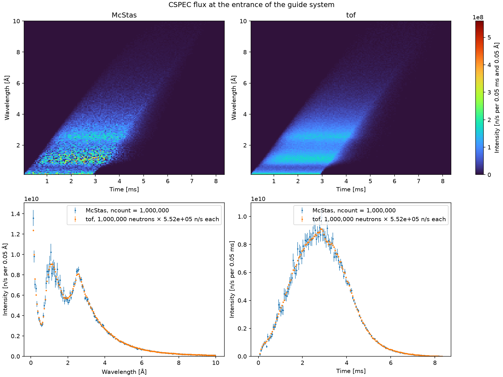
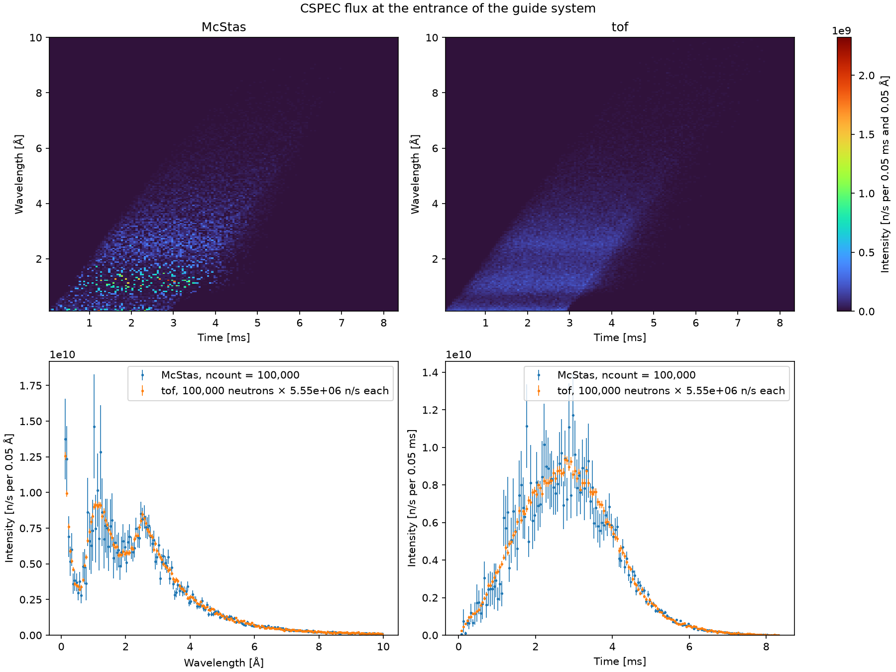
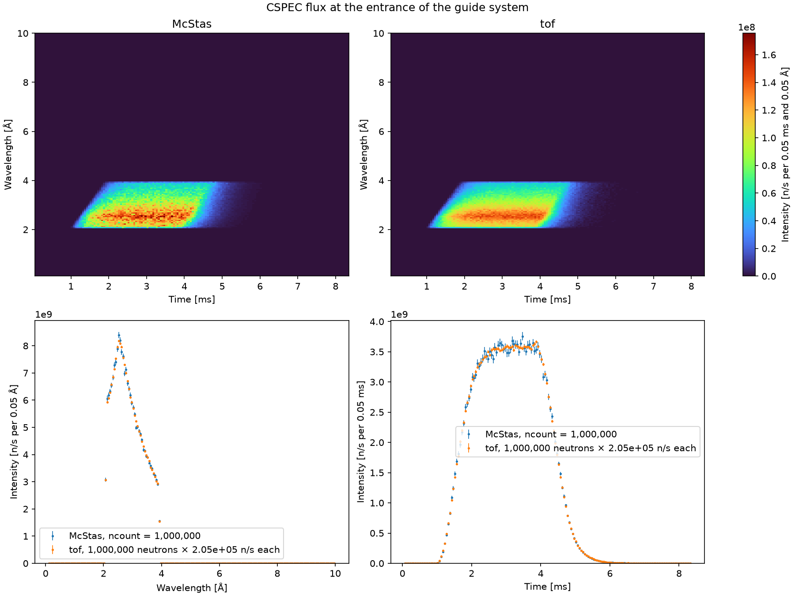

# Source

`CSPECSource`, in
[`mcdgs.diagnostics.cspec.source`](https://github.com/bingli621/mcdgs/blob/main/src/mcdgs/diagnostics/cspec/source.py),
compares McStas and [tof](../../how-to/simulate-the-choppers-with-tof.md) at the entrance of the
guide system, the opening of W03-01-011, the first optics of CSPEC. Nothing stands between the
source and that point, so the two should see the same pulse there: what differs is only how each
models the ESS moderator.

## The setup

It is the smallest CSPEC: three components and no McStas instrument parameters.

| Component | What it is |
| --------- | ---------- |
| `source` | The CSPEC source, `ESS_butterfly` on beam port W3, one pulse at 2 MW, as in `CSPEC`. By default it has the widest band, 0.1 to 10 Å; with `lambda0`, the band of `CSPEC` around it. |
| `arm_iscs` | The ISCS frame of CSPEC_nl-specs_1.E.xlsx, as in `CSPEC` (see [The ISCS frame](details.md#the-iscs-frame)). |
| `source_monitor` | A `Monitor_nD` that is the entrance of W03-01-011: its opening, 45 mm wide and 43 mm high, placed on `arm_iscs` as that guide is in `CSPEC`, 1.90424 m from the source and 16.3 mm off its axis. |

`source_monitor()` is the source monitor of `CSPEC`, from `mcdgs.instruments.cspec.monitors`
(see [Monitors](details.md#monitors)). It records one 2D map of time against wavelength, with the
same bins as the source monitor of T-Rex:

| Axis | Range | Bins | Bin width |
| ---- | ----- | ---- | --------- |
| Time | 0.048 to 8.35 ms | 166 | 0.05 ms |
| Wavelength | 0.1 to 10 Å | 198 | 0.05 Å |

The wavelength axis is the widest band of the source. The time axis runs from the fastest neutron
of that band, 0.1 Å leaving at the start of the pulse, to the slowest, 10 Å leaving at its end.
Each axis has the fewest bins of its width that cover it. The monitor has `restore_neutron=1`, so
it does not change the beam. Its window is the widest band, whatever the band of the source, so all
the figures share their axes.

`CSPECSource` has one control parameter, `lambda0`. Left at `None`, the source has the widest
band; set, it has the band of `CSPEC` around `lambda0`. It is defined like any instrument of
mcdgs: a parameters class, then an `Instrument` subclass that creates its components in beam
order, with their positions.

<!-- fmt:off -->
```python
--8<-- "src/mcdgs/diagnostics/cspec/source.py:instrument"
```
<!-- fmt:on -->

## Running both models

The same `CSPECSource` object runs in McStas and in tof. McStasScript writes the instrument file,
and McStas runs it and saves the monitor in its run folder:

<!-- fmt:off -->
```python
--8<-- "src/mcdgs/diagnostics/cspec/source.py:run_mcstas"
```
<!-- fmt:on -->

tof builds its model from the same components: the `ESS_butterfly` of beam port W3 becomes tof's
pulse `ess-cspec`, and the `Monitor_nD` a detector named `source_monitor`, 1.90431 m from the
moderator in a straight line. `read_mcstas_maps` reads the map of McStas in n/s per bin and
`read_tof_maps` counts the tof neutrons on the same bins:

<!-- fmt:off -->
```python
--8<-- "src/mcdgs/diagnostics/cspec/source.py:run_tof"
```
<!-- fmt:on -->

As for T-Rex, tof's pulse of beam port W3 was sampled 0.05 m from the moderator, so the tof
source stays at 0.05 m and the monitor at its distance from the moderator: see
[Where the tof source sits](../trex/source.md#where-the-tof-source-sits).

## Counts, intensity and error bars

McStas sets the weights of its rays itself, in n/s; each tof neutron has weight 1. tof takes its
weight from McStas: the scale, the McStas total over the tof total, is the n/s each tof neutron
stands for. Scaled, tof has the level of McStas, and the shape in time and wavelength of its own
model: the comparison is of shapes, not of absolute flux. A bin of $N$ neutrons has the Poisson
error $\sqrt{N}$. [Source of T-Rex](../trex/source.md#counts-and-intensity) explains both in full, and
what the scale depends on.

## The figure

`main` runs both models with the same seed, reads each monitor on the same bins, and uses the
functions of [`mcdgs.diagnostics.compare`](../../reference/diagnostics.md#mcdgs.diagnostics.compare)
to scale tof, print the means and draw the figure. Run as a module, it makes three figures,
`cspec_source_1e6.png`, `cspec_source_1e5.png` and `cspec_source_lambda0_3A.png`, in
`mcdgs_workspace/results/cspec_source/`, or in the folder given with `--out`. Each has two rows:

- **Top:** the time and wavelength map of McStas and of tof, side by side on one color scale, in
  n/s per 0.05 ms and 0.05 Å.
- **Bottom:** the wavelength spectrum, summed over time, and the time profile, summed over
  wavelength, of both models on the same axes, with their error bars.

### Over the widest band



This is `main` at its defaults: 1e6 McStas neutrons, 1e6 tof neutrons and seed 1. The total at
the entrance of the guide system is 5.52e11 n/s, so each tof neutron stands for 5.52e5 n/s.

| | McStas | tof |
| --- | --- | --- |
| Mean time | 2.85 ms | 2.85 ms |
| Mean wavelength | 2.41 Å | 2.42 Å |

The two models agree within their error bars almost everywhere. The spectrum has a peak at the
shortest wavelengths, below 0.3 Å, the thermal peak near 1.1 Å and the cold one near 2.6 Å. In
time, both rise over the 2.86 ms of the pulse and peak near 2.8 ms; the long wavelengths arrive
later, up to about 8 ms at 10 Å.

The model of CSPEC takes 90 % of the events from the cold moderator, `cold_frac` = 0.9, a FIXME,
not in CSPEC_nl-specs_1.E.xlsx. With every event from the cold moderator, McStas had no thermal
peak, and its mean wavelength was 3.05 Å against 2.42 Å for tof. The McStas points scatter more
below 2 Å than above: only a tenth of its rays come from the thermal moderator, each with a larger
weight.

### With a tenth of the neutrons

The same run with 1e5 neutrons in both models, seed 1:



The McStas total is 5.55e11 n/s, 0.4 % above that at 1e6, and each tof neutron stands for
5.55e6 n/s, ten times as much, as a tenth of the neutrons share the same flux. $\texttt{scale} \times \texttt{neutrons}$,
the n/s of the whole tof pulse, stays the same to within the noise of the McStas total. The means
are those at 1e6 to 0.01 ms and 0.01 Å, and the error bars are about $\sqrt{10}$ times longer.

### With the band of lambda0 = 3 Å

`CSPEC` does not simulate the widest band. Its source sends only the wavelengths that reach the
sample within one period of the source, a band of 1.853 Å around `lambda0`. At its default,
`lambda0` = 3 Å, that is 2.074 to 3.926 Å. The same run with that band, 1e6 neutrons in both
models and seed 1:



| | Widest band | Band of `lambda0` = 3 Å |
| --- | --- | --- |
| Band | 0.1 to 10 Å | 2.074 to 3.926 Å |
| McStas total Φ | 5.524e11 n/s | 2.051e11 n/s |
| Scale, n/s per tof neutron | 5.524e5 | 2.051e5 |
| Mean time, McStas and tof | 2.85 and 2.85 ms | 3.10 and 3.10 ms |
| Mean wavelength, McStas and tof | 2.41 and 2.42 Å | 2.86 and 2.86 Å |

- **The spectrum.** Inside the band it is that of the widest band: the cold peak near 2.6 Å, at
  the same n/s per bin, falling to the end of the band. Outside the band both models are 0.
- **The time profile.** Both rise from 1 ms to a plateau from about 2 to 4 ms, and end near
  6 ms.
- **Φ is 37 % of that of the widest band.** It is the flux of the band only, so `scale ×
  neutrons` is 2.05e11 n/s in place of 5.52e11 n/s. So scale the tof run of a `CSPEC` at a given
  `lambda0` at the source with that same band.

The figures need McStas, so they are not made with the site: `pixi run docs-diagnostics` makes
them again, with the other files of the CSPEC pages. To make all three yourself, run:

```bash
pixi run python -m mcdgs.diagnostics.cspec.source
```
