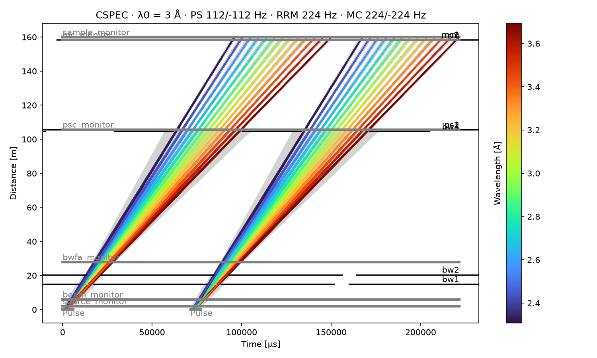

# Time-distance diagram

The time-distance diagram follows neutrons of CSPEC from the moderator, through the choppers, to
the sample. Time runs across and distance from the source up. Each neutron is a straight line
whose slope is its speed, so the slow, long wavelengths lean further to the right. It comes from
a [tof](../../how-to/simulate-the-choppers-with-tof.md) run. tof follows each neutron through the
choppers, but takes the guides, the bender and the slits as letting everything through.

## The code

tof takes each [monitor](details.md#monitors) of CSPEC as a detector, the last one
`sample_monitor` at the sample position, so the rays run on from the last chopper, `mc2`, to the
sample. The
instrument is CSPEC at its default parameters:

<!-- fmt:off -->
```python
--8<-- "src/mcdgs/diagnostics/cspec/time_distance.py:instrument"
```
<!-- fmt:on -->

`time_distance_diagram(cspec)`, from `mcdgs.tof.time_distance`, builds the tof model of the
instrument at its current parameters, runs it and draws the diagram:

<!-- fmt:off -->
```python
from mcdgs.tof import time_distance_diagram

--8<-- "src/mcdgs/diagnostics/cspec/time_distance.py:time_distance"
```
<!-- fmt:on -->

`N_PULSES`, `VISIBLE_RAYS` and `BLOCKED_RAYS` are set at the top of the module; their values are
below.

## The parameters of the simulation

The diagram below is at the default control parameters, with these settings:

--8<-- "docs/instruments/cspec/figures/time-distance/cspec_time_distance_params.txt"

The band of the source follows from `lambda0`. The frequencies and delays of the choppers follow
from the control parameters, as [Chopper timing](details.md#chopper-timing) explains.

## The diagram



- **Colored lines** are neutrons that reach `sample_monitor`, colored by wavelength.
- **Gray lines** are neutrons that a chopper stops. Each one ends at the chopper that stops it.
- **Black lines** are the choppers. Each gap in a line is a time when that chopper is open.
- **Thick gray lines** are the pulse at the moderator and the monitors: `source_monitor` and
  `beam_monitor` near the bottom, `bwfa_monitor` at 28 m, `psc_monitor` at 106 m, and
  `mc_monitor` and `sample_monitor` at 158.5 and 160 m, where their labels overlap.

The second pulse starts 1/14 s, about 71 ms, after the first. Each pulse goes through the
choppers in the same way:

- The bandwidth choppers `bw1` and `bw2`, at 15 and 20 m, open once per pulse, and so does `bw3`,
  at 105 m. They keep the band that reaches the sample before the next pulse does, so the two
  pulses never overlap there.
- The pulse-shaping choppers `ps1` and `ps2`, at 106 m, cut the band into narrow stripes.
- The RRM chopper `rrm` and the monochromatic choppers `mc1` and `mc2`, at 158.5 m, keep one
  short piece of each stripe. These are the sub-pulses that reach the sample, each of its own
  wavelength, one every 1/`nu_mc` = 1/224 s, about 4.5 ms, apart.

The labels of choppers close together, `bw3`, `ps1` and `ps2`, and `rrm`, `mc1` and `mc2`,
overlap. The title is `cspec.running_conditions()`: the instrument name, `lambda0`, and the
signed frequencies of the pulse-shaping (PS), RRM and monochromatic (MC) choppers. tof draws the
time in µs.

## Other settings

Change the control parameters with `update_params` and draw again. `bw3_delay`, in s, delays
`bw3` alone. The other settings are keyword arguments; `figsize` and `cmap` set the size of the
figure and the colormap:

```python
cspec.update_params(nu_mc=112.0, n=2, bw3_delay=0.002)
time_distance_diagram(cspec, 100_000, seed=1, n_pulses=1, blocked_rays=0)  # no gray lines
```

[`mcdgs.diagnostics.cspec.time_distance`](../../reference/diagnostics.md) makes the diagram and
the tables of its parameters, and `pixi run docs-diagnostics` runs it.
