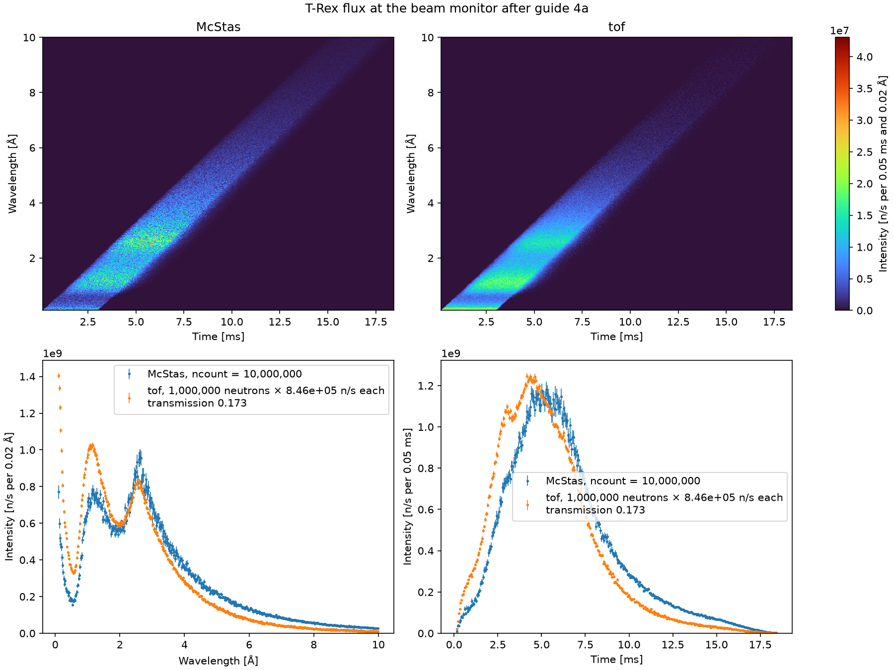

# Beam monitor

`TRexBeamMonitor`, in
[`mcdgs.diagnostics.trex_04_beam_monitor`](https://github.com/bingli621/mcdgs/blob/main/src/mcdgs/diagnostics/trex_04_beam_monitor.py),
compares McStas and [tof](../../how-to/simulate-the-choppers-with-tof.md) at the beam monitor of
T-Rex, in the gap after guide 4. Between the source and that monitor are the
[extraction guides](details.md#extraction-guides) 1 to 3 and guide 4a: McStas models them, tof
does not. The page shows how tof is brought to the level of McStas there, with a scale and a
transmission, and how to read from the map which real monitor can stand at that place.

## The setup

`TRexBeamMonitor` is T-Rex up to its beam monitor, with the bender out: the beam goes through the
thermal guide 4a. The bender is left out of it.

| Component | What it is |
| --------- | ---------- |
| `source` | The T-Rex source, `ESS_butterfly` on beam port W7, one pulse at 2 MW, with the widest band, 0.1 to 10 Å. |
| `source_monitor` | The time and wavelength monitor at the entrance of guide 1, as on [Source](source.md). |
| `arm_nboa`, `guide_1` to `guide_3` | The extraction guides, as in `TRex`. |
| `arm_guide_4`, `guide_4a` | Guide 4a, the thermal guide, always on the beam. |
| `beam_monitor` | `beam_monitor()` of [`mcdgs.instruments.trex.monitors`](../../reference/trex.md), a `Monitor_nD` in the middle of the gap after guide 4, at 5.902 m, 0.06 m wide and 0.0463 m high. |

The beam monitor records one 2D map of time against wavelength:

| Axis | Range | Bins | Bin width |
| ---- | ----- | ---- | --------- |
| Time | 0.15 to 18.4 ms | 366 | 0.05 ms |
| Wavelength | 0.1 to 10 Å | 495 | 0.02 Å |

The time runs from the fastest neutron of the band, 0.1 Å leaving at the start of the pulse, to
the slowest, 10 Å leaving at its end. In `TRex` the source and the beam monitor follow the band
of `lambda0`; here they keep the widest band, so the page covers every wavelength the source
sends. Both monitors have `restore_neutron=1`, so they do not change the beam.

`TRexBeamMonitor` has no control parameters and no McStas parameters:

<!-- fmt:off -->
```python
--8<-- "src/mcdgs/diagnostics/trex_04_beam_monitor.py:trex_beam_monitor"
```
<!-- fmt:on -->

## Running both models

As on [Source](source.md#running-both-models), the same object runs in McStas and in tof, and
each monitor of both models is read on the bins of the McStas map:

<!-- fmt:off -->
```python
--8<-- "src/mcdgs/diagnostics/trex_04_beam_monitor.py:run_mcstas"
```
<!-- fmt:on -->

<!-- fmt:off -->
```python
--8<-- "src/mcdgs/diagnostics/trex_04_beam_monitor.py:run_tof"
```
<!-- fmt:on -->

tof has no guides and no apertures: every neutron of its pulse reaches the beam monitor, at the
time of its straight flight from the source.

## Scale and transmission

tof has no flux: each of its neutrons has weight 1. It is brought to n/s in two steps.

### The scale, at the source monitor

The scale is the n/s that each tof neutron stands for. It is always set at the source monitor,
where nothing stands between the source and the monitor, so both models see the same beam:

```text
scale = McStas total at the source monitor (n/s) / tof neutrons at the source monitor
```

At the defaults of `main` that is 8.457e11 n/s over about a million tof neutrons, so
8.456e5 n/s per tof neutron. See [What the scale depends on](source.md#what-the-scale-depends-on)
for how it changes with the number of neutrons, the band and the opening of the monitor.

The beam monitor keeps that scale. Scaled again to the McStas total at the beam monitor, tof would
agree with McStas by construction, and what the guides take out of the beam would not show.

### The transmission, at the beam monitor

With the scale alone, tof at the beam monitor would have the whole beam of the source, as no
neutron is lost on its way. The transmission T is the factor on top of the scale that stands for
what the guides take out:

```text
tof intensity at the beam monitor = tof counts × scale × T
```

It is tuned so that tof matches McStas. By default, the argument `transmission=None` of `main`,
both have the same total at the beam monitor:

```text
T = McStas total at the beam monitor / (tof neutrons at the beam monitor × scale)
```

`read_scaled_comparisons` does both steps: it reads each monitor with `read_comparison`, sets the
scale at the first, the source monitor, and tunes T at the second, unless it is given:

<!-- fmt:off -->
```python
--8<-- "src/mcdgs/diagnostics/trex_04_beam_monitor.py:transmission"
```
<!-- fmt:on -->

Every tof neutron counted at the source monitor is also counted at the beam monitor, so the tof
counts cancel, and T is the share of the McStas beam at the source monitor that reaches the beam
monitor:

```text
T = McStas total at the beam monitor / McStas total at the source monitor
  = 1.466e11 n/s / 8.457e11 n/s = 0.1734
```

T is thus one number for the whole beam, the transmission of guides 1 to 4a in McStas. It moves
the level of tof but not its shape, so with the same total in both, a difference in shape is
what the guides do at each wavelength and time. A value given by hand, such as
`main(transmission=0.2)`, keeps the scale of the source and shows a difference in level as well.

## The figure

`main` runs both models with the same seed, prints the mean time and wavelength of each, the
McStas totals, the scale and the transmission, and saves `trex_beam_monitor.png` next to the
`mccode.h5` of the McStas run, or to the folder given with `--out`. The figure has the layout of
[Source](source.md#the-figure): the maps of both models on one color scale, then the wavelength
spectrum and the time profile of both, with their error bars. The legend gives the scale and the
transmission of tof.



This is `main` at its defaults: 1e7 McStas neutrons, 1e6 tof neutrons and seed 1.

| | McStas | tof |
| --- | --- | --- |
| Total | 1.466e11 n/s | 1.466e11 n/s, by the transmission |
| Mean time | 6.22 ms | 5.27 ms |
| Mean wavelength | 3.02 Å | 2.40 Å |

The guides pass the long wavelengths better than the short ones, so McStas has its beam shifted
to longer wavelengths, and with them to later times:

- **Below about 2 Å McStas is below tof.** At the thermal peak, 1.1 Å, it has about 75 % of tof,
  and below 0.3 Å a little over half of tof's peak.
- **From 2 Å to the cold peak they are close.** Near 2 Å they agree; at the cold peak, 2.6 Å,
  McStas is about 15 % higher.
- **Above 3 Å McStas is above tof**, more so the longer the wavelength: the guides pass a long
  wavelength at a larger angle, so more of it reaches the monitor.
- **In time, McStas peaks later**, near 5 ms against 4.5 ms, and has a longer tail, as its beam
  holds more of the slow neutrons.

## Estimating the count rate of a monitor

The intensity on this monitor is also what a real beam monitor at that place would see, so the
same map tells you which monitor can stand there. What decides it is the rate the monitor counts,
above all at the peak of each pulse, not the average flux.

### Per bin, per second, per pulse

A value of the map is in n/s per bin: the neutrons per second that pass the opening of the
monitor, with a time of arrival in that 0.05 ms and a wavelength in that 0.02 Å. The time is the
time within each pulse; the second is the average over the 14 Hz pulses. Summed over all bins, it
is the total through the opening:

| Quantity | How | At the beam monitor |
| -------- | --- | ------------------- |
| Total rate | sum of all bins | 1.47e11 n/s |
| Per pulse | total / 14 Hz | 1.05e10 n per pulse |
| Per area | total / (6 cm × 4.63 cm) | 5.28e9 n/s/cm² |

Halving the widths of the bins halves each value of the map, but leaves these sums unchanged;
only a change of the window changes them. Divide a bin by its widths, 0.05 ms and 0.02 Å, for a
density in n/s/ms/Å that does not depend on the bins.

### The peak rate

Each pulse reaches the monitor within a few ms of the 71.4 ms between pulses, so while it passes
the rate is far above the average. From the time profile, the sum of the map over wavelength, the
instantaneous rate in a time bin is

```text
instantaneous rate (n/s) = time profile (n/s per bin) / 14 Hz / 0.05 ms
```

Its maximum is the peak rate. At the beam monitor it is 1.69e12 n/s at 5.27 ms, some 11 times the
average. That is what the length of the pulse at the monitor suggests: most of the 1.05e10
neutrons of a pulse arrive within about 6 ms, and 1.05e10 / 6 ms ≈ 1.7e12 n/s.

### What the monitor counts

A beam monitor must leave the beam almost unchanged, so it detects only a small fraction ε of the
neutrons, typically 1e-5 to 1e-3. For ³He, ¹⁰B and most gas monitors ε grows about as the
wavelength, so a cold beam counts more than its flux alone suggests. `count_rate` weights each
bin of the map by ε at the center of its wavelength bin, sums over wavelength for the time
profile in counts/s, and gives its average and its peak:

<!-- fmt:off -->
```python
--8<-- "src/mcdgs/diagnostics/trex_04_beam_monitor.py:count_rate"
```
<!-- fmt:on -->

Without an efficiency it gives the rates of the flux above.

### Example: ε = C λ

Take a monitor whose efficiency grows as the wavelength, ε(λ) = C λ, with C = 5e-5 per Å: ε is
1e-4 at 2 Å and 5e-4 at 10 Å. `main` prints its rates:

```python
count_rate(intensity, bins, lambda wavelength: 5e-5 * wavelength)
```

| | Flux, ε = 1 | ε = C λ |
| --- | --- | --- |
| Average rate | 1.47e11 n/s | 2.21e7 counts/s |
| Peak rate | 1.69e12 n/s at 5.27 ms | 2.33e8 counts/s at 6.12 ms |

- **The average is C times the mean wavelength.** Summed over the map, ε = C λ gives
  C × ⟨λ⟩ × total, with ⟨λ⟩ the mean wavelength of McStas, 3.02 Å: the monitor counts as if it
  had ε = 1.5e-4 for every neutron, more than its 1e-4 at 2 Å, since the beam after the guides
  is cold.
- **The peak moves later.** The long wavelengths arrive later and count more, so the peak of the
  counts is at 6.12 ms, not at the 5.27 ms of the flux.
- **Both rates scale with C.** With another C, multiply them by its ratio to 5e-5.

### Choosing

Compare the peak rate with what the monitor can count. While peak rate × τ is small, a counting
monitor with a dead time τ loses a fraction of about peak rate × τ of its counts; keep it below
0.1, or the monitor no longer counts in proportion to the beam. Near 1 and above, it saturates:
it cannot count much faster than 1/τ, whatever the beam. If peak rate × τ is too large, take a
lower ε, a smaller opening, or a faster monitor. Leave a factor of 2 to 10 for a higher source
power and for the model.

In the example, with a dead time of 100 ns, peak rate × τ is 2.33e8 counts/s × 100 ns ≈ 23, far
above 0.1: the monitor is saturated, at most 1e7 counts/s. To bring it to 0.1, the peak must drop
to 1e6 counts/s, some 230 times lower: C of about 2e-7 per Å, ε of 4e-7 at 2 Å, below the usual
range of beam monitors. A monitor of the usual ε needs a smaller opening as well, or stands
further downstream, after the choppers, where the beam is weaker and its band narrower. Put the
`Monitor_nD` there, with the opening of the real monitor, and repeat.

McStas leaves out the fast neutrons and the γ rays from the source, which a monitor in the bunker
also sees. They do not change the rate of slow neutrons, but they decide which kinds of monitor
can stand there.

## Making the figure

The figure needs McStas, so it is not made with the site: `pixi run docs-diagnostics` makes it
again, with the other files of the T-Rex pages. To make it yourself, run:

```bash
pixi run python -m mcdgs.diagnostics.trex_04_beam_monitor
```

Call `main` with other numbers for a finer or a faster figure, or with a transmission of your own:

```bash
pixi run python -c "from mcdgs.diagnostics.trex_04_beam_monitor import main; main(ncount=1e6, transmission=0.2)"
```
