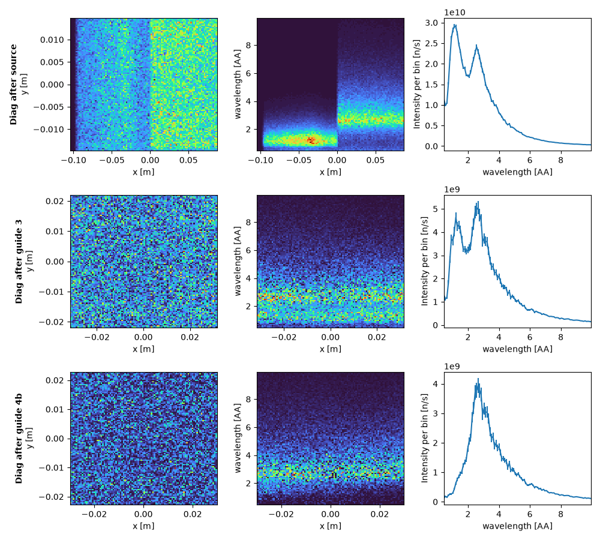
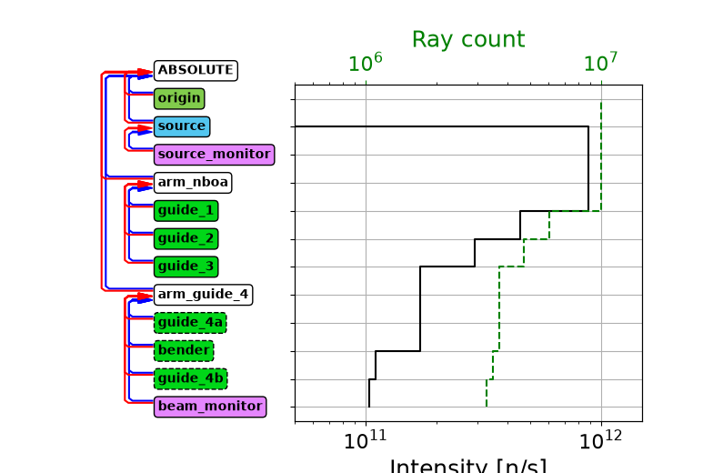
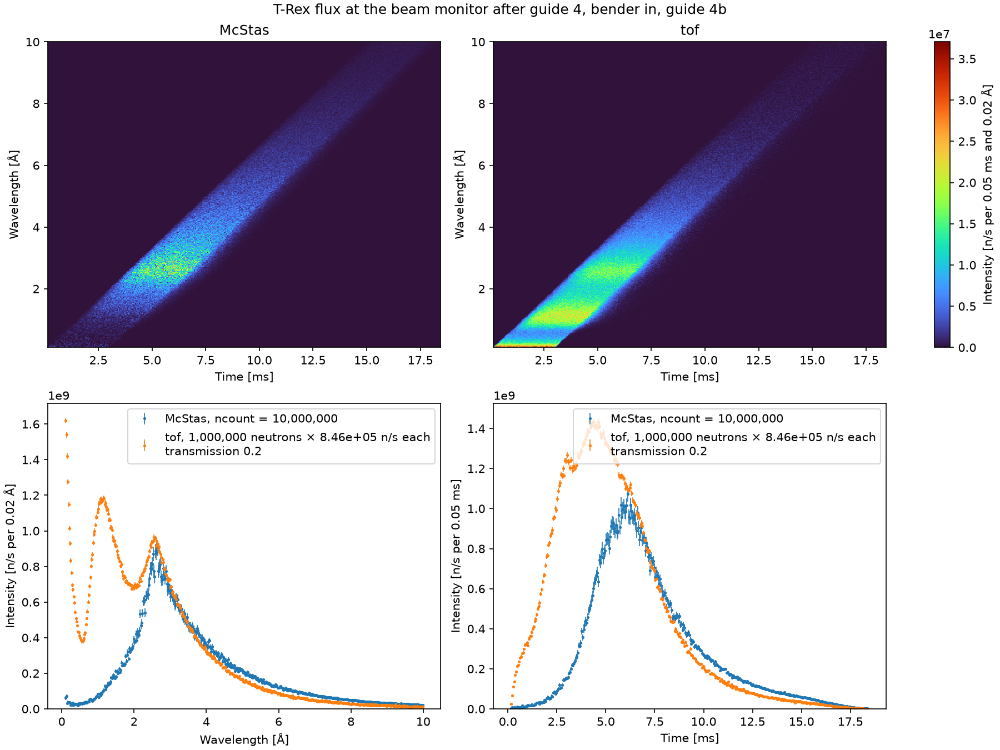
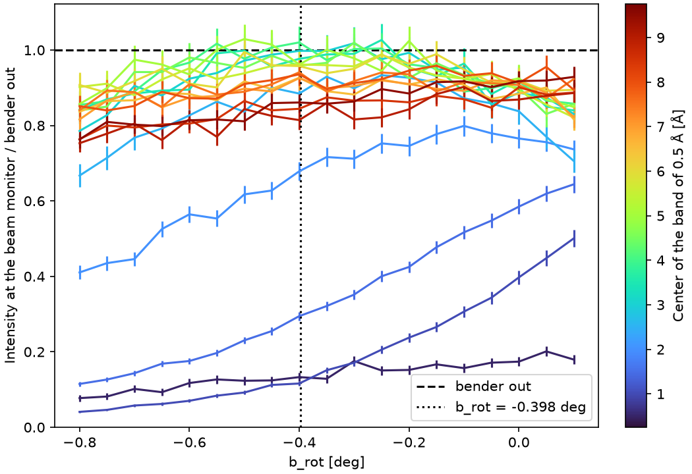

# Bender

[`mcdgs.diagnostics.trex_03_bender_scan`](https://github.com/bingli621/mcdgs/blob/main/src/mcdgs/diagnostics/trex_03_bender_scan.py)
shows what the [bender](details.md#bender) does to the beam. It runs the
[`Extraction`](extraction.md) with the bender in, through the bender and the cold guide 4b, and
reads its beam monitor, after guide 4: first at the nominal rotation of the bender, then over a
scan of its rotation, `b_rot`, to show how it passes each band of wavelengths.

## Bender in at the nominal rotation

With the bender in at its nominal rotation, the beam goes through the bender and the cold guide
4b. `main` runs this path after the scan, with `diagnose_path` of
[Extraction guides](extraction.md), which runs the path without the bender: what is said there of
the axes, the monitors and the scale of tof holds here too. These figures have 1e6 McStas
neutrons in the run with the diagnostics, 1e7 in the run of the diagram and the monitors, 1e6
tof neutrons and seed 1.

<!-- fmt:off -->
```python
--8<-- "src/mcdgs/diagnostics/trex_03_bender_scan.py:bender_in"
```
<!-- fmt:on -->

### Beam along the guides

The rows are the beam after the source, after guide 3 and at the exit of guide 4b; the columns
the beam profile, wavelength against x, and the spectrum.



The top two rows are those without the bender. At the exit of guide 4b the thermal peak is mostly
gone and the cold peak stays.

### Intensity along the guides



| Lost in | Share | Intensity after it |
| ------- | ----- | ------------------ |
| guide 1 | 48 % | 4.56e11 n/s |
| guide 2 | 36 % | 2.90e11 n/s |
| guide 3 | 41 % | 1.71e11 n/s |
| bender | 36 % | 1.11e11 n/s |
| guide 4b | 6 % | 1.04e11 n/s |

Guides 1 to 3 are as without the bender. Guide 4a is skipped, so its row is flat. The bender takes
36 % and guide 4b 6 %, against the 14 % of guide 4a, and 1.04e11 n/s reaches the beam monitor,
12 % of the beam before guide 1 and of that through the entrance of guide 1, against 17 % without
the bender.

### McStas and tof at the beam monitor

1.03e11 n/s reach the monitor, against 1.47e11 n/s without the bender. tof is scaled as without
the bender, with a `transmission` of 0.2.



At the cold peak, 2.6 Å, McStas and tof agree, as without the bender, and above about 4 Å McStas
is above tof. McStas has almost nothing below about 1.5 Å, and its time profile peaks about
1.5 ms later than tof's, since the beam is made of longer, slower wavelengths.

## The scan

`run_bender_scan` runs McStas at 19 values of `b_rot`, from −0.8 to 0.1 deg in steps of 0.05 deg,
with the bender in, and once with it out, through the thermal guide 4a. The scan is one
`Simulation.scan` of the `Extraction`, with `bender_in` and `b_rot` as McStas instrument
parameters, so McStas compiles it once:

<!-- fmt:off -->
```python
--8<-- "src/mcdgs/diagnostics/trex_03_bender_scan.py:run_scan"
```
<!-- fmt:on -->

`read_spectra` sums the map of the beam monitor over time, and then over bands of 0.5 Å centered
on 0.5, 1.0, … 9.5 Å: 19 bands over the 0.1 to 10 Å of the monitor. Each wavelength bin, 0.02 Å
wide, goes to the band whose center is nearest to its own, 25 bins to a band. A bin is centered on
each edge of two bands, and goes to the band above, so each band is that of its center moved up by
half a bin, 0.01 Å:

<!-- fmt:off -->
```python
--8<-- "src/mcdgs/diagnostics/trex_03_bender_scan.py:bands"
```
<!-- fmt:on -->

The bins are independent, so their errors add in quadrature:

<!-- fmt:off -->
```python
--8<-- "src/mcdgs/diagnostics/trex_03_bender_scan.py:sum_bands"
```
<!-- fmt:on -->

`transmission` divides each band of the scan by the same band with the bender out, and the
relative errors of the two add in quadrature:

<!-- fmt:off -->
```python
--8<-- "src/mcdgs/diagnostics/trex_03_bender_scan.py:transmission"
```
<!-- fmt:on -->



Each curve is one band, named in the legend by its center and half width. The first ten bands
are solid lines and the next ones dash-dotted, in the same colors again. The dashed line at 1 is
the bender-out intensity, and the dotted line the nominal rotation, −0.398 deg.

### Transmission at the nominal rotation

At −0.4 deg, the point of the scan nearest the nominal rotation:

| Band center | Transmission |
| ----------- | ------------ |
| 8.5 to 9.5 Å | 0.81 to 0.86 |
| 3.0 to 8.0 Å | 0.93 to 1.02 |
| 2.5 Å | 0.88 |
| 2.0 Å | 0.68 |
| 1.5 Å | 0.29 |
| 0.5 and 1.0 Å | 0.13 and 0.12 |

The errors are 0.007 to 0.04, the larger at the longer wavelengths, where fewer neutrons are.
Above 1 means the bender passes a band slightly better than guide 4a; the bands from 3 to 8 Å
pass within a few percent of guide 4a, within about two errors. They are flat from about −0.6 to −0.2 deg, so the nominal rotation
sits in the middle of that range. Above 8 Å the transmission is lower, 0.81 to 0.86 here and
0.75 to 0.93 over the scan. The bands of 1.0 and 1.5 Å keep rising up to the end of the scan at
0.1 deg, so their maximum lies outside it. The shortest band, around 0.5 Å, reaches at most 0.2.

## Making the figures

The figures need McStas, so they are not made with the site: `pixi run docs-diagnostics` makes
them again, with the other files of the T-Rex pages. To make them yourself, run:

```bash
pixi run python -m mcdgs.diagnostics.trex_03_bender_scan
```

This is `main` at its defaults: 1e6 McStas neutrons per angle, and seed 1. The scan goes to
`mcstas_output/bender_scan/`, the run without the bender to `mcstas_output/bender_out/`, each
replacing the one of an earlier run, and the figure, `bender_scan.png`, next to the scan.
`read_angles`, `read_spectra` and `transmission` read the two files again, without running McStas.

Then `main` runs the path with the bender in at its nominal rotation, with `path_ncount`, 1e7,
McStas neutrons in the run of the diagram and the monitors: its three figures go to
`mcstas_output/trex_extraction_bender_in/`, with McStasScript's event lists of the run with the
diagnostics, about 180 MB at 1e6 neutrons, and the run of the diagram to
`mcstas_output/trex_extraction_bender_in_intensity/`.
