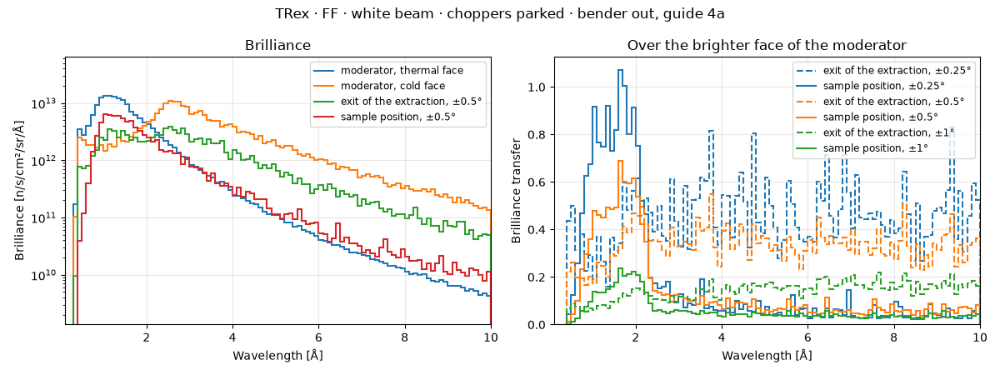
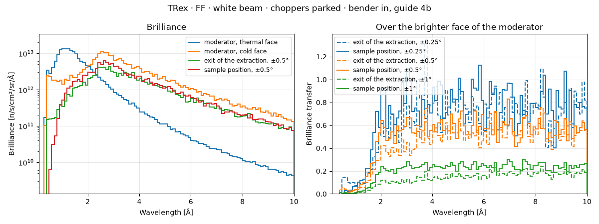
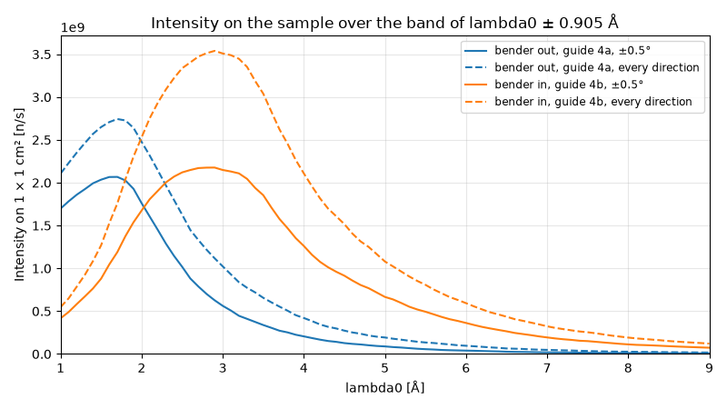

# Brilliance transfer

[`mcdgs.diagnostics.trex.brilliance_transfer`](https://github.com/bingli621/mcdgs/blob/main/src/mcdgs/diagnostics/trex/brilliance_transfer.py)
measures how much of the brilliance of the moderator the guides of T-Rex keep, at the exit of
the extraction and at the sample position, on both paths through guide 4. From the same rays
it finds the central wavelength `lambda0` that puts the most neutrons on the sample on each
path.

The [transmission of the guides](guides.md#transmission-of-the-guides) counts every neutron
that the source sends towards guide 1. The source aims at the whole entrance from every point
of the moderator, with far more divergence than a guide carries, so most of that beam is lost
however good the guides are. The brilliance transfer asks a sharper question: of what the
moderator could put into a given window of position and divergence, how much arrives?

The brilliance of a beam is its intensity per area, per solid angle and per wavelength, in
n/s/cm²/sr/Å. The area is a patch of a plane across the beam, and the solid angle that of the
directions in which the neutrons cross it. Along the beam the brilliance can only fall
(Liouville's theorem), so the brilliance in a window over that of the moderator is at most 1.
The windows are 1 × 1 cm on the beam axis, with the directions within ±0.25°, ±0.5° or ±1° of
the axis, both horizontally and vertically: a square pyramid of solid angle 4 asin(sin² δ) for
a half divergence δ, 3.05e-4 sr at ±0.5°. The module runs `TRex` as [Guides](guides.md) does,
in the white beam with every chopper parked, first with the bender out, through guide 4a, then
with it in, through the bender and guide 4b. On each path it reads the rays at two points:
before the beam monitor, at the exit of the extraction, and before `sample_pos`.

## The brilliance of the moderator

The reference is the moderator itself, from a second instrument, `ModeratorView`: the source
of T-Rex alone, aimed at a rectangle 0.14 m wide and 0.01 m high on a plane 1 m in front of it.
A ray that crosses the plane within ±0.5° of the axis comes from the moderator within ±8.7 mm
of the same x, so the brilliance on the plane at x is that of the moderator at x. Across x the
moderator has two faces, each about 0.1 m wide and each flat over its middle: the thermal face
at x < 0, the cold face at x > 0. Each face is read over its flat part, from 0.03 to 0.07 m from
the center, and the reference is the brighter face at each wavelength: the thermal one below
about 2 Å, the cold one above.

<!-- fmt:off -->
```python
--8<-- "src/mcdgs/diagnostics/trex/brilliance_transfer.py:instrument"
```
<!-- fmt:on -->

## Bender out, through guide 4a

At 1e7 neutrons of T-Rex on each path, 4e6 of the moderator and seed 1, in bins of 0.1 Å; a bin
with fewer than 20 rays in the window has no value:



In wider bands, from the same rays:

| Window | 0.5–1 Å | 1–1.5 Å | 1.5–2 Å | 2–3 Å | 3–4 Å | 4–6 Å | 6–8 Å | 8–10 Å |
| ------ | ------- | ------- | ------- | ----- | ----- | ----- | ----- | ------ |
| Exit of the extraction, ±0.25° | 0.311 | 0.269 | 0.433 | 0.461 | 0.494 | 0.483 | 0.485 | 0.454 |
| Exit of the extraction, ±0.5° | 0.195 | 0.234 | 0.360 | 0.363 | 0.365 | 0.351 | 0.347 | 0.325 |
| Exit of the extraction, ±1° | 0.065 | 0.077 | 0.116 | 0.113 | 0.127 | 0.154 | 0.170 | 0.164 |
| Sample position, ±0.25° | 0.534 | 0.818 | 0.918 | 0.235 | 0.092 | 0.064 | 0.047 | 0.046 |
| Sample position, ±0.5° | 0.264 | 0.473 | 0.589 | 0.191 | 0.100 | 0.078 | 0.058 | 0.059 |
| Sample position, ±1° | 0.069 | 0.144 | 0.207 | 0.081 | 0.051 | 0.042 | 0.036 | 0.034 |

- **Thermal neutrons reach the sample well.** From 1 to 2 Å the sample position has 0.8 to 0.9
  of the brilliance of the thermal face within ±0.25°, and about half within ±0.5°. The low
  transmission of the first guides is the divergence they cannot carry, not brilliance they
  lose.
- **Cold neutrons reach the middle of the sample with the brilliance of the thermal face.**
  Above 2 Å the brilliance at the sample position follows the spectrum of the thermal face,
  from 4 times below the cold one at 2 to 3 Å to 20 times at 8 to 10 Å, so the transfer drops
  to 0.05 to 0.2. The cold face is off the axis, at x > 0, so its neutrons enter guide 1 at an
  angle: at the exit of the extraction they leave at about −0.5°, the thermal ones at about
  +0.25°. At the sample position the cold neutrons lie on a band across position and
  divergence, from about −15 mm and −1° to +15 mm and +1°, with most of them away from its
  middle, where the window is.
- **Wide windows are mostly empty.** Within ±1° the transfer is low at both points: the beam
  does not fill that much divergence, as the vertical divergence at the sample position reaches
  only about ±0.7°.
- **At the exit of the extraction the window lies between the two beams**, the thermal at
  +0.25° and the cold at −0.5°, so the transfer there, 0.2 to 0.4 within ±0.5°, understates
  what each beam keeps.

The reference is the mean of each face over 4 cm, and the brightest part of the thermal face is
about 20 % above its mean, so a bin can come out slightly above 1, as near 1.7 Å.

## Bender in, through the bender and guide 4b

With the bender in, from the same run of the moderator:



| Window | 0.5–1 Å | 1–1.5 Å | 1.5–2 Å | 2–3 Å | 3–4 Å | 4–6 Å | 6–8 Å | 8–10 Å |
| ------ | ------- | ------- | ------- | ----- | ----- | ----- | ----- | ------ |
| Exit of the extraction, ±0.25° | 0.106 | 0.099 | 0.292 | 0.610 | 0.782 | 0.756 | 0.765 | 0.727 |
| Exit of the extraction, ±0.5° | 0.033 | 0.052 | 0.200 | 0.385 | 0.469 | 0.531 | 0.560 | 0.533 |
| Exit of the extraction, ±1° | 0.008 | 0.013 | 0.058 | 0.105 | 0.124 | 0.149 | 0.179 | 0.182 |
| Sample position, ±0.25° | 0.037 | 0.125 | 0.448 | 0.734 | 0.799 | 0.847 | 0.778 | 0.780 |
| Sample position, ±0.5° | 0.018 | 0.084 | 0.309 | 0.540 | 0.570 | 0.597 | 0.578 | 0.574 |
| Sample position, ±1° | 0.005 | 0.027 | 0.106 | 0.213 | 0.242 | 0.242 | 0.243 | 0.239 |

- **Cold neutrons now reach the middle of the sample with the brilliance of the cold face.**
  Above 2 Å the brilliance at the sample position follows the spectrum of the cold face, at
  0.73 to 0.85 of it within ±0.25° and about 0.55 to 0.6 within ±0.5°, against 0.05 to 0.24
  and 0.06 to 0.19 with the bender out. The bender turns the cold beam onto the axis: at the
  exit of the extraction it is centered within 0.02° of it, where without the bender it left at
  about −0.5°. At the sample position the cold neutrons fill the middle of position and
  divergence, where the window is.
- **The thermal neutrons are gone.** Below 1.5 Å the transfer is 0.13 or less at the sample
  position: the bender does not pass them, as [Bender](bender-scan.md) shows band by band. From
  1.5 to 2 Å, where the thermal face is still the brighter, the transfer is about half that
  above 2 Å.
- **Most of the cold brilliance the sample position gets, it already has at the exit of the
  extraction.** Within ±0.5° the exit keeps 0.39 to 0.56 of the cold face, and the sample
  position 0.54 to 0.6. The two windows do not hold the same rays: the guides after the
  extraction, which narrow the beam onto the sample, bring into the window at the sample
  position rays that were outside the window at the exit, so its transfer can be the higher.
- **Wide windows are still mostly empty**, at about 0.24 within ±1°, for the same reason as
  without the bender.

Within ±0.25° a bin of 0.1 Å holds few rays, so single bins scatter by up to 20 % and some
come out above 1; the bands of the table, of 5 to 20 bins each, average that out.

## Choosing lambda0

With its choppers turning, T-Rex passes a band of `lambda0` ± 0.905 Å to the sample (see
[Technical details](details.md)). `lambda0_flux` sums the intensity on the 1 × 1 cm area over
that band, for `lambda0` from 1 to 9 Å, on each path: within ±0.5°, and in every direction,
from the same rays at the sample position as above. It leaves out what the turning choppers
take, which depends on `rrm` and on the mode, so it compares the two paths and the central
wavelengths, not the flux of a measurement.



Intensity on 1 × 1 cm, in n/s, over the band of each `lambda0`:

| `lambda0` | Band | Bender out, ±0.5° | Bender out, every direction | Bender in, ±0.5° | Bender in, every direction |
| --------- | ---- | ----------------- | --------------------------- | ---------------- | -------------------------- |
| 1 Å | 0.10–1.90 Å | 1.70e9 | 2.11e9 | 4.16e8 | 5.47e8 |
| 1.5 Å | 0.60–2.40 Å | 2.04e9 | 2.65e9 | 8.79e8 | 1.27e9 |
| 2 Å | 1.10–2.90 Å | 1.76e9 | 2.48e9 | 1.68e9 | 2.53e9 |
| 2.5 Å | 1.60–3.40 Å | 1.02e9 | 1.63e9 | 2.12e9 | 3.34e9 |
| 3 Å | 2.10–3.90 Å | 5.62e8 | 1.02e9 | 2.15e9 | 3.51e9 |
| 3.5 Å | 2.60–4.40 Å | 3.38e8 | 6.56e8 | 1.85e9 | 3.04e9 |
| 4 Å | 3.10–4.90 Å | 2.06e8 | 4.21e8 | 1.26e9 | 2.11e9 |
| 5 Å | 4.10–5.90 Å | 8.88e7 | 1.93e8 | 6.67e8 | 1.08e9 |
| 6 Å | 5.10–6.90 Å | 3.98e7 | 9.63e7 | 3.63e8 | 5.94e8 |
| 7 Å | 6.10–7.90 Å | 1.93e7 | 4.85e7 | 1.94e8 | 3.24e8 |
| 8 Å | 7.10–8.90 Å | 1.19e7 | 2.69e7 | 1.12e8 | 1.92e8 |
| 9 Å | 8.10–9.90 Å | 7.42e6 | 1.73e7 | 7.35e7 | 1.22e8 |

- **Bender out: `lambda0` about 1.6 to 1.7 Å**, at about 2.1e9 n/s within ±0.5° and 2.7e9 in
  every direction. Its band, about 0.7 to 2.6 Å, holds the peak of the thermal face, at about
  1.1 Å, and the wavelengths guide 4a passes best, 1 to 2 Å.
- **Bender in: `lambda0` about 2.7 to 2.9 Å**, at about 2.2e9 n/s within ±0.5° and 3.5e9 in
  every direction, flat within a few percent from 2.6 to 3.1 Å within ±0.5°. Its band holds the
  peak of the cold face, at about 2.6 Å, which the bender passes as well as all longer
  wavelengths.
- **The two paths are even at `lambda0` 2 Å**, the default, in every direction, and within 5 %
  of each other within ±0.5°. Below it the bender out gives more, above it the bender in: twice
  as much at 2.5 Å, and from 4 Å up 6 to 10 times as much within ±0.5°, 5 to 7 times in every
  direction.

The choice of `lambda0` in a measurement is also one of incident energy, of the range of Q and of
resolution, which grows finer with the wavelength; these curves give what each choice costs in
neutrons on the sample.

## Making the figures

The figures need McStas, so they are not made with the site: `pixi run docs-diagnostics` makes
them again, with the other files of the T-Rex pages. To make them yourself, run:

```bash
pixi run python -m mcdgs.diagnostics.trex.brilliance_transfer
```

It saves the three figures, bender out, bender in and the sweep of `lambda0`, to
`mcdgs_workspace/results/trex_brilliance_transfer/`, or to the folder given with `--out`, and
prints the tables of this page. Its runs go to the run folders `trex_moderator_brilliance`,
`trex_brilliance_transfer` and `trex_brilliance_transfer_bender_in`, about 1 GB of rays.
