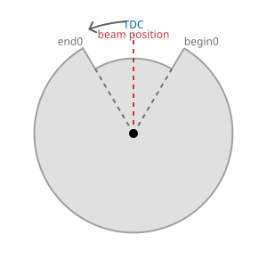
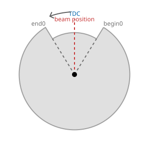
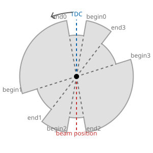
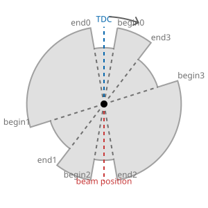
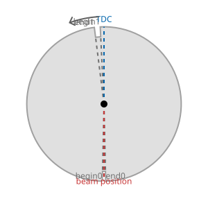
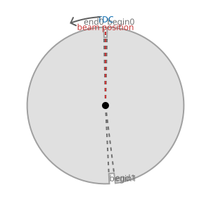
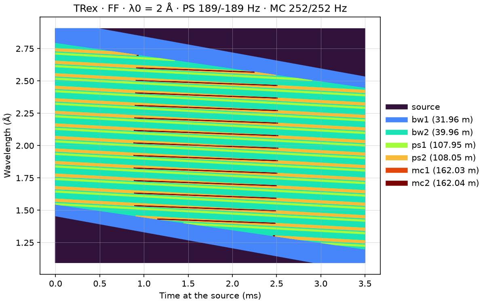

# Choppers

T-Rex has six disk choppers, in three pairs: the bandwidth choppers `bw1` and `bw2`, the
pulse-shaping choppers `ps1` and `ps2`, and the monochromatic choppers `mc1` and `mc2`. This page
gives how their frequencies and delays follow from the
[control parameters](details.md#control-parameters), shows each disk as scippneutron draws it,
and what the cascade lets through, in a chopper acceptance diagram. Pictures and diagram are at
the default parameters: `lambda0` = 2 Å, `rrm` = 18, `mode` = `"FF"` and `t0_offset` = 1.7 ms.

## Frequencies

The frequencies depend only on the source frequency, 14 Hz, and the repetition rate
multiplication factor `rrm`; `lambda0` sets the delays, below.

| Choppers | Frequency | At `rrm` = 18 |
| -------- | --------- | ------------- |
| Bandwidth, `bw1` and `bw2` | 14 Hz, the source frequency | 14 Hz |
| Pulse-shaping, `ps1` and `ps2` | 0.75 × `rrm` × 14 Hz, `ps2` with the opposite sign | 189 Hz and −189 Hz |
| Monochromatic, `mc1` and `mc2` | `rrm` × 14 Hz | 252 Hz |

- **Bandwidth choppers.** They turn once per pulse and open once, so they pass one band of
  wavelengths from each pulse: the band that reaches the sample within one source period.
- **Monochromatic choppers.** Each disk has one slit of each kind, a narrow and a wide one, so in
  either mode it opens once per turn: `rrm` times per source period. Each opening picks one
  sub-pulse out of the band, so `rrm` sets how many sub-pulses, of different wavelengths, reach
  the sample per pulse.
- **Pulse-shaping choppers.** They cut each sub-pulse short at the moderator end, and must open
  once for each sub-pulse that the monochromatic choppers pass. Two sub-pulses that leave the
  moderator together, one opening of the monochromatic choppers apart, differ in wavelength by a
  fixed step, Δλ. Their times of flight differ in proportion to the flight path, so they reach
  the pulse-shaping choppers, at 108 m, 108/162 = 2/3 as far apart in time as the monochromatic
  choppers, at 162 m. The pulse-shaping choppers must therefore open 3/2 times as often. Their
  disks have two slits of each kind, 180° apart, so they open twice per turn and turn at
  3/2 × 1/2 = 0.75 times the frequency of the monochromatic choppers.

**Counter-rotation.** Both pairs are counter-rotating: the slit edges of the two disks of a pair
cross the beam in opposite directions, so a pair opens and closes the beam faster than one disk.
The two pairs do this in different ways:

- The pulse-shaping choppers are on the same side of the beam, their axles above it
  (`beam_angle` 180°), and `ps2` turns the other way: its frequency is negative.
- The monochromatic choppers turn the same way, both at +252 Hz, but are on opposite sides of
  the beam: the axle of `mc1` is above it (`beam_angle` 180°) and that of `mc2` below it (0°).
  Turning the same way from opposite sides, their edges cross the beam in opposite directions.

## Delays

`lambda0` sets the delay of each disk, the time its zero mark is on the beam. Each disk is phased
so that the slit of the mode is centered on the beam when a neutron of wavelength `lambda0`,
leaving the moderator at `t0_offset`, reaches it:

delay = `t0_offset` + L × `lambda0` / 3956 m·Å/s − θ / (360° × ν),

with L the flight path to the disk, ν its signed frequency and θ the angle the disk turns from
its zero mark to put the slit of the mode on the beam. In `"RR"` θ is 0: a narrow slit is
centered at `beam_angle` from the zero mark, so it is on the beam at the delay. In `"FF"` it is
55° on the pulse-shaping choppers and 175° on the monochromatic choppers, the angle to their wide
slits; the bandwidth choppers have one slit, at θ = 0 in both modes.

| Chopper | Flight path L | λ0 arrives at | θ in `"FF"` | Delay |
| ------- | ------------- | ------------- | ----------- | ----- |
| `bw1` | 31.964 m | 17.860 ms | 0° | 17.860 ms |
| `bw2` | 39.955 m | 21.900 ms | 0° | 21.900 ms |
| `ps1` | 107.95 m | 56.275 ms | 55° | 55.467 ms |
| `ps2` | 108.05 m | 56.325 ms | 55° | 57.134 ms |
| `mc1` | 162.0275 m | 83.614 ms | 175° | 81.685 ms |
| `mc2` | 162.0375 m | 83.619 ms | 175° | 81.690 ms |

The frequency of `ps2` is negative, so θ / (360° × ν) is too, and its delay comes after the
arrival rather than before it. [Chopper timing](details.md#chopper-timing) gives where the flight
paths come from.

## The disks

[`get_choppers`](../../reference/tof.md) turns each `NXdisk_chopper` of an instrument into a
scippneutron `DiskChopper`, by name and in beam order, with the same slits, frequency, phase,
radius and slit height. scippneutron draws it with `make_svg`:

<!-- fmt:off -->
```python
from pathlib import Path

from mcdgs.instruments.trex.model import TRex
from mcdgs.tof.builder import get_choppers

folder = Path(".")  # where the pictures go
--8<-- "src/mcdgs/diagnostics/trex_05_choppers.py:draw_choppers"
```
<!-- fmt:on -->

In Jupyter, `get_choppers(trex)["ps1"]` shows the same drawing with a table of the disk.

| Chopper | Frequency | Beam crosses the disk | Slits |
| ------- | --------- | --------------------- | ----- |
| `bw1` | 14 Hz | at the top | one of 61.4° |
| `bw2` | 14 Hz | at the top | one of 63.3° |
| `ps1` | 189 Hz | at the bottom | 20°, 35°, 20°, 35° |
| `ps2` | −189 Hz | at the bottom | 20°, 35°, 20°, 35° |
| `mc1` | 252 Hz | at the bottom | 2.5°, 4.4° |
| `mc2` | 252 Hz | at the top | 2.5°, 4.4° |

| `bw1` | `bw2` |
| :---: | :---: |
|  |  |

| `ps1` | `ps2` |
| :---: | :---: |
|  |  |

| `mc1` | `mc2` |
| :---: | :---: |
|  |  |

Each disk is seen from the source, with its zero mark at the top (`TDC`, blue). The slits are
cut out of the gray disk, with their edges labeled `begin` and `end`; the red line is where the
beam crosses the disk, and the arrow the sense of rotation. The arrows of `ps1` and `ps2` point
opposite ways; those of `mc1` and `mc2` the same way, with the beam on opposite sides, which is
their counter-rotation. The drawing does not turn the disk by its phase: it is the disk as
built, not at any moment of the pulse.

The disks are 0.35 m in radius. The slits are 0.095 m high on the pulse-shaping choppers and
0.045 m on the monochromatic choppers; the 0.085 m of the bandwidth choppers is not known from
the sheet yet.

## Acceptance diagram

The acceptance diagram follows the pulse, a rectangle in time and wavelength, through the
choppers with scippneutron's chopper cascade. After each chopper, what is left is moved back to
the source, so the diagram shows which times and wavelengths leaving the moderator each chopper
accepts. See J.R.D. Copley, [An acceptance diagram analysis of the contaminant pulse removal
problem with direct geometry neutron chopper spectrometers](https://doi.org/10.1016/S0168-9002(03)01731-5).

<!-- fmt:off -->
```python
--8<-- "src/mcdgs/diagnostics/trex_05_choppers.py:acceptance"
```
<!-- fmt:on -->



The pulse leaves the moderator from 0 to 3.5 ms, over the band of the source, 1.095 to 2.905 Å.
Each chopper is drawn over the ones before it, in turbo from the source to the last chopper:

- The bandwidth choppers `bw1` and `bw2` cut two corners of the rectangle: the short wavelengths
  that leave early, which would arrive before they open, and the long ones that leave late,
  which would arrive after they close.
- The pulse-shaping choppers cut the band into slanted stripes, one per opening.
- The monochromatic choppers keep a short piece of each stripe, from about 1 to 2.5 ms: these
  sub-pulses, about 0.1 Å apart, are what reaches the sample. `mc2` lies over `mc1`, which
  accepts almost the same.

The title gives the mode, `lambda0`, and the signed frequencies of the pulse-shaping (PS) and
monochromatic (MC) choppers.
The band, the times and the number of pulses can be changed, all in Å and s:

```python
trex.acceptance_diagram(wavelength_min=0.1, wavelength_max=10)  # the widest band
trex.acceptance_diagram(time_min=0, time_max=0.005, n_pulses=2)  # two pulses, 5 ms long
```

Unlike [tof](../../how-to/simulate-the-choppers-with-tof.md), the diagram follows no neutrons:
it is exact and fast, but the pulse is a rectangle, not the shape of the ESS pulse.

[`mcdgs.diagnostics.trex_05_choppers`](../../reference/diagnostics.md) makes the pictures and
the diagram, and `pixi run docs-diagnostics` runs it.
