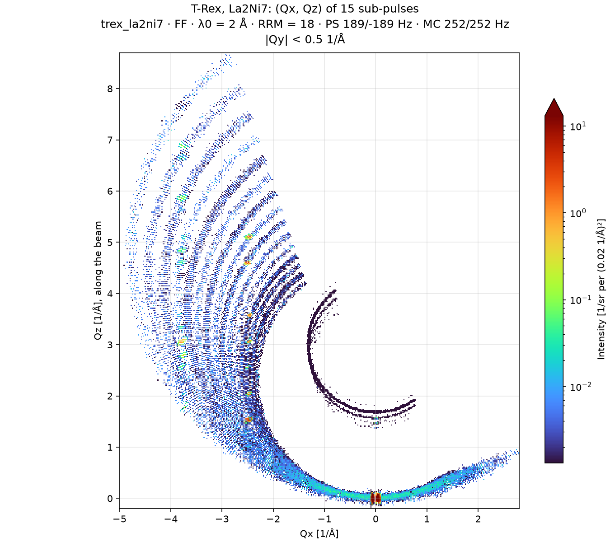

# Elastic plane

`TRexWithLa2Ni7`, in
[`mcdgs.diagnostics.trex_10_elastic_plane`](https://github.com/bingli621/mcdgs/blob/main/src/mcdgs/diagnostics/trex_10_elastic_plane.py),
puts the La2Ni7 crystal on `sample_pos` and reduces every neutron that reaches the banana
detector to its momentum transfer Q. It uses the sub-pulses and incident energies of
[Incident energy](incident-energy.md), and the [reduction package](../../reference/reduction.md)
throughout. The result is the horizontal plane of Q, where each of the 15 sub-pulses draws its
own arc.

## The setup

`TRexWithLa2Ni7` is `TRex` with the crystal of `la2ni7` on `sample_pos`, with the beamstop and
the banana detector. Its control parameters are the defaults: mode `"FF"`, `lambda0` = 2 Å and
`rrm` = 18. It has the [masked source](masked-source.md), which emits only the neutrons the
choppers let through.

| | |
| - | - |
| Crystal | La2Ni7, P6₃/mmc, a = 5.0556 Å, c = 24.598 Å, a 5 mm cube with a 30′ mosaic |
| Orientation | c* along the beam; (1.357 1 0) in the horizontal plane, to the left of the beam |
| Scattering | Bragg reflections from the CIF, and incoherent scattering, single scattering only |
| `SPLIT` | 100: few neutrons reach a 5 mm crystal, so McStas repeats each one that does |
| Detector | the banana detector, 3 m from the sample, 0.625° by 16 mm pixels, 25° below the beam to 15° above |

## Two runs, split at the sample

The guides and choppers take nearly all the time of a run, and they do not depend on the sample.
So `simulate` runs McStas in two parts, with `run_to_sample` and `run_from_sample` of
[`Simulation`](../../how-to/run-a-simulation.md):

1. **From the source to `sample_pos`**, here with 1e8 rays: under half a minute. Its folder
   holds the pre-sample and beamstop monitors, which come before `sample_pos` in beam order, and
   the beam at `sample_pos`, a beam file of 496,089 neutrons. With the masked source nearly
   every ray reaches the sample: the plain source took 1e10 rays, and about 10 minutes on
   18 cores, for as many.
2. **From that beam through the crystal to the detector**: about one second. It can run again,
   with another crystal or orientation, from the same beam.

The second part runs in the frame of `sample_pos`: the sample is the origin, z is the axis of
`arm_mc`, straight along the beam from the pre-sample monitor, y is up and x to the left of the
beam. That is the beam frame, so the positions need no change.

`reduce_runs` and `analyze` read the two runs again without McStas, so the reduction can change
without running it.

## The reduction

1. **The sub-pulses.** `subpulse_timing` finds the 15 sub-pulses at the pre-sample and beamstop
   monitors of the first part with `find_patches` and `subpulse_flight`, as on
   [Incident energy](incident-energy.md#finding-the-sub-pulses). Each gets its Ei from the
   flight between the monitors, and the time it reaches the sample with `time_at_sample`.
2. **The neutrons.** `read_events` reads the neutrons of the banana detector of the second part,
   by pixel. The second part has no source, so the incident beam is given by its direction, z.
3. **The windows.** `events_to_q_and_energy` gives each pixel and sub-pulse the arrival window
   of `arrival_window`, for an energy transfer from −0.8 Ei to 0.8 Ei, as on
   [Neutrons on sample](neutrons-on-sample.md#arrival-windows-at-the-detector). A neutron inside
   the window of a sub-pulse takes its Ei and its time at the sample, whatever its energy
   transfer within the window, and `QE_GRAPH` gives its Q = ki − kf, as (Qx, Qy, Qz).
4. **The normalization.** `normalized_events` divides each neutron by the solid angle of its
   pixel, from `pixel_solid_angle`, and by the intensity of its sub-pulse at the pre-sample
   monitor, its incoming flux. The intensity is then per incident neutron and per steradian,
   in 1/sr.

The pixels of the detector cover 4.4 × 10⁻⁵ to 5.9 × 10⁻⁵ sr each, the least at the top and the
bottom, which are furthest from the sample. Together they cover 2.09 sr, close to the
π (sin 15° + sin 25°) = 2.14 sr of the whole detector.

## The plane



`plot_plane` keeps the neutrons near the horizontal plane, |Qy| < 0.5 Å⁻¹, sums them over Qy
and draws them in (Qx, Qz). The detector also sees reflections well above and below the plane,
and a sum over all Qy would put those in the plane too. The color scale is logarithmic, in
turbo, four decades deep below the highest bin beyond the direct beam, |Q| > 0.2 Å⁻¹. The
direct beam that passes the beamstop, at Q = 0, is far above the rest and takes the color of
the top.

- **The arcs.** Each sub-pulse has its own ki, from 2.34 to 4.77 Å⁻¹. Its elastic neutrons
  lie on a circle of radius ki through the origin, centered on ki along the beam, and the
  detector covers part of it: 15 arcs, one per sub-pulse. They are the incoherent scattering of
  the crystal.
- **The Bragg peaks.** Two columns of peaks, at Qx ≈ −2.5 and −3.8 Å⁻¹, are the reflections
  (−1 −1 l) and (−2 −1 l), at Qy = −0.22 and +0.39 Å⁻¹ in this orientation. Along each, a
  reflection lights up where the Ewald sphere of one sub-pulse crosses it: with 15 wavelengths,
  many l of each row are reached.
- **The inner arcs.** The [weak patches](neutrons-on-sample.md#the-weak-patches) arrive 2.0 ms
  after their sub-pulse. Above about 2.1 Å, that is within the window of the sub-pulse before
  them, so the reduction gives them its Ei. Their elastic neutrons then look as if they had lost
  about 0.8 of their energy: kf ≈ 0.46 ki, a circle of about half the radius. They are about
  1e-4 of the intensity.

## The sub-pulses

`analyze` prints each sub-pulse: its Ei, its flux at the pre-sample monitor and the fraction of
its neutrons that reach the detector within its window. Split at |Q| = 0.2 Å⁻¹, that fraction is
the direct beam past the beamstop, and the neutrons the crystal scatters:

| Sub-pulse | λi | Ei | Flux | Direct beam | Scattered |
| --------- | -- | -- | ---- | ----------- | --------- |
| 0 | 1.317 Å | 47.16 meV | 8.1e5 n/s | 0 | 0.12 % |
| 1 | 1.418 Å | 40.70 meV | 2.0e6 n/s | 0 | 0.35 % |
| 3 | 1.613 Å | 31.46 meV | 2.2e6 n/s | 0.24 % | 0.55 % |
| 7 | 2.000 Å | 20.45 meV | 1.7e6 n/s | 8.9 % | 0.35 % |
| 10 | 2.290 Å | 15.59 meV | 1.7e6 n/s | 19.7 % | 0.34 % |
| 14 | 2.683 Å | 11.37 meV | 4.6e5 n/s | 36.3 % | 0.03 % |

The direct beam past the beamstop grows with the wavelength: the guides pass the long
wavelengths at larger angles, so their beam spreads more over the 3 m to the beamstop. The
crystal scatters 0.03 to 0.6 % of each sub-pulse into the detector.

## Making the figures

The figure needs McStas, so it is not made with the site. To run McStas and make it, run:

```bash
pixi run python -c "from mcdgs.diagnostics.trex_10_elastic_plane import main; main()"
```

At its defaults, `main` runs both parts, 1e9 rays from the masked source with seed 1, about ten
times the neutrons at the sample of the figure here, from 1e8 rays. It prints the sub-pulses and
saves the figure next to the `mccode.h5` of the second part, or to the folder given as `out`.
Running the module, as `pixi run docs-diagnostics` does, only reduces the runs again, without
McStas:

```bash
pixi run python -m mcdgs.diagnostics.trex_10_elastic_plane
```
