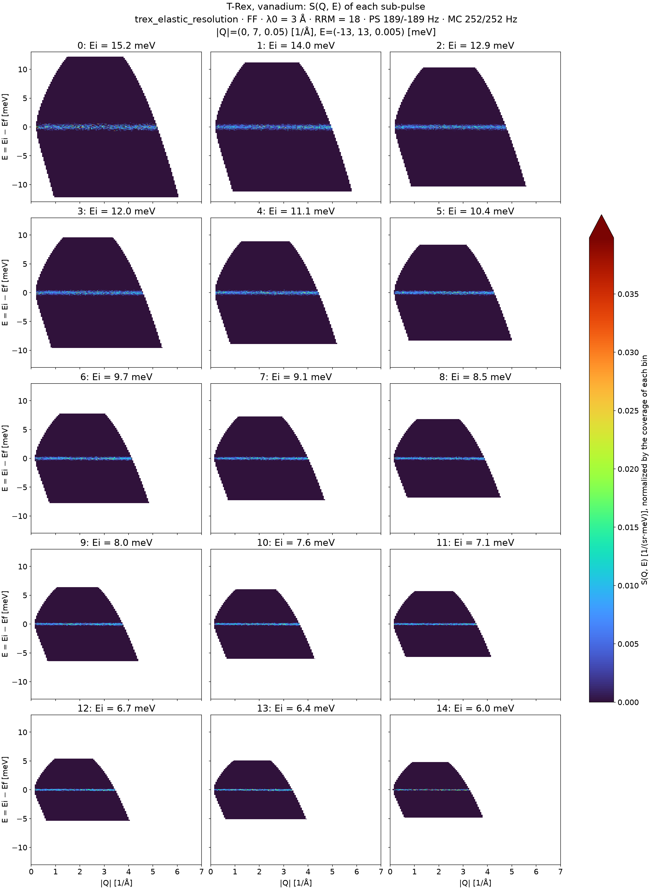
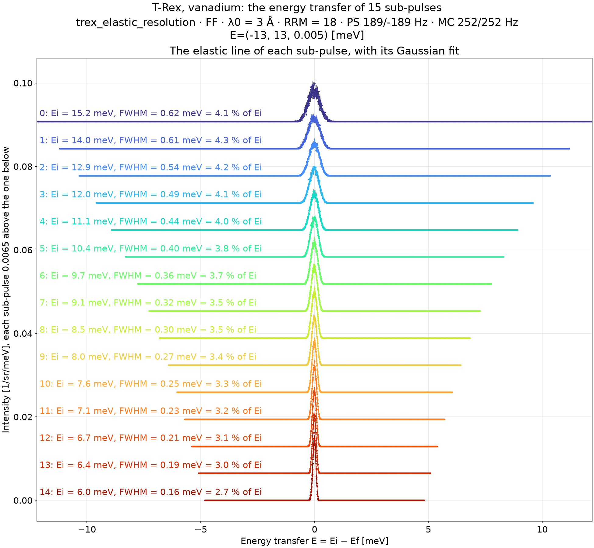
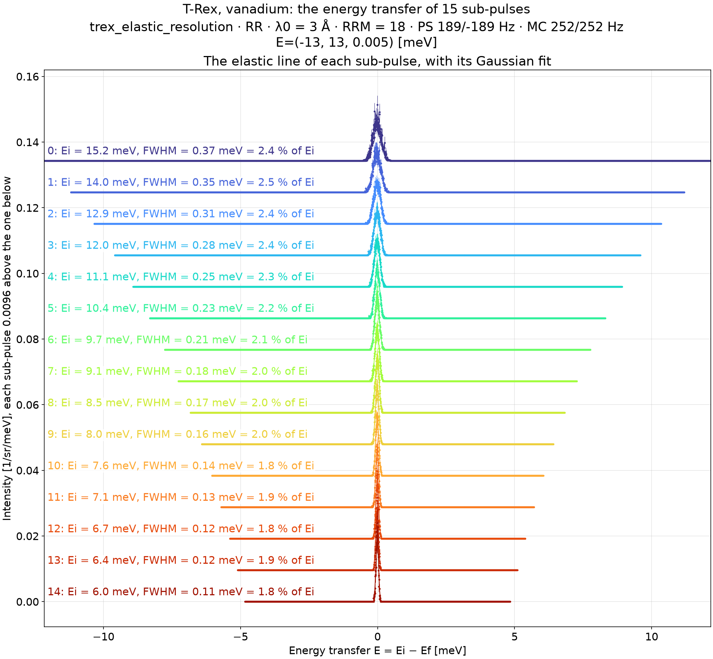
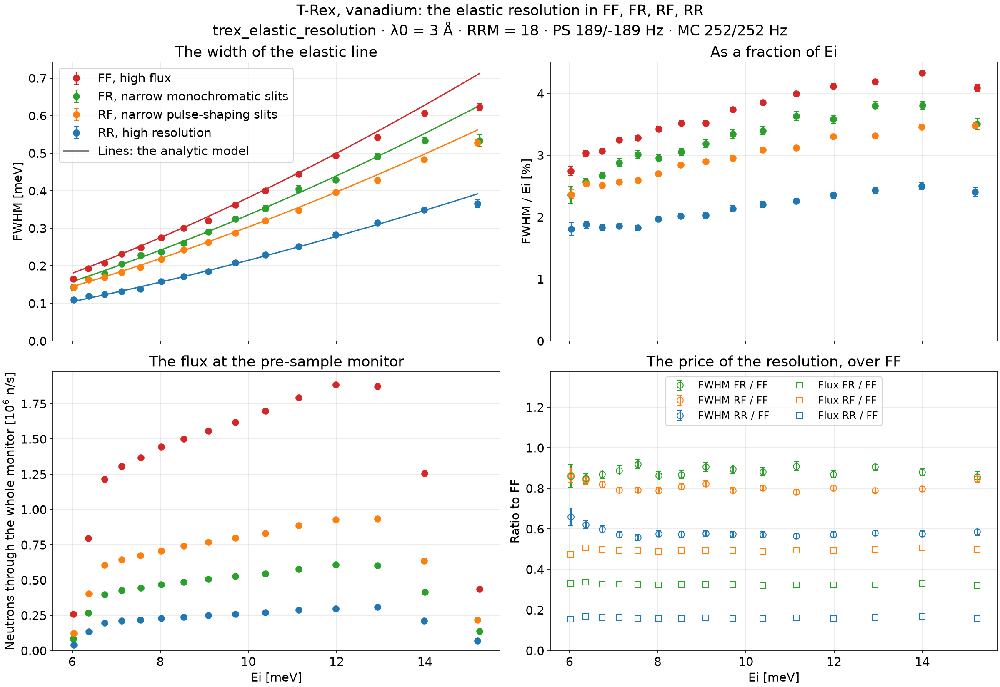

# Elastic resolution (long wavelength)

[`mcdgs.diagnostics.trex.elastic_resolution_incoherent_long`](https://github.com/bingli621/mcdgs/blob/main/src/mcdgs/diagnostics/trex/elastic_resolution_incoherent_long.py)
measures the energy resolution of T-Rex from vanadium at `lambda0` = 3 Å, with the bender in.
Everything else is as on [Elastic resolution (short wavelength)](elastic-resolution-incoherent-short.md),
at 1 Å: the same vanadium cylinder, the same four modes of the choppers, the same two runs and
the same reduction. Two control parameters change. The choppers are phased to `lambda0`, and the
masked source simulates its band. With `bender_in`, the beam goes through the
[bender](bender-scan.md) and the cold guide 4b instead of the thermal guide 4a.

The beam on the sample is a train of 15 sub-pulses, from 2.32 to 3.68 Å, with Ei from 15.2 to
6.0 meV. Their elastic lines are 0.16 to 0.62 meV wide in FF, 2.7 to 4.4 % of Ei, and 0.11 to
0.37 meV in RR, 1.8 to 2.5 % of Ei. At 1 Å they are 5.3 to 17 % of Ei in FF and 3.3 to 9.8 % in
RR, and at [2 Å](elastic-resolution-incoherent-middle.md) 3.5 to 7.4 % in FF and 2.2 to 4.3 % in
RR. One setting of the reduction differs from 1 Å to follow such narrow lines. It is listed
under [The reduction](#the-reduction).

## The setup

`TRexElasticResolution` is the instrument of the short-wavelength page, with `lambda0` = 3 Å,
`bender_in` = True and the other control parameters at their defaults: `rrm` = 18, the
pulse-shaping choppers at 189 Hz and the monochromatic choppers at 252 Hz, in each of the four
modes, FF, FR, RF and RR. The sample, its focusing window and the banana detector are those of
[the setup at 1 Å](elastic-resolution-incoherent-short.md#the-setup).

<!-- fmt:off -->
```python
--8<-- "src/mcdgs/diagnostics/trex/elastic_resolution_incoherent_long.py:instrument"
```
<!-- fmt:on -->

## Two runs, split at the sample

As at 1 Å, `simulate` runs McStas in each mode in two parts, with `run_to_sample` and
`run_from_sample` of [`Simulation`](../../how-to/run-a-simulation.md):

1. **From the source to `sample_pos`**, with 1e9 rays from the masked source, in 1.4 minutes
   on 18 cores.
2. **From that beam through the vanadium to the detector**, in about 4 seconds. 3.57 million
   neutrons reach the detector in FF, 0.89 million in RR.

The 15 sub-pulses bring 5.2 × 10⁷ n/s to the pre-sample monitor in FF and 8.6 × 10⁶ n/s in RR,
a sixth. The figures below are of FF, except in [FF and RR](#ff-and-rr) and
[All four modes](#all-four-modes).

## The reduction

The reduction is that of [1 Å](elastic-resolution-incoherent-short.md#the-reduction).
`scattered_pixels` leaves out the pixels within 5° of the beam: they hold 2.83 million of the
3.57 million neutrons in FF, the direct beam that passes the beamstop. The 38,760 pixels kept
cover 2.11 sr, from 5.0° to 143.7° of $2\theta$, and hold 737,521 neutrons. Only 274 of them fall
outside every arrival window. One setting of `elastic_resolution_incoherent_long` differs:

| | 1 Å | 3 Å | Why |
| - | - | - | - |
| Bins of E, spectra and S(Q, E) maps | 0.25 meV | 0.005 meV (`ENERGY_STEP`) | the lines are down to 0.11 meV wide |

On 0.05 meV bins, those of the other elastic-resolution diagnostics, the narrowest line of RR
has only three bins above 20 % of its highest, the bins the fit keeps, too few to fit a Gaussian
of three parameters with any degree of freedom left.

## S(Q, E)



`q_e_maps` histograms the neutrons of each sub-pulse in |Q| and E, in bins of 0.005 meV and
0.05 Å⁻¹, and divides each bin by its coverage, as at
[1 Å](elastic-resolution-incoherent-short.md#sq-e): S(Q, E) per steradian and per meV. Every map
spans the same range, E from −13 to 13 meV, the arrival window of the highest Ei, and |Q| from 0
to 7 Å⁻¹. The coverage shrinks with Ei: ±12.2 meV and |Q| up to 6.0 Å⁻¹ at 15.2 meV, ±4.8 meV
and |Q| up to 3.8 Å⁻¹ at 6.0 meV.

- **Only the elastic line.** Each map holds one band at E = 0, from the smallest |Q| to the
  largest the detector reaches at E = 0: 5.2 Å⁻¹ at 15.2 meV, 3.2 Å⁻¹ at 6.0 meV. The rest of the
  coverage is reached but empty.
- **The line is noisier at the highest Ei.** The first sub-pulse is the widest and has a third
  of the flux of the next one, so its neutrons are spread over more bins, with fewer in each.

## The spectra



As at 1 Å, the figure is linear and draws each sub-pulse over its whole arrival window, −0.8 Ei
to 0.8 Ei, with each bin a point with its error and the Gaussian fitted to it.

- **One line per sub-pulse, and nothing else.** No sub-pulse has neutrons beyond ±0.9 meV,
  although the windows span ±4.8 to ±12.2 meV.
- **The intensity falls with the wavelength**, from 4.8 × 10⁻³ per steradian at 2.32 Å to
  2.5 × 10⁻³ at 3.68 Å, as the absorption of vanadium grows with the wavelength.

## The Gaussian fits

`fit_elastic_lines` fits a Gaussian to the line of each sub-pulse against Ef, as at
[1 Å](elastic-resolution-incoherent-short.md#the-gaussian-fits), over the bins of at least 20 %
of the highest. $\chi^2$ per degree of freedom is 0.6 to 1.3 in FF, and 0.6 to 1.8 over the four
modes. `analyze` prints the table:

--8<-- "docs/instruments/trex/figures/elastic-resolution-incoherent-long/trex_elastic_resolution_incoherent_long_ff_lines.txt"

Every center lies 0.010 to 0.033 meV above its Ei in FF, 0.01 to 0.04 meV in every mode. So the
Ei of each sub-pulse and its time at the sample agree with what the detector sees.

## FF and RR



The same spectra and fits in RR. Every line is narrower than in FF, from 0.11 meV at 6.0 meV to
0.37 meV at 15.2 meV, and the fits are as good, with $\chi^2$ per degree of freedom from 0.6 to
1.3. Each sub-pulse has nearly the Ei it has in FF, within 0.4 %:

--8<-- "docs/instruments/trex/figures/elastic-resolution-incoherent-long/trex_elastic_resolution_incoherent_long_rr_lines.txt"

## All four modes



`plot_resolutions` draws the same four panels as at
[1 Å](elastic-resolution-incoherent-short.md#all-four-modes), with the width of the
[analytic resolution](elastic-resolution-model.md) of each mode as lines. `resolution_table`
gives the numbers side by side:

--8<-- "docs/instruments/trex/figures/elastic-resolution-incoherent-long/trex_elastic_resolution_incoherent_long_modes.txt"

- **RR is almost twice as fine, for a sixth of the flux.** Its lines are 0.56 to 0.66 times as
  wide as those of FF, and it keeps 0.16 to 0.17 of the flux, about the same share at every Ei.
  At 9.09 meV, the Ei of `lambda0`, RR has 0.189 meV with 6.9 × 10⁵ n/s, FF 0.323 meV with
  4.2 × 10⁶ n/s.
- **RF does more than FR, for less**, as at 1 Å. The narrow slits of the pulse-shaping choppers
  alone make the lines 0.79 to 0.88 times as wide as in FF and keep half of the flux; those of the
  monochromatic choppers alone make them 0.81 to 0.93 times as wide and keep a third. At
  9.09 meV, RF has 0.260 meV, FR 0.283 meV.
- **The analytic model follows McStas.** In every mode it gives the width of the 13 middle
  sub-pulses within 6 %, most within 3 %. It is wider at the two ends of the band, by up to 19 %
  in FR. The first and the last sub-pulse each bring about a third of the flux of their
  neighbor, so the bandwidth choppers most likely cut them, which the model leaves out; this
  has not been checked.
- **The pulse-shaping choppers set the width in FF.** At 9.09 meV, the
  [terms of the model](elastic-resolution-model.md) are 0.315 meV from the pulse-shaping
  choppers, 0.238 meV from the monochromatic choppers and 0.050 meV from the sample, 0.332 meV
  together, against 0.323 meV in McStas.

## The bender

These runs have the bender in. With it out, through the thermal guide 4a, the same runs give:

- **The same resolution.** The FWHM of every sub-pulse is the same within the errors of the
  fits, in every mode: 0.623 against 0.621 meV at 15.2 meV in FF, 0.365 against 0.374 meV in RR.
  The width comes from the choppers and the sample, not the guide.
- **Less than half of the flux.** The bender multiplies the flux at the pre-sample monitor by
  2.1 at 15.2 meV and 2.3 at 6.0 meV, and by 2.6 to 2.7 in the middle of the band: 2.0 × 10⁷ n/s
  in all of FF with the bender out, 5.2 × 10⁷ n/s with it in. The intensity of the vanadium per
  neutron at the pre-sample monitor also grows, by 2 to 30 %, so more of the beam hits the
  20 mm cylinder.

This gain is larger than the [bender scan](bender-scan.md#transmission-at-the-nominal-rotation)
suggests: at the beam monitor after guide 4, the bender passes about 0.95 of guide 4a from 3 to
8 Å, and less below. So the gain arises between that monitor and the sample, where the beam out
of guide 4b seems to be carried better than that out of guide 4a. This has not been studied yet.

## Making the figures

The figures need McStas, so they are not made with the site. To run McStas and make them, run:

```bash
pixi run python -c "from mcdgs.diagnostics.trex.elastic_resolution_incoherent_long import main; main()"
```

At its defaults, `main` runs both parts in all four modes, 1e9 rays from the masked source with
seed 1 each, as for the figures here: about a minute and a half per mode. It prints the tables and
saves the figures and the tables of each mode, and those that compare them, to
`mcdgs_workspace/results/trex_elastic_resolution_incoherent_long/`, or to the folder given as
`out`. Running the module, as `pixi run docs-diagnostics` does, only reduces the runs again,
without McStas:

```bash
pixi run python -m mcdgs.diagnostics.trex.elastic_resolution_incoherent_long
```
