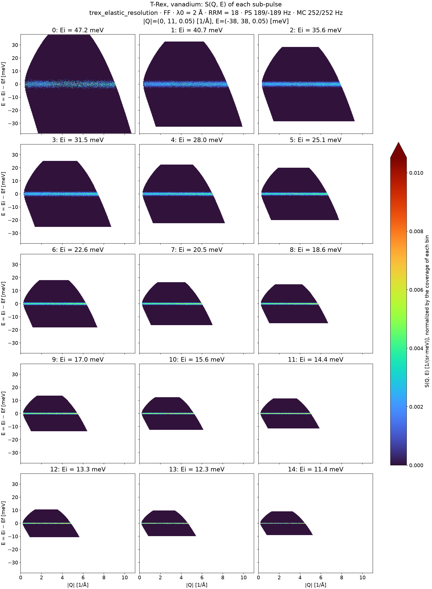
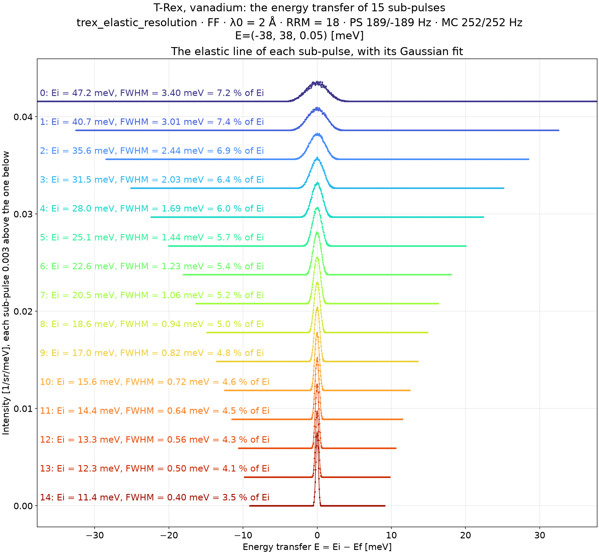
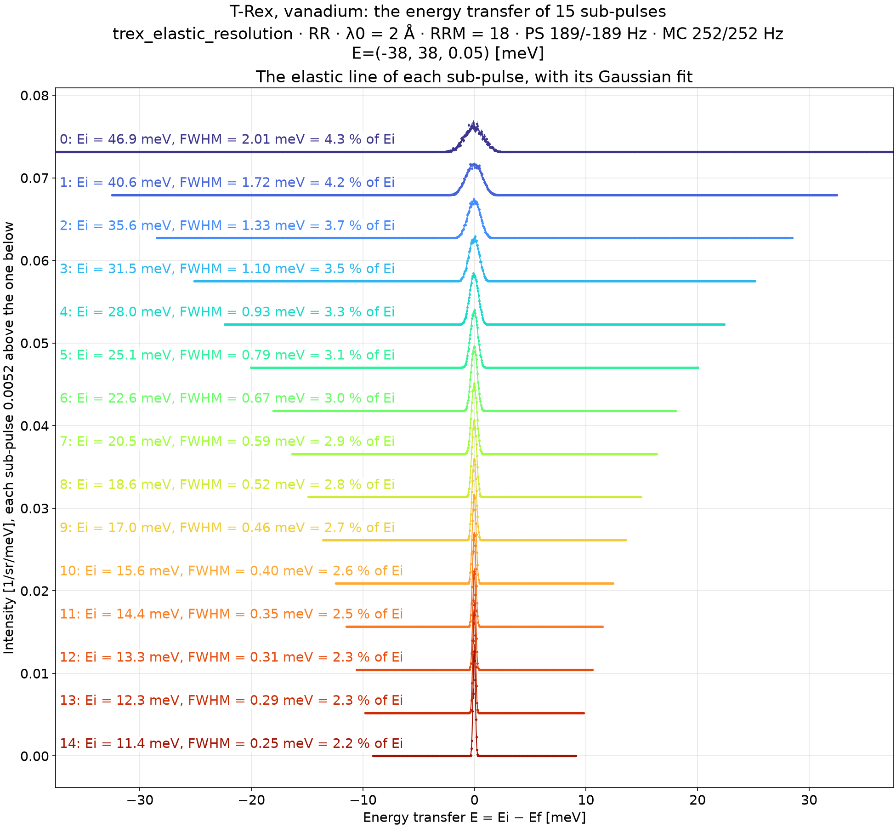
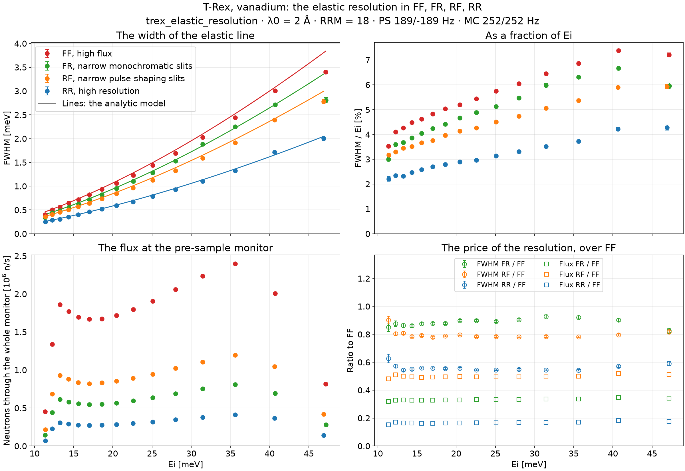

# Elastic resolution (middle wavelength)

[`mcdgs.diagnostics.trex.elastic_resolution_incoherent_middle`](https://github.com/bingli621/mcdgs/blob/main/src/mcdgs/diagnostics/trex/elastic_resolution_incoherent_middle.py)
measures the energy resolution of T-Rex from vanadium at `lambda0` = 2 Å, the default of `TRex`.
Everything else is as on [Elastic resolution (short wavelength)](elastic-resolution-incoherent-short.md),
at 1 Å: the same vanadium cylinder, the same four modes of the choppers, the same two runs and
the same reduction. Only `lambda0` changes: the choppers are phased to it, and the masked source
simulates its band. The bender stays out, as at 1 Å, so the beam goes through the thermal guide
4a. [Elastic resolution (long wavelength)](elastic-resolution-incoherent-long.md) does the same
at 3 Å, with the bender in.

The beam on the sample is a train of 15 sub-pulses, from 1.32 to 2.68 Å, with Ei from 47.2 to
11.4 meV. Their elastic lines are 0.40 to 3.40 meV wide in FF, 3.5 to 7.4 % of Ei, and 0.25 to
2.01 meV in RR, 2.2 to 4.3 % of Ei. At 1 Å they are 5.3 to 17 % of Ei in FF and 3.3 to 9.8 % in
RR; at 3 Å, 2.7 to 4.4 % in FF and 1.8 to 2.5 % in RR. One setting of the reduction differs from
1 Å to follow these lines. It is listed under [The reduction](#the-reduction).

## The setup

`TRexElasticResolution` is the instrument of the short-wavelength page, with `lambda0` = 2 Å and
the other control parameters at their defaults: `rrm` = 18, the bender out, the pulse-shaping
choppers at 189 Hz and the monochromatic choppers at 252 Hz, in each of the four modes, FF, FR,
RF and RR. The sample, its focusing window and the banana detector are those of
[the setup at 1 Å](elastic-resolution-incoherent-short.md#the-setup).

<!-- fmt:off -->
```python
--8<-- "src/mcdgs/diagnostics/trex/elastic_resolution_incoherent_middle.py:instrument"
```
<!-- fmt:on -->

## Two runs, split at the sample

As at 1 Å, `simulate` runs McStas in each mode in two parts, with `run_to_sample` and
`run_from_sample` of [`Simulation`](../../how-to/run-a-simulation.md):

1. **From the source to `sample_pos`**, with 1e9 rays from the masked source, in 1.5 minutes
   on 18 cores.
2. **From that beam through the vanadium to the detector**, in about 7 seconds. 4.09 million
   neutrons reach the detector in FF, 1.04 million in RR.

The 15 sub-pulses bring 2.5 × 10⁷ n/s to the pre-sample monitor in FF and 4.3 × 10⁶ n/s in RR,
a sixth. The figures below are of FF, except in [FF and RR](#ff-and-rr) and
[All four modes](#all-four-modes).

## The reduction

The reduction is that of [1 Å](elastic-resolution-incoherent-short.md#the-reduction).
`scattered_pixels` leaves out the pixels within 5° of the beam: they hold 2.69 million of the
4.09 million neutrons in FF, the direct beam that passes the beamstop. The 38,760 pixels kept
cover 2.11 sr, from 5.0° to 143.7° of $2\theta$, and hold 1,403,295 neutrons. Only 491 of them
fall outside every arrival window. One setting of `elastic_resolution_incoherent_middle` differs:

| | 1 Å | 2 Å | Why |
| - | - | - | - |
| Bins of E, spectra and S(Q, E) maps | 0.25 meV | 0.05 meV (`ENERGY_STEP`) | the lines are 0.25 to 3.4 meV wide |

The 0.05 meV bins are those of the other elastic-resolution diagnostics. The widest line, 3.4 meV,
is too narrow for its tails to thin out into empty bins, as those of 1 Å do on such bins, and the
narrowest, 0.25 meV in RR, still spans about eight bins above 20 % of its highest, the bins the
fit keeps.

## S(Q, E)



`q_e_maps` histograms the neutrons of each sub-pulse in |Q| and E, in bins of 0.05 meV and
0.05 Å⁻¹, and divides each bin by its coverage, as at
[1 Å](elastic-resolution-incoherent-short.md#sq-e): S(Q, E) per steradian and per meV. Every map
spans the same range, E from −38 to 38 meV, the arrival window of the highest Ei, and |Q| from 0
to 11 Å⁻¹. The coverage shrinks with Ei: ±37.7 meV at 47.2 meV, ±9.1 meV at 11.4 meV.

- **Only the elastic line.** Each map holds one band at E = 0, from the smallest |Q| to the
  largest the detector reaches at E = 0: 9.1 Å⁻¹ at 47.2 meV, 4.5 Å⁻¹ at 11.4 meV. The rest of the
  coverage is reached but empty.
- **The line is noisier at the highest Ei.** The first sub-pulse is the widest and has less than
  half of the flux of the next one, so its neutrons are spread over more bins, with fewer in each.

## The spectra



As at 1 Å, the figure is linear and draws each sub-pulse over its whole arrival window, −0.8 Ei
to 0.8 Ei, with each bin a point with its error and the Gaussian fitted to it.

- **One line per sub-pulse, and nothing else.** Each line lies well inside its window.
- **The width grows with Ei**, from 0.40 meV at 11.4 meV to 3.4 meV at 47.2 meV. As a fraction
  of Ei it goes from 3.5 % at the longest wavelength to 7.4 % at the second shortest.
- **The intensity falls with the wavelength**, from 6.8 × 10⁻³ per steradian at 1.32 Å to
  3.2 × 10⁻³ at 2.68 Å, as the absorption of vanadium grows with the wavelength.

## The Gaussian fits

`fit_elastic_lines` fits a Gaussian to the line of each sub-pulse against Ef, as at
[1 Å](elastic-resolution-incoherent-short.md#the-gaussian-fits), over the bins of at least 20 %
of the highest. $\chi^2$ per degree of freedom is 0.7 to 1.8 in FF, 0.5 to 1.6 in RR and 0.9 to
2.3 in RF. In FR it is 1.0 to 6.4: there the lines have a flat top, which a Gaussian does not
follow (see [All four modes](#all-four-modes)). `analyze` prints the table:

--8<-- "docs/instruments/trex/figures/elastic-resolution-incoherent-middle/trex_elastic_resolution_incoherent_middle_ff_lines.txt"

Every center lies 0.016 to 0.066 meV above its Ei in FF, and 0.014 to 0.075 meV in RF and RR.
In FR it is 0.015 to 0.074 meV, and 0.114 meV for the first sub-pulse. So the Ei of each
sub-pulse and its time at the sample agree with what the detector sees.

## FF and RR



The same spectra and fits in RR. Every line is narrower than in FF, from 0.25 meV at 11.4 meV to
2.0 meV at 47.2 meV, and the fits are as good, with $\chi^2$ per degree of freedom from 0.5 to
1.6. Each sub-pulse has nearly the Ei it has in FF, within 0.6 %:

--8<-- "docs/instruments/trex/figures/elastic-resolution-incoherent-middle/trex_elastic_resolution_incoherent_middle_rr_lines.txt"

## All four modes



`plot_resolutions` draws the same four panels as at
[1 Å](elastic-resolution-incoherent-short.md#all-four-modes), with the width of the
[analytic resolution](elastic-resolution-model.md) of each mode as lines. `resolution_table`
gives the numbers side by side:

--8<-- "docs/instruments/trex/figures/elastic-resolution-incoherent-middle/trex_elastic_resolution_incoherent_middle_modes.txt"

- **RR is almost twice as fine, for a sixth of the flux.** Its lines are 0.54 to 0.63 times as
  wide as those of FF, and it keeps 0.15 to 0.18 of the flux, about the same share at every Ei.
  At 20.45 meV, the Ei of `lambda0`, RR has 0.592 meV with 2.8 × 10⁵ n/s, FF 1.063 meV with
  1.7 × 10⁶ n/s.
- **RF does more than FR, for less**, as at 1 Å and 3 Å. The narrow slits of the pulse-shaping
  choppers alone make the lines 0.78 to 0.82 times as wide as in FF, 0.90 at the lowest Ei, and
  keep half of the flux; those of the monochromatic choppers alone make them 0.83 to 0.93 times
  as wide and keep a third. At 20.45 meV, RF has 0.846 meV, FR 0.954 meV.
- **FR has flat-topped lines.** Its wide pulse-shaping opening and narrow monochromatic one add
  up to a trapezoid in E rather than a Gaussian, so its fits have the largest $\chi^2$, up to 6.4
  per degree of freedom in the middle of the band. The FWHM of the Gaussian still follows the
  model there, within 5 %.
- **The analytic model follows McStas.** In every mode it gives the width of the 13 middle
  sub-pulses within 5 %, most within 4 %. It is wider at the two ends of the band, by up to 21 %
  in FR and 15 % in FF. The first and the last sub-pulse each bring a third to a half of the flux
  of their neighbor, so the bandwidth choppers most likely cut them, which the model leaves out;
  this has not been checked.
- **The pulse-shaping choppers set the width in FF.** At 20.45 meV, the
  [terms of the model](elastic-resolution-model.md) are 1.062 meV from the pulse-shaping
  choppers, 0.802 meV from the monochromatic choppers and 0.111 meV from the sample, 1.104 meV
  together, against 1.063 meV in McStas.

## Making the figures

The figures need McStas, so they are not made with the site. To run McStas and make them, run:

```bash
pixi run python -c "from mcdgs.diagnostics.trex.elastic_resolution_incoherent_middle import main; main()"
```

At its defaults, `main` runs both parts in all four modes, 1e9 rays from the masked source with
seed 1 each, as for the figures here: about a minute and a half per mode. It prints the tables and
saves the figures and the tables of each mode, and those that compare them, to
`mcdgs_workspace/results/trex_elastic_resolution_incoherent_middle/`, or to the folder given as
`out`. Running the module, as `pixi run docs-diagnostics` does, only reduces the runs again,
without McStas:

```bash
pixi run python -m mcdgs.diagnostics.trex.elastic_resolution_incoherent_middle
```
