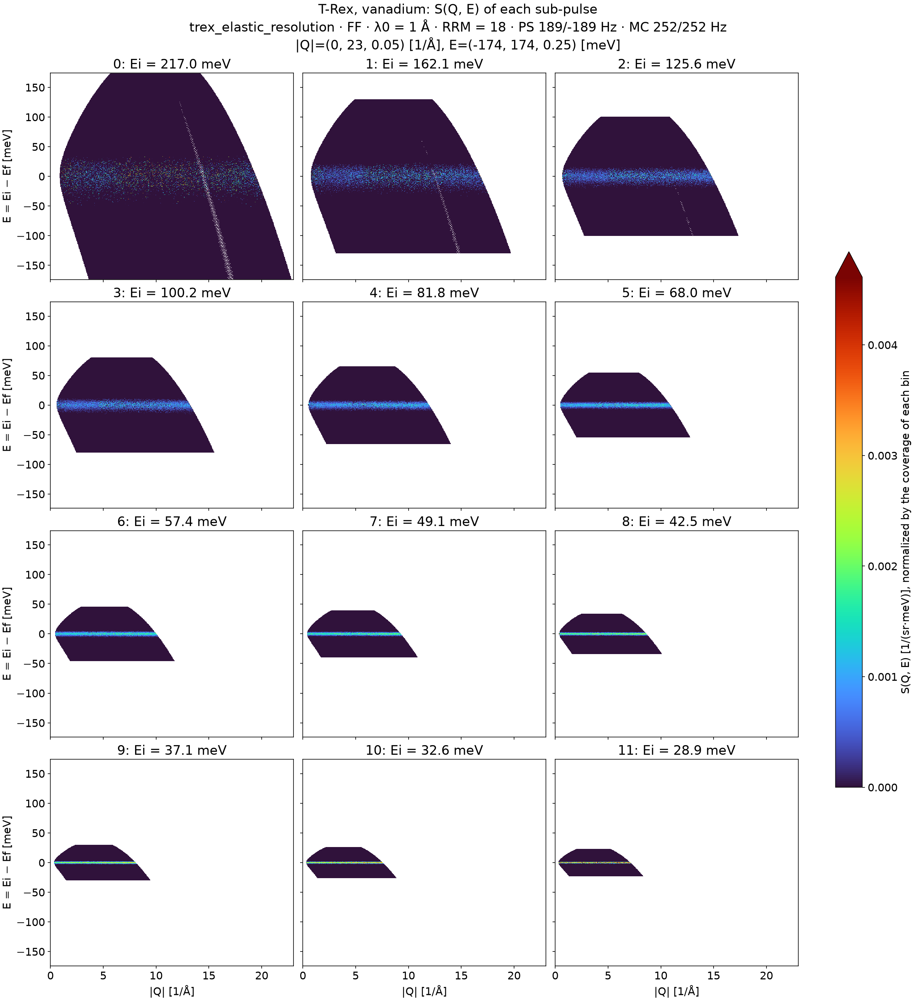
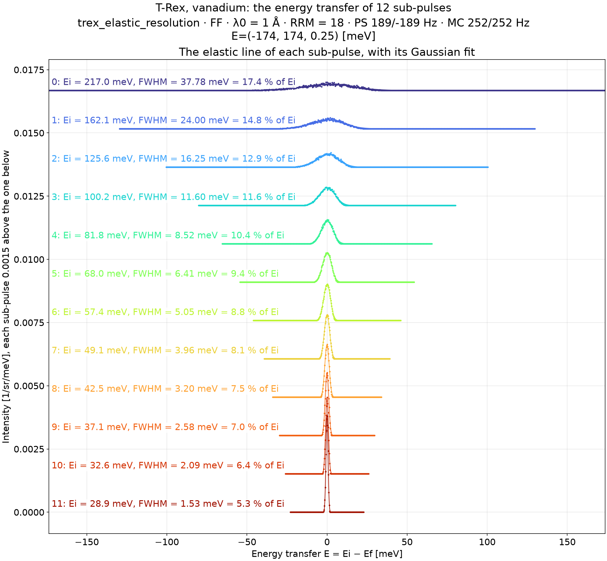
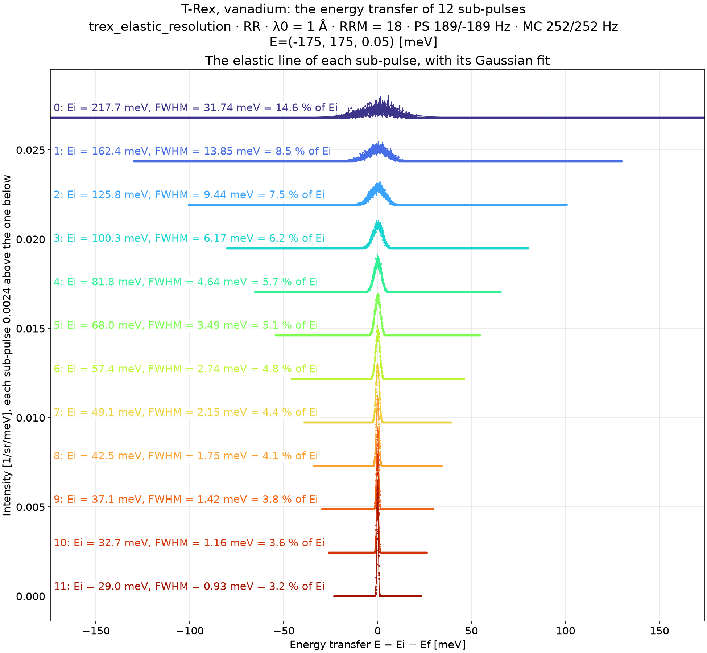
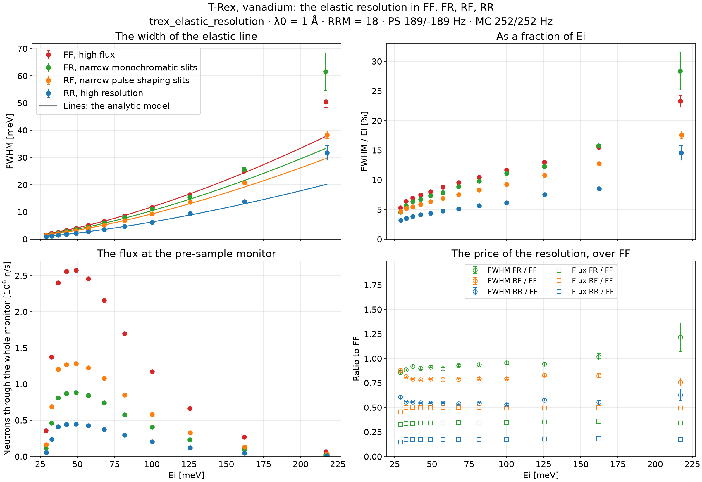

# Elastic resolution (short wavelength)

`TRexElasticResolution`, in
[`mcdgs.diagnostics.trex.elastic_resolution_incoherent_short`](https://github.com/bingli621/mcdgs/blob/main/src/mcdgs/diagnostics/trex/elastic_resolution_incoherent_short.py),
puts a vanadium cylinder on `sample_pos` and reduces every neutron that reaches the banana
detector to its energy transfer E = Ei − Ef. Vanadium scatters incoherently and elastically, so
every neutron it scatters has E = 0. The width of the line it gives is the energy resolution of
T-Rex, one value for each of the 12 sub-pulses at `lambda0` = 1 Å. Anything away from the line
would come from the instrument or the reduction, not from the sample.
[Elastic resolution (middle wavelength)](elastic-resolution-incoherent-middle.md) does the same
at `lambda0` = 2 Å, and [Elastic resolution (long wavelength)](elastic-resolution-incoherent-long.md)
at 3 Å, with the bender in.

The reduction is the one used on [Diffraction](diffraction.md), with the sub-pulses and
incident energies of [Incident energy](incident-energy.md) and the
[reduction package](../../reference/reduction.md).

## The setup

`TRexElasticResolution` is `TRex` with the vanadium of `vanadium` on `sample_pos`, the beamstop
and the banana detector. Its control parameters are `lambda0` = 1 Å and the defaults otherwise:
`rrm` = 18, the bender out, the pulse-shaping choppers at 189 Hz and the monochromatic choppers
at 252 Hz. It runs in each of the four modes of the choppers: `"FF"`, the wide slits of the
pulse-shaping and monochromatic choppers, for high flux, `"RR"`, the narrow ones, for high
resolution, and between them `"RF"`, the narrow slits of the pulse-shaping choppers with the
wide ones of the monochromatic choppers, and `"FR"`, the other way around. All four modes have
the same 12 sub-pulses, from 0.61 to 1.68 Å, with Ei from 217 to 28.9 meV. The choppers turn, so
the beam on the sample is a train of sub-pulses. This is not the white beam of the
`solid_angles` diagnostic, where every chopper is parked open. It has the
[masked source](masked-source.md).

| | |
| - | - |
| Sample | vanadium, a solid cylinder 20 mm across and 10 mm high, `Incoherent` |
| Cross-sections | 5.08 b absorption at 2200 m/s, 5.08 b incoherent, 13.827 ų per atom |
| Scattering | elastic, single scattering only (`order=1`) |
| Focusing | the window of `solid_angles.detector_window`: 182° by 52°, centered on the detector in the horizontal plane |
| Detector | the banana detector, 3 m from the sample, 0.625° by 16 mm pixels, 25° below the beam to 15° above |

Vanadium scatters in every direction, so without a window few neutrons would reach the detector.
The window covers the banana detector with a 1° margin on every side. It is centered in the
horizontal plane, which makes McStas span it exactly in height: it reaches as far above the beam
as the bottom of the detector lies below it.

<!-- fmt:off -->
```python
--8<-- "src/mcdgs/diagnostics/trex/elastic_resolution_incoherent_short.py:instrument"
```
<!-- fmt:on -->

## Two runs, split at the sample

As on [Diffraction](diffraction.md#two-runs-split-at-the-sample), `simulate` runs McStas in
each mode in two parts, with `run_to_sample` and `run_from_sample` of
[`Simulation`](../../how-to/run-a-simulation.md):

1. **From the source to `sample_pos`**, with 1e9 rays: about 1.1 minutes on 18 cores.
   Its folder holds the pre-sample and beamstop monitors and the beam at `sample_pos`.
2. **From that beam through the vanadium to the detector**: about 5 seconds. 1.49 million
   neutrons reach the detector in FF, 0.41 million in RR.

RR lets a sixth of the neutrons of FF through, 3.1 × 10⁶ n/s at the pre-sample monitor against
1.8 × 10⁷ n/s. `reduce_runs` and `analyze` read the runs of a mode again without McStas. The
figures below are of FF, except in [FF and RR](#ff-and-rr) and
[All four modes](#all-four-modes).

## The reduction

1. **The sub-pulses.** `subpulse_timing`, of `sample_runs`, finds the 12 sub-pulses at the
   pre-sample and beamstop monitors, with the Ei of each and the time it reaches the sample, as on
   [Incident energy](incident-energy.md#finding-the-sub-pulses). It keeps the patches of the
   monitor with at least 2 % (`MIN_FRACTION`) of the intensity of the strongest. Four more get
   through the choppers, at 0.21, 0.32, 0.42 and 0.52 Å, with under 1 % each: see
   [Shorter sub-pulses](#shorter-sub-pulses).
2. **The pixels.** `read_detector`, of `sample_runs`, reads the neutrons of the banana detector,
   by pixel.
   `scattered_pixels` leaves out the pixels within 5° of the beam ($2\theta$ < 5°). Those see the
   direct beam that passes the beamstop: 457,391 of the 1,485,970 neutrons in FF. The 38,760
   pixels kept cover 2.11 sr.
3. **The windows.** `events_to_q_and_energy` gives each pixel and sub-pulse the arrival window
   of `arrival_window`, from −0.8 Ei to 0.8 Ei, as on
   [Neutrons on sample](neutrons-on-sample.md#arrival-windows-at-the-detector). A neutron inside
   the window of a sub-pulse takes its Ei and its time at the sample, and `QE_GRAPH` gives its
   energy transfer.
4. **The normalization.** `normalized_events` divides each neutron by the solid angle of its
   pixel and by the intensity of its sub-pulse at the pre-sample monitor.
5. **The spectra.** `energy_spectra` sums the neutrons of each sub-pulse into bins of E of
   0.25 meV (`ENERGY_STEP`). It weights each one by the solid angle of its pixel and divides by
   the 2.11 sr of all the pixels. It divides each neutron by its $k_f/k_i = \sqrt{E_f/E_i}$, with
   the Ei of its sub-pulse, as `q_e_maps` does for S(Q, E): the cross section holds that factor on
   top of S(Q, E), below 1 where the neutron loses energy and above where it gains it. Across a
   line as wide as 17 % of Ei it runs from 0.96 to 1.04, so left in, it would lift the gain side
   of the line, tilt its shape and pull its center towards a higher Ef. The result is S(E)
   averaged over the detector, per neutron at the pre-sample monitor, per steradian and per meV.
   Each neutron of weight $w$ counts with the variance $w^2$, so a bin has the error
   $\sqrt{\sum w^2}$.

**Why 0.25 meV bins.** The lines at 1 Å are 0.9 to 38 meV wide. On the 0.05 meV bins of the other
elastic-resolution diagnostics, the tails of the widest lines are so sparse that many bins hold
no neutron. The fit drops the empty bins, so in the tails it sees only the bins that happen to
hold one, which lifts the tails and widens the Gaussian. On 0.05 meV bins, the FWHM of the
highest sub-pulse came out at 50.5 meV in FF and 61.5 meV in FR. On 0.25 meV bins it is 37.8 and
35.8 meV, and coarser bins change it little more: 36.9 and 34.3 meV on 0.5 meV bins. Below about
100 meV the bins make no difference. The narrowest line, 0.95 meV in RR, still spans four bins.

### Shorter sub-pulses

Of the 1,028,579 neutrons on the pixels kept in FF, 52,481 fall outside every window. Of these,
52,251 arrive before the window of the first sub-pulse opens, in groups 4 ms apart, at about
23, 19, 15 and 11 ms: the four sub-pulses at 0.52, 0.42, 0.32 and 0.21 Å that `subpulse_timing`
leaves out. At the pre-sample monitor, those at 0.32 to 0.52 Å bring 0.09 to 0.85 % of the
intensity of the strongest sub-pulse, the one at 0.21 Å almost nothing. The masked source spends many rays on them, so they are many neutrons of
small weight: 0.25 % of the intensity on the detector. They are left out of the spectra and the
maps.

## S(Q, E)



`q_e_maps` histograms the neutrons of each sub-pulse in |Q| and E, in bins of 0.25 meV and
0.05 Å⁻¹. Every sub-pulse has the same bins, so every map spans the same range: E from −174 to
174 meV, the arrival window of the highest Ei, and |Q| from 0 to 23 Å⁻¹, the largest the
detector reaches. `plot_q_e_maps` draws the 12 maps from the highest Ei to the lowest, on shared
axes and one linear scale in turbo.

**Normalized by the coverage of each bin.** A pixel at the scattering angle $2\theta$ sees every E of
the arrival window, each at its own |Q|: a line through the map, its trajectory.
`q_e_coverage`, in the [reduction package](../../reference/reduction.md), sums for each bin the
solid angle of every pixel times the length in E of its trajectory inside the bin, in sr·meV.
Each bin holds the fraction of the incident neutrons of its sub-pulse scattered into it;
divided by its coverage, it is S(Q, E) per steradian and per meV, whatever the part of the
detector that sees the bin. This is the normalization of MDNorm, for |Q| rather than the vector
Q. The pixels are grouped by $2\theta$, 0.02° wide, into one trajectory each, and each bin of E is
followed at four points: the whole normalization takes a few seconds.

**Colored is reached, white is not.** A bin that no trajectory crosses has no coverage: the
sub-pulse cannot reach it, and it is white. A bin it reaches has the color of its value, the
bottom of the scale if it holds no neutron. So the colored area of each map is its coverage: E
in its arrival window, −0.8 Ei to 0.8 Ei, and |Q| between those of the smallest and the largest
$2\theta$ of the pixels, 5° and 143.7°, at that E. The lower the Ei, the smaller the part of the
common range it covers: ±23 meV and |Q| below 8.3 Å⁻¹ at 28.9 meV.

- **Only the elastic line.** Each map holds one band at E = 0, as wide as the resolution of its
  sub-pulse, which the spectra below measure, from the smallest |Q| to the largest the detector
  reaches. The rest of the coverage is dark, reached but empty: vanadium scatters nothing
  inelastically here, and the sample scatters only once.
- **The line is nearly flat in |Q|.** Vanadium scatters alike in every direction, and the
  normalization takes out how much of the detector sees each |Q|. Summed over E, the line of
  sub-pulse 4, at `lambda0`, stays between 0.0074 and 0.0082 per steradian from 0.5 to 14 Å⁻¹;
  that of sub-pulse 11 rises from 0.0059 to 0.0064 up to 8 Å⁻¹. The line of sub-pulse 0 is lower
  below 2 Å⁻¹, 0.0066 against about 0.009 from 2 to 14 Å⁻¹; this has not been studied.
- **A white stripe at $2\theta$ = 90°.** The three highest sub-pulses show a thin white line
  across their maps, where |Q| = $\sqrt{k_i^2 + k_f^2}$. No pixel center lies between 89.94° and
  90.51° of $2\theta$: next to 90° in the horizontal plane, the pixels of every height have nearly
  the same $2\theta$, on one side of 90° or the other. The coverage takes each pixel as a point at
  its center, so it leaves that band out. The detector itself covers it. The stripe fades with Ei,
  and from 82 meV down it does not show.
- **The scale** is shared by all the maps, from 0 to the 99.9th percentile of the bins with
  neutrons. The lines of the highest Ei are spread over the most bins, so few neutrons fall in
  each, and they look speckled.

## The spectra



The figure is linear and spans the whole energy coverage: each sub-pulse is drawn over its
arrival window, −0.8 Ei to 0.8 Ei, empty bins included. Each bin is a point with its error, and
each line is the Gaussian fitted to a sub-pulse, labeled with its Ei, its FWHM and the FWHM
as a fraction of Ei. The sub-pulses are stacked from the highest Ei at the top to the lowest at
the bottom, each lifted above the one below by 0.4 of the highest bin, so that each stands on
its own baseline and the width of its window shows.

- **One line per sub-pulse, and nothing else.** Each line lies well inside its window. The
  widest, at 217 meV, reaches from −52 to 36 meV, within a window of ±174 meV.
- **The width grows with Ei**, from 1.5 meV at 28.9 meV to 38 meV at 217 meV. As a fraction
  of Ei it goes from 5.3 % at the longest wavelength to 17 % at the shortest.
- **The shape.** The lines of the long wavelengths are narrow and peaked. Those of the short
  wavelengths are broad, with a flat top.
- **The intensity falls with the wavelength**, from 9.2 × 10⁻³ to 6.2 × 10⁻³ per steradian. The
  absorption of vanadium goes as the wavelength, so the cylinder absorbs more of the slow
  neutrons. The intensity is per neutron at the pre-sample monitor, so it also counts the
  neutrons that miss the 20 mm cylinder.

## The Gaussian fits

`fit_elastic_lines` fits a Gaussian to the line of each sub-pulse against Ef, weighting each bin
by its error:

$$
I(E_f) = h \exp\left(-\frac{(E_f - E_c)^2}{2\sigma^2}\right), \qquad \text{FWHM} = 2\sqrt{2 \ln 2}\,\sigma \approx 2.355\,\sigma.
$$

$\sigma$ is the standard deviation of the Gaussian, not its width: the full width at half maximum is
2.355 times larger. The fit keeps only the core of each line, the bins of at least 20 % of the
highest. The tails are not Gaussian, and a bin there holds few neutrons, some of tiny weight,
whose variance is no error for the bin. Over the core, $\chi^2$ per degree of freedom is 1.2 to
4.3 in FF, the highest for the narrow lines of the lowest Ei, whose many neutrons show that they
are not quite Gaussian.

The intensity is that of the whole spectrum, summed over E. `analyze` prints the table:

--8<-- "docs/instruments/trex/figures/elastic-resolution-incoherent-short/trex_elastic_resolution_incoherent_short_ff_lines.txt"

From 68 meV down, every center lies within 0.03 meV of its Ei. Above, the centers fall below
Ei, the more the higher the Ei: by 0.1 meV at 100 meV, 0.3 meV at 126 meV and 1.0 meV, 0.45 %,
at 217 meV. In FR the highest is 1.8 meV below its Ei, 0.84 %. Where this comes from has not been
studied.

## FF and RR



The same spectra and fits in RR. Every line is narrower than in FF, and the fits are as good,
with $\chi^2$ per degree of freedom from 0.2 to 4.0, most near 1. Each sub-pulse has nearly the
Ei it has in FF: they differ by 0.5 % at most, 217.65 meV against 216.98 meV for the highest:

--8<-- "docs/instruments/trex/figures/elastic-resolution-incoherent-short/trex_elastic_resolution_incoherent_short_rr_lines.txt"

## All four modes

The mixed modes take one pair of choppers at a time from FF to RR: RF narrows the slits of the
pulse-shaping choppers only, FR those of the monochromatic choppers only. Their spectra, fits and
maps are made as for FF and RR.



`plot_resolutions` draws, against Ei, the FWHM of every mode, the FWHM as a fraction of Ei, the flux
of each sub-pulse at the pre-sample monitor, and the FWHM, open circles, and the flux, open squares,
of each mode over those of FF. The FWHM has the error of its fit; the flux has no error bars, since
the sub-pulses are found from the intensity of the monitor alone. The lines in the first panel
are the width the [analytic resolution](elastic-resolution-model.md) gives each mode, from the
geometry alone. `resolution_table` gives the numbers side by side:

--8<-- "docs/instruments/trex/figures/elastic-resolution-incoherent-short/trex_elastic_resolution_incoherent_short_modes.txt"

- **RR is almost twice as fine.** Its lines are 0.52 to 0.62 times as wide as those of FF: from
  0.95 meV at 29.0 meV to 21 meV at 218 meV, 3.3 % to 9.8 % of Ei, against 5.3 % to 17 % in FF.
- **For a sixth of the flux.** Every sub-pulse keeps 0.15 to 0.18 of its flux in RR, about
  the same share at every Ei: 2.9 × 10⁵ against 1.7 × 10⁶ n/s at 81.8 meV, the Ei of `lambda0`.
  The narrow slits of the pulse-shaping and monochromatic choppers shorten each sub-pulse, which
  sets its time at the sample, and its spread of Ei. So the lines narrow, and fewer neutrons pass.
- **RF does more than FR, for less.** The narrow slits of the pulse-shaping choppers alone make
  the lines 0.78 to 0.88 times as wide as in FF and keep 0.45 to 0.50 of the flux; those of the
  monochromatic choppers alone make them 0.83 to 0.95 times as wide and keep only 0.33 to 0.36.
  At 81.8 meV, RF has 6.8 meV with 8.5 × 10⁵ n/s, FR 7.8 meV with 5.8 × 10⁵ n/s. Only at the
  lowest Ei, 28.9 meV, is FR the narrower, 0.83 against 0.88 of FF.
- **The narrow monochromatic slits cost more than their width.** They are 0.57 of the wide
  ones, 2.5° against 4.4°, as the narrow pulse-shaping slits are, 20° against 35°. RF keeps
  about that share of the flux, a half; FR keeps a third.
- **FWHM / Ei grows with Ei in every mode**, to 17 % in FF and 9.8 % in RR at the highest Ei.
- **The analytic model follows McStas.** From 37 to 217 meV it gives the width within 7 % in
  every mode, most within 3 %. At the lowest Ei, 28.9 meV, it is 6 to 29 % wider than McStas.
  That sub-pulse brings a quarter of the flux of the one before it, so the bandwidth choppers
  most likely cut it, which the model leaves out; this has not been checked.

## Making the figures

The figures need McStas, so they are not made with the site. To run McStas and make them, run:

```bash
pixi run python -c "from mcdgs.diagnostics.trex.elastic_resolution_incoherent_short import main; main()"
```

At its defaults, `main` runs both parts in all four modes, 1e9 rays from the masked source with
seed 1 each, as for the figures here: about a minute per mode. It prints the tables and saves the
figures and the tables of each mode, and those that compare them, to
`mcdgs_workspace/results/trex_elastic_resolution_incoherent_short/`, or to the folder given as
`out`. Running the module, as `pixi run docs-diagnostics` does, only reduces the runs again,
without McStas:

```bash
pixi run python -m mcdgs.diagnostics.trex.elastic_resolution_incoherent_short
```
