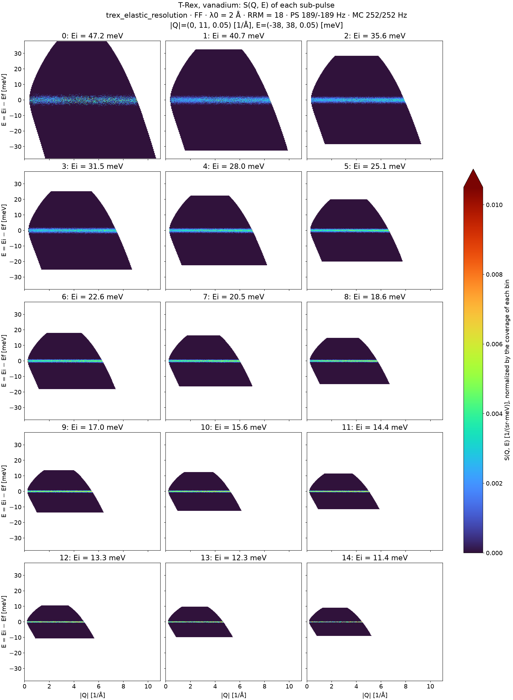
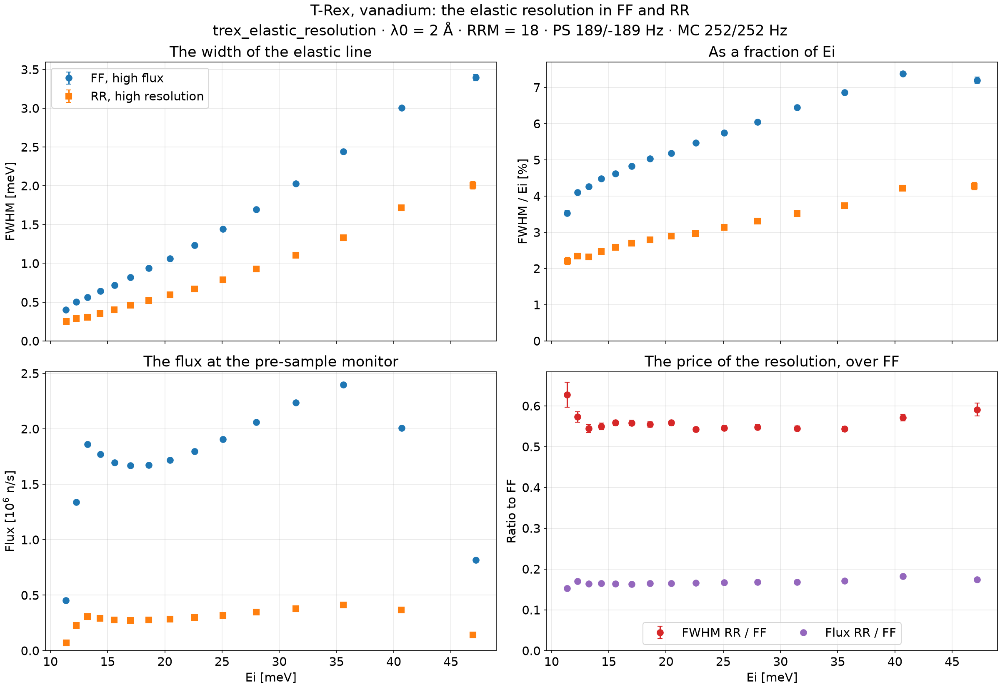

# Elastic resolution

`TRexElasticResolution`, in
[`mcdgs.diagnostics.trex.elastic_resolution_incoherent`](https://github.com/bingli621/mcdgs/blob/main/src/mcdgs/diagnostics/trex/elastic_resolution_incoherent.py),
puts a vanadium cylinder on `sample_pos` and reduces every neutron that reaches the banana
detector to its energy transfer E = Ei − Ef. Vanadium scatters incoherently and elastically, so
every neutron it scatters has E = 0. The width of the line it gives is the energy resolution of
T-Rex, one value for each of the 15 sub-pulses. Anything away from the line would come from the
instrument or the reduction, not from the sample.

The reduction is the one used on [Diffraction](diffraction.md), with the sub-pulses and
incident energies of [Incident energy](incident-energy.md) and the
[reduction package](../../reference/reduction.md).

## The setup

`TRexElasticResolution` is `TRex` with the vanadium of `vanadium` on `sample_pos`, the beamstop
and the banana detector. Its control parameters are the defaults, `lambda0` = 2 Å and
`rrm` = 18, in each of the two modes of the choppers: `"FF"`, the wide slits of the
pulse-shaping and monochromatic choppers, for high flux, and `"RR"`, the narrow ones, for high
resolution. Both modes have the same 15 sub-pulses. The choppers turn, so the beam on the sample is a train of sub-pulses. This is
not the white beam of the `solid_angles` diagnostic, where every chopper is parked open. It has
the [masked source](masked-source.md).

| | |
| - | - |
| Sample | vanadium, a solid cylinder 20 mm across and 10 mm high, `Incoherent` |
| Cross-sections | 5.08 b absorption at 2200 m/s, 5.08 b incoherent, 13.827 ų per atom |
| Scattering | elastic, single scattering only (`order=1`) |
| Focusing | the window of `solid_angles.detector_window`: 182° by 52°, centered on the detector in the horizontal plane |
| Detector | the banana detector, 3 m from the sample, 0.625° by 16 mm pixels, 25° below the beam to 15° above |

Vanadium scatters in every direction, so without a window few neutrons would reach the detector.
The window covers the banana detector with a 1° margin on every side. It is centered in the
horizontal plane, which makes McStas span it exactly in height: it reaches as far above the beam
as the bottom of the detector lies below it.

<!-- fmt:off -->
```python
--8<-- "src/mcdgs/diagnostics/trex/elastic_resolution_incoherent.py:instrument"
```
<!-- fmt:on -->

## Two runs, split at the sample

As on [Diffraction](diffraction.md#two-runs-split-at-the-sample), `simulate` runs McStas in
each mode in two parts, with `run_to_sample` and `run_from_sample` of
[`Simulation`](../../how-to/run-a-simulation.md):

1. **From the source to `sample_pos`**, with 1e9 rays: about a minute and a half on 18 cores.
   Its folder holds the pre-sample and beamstop monitors and the beam at `sample_pos`.
2. **From that beam through the vanadium to the detector**: under ten seconds. 4.09 million
   neutrons reach the detector in FF, 1.04 million in RR.

RR lets a sixth of the neutrons of FF through, 4.3 × 10⁶ n/s at the pre-sample monitor against
2.5 × 10⁷ n/s. `reduce_runs` and `analyze` read the runs of a mode again without McStas. The
figures below are of FF, except in [FF and RR](#ff-and-rr).

## The reduction

1. **The sub-pulses.** `subpulse_timing`, of `sample_runs`, finds the 15 sub-pulses at the
   pre-sample and beamstop monitors, with the Ei of each and the time it reaches the sample, as on
   [Incident energy](incident-energy.md#finding-the-sub-pulses).
2. **The pixels.** `read_detector`, of `sample_runs`, reads the neutrons of the banana detector,
   by pixel.
   `scattered_pixels` leaves out the pixels within 5° of the beam (2θ < 5°). Those see the
   direct beam that passes the beamstop: 2.69 million of the 4.09 million neutrons, on 405
   pixels. The 38,760 pixels kept cover 2.11 sr.
3. **The windows.** `events_to_q_and_energy` gives each pixel and sub-pulse the arrival window
   of `arrival_window`, from −0.8 Ei to 0.8 Ei, as on
   [Neutrons on sample](neutrons-on-sample.md#arrival-windows-at-the-detector). A neutron inside
   the window of a sub-pulse takes its Ei and its time at the sample, and `QE_GRAPH` gives its
   energy transfer.
4. **The normalization.** `normalized_events` divides each neutron by the solid angle of its
   pixel and by the intensity of its sub-pulse at the pre-sample monitor.
5. **The spectra.** `energy_spectra` sums the neutrons of each sub-pulse into 0.05 meV bins of
   E. It weights each one by the solid angle of its pixel and divides by the 2.11 sr of all the
   pixels. The result is the intensity averaged over the detector, per neutron at the
   pre-sample monitor, per steradian and per meV. Each neutron of weight w counts with the
   variance w², so a bin has the error √Σw².

## S(Q, E)



`q_e_maps` histograms the neutrons of each sub-pulse in |Q| and E, in bins of 0.05 meV and
0.05 Å⁻¹. Every sub-pulse has the same bins, so every map spans the same range: E from −38 to
38 meV, the arrival window of the highest Ei, and |Q| from 0 to 11 Å⁻¹, the largest the
detector reaches. `plot_q_e_maps` draws the 15 maps from the highest Ei to the lowest, on shared
axes and one linear scale in turbo.

**Normalized by the coverage of each bin.** A pixel at the scattering angle 2θ sees every E of
the arrival window, each at its own |Q|: a line through the map, its trajectory.
`q_e_coverage`, in the [reduction package](../../reference/reduction.md), sums for each bin the
solid angle of every pixel times the length in E of its trajectory inside the bin, in sr·meV.
Each bin holds the fraction of the incident neutrons of its sub-pulse scattered into it;
divided by its coverage, it is S(Q, E) per steradian and per meV, whatever the part of the
detector that sees the bin. This is the normalization of MDNorm, for |Q| rather than the vector
Q. The pixels are grouped by 2θ, 0.02° wide, into one trajectory each, and each bin of E is
followed at four points: the whole normalization takes a few seconds.

**Colored is reached, white is not.** A bin that no trajectory crosses has no coverage: the
sub-pulse cannot reach it, and it is white. A bin it reaches has the color of its value, the
bottom of the scale if it holds no neutron. So the colored area of each map is its coverage: E
in its arrival window, −0.8 Ei to 0.8 Ei, and |Q| between those of the smallest and the largest
2θ of the pixels, 5° and 143.7°, at that E. The lower the Ei, the smaller the part of the
common range it covers: ±9 meV and |Q| below 5.2 Å⁻¹ at 11.4 meV.

- **Only the elastic line.** Each map holds one band at E = 0, as wide as the resolution of its
  sub-pulse, which the spectra below measure, from the smallest |Q| to the largest the detector
  reaches. The rest of the coverage is dark, reached but empty: vanadium scatters nothing
  inelastically here, and the sample scatters only once.
- **The line is flat in |Q|.** Vanadium scatters alike in every direction, and the
  normalization takes out how much of the detector sees each |Q|. Before it, the band was twice
  as bright at 2θ below 36°, where the detector covers both sides of the beam, and grew toward
  backscattering, where a bin of |Q| spans more of 2θ. Summed over E, the line of sub-pulse 0
  stays between 0.0067 and 0.0073 per steradian from 0.5 to 8.5 Å⁻¹.
- **What is left is absorption.** At the longest wavelengths the line rises toward high |Q|, by
  about 20 % for sub-pulse 14. The 20 mm cylinder absorbs less of what it scatters backward than
  of what it scatters forward, and more at long wavelengths, as absorption goes as the
  wavelength.
- **The scale** is shared by all the maps, from 0 to the 99.9th percentile of the bins with
  neutrons. A bin on the edge of the coverage, with little of it, can stand far above the rest:
  its few neutrons are divided by a small coverage. The narrow lines of the lowest Ei are the
  brightest, their intensity spread over the fewest meV.

## The spectra


The figure is linear and spans the whole energy coverage: each sub-pulse is drawn over its
arrival window, −0.8 Ei to 0.8 Ei, empty bins included. Each bin is a point with its error, and
each line is the Gaussian fitted to a sub-pulse, labeled with its Ei, its FWHM and the FWHM
as a fraction of Ei. The sub-pulses are
stacked from the highest Ei at the top to the lowest at the bottom, each lifted above the one
below by 0.4 of the highest bin, so that each stands on its own baseline and the width of its
window shows.

- **One line per sub-pulse, and nothing else.** No sub-pulse has neutrons beyond about
  ±0.1 Ei, although its window spans ±0.8 Ei. Of the 1,403,295 neutrons on the pixels kept, only
  491 fall outside every window. So no sub-pulse leaks into the window of the next: there is no
  neutron [between the sub-pulses](neutrons-on-sample.md#between-the-sub-pulses).
- **The width grows with Ei**, from 0.40 meV at 11.4 meV to 3.4 meV at 47.2 meV. As a fraction
  of Ei it goes from 3.5 % at the longest wavelength to about 7 % at the shortest.
- **The shape.** The lines of the long wavelengths are narrow and peaked. Those of the short
  wavelengths have a flat top and long tails.
- **The intensity falls with the wavelength**, from 6.8 × 10⁻³ to 3.2 × 10⁻³ per steradian. The
  absorption of vanadium goes as the wavelength, so the cylinder absorbs more of the slow
  neutrons. The intensity is per neutron at the pre-sample monitor, so it also counts the
  neutrons that miss the 20 mm cylinder.

## The Gaussian fits

`fit_elastic_lines` fits a Gaussian to the line of each sub-pulse against Ef, weighting each bin
by its error:

I(Ef) = h exp(−(Ef − Ec)² / 2σ²), with FWHM = 2 √(2 ln 2) σ ≈ 2.355 σ.

σ is the standard deviation of the Gaussian, not its width: the full width at half maximum is
2.355 times larger. The fit keeps only the core of each line, the bins of at least 20 % of the
highest. The tails are not Gaussian, and a bin there holds few neutrons, some of tiny weight,
whose variance is no error for the bin. Fitted over every bin, the tails pull the Gaussian
narrow, with χ² per degree of freedom of up to 540. Over the core it is 0.7 to 1.8.

The intensity is that of the whole spectrum, summed over E. `analyze` prints the table:

--8<-- "docs/instruments/trex/figures/elastic-resolution-incoherent/trex_elastic_resolution_incoherent_ff_lines.txt"

Every center lies within 0.1 meV of its Ei, 0.02 to 0.09 meV above it. So the Ei of each
sub-pulse and its time at the sample agree with what the detector sees.

## FF and RR


The same spectra and fits in RR. Every line is narrower than in FF, and the fits are as good,
with χ² per degree of freedom from 0.5 to 1.6. Each sub-pulse has nearly the Ei it has in FF: they
differ by 0.6 % at most, 46.91 meV against 47.17 meV for the highest:

--8<-- "docs/instruments/trex/figures/elastic-resolution-incoherent/trex_elastic_resolution_incoherent_rr_lines.txt"



`plot_resolutions` draws, against Ei, the FWHM of both modes, the FWHM as a fraction of Ei, the
flux of each sub-pulse at the pre-sample monitor, and the FWHM and the flux of RR over those of
FF. The FWHM has the error of its fit; the flux has no error bars, since the sub-pulses are found
from the intensity of the monitor alone. RR narrows the elastic line to about
0.55 of FF, for about 0.17 of its flux, at every Ei. `resolution_table` gives the numbers side by
side:

--8<-- "docs/instruments/trex/figures/elastic-resolution-incoherent/trex_elastic_resolution_incoherent_modes.txt"

- **RR is almost twice as fine.** Its lines are 0.54 to 0.63 times as wide as those of FF: from
  0.25 meV at 11.4 meV to 2.0 meV at 46.9 meV, 2.2 % to 4.3 % of Ei, against 3.5 % to 7.4 % in
  FF.
- **For a sixth of the flux.** Every sub-pulse keeps 0.15 to 0.18 of its flux in RR, about
  the same share at every Ei: 2.8 × 10⁵ against 1.7 × 10⁶ n/s at 20.45 meV. The narrow slits of the pulse-shaping and monochromatic choppers
  shorten each sub-pulse, which sets its time at the sample, and its spread of Ei. So the lines
  narrow, and fewer neutrons pass.
- **The same trend against Ei.** In both modes FWHM / Ei grows with Ei. In FF it levels off
  above 40 meV, 7.4 % at 40.7 meV and 7.2 % at 47.2 meV; in RR it still grows, to 4.3 %.

## Making the figures

The figures need McStas, so they are not made with the site. To run McStas and make them, run:

```bash
pixi run python -c "from mcdgs.diagnostics.trex.elastic_resolution_incoherent import main; main()"
```

At its defaults, `main` runs both parts in both modes, 1e9 rays from the masked source with
seed 1 each, as for the figures here: about three minutes in all. It prints the tables and
saves the figures and the tables of each mode, and those that compare them, to
`mcdgs_workspace/results/trex_elastic_resolution_incoherent/`, or to the folder given as `out`.
Running the module, as `pixi run docs-diagnostics` does, only reduces the runs again, without
McStas:

```bash
pixi run python -m mcdgs.diagnostics.trex.elastic_resolution_incoherent
```
