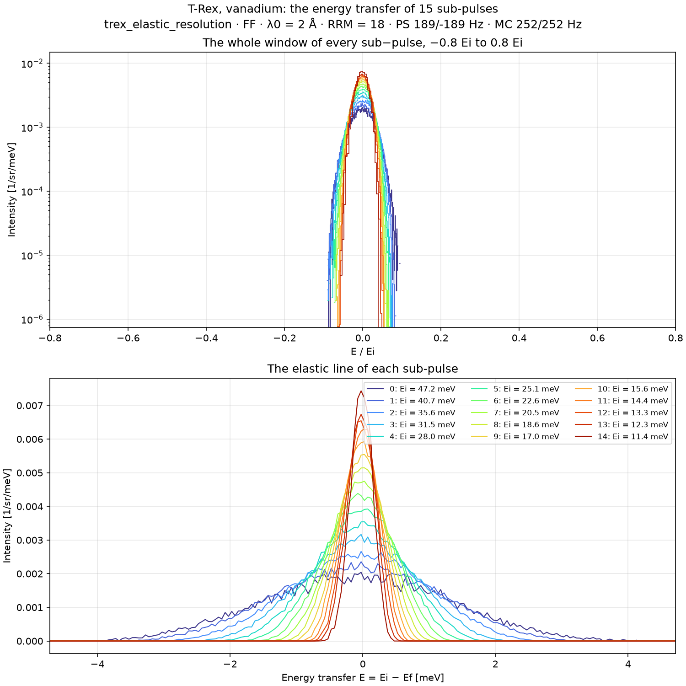

# Elastic resolution

`TRexElasticResolution`, in
[`mcdgs.diagnostics.trex.elastic_resolution_incoherent`](https://github.com/bingli621/mcdgs/blob/main/src/mcdgs/diagnostics/trex/elastic_resolution_incoherent.py),
puts a vanadium cylinder on `sample_pos` and reduces every neutron that reaches the banana
detector to its energy transfer E = Ei − Ef. Vanadium scatters incoherently and elastically, so
every neutron it scatters has E = 0. The width of the line it gives is the energy resolution of
T-Rex, one value for each of the 15 sub-pulses. Anything away from the line would come from the
instrument or the reduction, not from the sample.

The reduction is the one used on [Elastic plane](elastic-plane.md), with the sub-pulses and
incident energies of [Incident energy](incident-energy.md) and the
[reduction package](../../reference/reduction.md).

## The setup

`TRexElasticResolution` is `TRex` with the vanadium of `vanadium` on `sample_pos`, the beamstop
and the banana detector. Its control parameters are the defaults: mode `"FF"`, `lambda0` = 2 Å
and `rrm` = 18. The choppers turn, so the beam on the sample is a train of sub-pulses. This is
not the white beam of the `solid_angles` diagnostic, where every chopper is parked open. It has
the [masked source](masked-source.md).

| | |
| - | - |
| Sample | vanadium, a solid cylinder 20 mm across and 10 mm high, `Incoherent` |
| Cross-sections | 5.08 b absorption at 2200 m/s, 5.08 b incoherent, 13.827 ų per atom |
| Scattering | elastic, single scattering only (`order=1`) |
| Focusing | the window of `solid_angles.detector_window`: 182° by 52°, centered on the detector in the horizontal plane |
| Detector | the banana detector, 3 m from the sample, 0.625° by 16 mm pixels, 25° below the beam to 15° above |

Vanadium scatters in every direction, so without a window few neutrons would reach the detector.
The window covers the banana detector with a 1° margin on every side. It is centered in the
horizontal plane, which makes McStas span it exactly in height: it reaches as far above the beam
as the bottom of the detector lies below it.

<!-- fmt:off -->
```python
--8<-- "src/mcdgs/diagnostics/trex/elastic_resolution_incoherent.py:instrument"
```
<!-- fmt:on -->

## Two runs, split at the sample

As on [Elastic plane](elastic-plane.md#two-runs-split-at-the-sample), `simulate` runs McStas in
two parts, with `run_to_sample` and `run_from_sample` of
[`Simulation`](../../how-to/run-a-simulation.md):

1. **From the source to `sample_pos`**, with 1e9 rays: about a minute and a half on 18 cores.
   Its folder holds the pre-sample and beamstop monitors and the beam at `sample_pos`.
2. **From that beam through the vanadium to the detector**: under ten seconds. 4.09 million
   neutrons reach the detector.

`reduce_runs` and `analyze` read the two runs again without McStas.

## The reduction

1. **The sub-pulses.** `subpulse_timing` of the elastic plane finds the 15 sub-pulses at the
   pre-sample and beamstop monitors, with the Ei of each and the time it reaches the sample, as on
   [Incident energy](incident-energy.md#finding-the-sub-pulses).
2. **The pixels.** `read_events` reads the neutrons of the banana detector, by pixel.
   `scattered_pixels` leaves out the pixels within 5° of the beam (2θ < 5°). Those see the
   direct beam that passes the beamstop: 2.69 million of the 4.09 million neutrons, on 405
   pixels. The 38,760 pixels kept cover 2.11 sr.
3. **The windows.** `events_to_q_and_energy` gives each pixel and sub-pulse the arrival window
   of `arrival_window`, from −0.8 Ei to 0.8 Ei, as on
   [Neutrons on sample](neutrons-on-sample.md#arrival-windows-at-the-detector). A neutron inside
   the window of a sub-pulse takes its Ei and its time at the sample, and `QE_GRAPH` gives its
   energy transfer.
4. **The normalization.** `normalized_events` divides each neutron by the solid angle of its
   pixel and by the intensity of its sub-pulse at the pre-sample monitor.
5. **The spectra.** `energy_spectra` sums the neutrons of each sub-pulse into 0.05 meV bins of
   E. It weights each one by the solid angle of its pixel and divides by the 2.11 sr of all the
   pixels. The result is the intensity averaged over the detector, per neutron at the
   pre-sample monitor, per steradian and per meV.

## The spectra



The top panel draws each sub-pulse over its whole arrival window, against E / Ei, on a log scale
four decades deep. The bottom panel draws the elastic lines against E in meV, on a linear scale.

- **One line per sub-pulse, and nothing else.** No sub-pulse has neutrons beyond about
  ±0.1 Ei, although its window spans ±0.8 Ei. Of the 1,403,295 neutrons on the pixels kept, only
  491 fall outside every window. So no sub-pulse leaks into the window of the next: there is no
  neutron [between the sub-pulses](neutrons-on-sample.md#between-the-sub-pulses).
- **The width grows with Ei.** The line is 0.41 meV wide at 11.4 meV and 3.03 meV at 47.2 meV.
  As a fraction of Ei it goes from 3.6 % at the longest wavelength to about 7 % at the
  shortest.
- **The shape.** The lines of the long wavelengths are narrow and peaked. Those of the short
  wavelengths have a flat top and long tails.
- **The intensity falls with the wavelength**, from 6.8 × 10⁻³ to 3.2 × 10⁻³ per steradian. The
  absorption of vanadium goes as the wavelength, so the cylinder absorbs more of the slow
  neutrons. The intensity is per neutron at the pre-sample monitor, so it also counts the
  neutrons that miss the 20 mm cylinder.

## The elastic lines

`elastic_lines` gives the line of each sub-pulse: its center, the highest bin, and its full width
at half maximum, interpolated linearly on each side. The intensity is that of the whole spectrum,
summed over E. `analyze` prints the table:

--8<-- "docs/instruments/trex/figures/elastic-resolution-incoherent/trex_elastic_resolution_incoherent_lines.txt"

Every line is centered within 0.075 meV of zero, about one bin of 0.05 meV. So the Ei of each
sub-pulse and its time at the sample agree with what the detector sees.

## Making the figures

The figure needs McStas, so it is not made with the site. To run McStas and make it, run:

```bash
pixi run python -c "from mcdgs.diagnostics.trex.elastic_resolution_incoherent import main; main()"
```

At its defaults, `main` runs both parts, 1e9 rays from the masked source with seed 1, as for
the figure here. It prints the table and saves the figure and the table to
`mcdgs_workspace/results/trex_elastic_resolution_incoherent/`, or to the folder given as `out`.
Running the module, as `pixi run docs-diagnostics` does, only reduces the runs again, without
McStas:

```bash
pixi run python -m mcdgs.diagnostics.trex.elastic_resolution_incoherent
```
