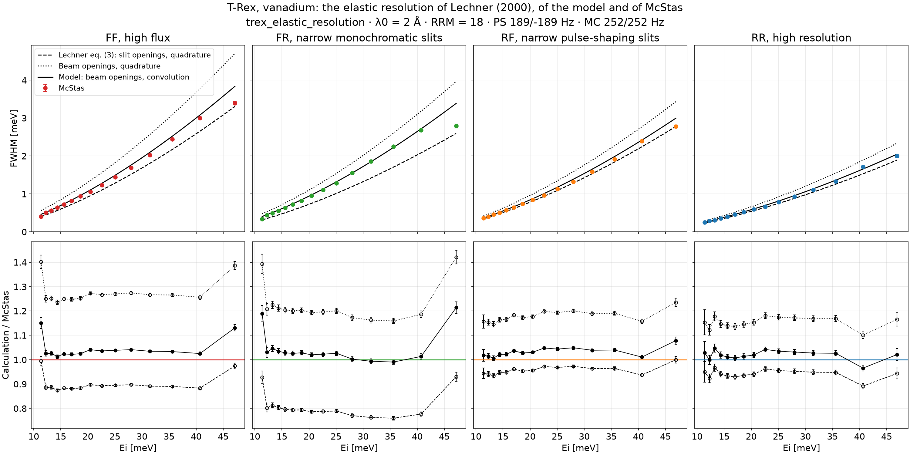

# Analytic elastic resolution

The [elastic resolution](elastic-resolution-incoherent.md) page measures the width of the
elastic line of vanadium in McStas, in each of the four modes of the choppers. This page computes
the same width without McStas, from the geometry of T-Rex alone: first with the formula of
Lechner (2000) as written, then with a model that keeps his formula but changes two of its steps
for T-Rex, and compares both with McStas. The calculations are in
[`mcdgs.diagnostics.trex.elastic_resolution_model`](https://github.com/bingli621/mcdgs/blob/main/src/mcdgs/diagnostics/trex/elastic_resolution_model.py),
whose docstrings follow the same steps.

In short: the formula as written gives lines 3 % to 24 % narrower than McStas, and puts the two
mixed modes in the wrong order. The model, with no free parameter, gives the simulated width
within 5 % for at least 13 of the 15 sub-pulses, in every mode.

## The formula of Lechner

Two disk choppers, the pulse-shaping choppers at a distance $L_{PM}$ before the monochromatic
choppers, define the incident neutrons; the sample is $L_{MS}$ after the monochromatic choppers,
and the detector $L_2$ after the sample. The pulse-shaping choppers are open for a time $\tau_1$,
the monochromatic choppers for $\tau_2$, both as a FWHM. Eq. (3) of Lechner (2000) gives the FWHM
of the energy transfer, here on the elastic line, $\lambda = \lambda_0$:

$$
\Delta(h\nu) = \frac{2 E_i v_0}{L_{PM} L_2}
\sqrt{\left(\tau_1 L_{MD}\right)^2 + \left(\tau_2 \left(L_{PM} + L_{MD}\right)\right)^2
+ \left(\frac{L_{PM}\,\Delta L}{v_0}\right)^2},
$$

with $v_0$ the speed of the neutrons, $L_{MD} = L_{MS} + L_2$ the path from the monochromatic
choppers to the detector, and $\Delta L$ the uncertainty of the flight path, from the beam
divergence, the sample and the detector thickness. $2 E_i v_0$ is his $647.2 / \lambda^3$, in µeV,
Å, m and µs. The three terms are added in quadrature, as for Gaussians. The same equation is
eq. (19) of Gaspar (2007) at $E_i = E_f$.

Lechner gives $\tau_1$ and $\tau_2$ as the FWHM of the chopper pulses, without a formula for them.
The usual one, for a pair of counter-rotating disks with a slit of arc $a$ at the rim moving at the
rim speed $u$, is eq. (1) of Gaspar (2007):

$$
\tau = \frac{a}{2u}.
$$

For $\Delta L$, only the sample counts here, as the simulated detector has no depth. Eq. (20) of
Gaspar (2007) gives, on the elastic line, for a rectangle of half-width $c$ and half-thickness $a$,

$$
\Delta L = \sqrt{c^2 \sin^2 2\theta + a^2 \left(1 - \cos 2\theta\right)^2}.
$$

For the vanadium cylinder of radius 1 cm, both $c$ and $a$ are taken as the radius, and
$\Delta L$ is averaged as a root mean square over the scattering angles the reduction keeps,
−36° to −5° and 5° to 144°. For T-Rex:

| | |
| --- | --- |
| $L_{PM}$, pulse-shaping to monochromatic choppers | 54.03 m |
| $L_{MS}$, monochromatic choppers to sample | 1.77 m |
| $L_2$, sample to detector | 3.00 m |
| $\tau_1$ from the slit, F / R | 257 / 147 µs |
| $\tau_2$ from the slit, F / R | 24.3 / 13.8 µs |

At the sub-pulse of $\lambda_0$ = 2 Å, 20.45 meV, each term and all three together:

--8<-- "docs/instruments/trex/figures/elastic-resolution-incoherent/trex_elastic_resolution_incoherent_literature_terms.txt"

By this formula, the two chopper terms of FF are about the same, 0.61 and 0.71 meV, and FR, with
0.75 meV, is finer than RF, with 0.81 meV. McStas gives FR 0.95 meV and RF 0.85 meV: the other
order. The next two sections show why.

## What the formula misses for T-Rex

**1. The opening of a pair depends on the width of the beam.** Each pair is two disks with the
same slit, whose rims cross the beam in opposite directions. A neutron passes if it is inside both
slits. The two slits overlap on a window $a - 2u|t|$ wide, which closes in $a / (2u)$:

- **A beam at least as wide as the slit** sees the whole window, so the pair is open as a triangle
  in time, with a FWHM of $a / (2u)$: the $\tau$ above.
- **A beam narrower than the slit** cuts the top off the triangle. The pair is open as a trapezoid,
  for longer: up to $a / u$, that of a single disk, for a beam of no width.

T-Rex has both:

| Pair | Beam | Slit (F / R) | Rim speed | Opening FWHM (F / R) | $a / (2u)$ (F / R) |
| --- | --- | --- | --- | --- | --- |
| Pulse-shaping | 60.0 mm | 213.8 / 122.2 mm | 415.6 m/s | 442 / 222 µs | 257 / 147 µs |
| Monochromatic | 22.4 mm | 26.9 / 15.3 mm | 554.2 m/s | 28.3 / 13.8 µs | 24.3 / 13.8 µs |

The beam at the pulse-shaping choppers is much narrower than their slits, so they are open 1.5 to
1.7 times as long as $a / (2u)$. The narrow slit of the monochromatic choppers is narrower than its
beam, so it opens as the triangle, but passes at most 68 % of the beam. So the pulse-shaping
choppers weigh more than $a / (2u)$ gives them, and the narrow pulse-shaping slits of RF do more
than the narrow monochromatic slits of FR. Lechner points to this himself: the pulse width is set
by the window of the chopper and the aperture of the guide together (his Sec. 5.2), and windows
wider than the guide give a pulse with sharper edges (his Fig. 2).

**2. The openings are not Gaussians.** They are trapezoids and triangles, and adding their widths
in quadrature makes the line too wide. With the openings of the beam, eq. (3) gives 1.35 meV in FF
at 20.45 meV, against 1.06 meV in McStas. Without the first change, the two errors partly cancel:
the openings of the slits are too short, and quadrature makes the line too wide. Lechner notes that
for pulses that are not Gaussian the standard deviation may serve better than the FWHM (his
Sec. 3); the model goes one step further and convolves the shapes themselves.

## The model

The model keeps eq. (3) of Lechner, and changes how its terms are found and combined:

1. **The flight of an elastic neutron.** The reduction gives every neutron of a sub-pulse the
   $E_i$ and the time at the sample of the sub-pulse. A neutron that passes the choppers
   $\delta t_P$ and $\delta t_M$ off the centers of their openings is then measured with an energy
   transfer off by

    $$
    \delta E = \frac{2 E_i v_0}{L_2} \left(A\,\delta t_M - B\,\delta t_P\right), \qquad
    A = 1 + \frac{L_{MD}}{L_{PM}} = 1.088, \qquad B = \frac{L_{MD}}{L_{PM}} = 0.088,
    $$

    the weights of $\tau_2$ and $\tau_1$ in eq. (3) of Lechner (2000).

2. **The opening of each pair**, computed exactly as the length of the beam inside both slits at
   each time, for a beam that fills the window of the disks evenly. The second disk of the
   pulse-shaping pair is 0.1 m downstream of the first, and its delay is set for the speed of
   $\lambda_0$, so for the other sub-pulses the two slits are centered at different times, by up
   to ±17 µs. The model takes that in too.
3. **Where in the sample the neutron scatters.** A neutron that scatters at $(x, y)$ from the
   center of the sample, $x$ along the beam, into $2\theta$, flies further by

    $$
    \delta_\text{path} = x \left(1 - \cos 2\theta\right) - y \sin 2\theta,
    $$

    which reads as $\delta E = 2 E_i\,\delta_\text{path} / L_2$: the $\Delta L$ term of eq. (3) of
    Lechner, as eq. (20) of Gaspar (2007) gives it for a rectangle. For the cylinder of radius
    $r$, $\delta_\text{path}$ is the projection of a uniform disk on a vector of length
    $2 \sin\theta$, a semicircle of radius $2r\,|\sin\theta|$, averaged over the same scattering
    angles, evenly per degree.

4. **The detector** of the simulation has no depth and lists the exact time of each neutron, so it
   adds nothing. A real detector adds its thickness to $\Delta L$, as Lechner does with 15 mm ³He
   tubes (his Table 1), or as eq. (9) of Gaspar (2007).
5. **The three together.** The three errors are independent: the moderator pulse, 2.86 ms long, is
   flat across the openings. The model convolves the three distributions of $\delta E$, rather
   than adding their widths in quadrature as eq. (3) does.
6. **The width.** The model fits a Gaussian to the core of the convolution, the values of at least
   a fifth of the highest, each with an error of its square root as for a count, as the reduction
   fits the simulated lines, and gives its FWHM.

At the sub-pulse of $\lambda_0$, 20.45 meV, the distributions of $\delta E$ of the three terms, and of all three
together, in each mode:

--8<-- "docs/instruments/trex/figures/elastic-resolution-incoherent/trex_elastic_resolution_incoherent_terms.txt"

- **The pulse-shaping choppers set the width of FF.** Their term, 1.06 meV, is the largest in FF
  and in FR; the monochromatic choppers give 0.80 meV, and the sample 0.11 meV.
- **So RF does more than FR.** The narrow pulse-shaping slits cut the largest term to less than
  half, 0.49 meV; the narrow monochromatic slits cut the smaller one to 0.44 meV. RF comes to
  0.87 meV, FR to 0.97 meV: the order of McStas.
- **The sample hardly counts.** Its term is a tenth of the others, and adds little to their
  convolution.

## Lechner, the model and McStas

Each mode in a column: on top, the FWHM of McStas, points with the error of their fit, and of
three calculations, lines; below, each calculation over McStas at the Ei of every sub-pulse. The
dashed line is eq. (3) of Lechner as written, with the openings $a / (2u)$; the dotted line, the
same with the openings of the beam but still in quadrature, which shows what each of the two
changes does; the solid line, the model.

--8<-- "docs/instruments/trex/figures/elastic-resolution-incoherent/trex_elastic_resolution_incoherent_calculations.txt"

- **Eq. (3) as written is too narrow**, by a similar factor at every Ei: 0.87 to 0.90 of McStas in
  FF, 0.76 to 0.81 in FR, 0.93 to 0.97 in RF and 0.89 to 0.97 in RR, for the 13 middle sub-pulses.
  It is furthest off in FR, where it underrates the pulse-shaping choppers most.
- **The openings of the beam alone overshoot**, to 1.10 to 1.27 of McStas: the longer openings
  are right, but quadrature makes their trapezoids too wide.
- **The model is within 5 %**: 0.96 to 1.05 of McStas for the 13 middle sub-pulses, in every mode.
- **The outermost sub-pulses are narrower than every calculation.** At 47.17 meV and 11.36 meV the
  model is up to 21 % wider than McStas in FF and FR. Those sub-pulses carry much less flux than
  the others, which suggests that the bandwidth choppers cut them, and with them part of their
  time spread. This is not checked yet.

The model against McStas, in meV:

--8<-- "docs/instruments/trex/figures/elastic-resolution-incoherent/trex_elastic_resolution_incoherent_model.txt"

## The ratio of the opening times, and the intensity

Lechner (2000) also gives the intensity at the detectors, which goes as $\tau_1 \tau_2$, eq. (1),
and the ratio of the opening times that gives the most intensity for a resolution, eq. (4). On the
elastic line,

$$
\rho_\text{opt} = \left(\frac{\tau_1}{\tau_2}\right)_\text{opt} = \frac{L_{PM} + L_{MD}}{L_{MD}},
$$

at which the two chopper terms of eq. (3) are equal: 12.3 for T-Rex. With the openings of the
beam, at the sub-pulse nearest $\lambda_0$:

--8<-- "docs/instruments/trex/figures/elastic-resolution-incoherent/trex_elastic_resolution_incoherent_lechner.txt"

- **FF and RR are above the optimum**, at 15.6 and 16.1: the pulse-shaping choppers are open a
  little too long for the monochromatic ones. With the openings of the slits, FF would be at 10.6,
  close to it, which is why eq. (3) as written has the two chopper terms about equal.
- **RF moves toward the optimum, FR away from it**, to 7.8 and 32.1. That is why RF is the finer of
  the two at about the same $\tau_1 \tau_2$.
- **The intensity goes as the areas of the openings, not as their FWHM.** $\tau_1 \tau_2$ has FR at 0.49 of
  FF, the same as RF, but McStas gives 0.33: the narrow monochromatic slit cuts the beam, which its
  FWHM does not show. The product of the areas of the two openings, the fraction of the beam that
  passes each pair integrated over time, gives the flux of McStas to two decimals in every mode
  but RR, 0.17 against 0.16.

## What the model leaves out

- Terms of second order in the offsets $\delta t_P$ and $\delta t_M$.
- The spread of path lengths in the guide between the choppers, and gravity.
- The bandwidth choppers.
- The beam filling the window of the disks unevenly.
- The sample out of the horizontal plane, and its absorption.

## References

- R. E. Lechner, *Quasielastic high-resolution time-of-flight spectrometers employing multi-disk
  chopper cascades for spallation sources*, Proceedings of ICANS-XV (Tsukuba, 2000), JAERI-Conf
  2001-002, pp. 357–376; the proceedings are
  [doi:10.11484/jaeri-conf-2001-002](https://doi.org/10.11484/jaeri-conf-2001-002), and the paper
  is open at [OSTI](https://www.osti.gov/etdeweb/servlets/purl/20226979). The main
  reference here: eq. (1), the intensity, eq. (3), the energy resolution, and eq. (4), the optimal
  ratio of the opening times, and Secs. 3 and 5.2 and Fig. 2 on the shape of the pulses.
- A. M. Gaspar, *Methods for analytically estimating the resolution and intensity of neutron
  time-of-flight spectrometers. The case of the TOFTOF spectrometer*,
  [arXiv:0710.5319](https://arxiv.org/abs/0710.5319) (2007), a technical report of 2005. Eqs.
  (1), (9), (19) and (20), and footnote 1, as cited above.
- N. Violini, J. Voigt, S. Pasini and T. Brückel, *A method to compute the covariance matrix of
  wavevector-energy transfer for neutron time-of-flight spectrometers*, Nucl. Instrum. Methods Phys.
  Res. A **736**, 31–39 (2014),
  [doi:10.1016/j.nima.2013.10.042](https://doi.org/10.1016/j.nima.2013.10.042). The covariance of Q
  and E for direct-geometry spectrometers with pulse-shaping and monochromatic choppers, by the
  group that proposed T-Rex. Not used here: the next step beyond the width in energy alone.

## Making the figures

The figures and the tables of this page are made with those of the
[elastic resolution](elastic-resolution-incoherent.md#making-the-figures) page, by the same
`analyze`. The calculations themselves need no McStas; the comparison needs the runs of every
mode.
