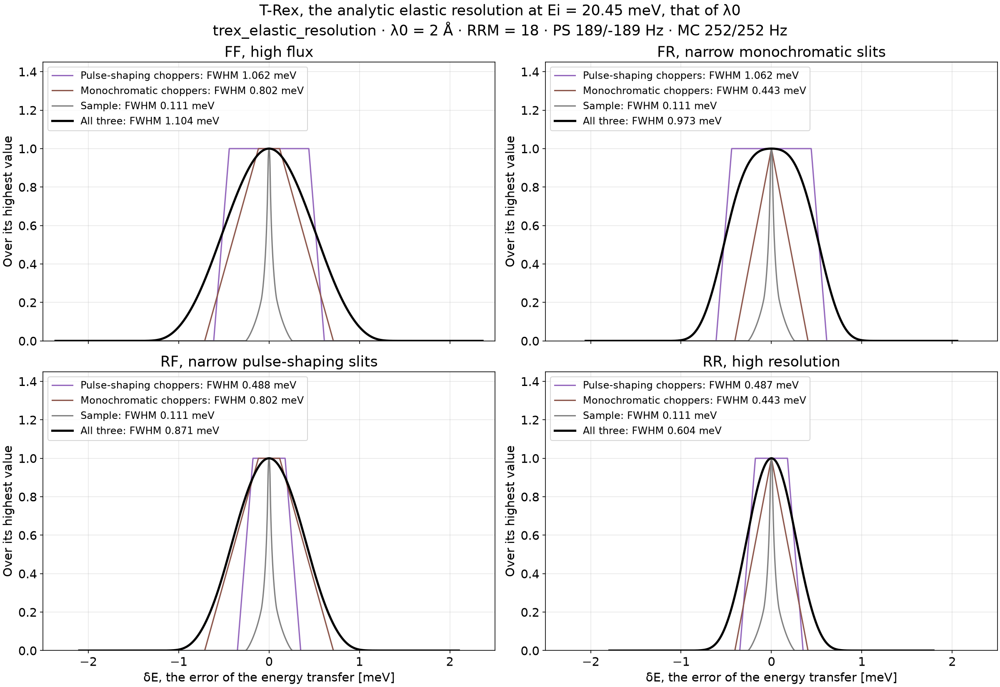

# Analytic elastic resolution

The [elastic resolution](elastic-resolution-incoherent.md) page measures the width of the
elastic line of vanadium in McStas, in each of the four modes of the choppers. This page computes
the same width from the geometry of T-Rex alone, without McStas: how long each pair of choppers is
open, where in the sample a neutron scatters, and how the reduction turns both into an error of
the energy transfer. The model is in
[`mcdgs.diagnostics.trex.elastic_resolution_model`](https://github.com/bingli621/mcdgs/blob/main/src/mcdgs/diagnostics/trex/elastic_resolution_model.py),
whose docstrings follow the same steps. It has no free parameter, and it gives the simulated width
within 5 % for at least 13 of the 15 sub-pulses, in every mode.

The calculation follows the first-order treatment of disk-chopper spectrometers of Gaspar (2007),
cited by equation below, with two changes: the opening of each pair of choppers is computed for
the actual width of the beam, and the three terms are convolved rather than added in quadrature.

## 1. The flight of an elastic neutron

A neutron passes the pulse-shaping choppers at t_P and the monochromatic choppers at t_M, a
distance L_PM apart. That fixes its speed, v = L_PM / (t_M − t_P). It reaches the sample L_MS
after the monochromatic choppers, and the detector L2 after the sample.

The reduction does not know t_P and t_M of each neutron. It gives every neutron of a sub-pulse
the Ei and the time at the sample of the sub-pulse, takes Ef from the flight time over L2, and
E = Ei − Ef. A neutron that passes the choppers δt_P and δt_M off the centers of their openings is
then measured with a flight time off by

```text
δ(t_D − t_S) = A δt_M − B δt_P,    A = 1 + L_MD / L_PM,    B = L_MD / L_PM,
```

with L_MD = L_MS + L2, the path from the monochromatic choppers to the detector. On the elastic
line, Ef = Ei, so the energy transfer is off by

```text
δE = (2 Ei v0 / L2) (A δt_M − B δt_P),
```

with v0 the speed of the sub-pulse. This is eq. (19) of Gaspar (2007) at Ei = Ef, with his L0 for
L_PM and his L2 + L1 for L_MD. For T-Rex:

| | |
| --- | --- |
| L_PM, pulse-shaping to monochromatic choppers | 54.03 m |
| L_MS, monochromatic choppers to sample | 1.77 m |
| L2, sample to detector | 3.00 m |
| A | 1.088 |
| B | 0.088 |

The pulse-shaping choppers weigh in only by B, but they are open about fifteen times as long as
the monochromatic ones, so their term is as large or larger. Both terms grow as Ei v0, so FWHM / Ei
grows as the square root of Ei: the trend of every mode on the elastic resolution page.

## 2. How long a pair of choppers is open

Each pair is two disks with the same slit, whose rims cross the beam in opposite directions at the
rim speed u. A neutron passes if it is inside both slits. Two slits of arc a overlap on a window
a − 2u|t| wide, which closes in a / (2u):

- **A beam at least as wide as the slit** sees the whole window, so the pair is open as a triangle
  in time, with a FWHM of a / (2u). This is eq. (1) of Gaspar (2007), Δt = b / (2π f D).
- **A beam narrower than the slit** cuts the top off the triangle. The pair is open as a trapezoid,
  for longer: up to a / u, that of a single disk, for a beam of no width.

T-Rex has both cases:

| Pair | Beam | Slit (F / R) | Rim speed | Opening FWHM (F / R) | a / (2u), the triangle (F / R) |
| --- | --- | --- | --- | --- | --- |
| Pulse-shaping | 60.0 mm | 213.8 / 122.2 mm | 415.6 m/s | 442 / 222 µs | 257 / 147 µs |
| Monochromatic | 22.4 mm | 26.9 / 15.3 mm | 554.2 m/s | 28.3 / 13.8 µs | 24.3 / 13.8 µs |

The beam at the pulse-shaping choppers is much narrower than their slits, so their openings are
long trapezoids, 1.5 to 1.7 times the triangle. The narrow slit of the monochromatic choppers is
narrower than its beam, so it opens as the triangle, and passes at most 68 % of the beam: one
reason why FR keeps only a third of the flux of FF. The model computes each opening exactly, as
the length of the beam inside both slits at each time, for a beam that fills the window of the
disks evenly.

The second disk of the pulse-shaping pair is 0.1 m downstream of the first. Its delay is set for
the speed of λ0, so for a sub-pulse of another speed the two slits are centered at different
times, by up to ±17 µs for the outermost sub-pulses. The model takes that in.

## 3. Where in the sample the neutron scatters

A neutron that scatters at (x, y) from the center of the sample, x along the beam and y across
it, into the scattering angle 2θ, flies further by

```text
δpath = x (1 − cos 2θ) − y sin 2θ,
```

which the reduction, putting every neutron at the center, reads as δE = 2 Ei δpath / L2. This is
eq. (20) of Gaspar (2007), for a rectangle, at Ei = Ef. For the vanadium cylinder of radius 1 cm,
δpath is the projection of a uniform disk on a vector of length 2 sin θ: a semicircle of radius
2r |sin θ|. The model averages it over the scattering angles of the detector that the reduction
keeps, −36° to −5° and 5° to 144°, evenly per degree: vanadium scatters the same in every
direction, and the pixels of the banana are of equal angle. It leaves out that the detector also
spans 25° below to 15° above the beam.

## 4. The detector

The banana detector of the simulation has no depth, and lists the exact time of every neutron, so
it adds nothing. A real detector adds a term from its depth, like that of the sample: eq. (9) of
Gaspar (2007). This is where the model could describe the real instrument better than the
simulation does, once the detector is known.

## 5. The three together

The three errors are independent. The moderator pulse, 2.86 ms long, is flat across the openings,
so δt_P and δt_M are not correlated, and neither is with where the neutron scatters. The model
therefore convolves the three distributions of δE.

It does not add their widths in quadrature, as Gaspar (2007) does for Gaussians (his footnote 1).
The openings are trapezoids and triangles, not Gaussians, and quadrature makes the line too wide:
in FF at 20.45 meV, the root of the sum of the squares of the three widths below is 1.34 meV,
against 1.10 meV for their convolution and 1.06 meV in McStas.

## 6. The width

The model fits a Gaussian to the core of the convolution, the values of at least a fifth of the
highest, each with an error of its square root as for a count, as the reduction fits the
simulated lines, and gives its FWHM.

## The terms at λ0

At the sub-pulse of λ0 = 2 Å, 20.45 meV, the distributions of δE of the three terms, and of all
three together, in each mode:



--8<-- "docs/instruments/trex/figures/elastic-resolution-incoherent/trex_elastic_resolution_incoherent_terms.txt"

- **The pulse-shaping choppers set the width of FF.** Their term, 1.06 meV, is the largest in FF
  and in FR; the monochromatic choppers give 0.80 meV, and the sample 0.11 meV.
- **So RF does more than FR.** The narrow pulse-shaping slits cut the largest term to less than
  half, 0.49 meV; the narrow monochromatic slits cut the smaller one to 0.44 meV. RF comes to
  0.87 meV, FR to 0.97 meV.
- **The sample hardly counts.** Its term is a tenth of the others, and adds little to their
  convolution.

## Against McStas

The model is the line of each mode in the first panel of the
[comparison of the modes](elastic-resolution-incoherent.md#all-four-modes). At the Ei of every
sub-pulse:

--8<-- "docs/instruments/trex/figures/elastic-resolution-incoherent/trex_elastic_resolution_incoherent_model.txt"

- **Within 5 % for at least 13 of the 15 sub-pulses**, in every mode, with no parameter fitted. The model
  is mostly 1 % to 5 % wider than McStas.
- **The outermost sub-pulses are narrower than the model.** At 47.17 meV and 11.36 meV the model
  is up to 21 % wider in FF and FR. Those sub-pulses carry much less flux than the others, which
  suggests that the bandwidth choppers cut them, and with them part of their time spread. This is
  not checked yet.

## What it leaves out

- Terms of second order in the offsets δt_P and δt_M.
- The spread of path lengths in the guide between the choppers, and gravity.
- The bandwidth choppers.
- The beam filling the window of the disks unevenly.
- The sample out of the horizontal plane, and its absorption.

## References

- A. M. Gaspar, *Methods for analytically estimating the resolution and intensity of neutron
  time-of-flight spectrometers. The case of the TOFTOF spectrometer*,
  [arXiv:0710.5319](https://arxiv.org/abs/0710.5319) (2007), a technical report of 2005. Eqs.
  (1), (9), (19) and (20), and footnote 1, as cited above.
- N. Violini, J. Voigt, S. Pasini and T. Brückel, *A method to compute the covariance matrix of
  wavevector-energy transfer for neutron time-of-flight spectrometers*, Nucl. Instrum. Methods Phys.
  Res. A **736**, 31–39 (2014),
  [doi:10.1016/j.nima.2013.10.042](https://doi.org/10.1016/j.nima.2013.10.042). The covariance of Q
  and E for direct-geometry spectrometers with pulse-shaping and monochromatic choppers, by the
  group that proposed T-Rex. Not used here: the next step beyond the width in energy alone.

## Making the figures

The figure and the tables of this page are made with those of the
[elastic resolution](elastic-resolution-incoherent.md#making-the-figures) page, by the same
`analyze`. The model itself needs no McStas; the comparison needs the runs of every mode.
