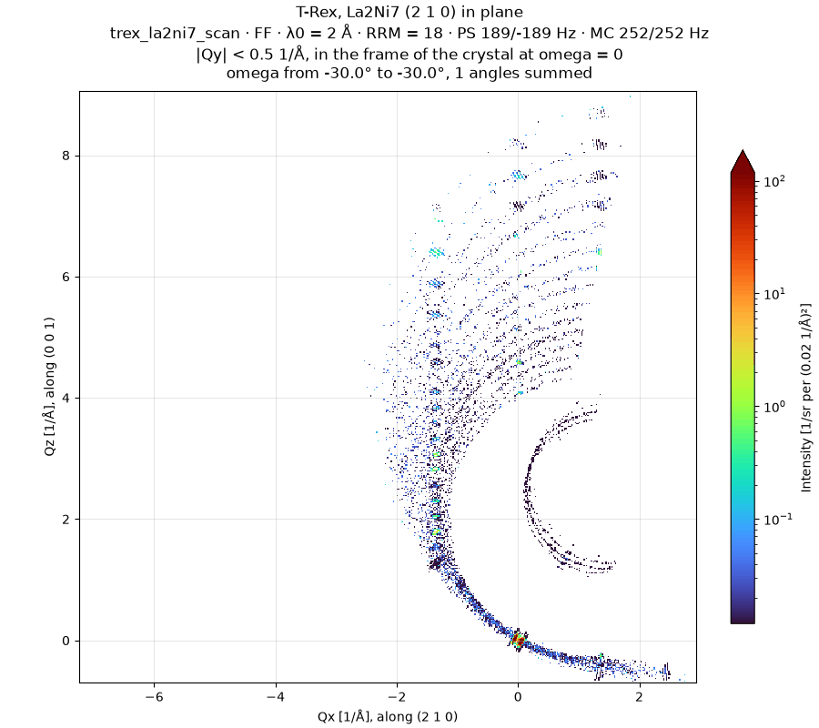
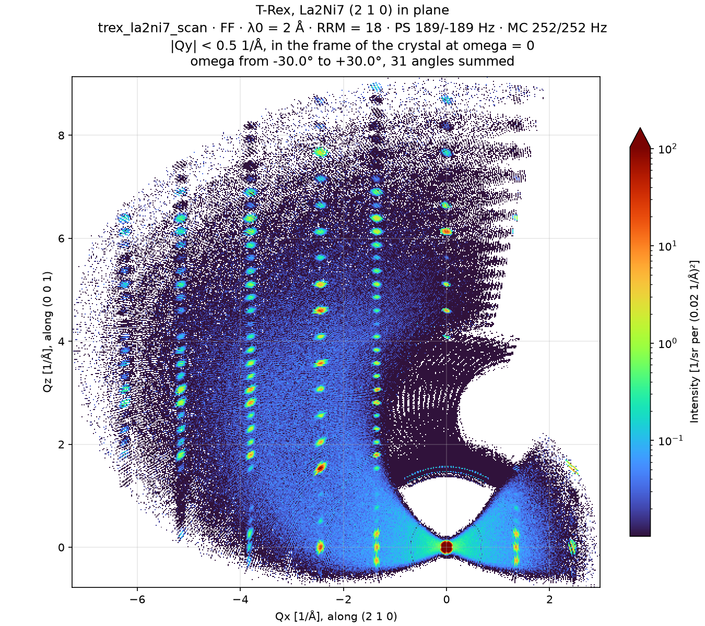

# Rotation scan

`TRexWithRotatingLa2Ni7`, in
[`mcdgs.diagnostics.trex.elastic_scan`](https://github.com/bingli621/mcdgs/blob/main/src/mcdgs/diagnostics/trex/elastic_scan.py),
turns the La2Ni7 crystal about the vertical, one angle at a time, and maps the horizontal plane
of its reciprocal space. Each angle is reduced as on [Elastic plane](elastic-plane.md); turned
into the frame of the crystal, the angles add up to one map.

## The setup

`TRexWithRotatingLa2Ni7` is `TRex` with the crystal of `la2ni7` on a goniometer: McStas
`ROTATED (0, omega, 0)`, with `omega` an instrument parameter. Its control parameters are the
defaults.

| | |
| - | - |
| Crystal | La2Ni7, as on [Elastic plane](elastic-plane.md#the-setup) |
| Orientation at omega = 0 | c* along the beam; (2 1 0) in the horizontal plane, to the left of the beam |
| omega | −30° to 30°, in 31 steps of 2° |
| `SPLIT` | 10, against 100 for one angle: every angle lists its own neutrons |

With (2 1 0) in the horizontal plane, 2a* + b* and c* span it, so turning the crystal about the
vertical keeps that plane of reciprocal space horizontal. Each angle brings other reflections of
it onto the Ewald spheres of the sub-pulses.

## The scan

`simulate` runs only the part from `sample_pos` to the detector, with `scan_from_sample` of
[`Simulation`](../../how-to/run-a-simulation.md), once per angle and in parallel. Each angle
starts from the beam file of [Elastic plane](elastic-plane.md#two-runs-split-at-the-sample), the
6,629,716 neutrons at `sample_pos` from 1e9 rays of the masked source: the beam before the
sample does not depend on the crystal. The 31 angles take about a minute and a half on
18 cores, and about 4.5 GB, in one file with one entry per angle.

## The reduction

`reduce_angles` takes the sub-pulses from the run to the sample of
[Elastic plane](elastic-plane.md#the-reduction), the same for every angle, and reads the angles
one at a time, with `read_events`. Each is reduced and normalized as there, per incident neutron
and per steradian. Then `crystal_frame` turns its Q by the angle of the crystal, with the McStas
rotation matrix of `ROTATED (0, omega, 0)`: Q is then in the frame of the crystal as it stands at
omega = 0, and a reflection has the same Q at every angle. The neutrons with |Qy| < 0.5 Å⁻¹ in
that frame go into one (Qx, Qz) map per angle, and the maps of all angles add up.

## The map



`animate` builds the map up one angle per frame, with the angles summed so far in the title;
the last frame is the whole scan. Qx is along (2 1 0) and Qz along (0 0 1). The crystal frame is
fixed, so the region the detector covers turns about the origin with omega, and each reflection
appears as that region passes it. The color scale is that of
[Elastic plane](elastic-plane.md#the-plane), logarithmic, in turbo, four decades deep below the
highest bin beyond the direct beam, here of the whole scan for every frame, so the map grows
brighter as the angles add up.

`plot_scan` draws the whole scan, the last frame of the GIF, as a figure of its own:



The Bragg peaks line up in rows along c*. Each row is the reflections (h k l) of one h and k,
all l, whose in-plane part lies within the slice of Qy:

| Row | Qx | Qy |
| --- | -- | -- |
| (1 0 l) | +1.36 Å⁻¹ | −0.47 Å⁻¹ |
| (0 0 l) | 0 | 0 |
| (−1 0 l) | −1.36 Å⁻¹ | +0.47 Å⁻¹ |
| (−1 −1 l) | −2.44 Å⁻¹ | −0.47 Å⁻¹ |
| (−2 −1 l) | −3.80 Å⁻¹ | 0 |
| (−3 −1 l) | −5.15 Å⁻¹ | +0.47 Å⁻¹ |
| (−3 −2 l) | −6.24 Å⁻¹ | −0.47 Å⁻¹ |

(−2 −1 l) and (0 0 l) lie in the horizontal plane; the others lie 0.47 Å⁻¹ above or below it,
just inside the slice. Between the peaks is the incoherent scattering of the crystal, which
follows the detector around as the crystal turns. An elastic neutron has its Q on the circle of
its sub-pulse, of radius ki through the origin, and the smallest ki is 2.34 Å⁻¹. The empty
region near the origin lies inside that circle at every angle of the scan, so no elastic neutron
reaches it.

## Making the figures

The GIF and the figure need McStas, so they are not made with the site: `pixi run
docs-diagnostics` makes them again, with the other files of the T-Rex pages. The scan starts
from the beam file of [Elastic plane](elastic-plane.md), so run that first. Then:

```bash
pixi run python -m mcdgs.diagnostics.trex.elastic_scan
```

`main` runs the 31 angles, then saves the GIF and the figure in the scan folder, or in the
folder given with `--out`. To reduce the scan again without McStas:

```bash
pixi run python -c "from mcdgs.diagnostics.trex.elastic_scan import analyze; analyze()"
```
