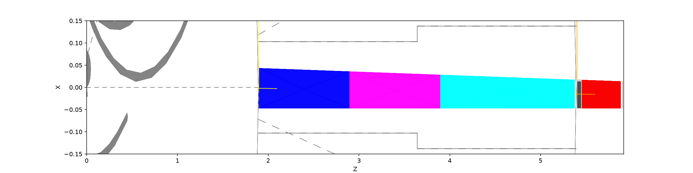
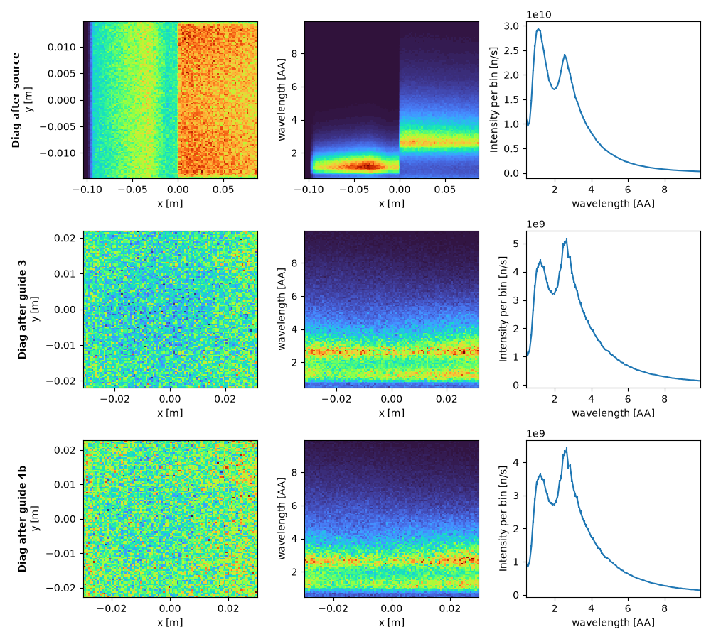
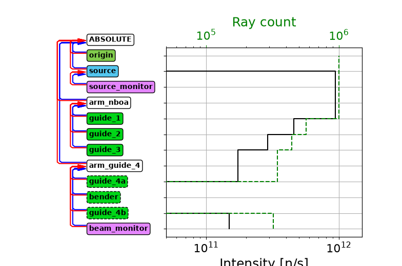
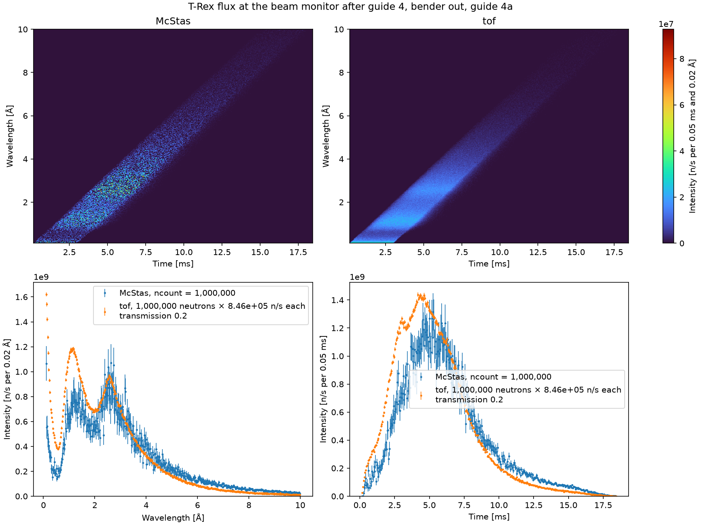

# Extraction guides

`Extraction`, in
[`mcdgs.diagnostics.trex_02_extraction`](https://github.com/bingli621/mcdgs/blob/main/src/mcdgs/diagnostics/trex_02_extraction.py),
is T-Rex up to the beam monitor after guide 4: the source, the
[extraction guides](details.md#extraction-guides) 1 to 3, and guide 4 with its
[two paths](details.md#two-paths-through-guide-4), the thermal guide 4a with the bender out and
the bender and the cold guide 4b with it in. It has the same components as `TRex`, with the same
values, but for the band: its source keeps the widest band, 0.1 to 10 Å, and its beam monitor
that band too, while those of `TRex` follow `lambda0`. It also has the `source_monitor` of
[Source](source.md), at the entrance of guide 1.

It is defined like any instrument of mcdgs: a parameters class, then an `Instrument` subclass that
creates its components in beam order. Its two control parameters, `bender_in` and `b_rot`, are
McStas instrument parameters, so one compiled instrument runs both paths: each component of guide 4
has a McStas `WHEN` on `bender_in`, and a run uses either guide 4a or the bender and guide 4b.

<!-- fmt:off -->
```python
--8<-- "src/mcdgs/diagnostics/trex_02_extraction.py:extraction"
```
<!-- fmt:on -->



The view is from above, as McStas draws it: z along the beam, from the source to the entrance of
guide 5 at 5.916 m, and x across it, ±0.15 m. The two axes have different scales, so the
guides look much wider than they are. On the left are the moderator and the ESS emblem that
`ESS_butterfly` draws in place of the target wheel, with the instrument axis dashed. The yellow
line at 1.896 m is the focusing rectangle of the source, and the short yellow and orange lines
at 1.896 m and 5.401 m are the arms that guides 1 and 4 are placed on. Guides 1, 2 and 3, in blue, magenta and cyan, run from 1.896 m to
5.375 m; they taper towards the fixed wall at x = -0.047 m, and the taper of the extraction
turns them by -0.215°. Guide 4 starts at 5.401 m: the short bender, dark gray, and then guide 4b
in red, on top of guide 4a, which takes the same place, as only one of the two paths is used in a
run. The beam monitor is the thin line at 5.902 m. The thin gray lines across the beam at about
1.9 m and 5.4 m are `ESS_butterfly`'s circles of 2 m, inside which no optics is allowed, and of
5.5 m, the target monolith, around the center of the moderator. The gray lines along the beam,
0.206 m and then 0.276 m apart, are the beam port plug, and the dashed lines the next beam
ports.

`main` draws this view and runs the path without the bender, through the thermal guide 4a, with
`diagnose_path`: McStas twice and tof once, for three figures, McStasScript's diagnostics along
the guides, McStasScript's diagram of the intensity before each component, and McStas and tof
side by side at the beam monitor. The path with the bender is on
[Bender](bender-scan.md#bender-in-at-the-nominal-rotation), which runs `diagnose_path` with
the bender in. The figures are `main` at its defaults: 1e7 McStas neutrons per run, 1e6 tof
neutrons and seed 1.

## Beam along the guides

Each row is one position in the beam: after the source, after guide 3 and at the exit of guide 4,
where guide 4b ends; with the bender out the beam there has come through guide 4a. The columns are
the beam profile, wavelength against x, and the spectrum in n/s per bin. x is across the beam in
the frame of the component, so after guide 3 it spans the exit of guide 3, ±31.9 mm, and at the
exit of guide 4 that of guide 4, ±30.1 mm.

<!-- fmt:off -->
```python
--8<-- "src/mcdgs/diagnostics/trex_02_extraction.py:diagnostics"
```
<!-- fmt:on -->



After the source the two moderators are side by side: the thermal one at x < 0 with its peak near
1.2 Å, the cold one at x > 0 with its peak near 2.6 Å. After guide 3 the two are mixed across the
width of the guide, and the spectrum still has both peaks. Through guide 4a both peaks reach the
exit of guide 4.

The maps have 100 × 100 bins, so at 1e7 neutrons each bin holds a few hundred rays and the maps
are still a little grainy. The spectra, on one axis, are smooth.

## Intensity along the guides

McStasScript's diagram lists the components in beam order, with arrows from each to the one it is
placed relative to. Next to it, the black line is the intensity just before each component, in
n/s, and the dashed green line the number of rays, both on a log scale zoomed to 5e10 to
1.5e12 n/s. Each step of the line is what one component loses. It is a McStas run of its own,
which adds a monitor before every component; those monitors are 100 m wide, so they count every
ray, inside an opening or not. `show_diagram` has no range for the intensity, so the range is set
on the axes it drew, and its `plt.show()` is held back so the figure can be saved:

<!-- fmt:off -->
```python
--8<-- "src/mcdgs/diagnostics/trex_02_extraction.py:diagram"
```
<!-- fmt:on -->



| Lost in | Share | Intensity after it |
| ------- | ----- | ------------------ |
| guide 1 | 48 % | 4.56e11 n/s |
| guide 2 | 36 % | 2.90e11 n/s |
| guide 3 | 41 % | 1.71e11 n/s |
| guide 4a | 14 % | 1.48e11 n/s |

The beam leaves the source at 8.84e11 n/s, all it sends towards guide 1, and passes the source
monitor unchanged. Guides 1 to 3 take most of it: after guide 3, 19 % is left. Guide 4a takes
14 % more, and 1.48e11 n/s reaches the beam monitor, 17 % of the beam before guide 1. The bender
and guide 4b are skipped, so their rows are empty.

The 48 % of guide 1 includes the beam that misses its opening. The source aims at a rectangle
4 mm wider than the entrance, as it is centered on the axis and the entrance is not (see
[Source](details.md#source)). The source monitor, which is the entrance, sees 8.46e11 n/s, so
4 % of the 8.84e11 never enters guide 1. From the entrance of guide 1, 17 % reaches the beam
monitor.

## McStas and tof at the beam monitor

The beam monitor is in the gap after guide 4, at 5.902 m, 0.06 m wide and 0.0463 m high. It
records one map of time, 0.15 to 18.4 ms in 366 bins of 0.05 ms, against wavelength, 0.1 to 10 Å
in 495 bins of 0.02 Å. The time runs from the fastest neutron of the band, 0.1 Å, leaving at the
start of the pulse, to the slowest, 10 Å, leaving 3.5 ms later. Both models see the same monitor;
see [Source](source.md) for how the two are read and compared. At 1e7 McStas neutrons the McStas
spectra are smooth, with error bars of a few percent.

tof has no guides and no bender: every neutron of its pulse reaches the monitor, at the time of
its straight flight from the source. Its counts are scaled where both models see the same beam,
at the source monitor, to the McStas total there: 8.46e5 n/s per tof neutron. At the beam monitor
they are scaled again by a `transmission` of 0.2, the argument of `main`, for what the guides
would let through. That is close to the 17 % of McStas above, so where McStas is above tof the
guides pass more than 0.2 of the beam, and where it is below, less. [Beam monitor](beam-monitor.md)
runs the same path with the transmission tuned to McStas, 0.1734, and explains both factors. `read_scaled_comparisons`
reads each monitor of both models on its bins, from `monitor_bins`; the scale of the source
monitor is passed on to the beam monitor:

<!-- fmt:off -->
```python
--8<-- "src/mcdgs/diagnostics/trex_02_extraction.py:scale_tof"
```
<!-- fmt:on -->

1.47e11 n/s reach the monitor:



At the cold peak, 2.6 Å, McStas and tof agree: the guides pass about 0.2 of it. Above about 4 Å
McStas is above tof, since the guides pass a long wavelength at a larger angle, so more of it
reaches the monitor. McStas is below tof at the thermal peak, 1.1 Å, where the guides pass about
13 %, and below 0.3 Å it has a fraction of tof's peak.

## Making the figures

The figures need McStas, so they are not made with the site: `pixi run docs-diagnostics` makes
them again, with the other files of the T-Rex pages. To make them yourself, run:

```bash
pixi run python -m mcdgs.diagnostics.trex_02_extraction
```

The view from above goes to `mcstas_input/trex_extraction/`, next to the instrument file, and
the three figures of the path to the folder of its run with the diagnostics,
`mcstas_output/trex_extraction_bender_out/`. That folder also holds McStasScript's event lists of
the three diagnostics positions, about 1.8 GB at 1e7 neutrons. The run of the diagram has a
folder of its own, `mcstas_output/trex_extraction_bender_out_intensity/`. The two McStas runs
take about a minute on 8 cores. Call `main` with
other numbers for finer or faster figures:

```bash
pixi run python -c "from mcdgs.diagnostics.trex_02_extraction import main; main(ncount=1e6)"
```
