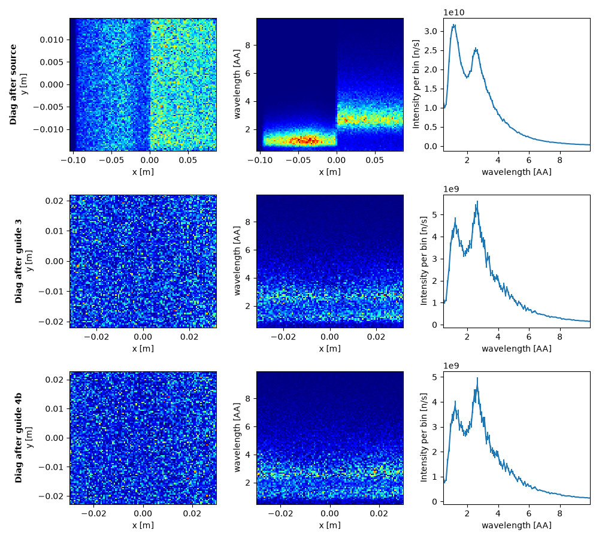
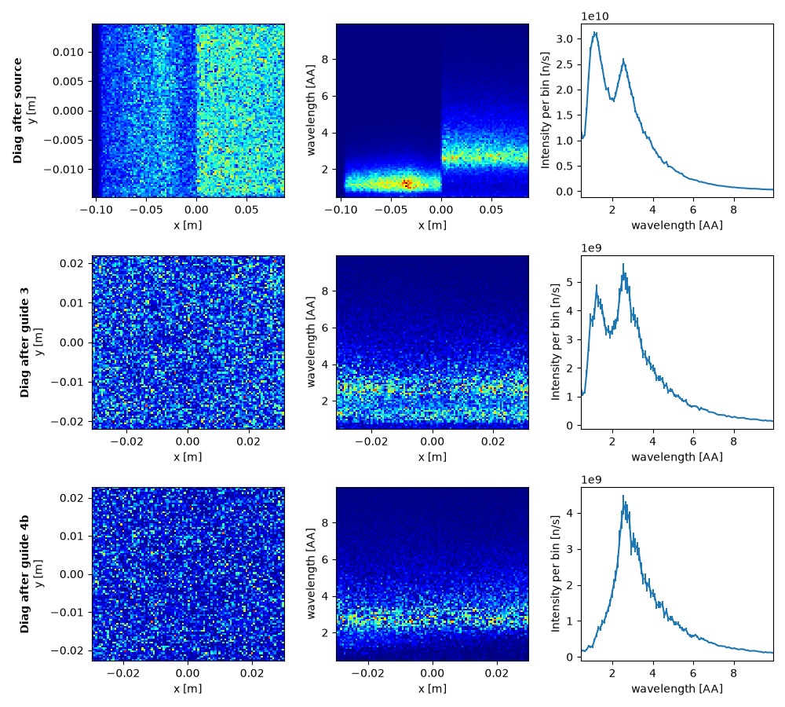
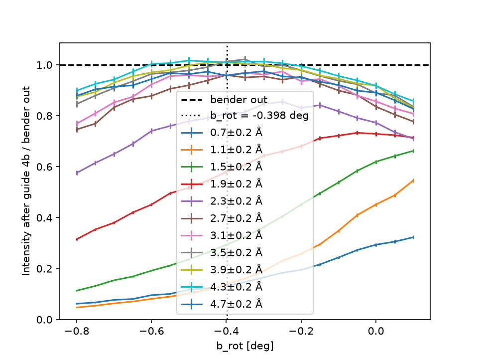

# Extraction results

These figures come from the model of the [extraction guides](index.md#extraction-guides).

## Beam along the guides

Each row is one position in the beam: after the source, after guide 3 and at the exit of guide 4.
The columns are the beam profile, wavelength against x, and the spectrum in n/s per bin.
[`diagnosis/trex/bender/guide_extraction.py`](https://github.com/bingli621/mcdgs/blob/main/diagnosis/trex/bender/guide_extraction.py)
draws these views for the path set by `bender_in`; the figure is saved by hand.

**Bender out**, through the thermal guide 4a:

**Bender in**, through the cold guide 4b:

The top rows are the same in both figures. After the source the two moderators are side by
side: the thermal one at x < 0 with its peak near 1.2 Å, the cold one at x > 0 with its peak near
2.6 Å. After guide 3 the two are mixed across the width of the guide, and the spectrum still has
both peaks. The bottom rows differ: without the bender both peaks reach the exit, while with it
the thermal peak is mostly gone and the cold peak stays.

## Rotation of the bender

[`diagnosis/trex/bender/bender_efficiency.py`](https://github.com/bingli621/mcdgs/blob/main/diagnosis/trex/bender/bender_efficiency.py)
scans `b_rot` from -0.8 to 0.1 deg with 1e7 neutrons per angle. Each curve is one band of
wavelengths at the exit of guide 4, divided by the same band with the bender out, so the dashed line
at 1 is the bender-out intensity. The dotted line is the nominal rotation, -0.398 deg. The legend
repeats blue: the lowest blue curve is 0.7 Å, the upper one 4.7 Å.

Approximate transmission at the nominal rotation:

| Wavelength | Transmission |
| ---------- | ------------ |
| 2.7 Å and above | 0.92 to 1.0 |
| 2.3 Å | 0.8 |
| 1.9 Å | 0.58 |
| 1.5 Å | 0.3 |
| 0.7 and 1.1 Å | 0.13 |

The bands of about 3 Å and above peak broadly around the nominal rotation. The bands up to 1.5 Å
keep rising up to the end of the scan at 0.1 deg, so their maximum lies outside it.

`simulate()` is commented out at the end of the script, so by default it replots the last scan
from `mcstas_output/`. To run a new scan, uncomment it.
