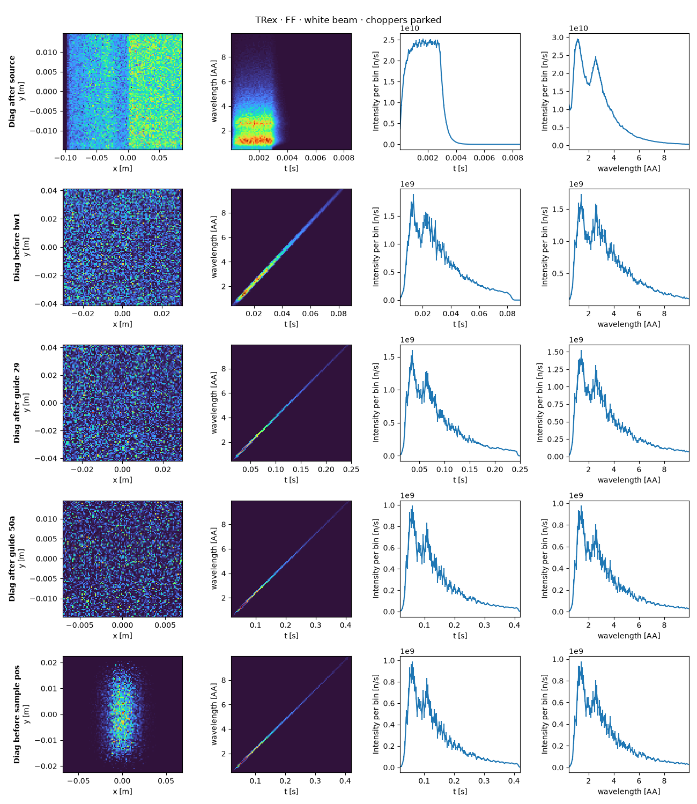
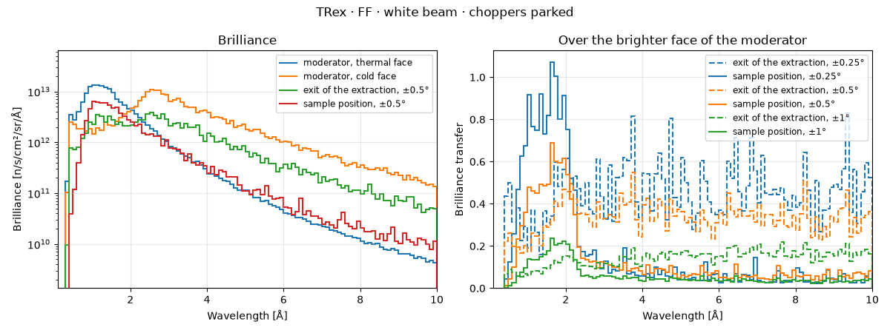

# Guides

[`mcdgs.diagnostics.trex.guides_diagnostics`](https://github.com/bingli621/mcdgs/blob/main/src/mcdgs/diagnostics/trex/guides_diagnostics.py)
follows the beam of T-Rex through all its guides, from the source to the sample position. It
runs `TRex` in the white beam, 0.1 to 10 Å (`lambda0` `None`), with every chopper parked on its
wide slit (`rrm` 0, mode `"FF"`), so the beam is not chopped: what it loses on the way is what
the guides take out, and the little the parked disks block. The bender is out, so the beam goes
through the thermal guide 4a.

It uses McStasScript's two tools: its beam diagnostics, the beam at five points along the
instrument, and its diagram of the intensity before every component. From the rays of the
diagnostics it also draws the transmission of the guides by wavelength. A second module reads
the same rays in windows of position and divergence, for the
[brilliance transfer](#brilliance-transfer) of the guides.
[Run McStasScript's diagnostics](../../how-to/run-mcstasscript-diagnostics.md) has the code and
explains both tools; this page shows what they give for T-Rex. The guides themselves are listed
in [Technical details](details.md#curved-guides).

## The beam along the guides

The points are after the source, before the first bandwidth chopper `bw1` (32.0 m), after guide
29 at the end of the curve (96.0 m), after guide 50a at the end of the straight guide (163.1 m)
and before `sample_pos` (163.8 m). Each row is one point; the columns are the beam profile,
wavelength against time, and the spectra in time and in wavelength, in n/s per bin. At 1e6
neutrons and seed 1:



After the source, the beam leaves the two moderators side by side, brighter at x above 0,
within the pulse, about 3 ms long. Its spectrum has two peaks, at about 1.1 and 2.5 Å, and a
long tail to 10 Å. Further along, a neutron arrives later the longer its wavelength, so
wavelength against time is a band. The band keeps the length of the pulse while the flight time
grows with the distance, so it looks thinner at every point. Before the first bandwidth chopper,
the beam fills the guide, ±0.03 m by ±0.04 m, and has 14 times less intensity than after the
source. From there to the sample position, the spectrum keeps its two peaks, and drops by a
factor of about 2.3; 114224 of the 1e6 rays reach the sample position. There, the beam is a spot
about 0.04 m across.

## The intensity before each component

McStasScript's diagram lists the components in beam order, with the intensity just before each,
in n/s, and the number of rays, on a log scale. Each step of the line is what one component
loses. At 1e7 neutrons and seed 1:

??? abstract "The diagram of the intensity before each component"

    

The intensity falls from 8.8e11 n/s at the entrance of guide 1 to 2.5e10 n/s at the sample
position. Most of it is lost in the first guides, up to about 20 m; the parked choppers take
little. Guide 4a, the bender and guide 4b have dashed boxes: they take part only under a
condition on `bender_in`, and the line is not to be read there. At `arm_bwc1`, `arm_bwc2` and
`arm_end_of_curve` the line dips to about half and comes back at the next component. An arm
takes nothing from the beam, so the dip is how the diagram's monitor reads at those arms, not a
loss. With the choppers turning, the pulse-shaping and monochromatic choppers take the largest
steps, down to about 1e7 n/s at the detector.

## Transmission of the guides

### Along the beam

The transmission of a section is the intensity at its exit over that at its entrance, read from
the diagram's run, at 1e7 neutrons. The sections follow the tables of
[Technical details](details.md#curved-guides):

| Guides | From → to, m | In, n/s | Out, n/s | Transmission |
| ------ | ------------ | ------- | -------- | ------------ |
| 1 to 4a, extraction | 1.9 → 5.9 | 8.84e11 | 1.48e11 | 0.167 |
| 5 to 9, start of the curve | 5.9 → 22.7 | 1.48e11 | 5.97e10 | 0.404 |
| 10 to 25, curve, with `bw1` and `bw2` | 22.7 → 82.0 | 5.97e10 | 5.16e10 | 0.863 |
| 26 to 29, end of the curve | 82.0 → 96.0 | 5.16e10 | 4.39e10 | 0.851 |
| 30 to 33, straight, with `ps1` and `ps2` | 96.0 → 111.1 | 4.39e10 | 3.73e10 | 0.849 |
| 34 to 45, elliptic | 111.1 → 155.6 | 3.73e10 | 3.54e10 | 0.950 |
| 47 to 50a, focusing, with `mc1` and `mc2` | 155.6 → 163.1 | 3.54e10 | 2.48e10 | 0.701 |
| All | 1.9 → 163.8 | 8.84e11 | 2.48e10 | 0.028 |

From the beam monitor after guide 4, the guides pass 0.168 of the beam to the sample position.
The losses are not spread evenly:

- **The first 20 m take most.** The extraction guides pass a sixth of the beam, and guides 5 to
  9 less than half of the rest, most of it in guides 5 and 6. Most likely, the beam leaves the
  extraction with more divergence than guides 5 to 9, with m 1.5 on their sides, carry.
- **The middle of the curve loses little**, under 1 % per 4 m guide. Guides 26 to 29 lose more,
  where the m of one side drops from 1.5 to 1, and so do guides 30 to 33, the straight guide
  after the curve, with m 1 on both sides: they trim the divergence the curve leaves.
- **Guides 34 to 45 pass 95 %.** Most of what reaches them already fits within m 1.
- **The focusing end takes 30 %**, most in guide 49, 17.5 %, and guide 50a, 12 %: the guides
  narrow from 45 × 55 mm to 14 × 30 mm, which raises the divergence of the beam.
- **The parked choppers take about 3 % together**: 0.1 % each for `bw1` and `bw2`, 1.1 % for the
  pulse-shaping pair and 1.7 % for the monochromatic pair. Parked on their wide slits, they
  block little of the beam.

### By wavelength

The rays of the beam diagnostics give the transmission by wavelength, as the ratio of the
intensities at two points, in bins of 0.1 Å, at 1e6 neutrons. On the left are the sections
between the points, on the right the whole way to the sample position, on a log scale. A bin
that fewer than 20 rays reach has no value, which leaves out most wavelengths below 0.4 Å:


The end of the straight guide, after guide 50a, is left out: the beam reaches the sample
position from there unchanged. In wider bands, from the same rays:

| From → to | 0.1–0.5 Å | 0.5–1 Å | 1–1.5 Å | 1.5–2 Å | 2–3 Å | 3–4 Å | 4–6 Å | 6–8 Å | 8–10 Å |
| --------- | --------- | ------- | ------- | ------- | ----- | ----- | ----- | ----- | ------ |
| Source → `bw1` | 0.009 | 0.027 | 0.050 | 0.061 | 0.058 | 0.078 | 0.122 | 0.207 | 0.300 |
| `bw1` → end of the curve | 0.151 | 0.808 | 0.886 | 0.891 | 0.825 | 0.727 | 0.674 | 0.646 | 0.646 |
| End of the curve → sample | 0.324 | 0.487 | 0.637 | 0.627 | 0.601 | 0.554 | 0.523 | 0.492 | 0.457 |
| `bw1` → sample | 0.049 | 0.393 | 0.564 | 0.559 | 0.496 | 0.403 | 0.353 | 0.318 | 0.295 |

Here the source is the beam just after it, all the source sends toward guide 1. The mean
wavelength is 2.60 Å after the source, 3.58 Å before `bw1`, 3.36 Å at the end of the curve and
3.20 Å at the sample position.

- **Up to `bw1`, the long wavelengths pass best**, from under 1 % below 0.5 Å to 30 % at 8 to
  10 Å. A supermirror of a given m reflects up to an angle in proportion to the wavelength, so
  the first guides carry the long wavelengths at much larger angles than the short ones.
- **After `bw1`, 1 to 2 Å pass best**, 56 % to the sample position, and the transmission falls
  toward long wavelengths, to 30 % at 8 to 10 Å. The long wavelengths the first guides took in
  at large angles reflect more often, and lose more at each reflection. Gravity adds to it: a
  neutron of 8 Å, at 494 m/s, takes 0.27 s from `bw1` to the sample and would fall 0.35 m, four
  times the height of the guide, so it bounces off the bottom wall all the way.
- **Below 0.5 Å, the curve takes almost everything.** Over its 90 m the 12 km curve leaves no
  line of sight through the 60 mm guide, so a neutron must reflect off its walls to pass. The
  angle that needs, about √(2 × 60 mm / 12 km) = 0.18°, is the critical angle of m 2.5 at
  about 0.7 Å: shorter wavelengths fall off, to 15 % below 0.5 Å.

Overall, from the source to the sample position, about 3 % pass at 1 to 4 Å, both peaks
alike, and 9 % at 8 to 10 Å: the first guides favor the long wavelengths more than the rest
favor the short ones, and the mean wavelength rises from 2.60 Å to 3.20 Å.

## Brilliance transfer

The transmission counts every neutron that the source sends towards guide 1. The source aims at
the whole entrance from every point of the moderator, with far more divergence than a guide
carries, so most of that beam is lost however good the guides are. The brilliance transfer
asks a sharper question: of what the moderator could put into a given window of position and
divergence at the sample, how much arrives?

The brilliance of a beam is its intensity per area, per solid angle and per wavelength, in
n/s/cm²/sr/Å. Along the beam it can only fall (Liouville's theorem), so the brilliance in a
window over that of the moderator is at most 1.
[`mcdgs.diagnostics.trex.brilliance_transfer`](https://github.com/bingli621/mcdgs/blob/main/src/mcdgs/diagnostics/trex/brilliance_transfer.py)
reads it in windows of 1 × 1 cm on the beam axis, with a divergence of ±0.25°, ±0.5° or ±1°
from the axis, both horizontally and vertically. It runs `TRex` as above, white beam, choppers
parked and bender out, and reads the rays at two points: before the beam monitor, at the exit
of the extraction, and before `sample_pos`.

### The brilliance of the moderator

The reference is the moderator itself, from a second instrument, `ModeratorView`: the source
of T-Rex alone, aimed at a rectangle 0.14 m wide and 0.01 m high on a plane 1 m in front of it.
A ray that crosses the plane within ±0.5° of the axis comes from the moderator within ±8.7 mm
of the same x, so the brilliance on the plane at x is that of the moderator at x. Across x the
moderator has two faces, each about 0.1 m wide and each flat over its middle: the thermal face
at x < 0, the cold face at x > 0. Each face is read over its flat part, from 0.03 to 0.07 m from
the center, and the reference is the brighter face at each wavelength: the thermal one below
about 2 Å, the cold one above.

<!-- fmt:off -->
```python
--8<-- "src/mcdgs/diagnostics/trex/brilliance_transfer.py:instrument"
```
<!-- fmt:on -->

### At the exit of the extraction and at the sample position

At 1e7 neutrons of T-Rex, 4e6 of the moderator and seed 1, in bins of 0.1 Å; a bin with fewer
than 20 rays in the window has no value:



In wider bands, from the same rays:

| Window | 0.5–1 Å | 1–1.5 Å | 1.5–2 Å | 2–3 Å | 3–4 Å | 4–6 Å | 6–8 Å | 8–10 Å |
| ------ | ------- | ------- | ------- | ----- | ----- | ----- | ----- | ------ |
| Exit of the extraction, ±0.25° | 0.311 | 0.269 | 0.433 | 0.461 | 0.494 | 0.483 | 0.485 | 0.454 |
| Exit of the extraction, ±0.5° | 0.195 | 0.234 | 0.360 | 0.363 | 0.365 | 0.351 | 0.347 | 0.325 |
| Exit of the extraction, ±1° | 0.065 | 0.077 | 0.116 | 0.113 | 0.127 | 0.154 | 0.170 | 0.164 |
| Sample position, ±0.25° | 0.534 | 0.818 | 0.918 | 0.235 | 0.092 | 0.064 | 0.047 | 0.046 |
| Sample position, ±0.5° | 0.264 | 0.473 | 0.589 | 0.191 | 0.100 | 0.078 | 0.058 | 0.059 |
| Sample position, ±1° | 0.069 | 0.144 | 0.207 | 0.081 | 0.051 | 0.042 | 0.036 | 0.034 |

- **Thermal neutrons reach the sample well.** From 1 to 2 Å the sample position has 0.8 to 0.9
  of the brilliance of the thermal face within ±0.25°, and about half within ±0.5°. The low
  transmission of the first guides is the divergence they cannot carry, not brilliance they
  lose.
- **Cold neutrons reach the middle of the sample with the brilliance of the thermal face.**
  Above 2 Å the brilliance at the sample position follows the spectrum of the thermal face,
  from 4 times below the cold one at 2 to 3 Å to 20 times at 8 to 10 Å, so the transfer drops
  to 0.05 to 0.2. The cold face is off
  the axis, at x > 0, so its neutrons enter guide 1 at an angle: at the exit of the extraction
  they leave at about −0.5°, the thermal ones at about +0.25°. At the sample position the cold
  neutrons lie on a band across position and divergence, from about −15 mm and −1° to +15 mm
  and +1°, with most of them away from its middle, where the window is. This is with the
  bender out, through the thermal guide 4a.
- **Wide windows are mostly empty.** Within ±1° the transfer is low at both points: the beam
  does not fill that much divergence, as the vertical divergence at the sample position reaches
  only about ±0.7°.
- **At the exit of the extraction the window lies between the two beams**, the thermal at
  +0.25° and the cold at −0.5°, so the transfer there, 0.2 to 0.4 within ±0.5°, understates
  what each beam keeps.

The reference is the mean of each face over 4 cm, and the brightest part of the thermal face is
about 20 % above its mean, so a bin can come out slightly above 1, as near 1.7 Å.

## Making the figures

The figures need McStas, so they are not made with the site: `pixi run docs-diagnostics` makes
them again, with the other files of the T-Rex pages. To make them yourself, run:

```bash
pixi run python -m mcdgs.diagnostics.trex.guides_diagnostics
```

It saves the three figures to `mcdgs_workspace/results/trex_guides_diagnostics/`, or to the
folder given with `--out`. The brilliance transfer is a module of its own:

```bash
pixi run python -m mcdgs.diagnostics.trex.brilliance_transfer
```

It saves its figure to `mcdgs_workspace/results/trex_brilliance_transfer/`, or to the folder
given with `--out`, and prints the table of the bands. Its runs go to the run folders
`trex_moderator_brilliance` and `trex_brilliance_transfer`, about 0.5 GB of rays. The transmissions of the tables are read from the run folders it
writes, `trex_guides_diagnostics` and `trex_guides_diagnostics_analysis` in the workspace.
