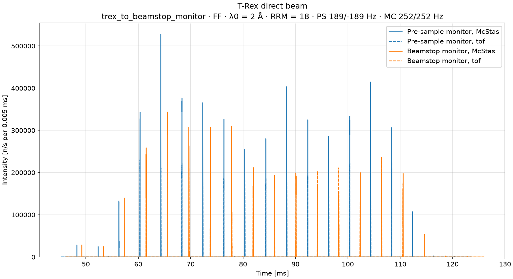
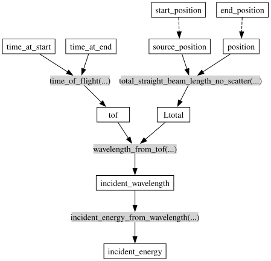
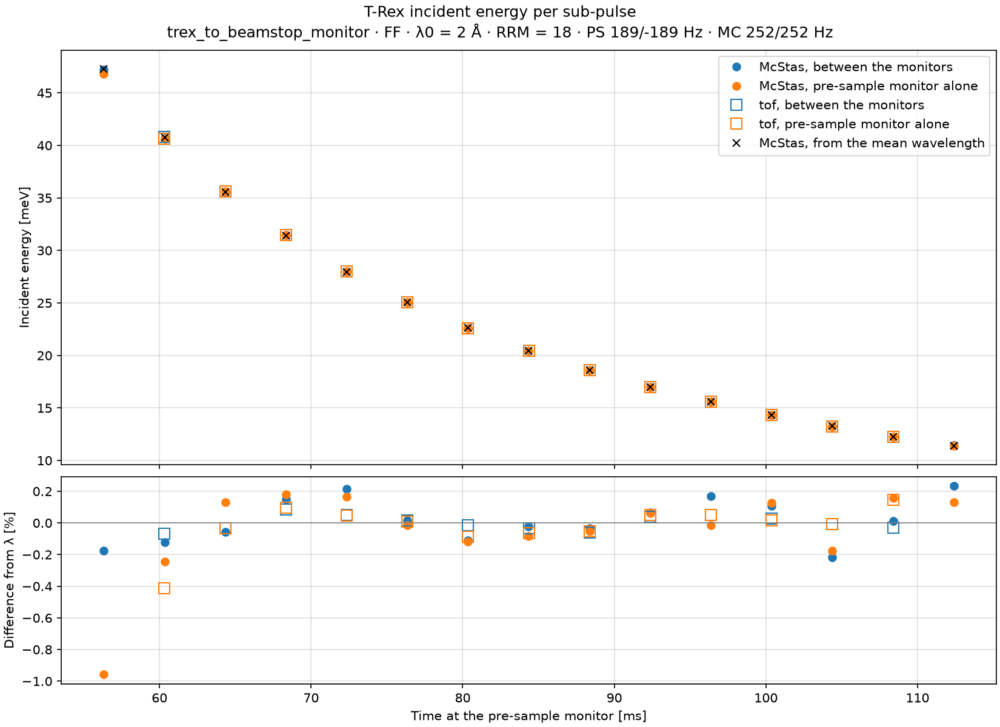

# Incident energy

`TRexToBeamstopMonitor`, in
[`mcdgs.diagnostics.trex_08_determine_ei`](https://github.com/bingli621/mcdgs/blob/main/src/mcdgs/diagnostics/trex_08_determine_ei.py),
finds the incident energy Ei of each sub-pulse of T-Rex from when it reaches two monitors: the
pre-sample monitor, just before the sample, and the beamstop monitor, 3.3 m further on. Ei follows
from the length of the flight and the time it takes. The calculation is a graph of
[scippneutron](https://scipp.github.io/scippneutron/) functions, and it runs on McStas and on
[tof](../../how-to/simulate-the-choppers-with-tof.md) alike.

!!! warning "The two monitors need 5 µs time bins"

    The flight between the monitors takes only 1.1 to 2.2 ms, so Ei is very sensitive to timing:
    a time error δt gives an error of 2 δt / t in Ei. In bins of 0.05 ms, as the other monitors
    of T-Rex have, the mean time of a sub-pulse is off by up to half a bin, and Ei by up to 1 %.
    The pre-sample and beamstop monitors therefore have bins of 5 µs, which bring the error down
    to 0.2 %. See [Why the time bins matter](#why-the-time-bins-matter).

## The setup

`TRexToBeamstopMonitor` is `TRex` with the La2Ni7 crystal of `la2ni7` on `sample_pos`, without
the beamstop and the banana detector after it: the beamstop monitor is the last monitor that
counts. Its control parameters are those of `TRex`, here the defaults: mode `"FF"`,
`lambda0` = 2 Å and `rrm` = 18.

The beamstop monitor sits 2.999 m after the sample, on the face of the beamstop, but it comes
before the sample in beam order. It counts the direct beam as if there were no sample, and then
gives each neutron back, unchanged, to the sample. So both monitors see the same sub-pulses,
whatever the sample does.

| Monitor | Along the beam | Size | Time | Time bins | Wavelength |
| ------- | -------------- | ---- | ---- | --------- | ---------- |
| `pre_sample_monitor` | 163.5 m, between `slit_mc` and the sample | 0.1 m × 0.1 m | 45.3 to 123.6 ms | 15659 of 5 µs | 1.095 to 2.915 Å, in 91 bins of 0.02 Å |
| `beamstop_monitor` | 166.8 m, 2.999 m after `sample_pos` | 0.1 m × 0.1 m | 46.2 to 126.0 ms | 15961 of 5 µs | 1.095 to 2.915 Å, in 91 bins of 0.02 Å |

tof is scaled to McStas as on [Neutrons on sample](neutrons-on-sample.md#scale-and-transmission),
with `read_scaled_comparisons`: the scale is set at the source monitor, and a transmission of
0.0159 on top of it, tuned at the pre-sample monitor, holds at the beamstop monitor too.

## The direct beam at both monitors



The intensity of both monitors against time, summed over wavelength: the pre-sample monitor in
blue, the beamstop monitor in orange, McStas as solid lines and tof as dashed ones. Each
sub-pulse reaches the beamstop monitor 1.1 to 2.2 ms after the pre-sample monitor, the slower
ones later.

In McStas, the beamstop monitor counts 2.229e7 n/s, 11 % less than the 2.509e7 n/s at the
pre-sample monitor: the beam spreads over the 3.3 m, and part of it misses the 0.1 m monitor.
tof has no divergence and counts all of it. This loss hardly changes Ei: with a 1 m × 1 m beamstop
monitor, which catches the whole beam, Ei moves by at most 0.3 %, within the scatter of the
sub-pulses, from −0.18 to +0.20 % of the reference.

## How Ei is calculated

### Finding the sub-pulses

`subpulse_flights` finds the sub-pulses at each monitor with `find_patches` of
[Neutrons on sample](neutrons-on-sample.md#the-patches): a patch is a run of time bins with
neutrons, and its time is the mean time of its neutrons, weighted by the intensity. Patches with
less than 2 % of the intensity of the strongest are left out: these are the weak patches between
the sub-pulses.

The flight between the monitors, at most 2.2 ms, is shorter than the 4 ms between sub-pulses, so
the n-th sub-pulse at the pre-sample monitor is the n-th at the beamstop monitor. If the two
monitors do not have as many sub-pulses, `subpulse_flights` stops with an error rather than pair
them wrongly.

### The scippneutron graph

A scipp graph says how to compute each coordinate from others: each entry is a coordinate and the
function, or kernel, that computes it from coordinates named by its arguments, or another name
for a coordinate. `transform_coords` follows the graph from what is known to what is asked for.
`EI_GRAPH`, in the reduction package,
[`mcdgs.reduction.incident_energy`](../../reference/reduction.md), takes a straight flight from a
start to an end and gives its incident energy:

<!-- fmt:off -->
```python
--8<-- "src/mcdgs/reduction/incident_energy.py:ei_graph"
```
<!-- fmt:on -->

`sc.show_graph` draws it: the coordinates are boxes, and the kernels gray labels between them,
with an arrow from each coordinate to the kernel that takes it. A dashed arrow gives a coordinate
another name.



Apart from `time_of_flight`, its kernels are scippneutron's:

| Coordinate | Kernel | Computes |
| ---------- | ------ | -------- |
| `source_position`, `position` | the names `start_position` and `end_position` | the ends of the flight |
| `Ltotal` | `total_straight_beam_length_no_scatter` | L = \|position − source_position\| |
| `tof` | `time_of_flight` | t = time_at_end − time_at_start |
| `incident_wavelength` | `wavelength_from_tof` | λ = h t / (m<sub>n</sub> L) |
| `incident_energy` | `incident_energy_from_wavelength` | Ei = h² / (2 m<sub>n</sub> λ²) |

In scippneutron the flight runs from a source to a position, as for a neutron that flies from the
moderator to a detector without scattering. Here it runs between any two points, so the graph
names `start_position` the source and `end_position` the position. `incident_flight` follows the
graph for given positions and times, and returns `Ltotal`, `tof`, `incident_wavelength` and
`incident_energy`.

### Two flights

`subpulse_flights` follows the graph twice for each sub-pulse, through `incident_flight`:

<!-- fmt:off -->
```python
--8<-- "src/mcdgs/diagnostics/trex_08_determine_ei.py:two_flights"
```
<!-- fmt:on -->

The two flights differ only in what goes into the graph:

| | Between the monitors | From the source, with the pre-sample monitor alone |
| - | -------------------- | -------------------------------------------------- |
| `start_position` | the pre-sample monitor | the source, at the origin |
| `end_position` | the beamstop monitor | the pre-sample monitor |
| `time_at_start` | the mean time of the sub-pulse at the pre-sample monitor | `t0_offset`, 1.7 ms, for every sub-pulse |
| `time_at_end` | the mean time of the sub-pulse at the beamstop monitor | the mean time of the sub-pulse at the pre-sample monitor |
| `Ltotal` | 3.299 m | 163.499 m |
| `tof` | 1.1 to 2.2 ms | 55 to 111 ms |

**Between the monitors**, both times are measured, and nothing about the source is assumed.

**From the source**, only the pre-sample monitor is measured. For the start, every sub-pulse is
taken to leave the moderator at `t0_offset`, the time the choppers are phased to. Its
coordinates are kept with the prefix `one_monitor_`.

### The reference

The monitors also record the wavelength of each neutron. The mean wavelength of a sub-pulse at the
pre-sample monitor gives the Ei it should have, through scippneutron's `energy_from_wavelength`.
This reference is what each method is checked against.

## The incident energy of each sub-pulse



The top panel has Ei of each sub-pulse against its time at the pre-sample monitor: between the
monitors in blue, from the pre-sample monitor alone in orange, McStas as filled circles and tof as
hollow squares, and the reference of McStas as black crosses. The bottom panel has the difference
of each from the reference of its own model.

McStas finds 15 sub-pulses, from 47.2 meV (1.32 Å) to 11.4 meV (2.68 Å); tof finds 13, without the
first and the last, which are weak in tof (see
[The sub-pulses at the band edges](neutrons-on-sample.md#the-sub-pulses-at-the-band-edges)). Some
values, in McStas:

| Sub-pulse | At the pre-sample monitor | Between the monitors | λi | Ei between the monitors | Ei, pre-sample monitor alone | Ei from the mean λ |
| --------- | ------------------------- | -------------------- | -- | ----------------------- | ---------------------------- | ------------------ |
| 0 | 56.329 ms | 1.0979 ms | 1.317 Å | 47.191 meV (−0.18 %) | 46.822 meV (−0.96 %) | 47.275 meV |
| 7 | 84.358 ms | 1.6673 ms | 1.999 Å | 20.464 meV (−0.02 %) | 20.451 meV (−0.08 %) | 20.468 meV |
| 14 | 112.386 ms | 2.2322 ms | 2.677 Å | 11.417 meV (+0.23 %) | 11.405 meV (+0.13 %) | 11.391 meV |

Over all sub-pulses, the difference from the reference is:

| Method | McStas | tof |
| ------ | ------ | --- |
| Between the monitors | −0.22 to +0.23 % | −0.07 to +0.08 % |
| Pre-sample monitor alone | −0.96 to +0.18 % | −0.41 to +0.15 % |

Both methods agree with the reference to about 0.2 %. The pre-sample monitor alone is worst for
the fastest sub-pulse, −0.96 % in McStas: it assumes that every sub-pulse leaves the moderator at
1.7 ms, and an error in that time weighs most where the flight is shortest. The flight between the
monitors needs no such assumption, which is why two monitors are the usual way to measure Ei.

## Why the time bins matter

Ei = ½ m<sub>n</sub> (L / t)², so a relative error in the time gives twice that in Ei:

```text
δEi / Ei = 2 δt / t
```

The same timing error therefore matters some 50 times more between the monitors than from the
source:

| Flight | L | t, for sub-pulse 7 | δEi / Ei for δt = 10 µs |
| ------ | - | ------------------ | ----------------------- |
| Between the monitors | 3.299 m | 1.667 ms | 1.2 % |
| From the source to the pre-sample monitor | 163.499 m | 82.66 ms | 0.02 % |

A sub-pulse is only about 0.02 to 0.03 ms wide, one or two bins of 0.05 ms. Its mean time is a
mean of bin centers, so it can be off by up to 25 µs, half a bin. With the time bins of the other
monitors, 0.05 ms, the flight between the monitors gave Ei to only about 1 %; in 5 µs bins it
gives it to 0.2 %:

| Time bins of both monitors | Between the monitors, McStas | Between the monitors, tof | Pre-sample monitor alone, McStas |
| -------------------------- | ---------------------------- | ------------------------- | -------------------------------- |
| 0.05 ms | −0.90 to +1.07 % | −0.03 to +0.14 % | −0.98 to +0.19 % |
| 0.005 ms, the default | −0.22 to +0.23 % | −0.07 to +0.08 % | −0.96 to +0.18 % |

The pre-sample monitor alone hardly changes: over 83 ms, the bins are fine enough either way.
The cost is ten times more time bins in each of the two maps, about 16,000 by 91 wavelengths.

## Making the figures

The figures need McStas, so they are not made with the site: `pixi run docs-diagnostics` makes
them again, with the other files of the T-Rex pages. To make them yourself, run:

```bash
pixi run python -m mcdgs.diagnostics.trex_08_determine_ei
```

At its defaults, `main` runs 1e8 McStas neutrons and 1e7 tof neutrons, with seed 1, prints the
table of each model, and saves the two figures and the graph next to the `mccode.h5` of the McStas
run, or to the folder given with `--out`. `sc.show_graph` needs graphviz, which the default pixi
environment has.
