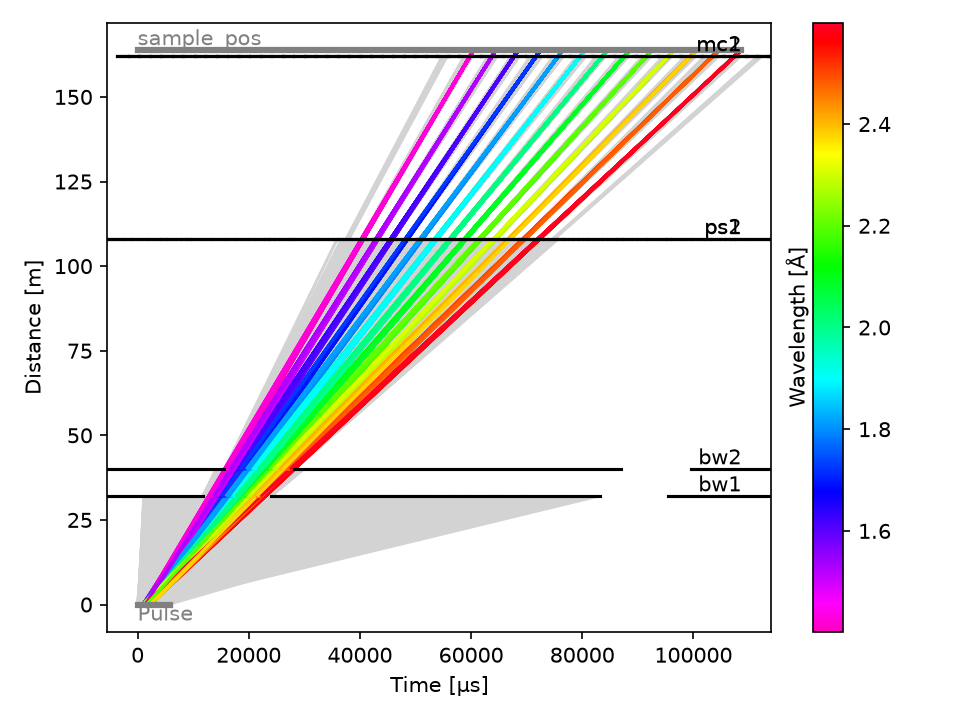

# T-Rex

The T-Rex model at the default [control parameters](details.md#control-parameters): its geometry
as McStas draws it, and the timing of its choppers as tof follows it. The two flat figures of the
geometry have the same scale on their two axes, in m.

## Seen from above

z is along the beam and x across it (projection `zx`). The circle at the origin is the drawing
of the source. The guides follow it in alternating colors up to `sample_pos`, 163.8 m along the
beam. Over that length the beam axis moves about 0.83 m in x, too little to see at this scale.
The short ticks across the beam are the choppers: `bw1` near 32 m, `bw2` near 40 m, the P-Chopper
near 108 m and the M-Chopper near 162 m.

## Along the beam

x is across the beam and y up (projection `xy`), with every component drawn on top of each other
and the view limited to x from −0.5 to 1.5 m and y from −1 to 1 m. The gray background is the
drawing of the source. The guides are the narrow band at y = 0, running from x ≈ 0 at the source
to x ≈ 0.83 m at the sample.

The chopper disks are 0.7 m across, each to one side of the beam. The two disks of `bw1` and
`bw2`, and of `ps1` and `ps2`, sit on the same side and overlap. `mc1` and `mc2` sit on
opposite sides:

| Disk | Choppers | Position | Side of the beam |
| ---- | -------- | -------- | ---------------- |
| Orange, left | `bw1`, `bw2` | x ≈ 0.01 to 0.03 m | Below |
| Red, middle | `ps1`, `ps2` | x ≈ 0.41 m | Above |
| Dark gray, right | `mc1` | x ≈ 0.82 m | Above |
| Light gray, right | `mc2` | x ≈ 0.82 m | Below |

The notches at the edge of the disks are the slits. The four of the P-Chopper are the clearest:
two of 20° and two of 35°. See [Chopper timing](details.md#chopper-timing) for how the mode puts
a narrow or a wide slit on the beam.

## Chopper timing in tof

Time since the start of the pulse runs across, and distance from the source up, to the sample
position at 163.8 m. Each colored line is a neutron that reaches the sample, colored by its
wavelength; the gray ones are some of those the choppers stop. The black lines are the choppers,
broken where they are open, from `bw1` and `bw2` at the bottom to the M-Chopper at the top.

The bandwidth choppers pass 1.40 to 2.60 Å around `lambda0`, 2.0 Å. The P- and M-Chopper, at 189
and 252 Hz, cut that band into 13 sub-pulses, which arrive at the sample from 60 to 109 ms after
the start of the pulse. Of 1,000,000 neutrons from the source, 1857 get there. tof leaves out
the guides and the bender: see [Simulate the choppers with tof](../../how-to/simulate-the-choppers-with-tof.md).

## In 3D

<iframe src="files/overview_3d.html" title="T-Rex in 3D" width="100%" height="660"
        style="border: none"></iframe>

Drag to rotate, scroll to zoom and right-drag to pan. The controls above and below the scene,
"Take me to", "Colormode" and the component details, need a running Python kernel and do nothing
on this page.

[`notebooks/trex/overview.ipynb`](https://github.com/bingli621/mcdgs/blob/main/notebooks/trex/overview.ipynb)
draws the figures. The geometry comes from McStasScript's `show_instrument` (mcdisplay): the two
flat figures with the `matplotlib_2d` backend, saved to this page's `figures/` folder, and the 3D
one with the `pythreejs` backend, saved as a web page to its `files/` folder. The time-distance
diagram is tof's own plot of a run with 1,000,000 neutrons and seed 1, saved to `figures/`.
Running the notebook again updates the page.
