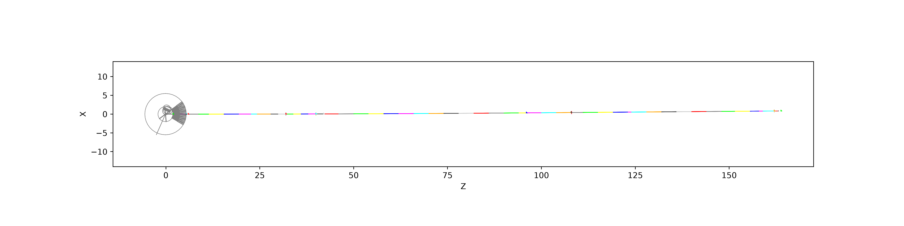
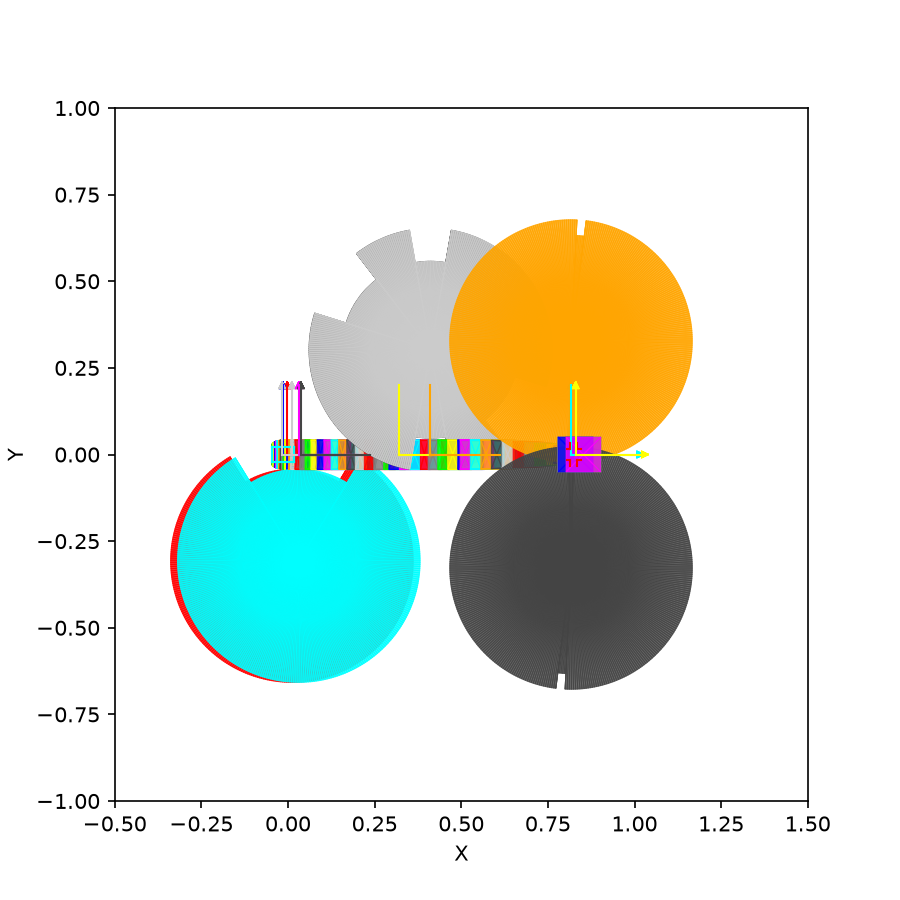

# T-Rex

The T-Rex model at the default [control parameters](details.md#control-parameters): where each
component is, its geometry as McStas draws it, and the timing of its choppers as tof follows it. The two flat figures of the
geometry have the same scale on their two axes, in m.

## Instrument layout

`print(trex)` lists the control parameters, the McStas instrument parameters they give, and every
component in the order of the beam. For each component, `at` and `rotated` are its placement in
the `.instr` file, relative to the component named under `relative`, or to the origin where that
is `-`. `position` is where it ends up in the lab frame. Lengths are in m and angles in deg.

???+ abstract "print(trex)"

    ```text
    --8<-- "docs/instruments/trex/generated/trex_print.txt"
    ```

The printout is made from the current code for every build of this site.

## Seen from above



z is along the beam and x across it (projection `zx`). The circle at the origin is the drawing
of the source. The guides follow it in alternating colors up to `sample_pos`, 163.8 m along the
beam. Over that length the beam axis moves about 0.83 m in x, too little to see at this scale.
The short ticks across the beam are the choppers: `bw1` near 32 m, `bw2` near 40 m, the P-Chopper
near 108 m and the M-Chopper near 162 m.

This figure and the next need McStas, so they are not made with the site:
[`scripts/docs_mcstas_overview.py`](https://github.com/bingli621/mcdgs/blob/main/scripts/docs_mcstas_overview.py)
draws them with McStasScript's `show_instrument` (mcdisplay), and `pixi run docs-mcstas` runs it.
They show the instrument as of that run.

## From detector to source



x is across the beam and y up (projection `xy`), with every component drawn on top of each other
and the view limited to x from −0.5 to 1.5 m and y from −1 to 1 m. The gray background is the
drawing of the source. The guides are the narrow band at y = 0, running from x ≈ 0 at the source
to x ≈ 0.83 m at the sample.

The chopper disks are 0.7 m across, each to one side of the beam. The two disks of `bw1` and
`bw2`, and of `ps1` and `ps2`, sit on the same side and overlap. `mc1` and `mc2` sit on
opposite sides:

| Disk | Choppers | Position | Side of the beam |
| ---- | -------- | -------- | ---------------- |
| Orange, left | `bw1`, `bw2` | x ≈ 0.01 to 0.03 m | Below |
| Red, middle | `ps1`, `ps2` | x ≈ 0.41 m | Above |
| Dark gray, right | `mc1` | x ≈ 0.82 m | Above |
| Light gray, right | `mc2` | x ≈ 0.82 m | Below |

The notches at the edge of the disks are the slits. The four of the P-Chopper are the clearest:
two of 20° and two of 35°. See [Chopper timing](details.md#chopper-timing) for how the mode puts
a narrow or a wide slit on the beam.

## Chopper timing in tof


Time since the start of the pulse runs across, and distance from the source up, to the sample
position at 163.8 m. Each colored line is a neutron that reaches the sample, colored by its
wavelength; the gray ones are some of those the choppers stop. The black lines are the choppers,
broken where they are open, from `bw1` and `bw2` at the bottom to the M-Chopper at the top.

The bandwidth choppers pass one band of wavelengths around `lambda0`, and the P- and M-Chopper cut
it into sub-pulses. The figure is the default mode; the table gives both, from the same neutrons:

--8<-- "docs/instruments/trex/generated/tof_modes.txt"

Arrival times are from the start of the pulse. tof leaves out the guides and the bender: see
[Simulate the choppers with tof](../../how-to/simulate-the-choppers-with-tof.md). The figure and
the table are made from the current code, with seed 1, for every build of this site.
