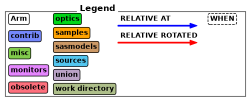
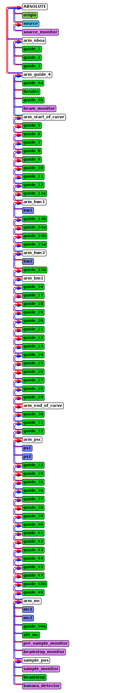

# McStas instrument file

This is the McStas instrument file the model generates, at the default
[control parameters](details.md#control-parameters). The chopper timings, `nu_<name>` and
`delay_<name>`, are the defaults of its instrument parameters.
[`mcdgs.diagnostics.trex.overview`](../../reference/diagnostics.md) writes it to
`mcstas_input/TRex/` and copies it here; `pixi run docs-diagnostics` runs it. The tests
check that this copy matches the current code. [Download it](figures/overview/TRex.instr), or expand it here:

??? abstract "TRex.instr"

    ```c
    --8<-- "docs/instruments/trex/figures/overview/TRex.instr"
    ```

## How the components are placed

McStasScript's `show_diagram()` draws the components of the same file in beam order. Each blue
arrow points from a component to the one it is placed `AT ... RELATIVE` to, and each red arrow to
the one it is `ROTATED ... RELATIVE` to; `ABSOLUTE` is the lab frame. The color of a box is the
kind of McStas component, and a dashed box is a component with a `WHEN`, here those of the
bispectral switch.
[`mcdgs.diagnostics.trex.overview`](../../reference/diagnostics.md) draws it with the
instrument file.



??? abstract "show_diagram()"

    
