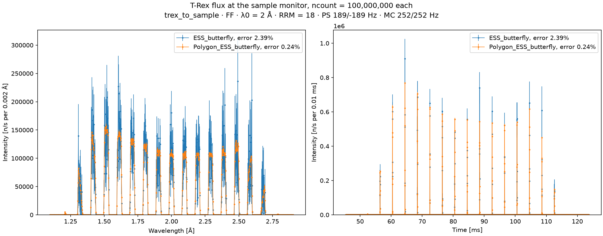
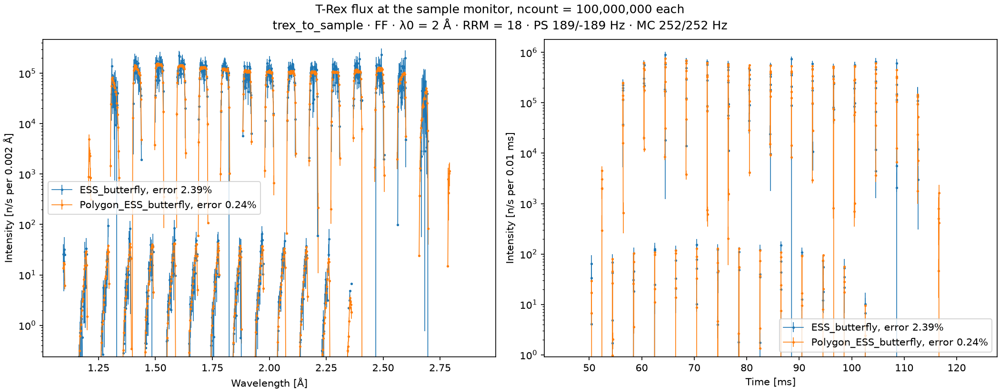
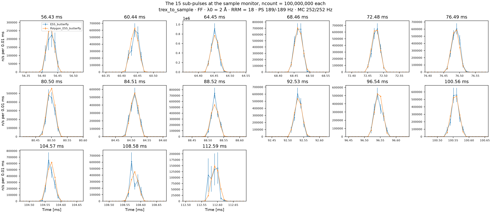

# Masked source

The choppers of T-Rex let through about 1 % of what the source emits. A McStas run with the plain
source, `ESS_butterfly`, spends the other 99 % of its rays on neutrons that a chopper stops long
before the sample. The masked source, `Polygon_ESS_butterfly`, emits only the neutrons the
choppers can let through, so nearly every ray it draws reaches the sample.

[`mcdgs.diagnostics.trex_08_masked_source`](https://github.com/bingli621/mcdgs/blob/main/src/mcdgs/diagnostics/trex_08_masked_source.py)
runs T-Rex with each source, with the same number of rays, and compares what reaches the sample.
Both give the same intensity, but the masked source's error is ten times smaller.

## How the masked source works

`Polygon_ESS_butterfly` is a McStas component that builds on `ESS_butterfly`. It is the same
moderator, with the same parameters, plus a description of the chopper train.

A neutron leaves the moderator at a time t with a speed v. It reaches a disk L metres away at
t + L/v, and passes if the disk is open then. Before the run, the component computes, for every
disk, which (1/v, t) pairs pass it, and keeps the region all the disks pass: a union of convex
polygons. Nothing is binned, so the region is exact.

The source samples 1/v and t uniformly, over the band of `lambda0` and over 3 × 2.857 = 8.571 ms
of emission. A ray drawn outside the region is drawn again inside it, and every ray's weight is
multiplied by the acceptance, the share of the sampled plane the region covers. Since both
coordinates are sampled uniformly and independently, this leaves the intensity unchanged:
only the rays are spent differently.

For T-Rex at its defaults (`lambda0` = 2 Å, `rrm` = 18, mode `"FF"`), the region is 42 polygons.
Its acceptance is 0.0114: 1.1 % of the sampled plane can reach the sample.

### The chopper train

`masked_source` in `mcdgs.instruments.trex.sources` describes the six disks to the component, from
the same values as the disks themselves:

| Field | Value |
| ----- | ----- |
| `speed`, `delay` | The instrument parameters `nu_<name>` and `delay_<name>`, so they follow `lambda0`, `rrm` and the mode |
| `beam`, `edges` | The beam angle and all the slit edges of the disk: the mode only changes the delay |
| `path` | The distance of the disk from the moderator along the beam, as on [Choppers](choppers.md) |
| `aperture` | The angle the beam window subtends on the disk, 4.2° for the monochromatic choppers to 13.5° for the pulse-shaping ones |

The beam crosses a disk over the width of its window, not at one point, so each opening is open
a little longer than on the beam axis: the aperture widens each window in time. The path through
the guides is also slightly longer than the straight line, by up to `PATH_SPREAD_FRACTION` = 1e-4
of the path (FIXME, not in Table of Optics v3.2), which widens each window a little more for slow
neutrons.

### Using it

`TRex` takes the masked source with `source_masked=True`:

```python
from mcdgs.instruments.trex.model import TRex

trex = TRex(source_masked=True)
```

The source stays masked when `update_params` changes `lambda0`, and when the instrument is saved
to a parameters file and loaded again.

Every component after the choppers sees the beam it would see with the plain source. The
components before them do not: the source monitor and the beam monitor see only the neutrons the
choppers will let through. For the beam the guides carry to the choppers, use the plain source.

## The setup

`main` runs `TRexToSample` of [Neutrons on sample](neutrons-on-sample.md) twice, T-Rex up to its
sample monitor at the defaults: once with each source, with 1e8 rays and seed 1. Its sample
monitor has finer bins than that of T-Rex, to show the shape of each sub-pulse:

| Axis | Range | Bins | Bin width |
| ---- | ----- | ---- | --------- |
| Time | 45.3 to 123.8 ms | 7843 | 0.01 ms, a fifth of that of T-Rex |
| Wavelength | 1.095 to 2.905 Å | 905 | 0.002 Å, a tenth of that of T-Rex |

## The result

--8<-- "docs/instruments/trex/figures/masked-source/trex_masked_source.txt"

- **The same intensity.** Both sources give the sample 2.5e7 n/s. The plain source has the total
  of [Neutrons on sample](neutrons-on-sample.md#scale-and-transmission), 2.497e7 n/s, since it is
  the same run. The masked source gives 1.5 % more, 0.6 times the error of the plain source.
- **A tenth of the error.** From the same 1e8 rays, the plain source has an error of 2.4 % and the
  masked source 0.24 %. The plain source would need about 1e10 rays to do as well.
- **No dearer per ray.** Both runs take about as long, 12 to 15 s here, which varies from run to
  run. The figure of merit, one over the relative error squared times the time, is about 75 to 105
  times higher with the masked source.

## The figures

### Spectrum and time profile



The wavelength spectrum, summed over time, and the time profile, summed over wavelength, of both
sources, with error bars. The same 15 sub-pulses arrive with both, 4.01 ms apart. In the
spectrum each is about 0.04 Å across, with a flat top. The masked source draws that shape
smoothly, while the plain source scatters about it by up to half its height.

### On a log scale



The same, on a log intensity axis six decades deep. It shows the weak patches of
[Neutrons on sample](neutrons-on-sample.md#the-weak-patches), three to four decades below the
sub-pulses: the masked source has them too, at the same times, wavelengths and intensities. They
are neutrons that left the moderator late, in the tail of the pulse, and pass the second slit of
the monochromatic choppers: the region includes them, since it holds every neutron the disks
pass.

### Every sub-pulse



The time profile around each sub-pulse, 0.1 ms on each side. `find_peaks` finds them in the
profile of the masked source: runs of bins above 1 % of the highest bin, a gap of more than
1 ms starting the next. Each sub-pulse is about 0.06 ms across, five to seven bins. In every
one, the masked source follows the plain source within its error bars, with error bars too small
to see.

## Making the figures

The figures need McStas, so they are not made with the site: `pixi run docs-diagnostics` makes
them again, with the other files of the T-Rex pages. To make them yourself, run:

```bash
pixi run python -m mcdgs.diagnostics.trex_08_masked_source
```

At its defaults, `main` runs 1e8 rays with each source, with seed 1, and saves the figures and
the table next to the `mccode.h5` of the run with the plain source, or to the folder given with
`--out`. The masked source also writes its region, `source.json` in its run folder: the
polygons, their area and the acceptance.
