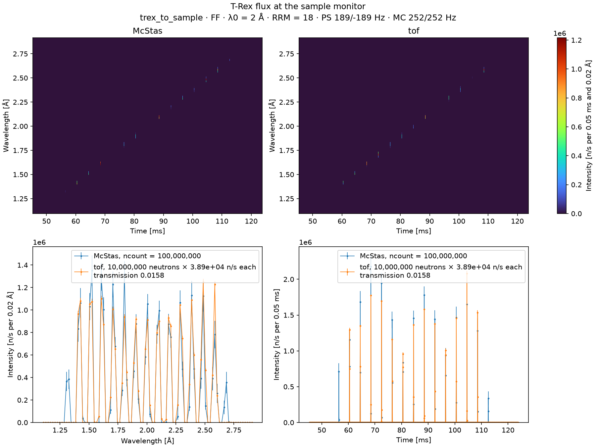
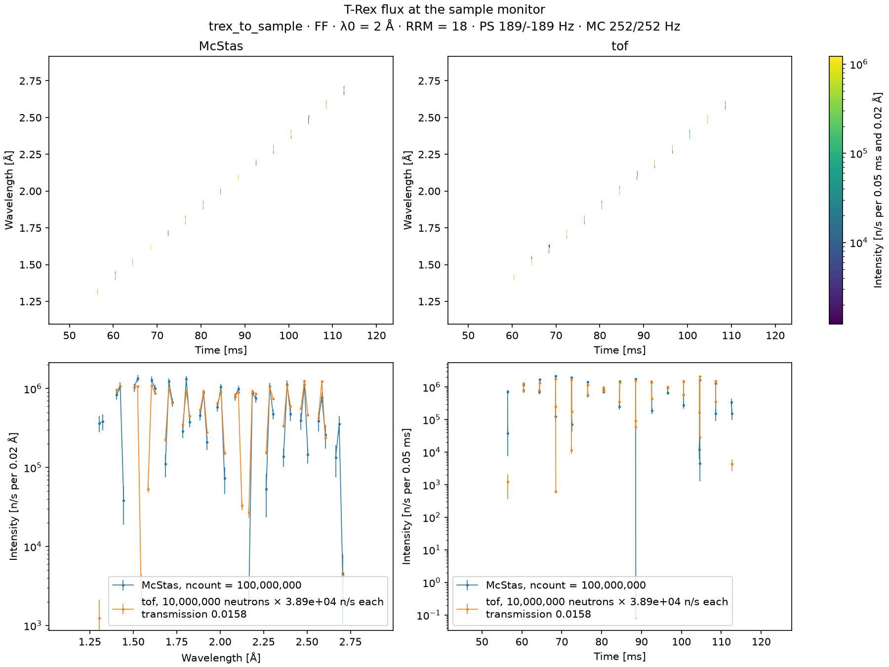
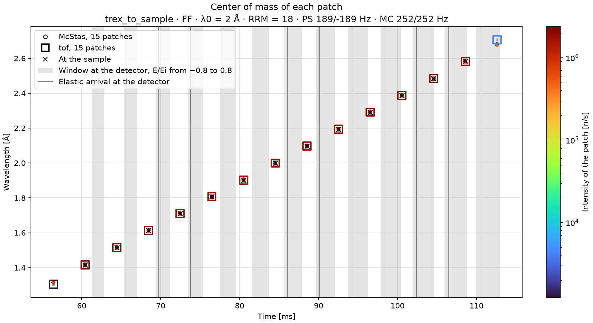

# Neutrons on sample

`TRexToSample`, in
[`mcdgs.diagnostics.trex_07_neutrons_on_sample`](https://github.com/bingli621/mcdgs/blob/main/src/mcdgs/diagnostics/trex_07_neutrons_on_sample.py),
compares McStas and [tof](../../how-to/simulate-the-choppers-with-tof.md) at the sample monitor of
T-Rex, 163.8 m from the source. On the way are all the guides and all the
[choppers](choppers.md): McStas models both, tof only the choppers. The page shows what reaches
the sample, in time and wavelength, and where the two models differ.

## The setup

`TRexToSample` is `TRex` up to its sample monitor, at `sample_pos`: without a sample, and without
the beamstop and the banana detector after it. Its control parameters are those of `TRex`, here
the defaults: mode `"FF"`, `lambda0` = 2 Å and `rrm` = 18.

<!-- fmt:off -->
```python
--8<-- "src/mcdgs/diagnostics/trex_07_neutrons_on_sample.py:trex_to_sample"
```
<!-- fmt:on -->

The sample monitor records one 2D map of time against wavelength, on the band of `lambda0`:

| Axis | Range | Bins | Bin width |
| ---- | ----- | ---- | --------- |
| Time | 45.3 to 123.8 ms | 1569 | 0.05 ms |
| Wavelength | 1.095 to 2.915 Å | 91 | 0.02 Å |

## Scale and transmission

tof is brought to n/s as on [Beam monitor](beam-monitor.md#scale-and-transmission). The scale is
set at the source monitor, at the entrance of guide 1, where both models see the same beam: at
the defaults of `main`, 3.889e11 n/s in McStas over 1e7 tof neutrons, 3.889e4 n/s per tof
neutron. At the sample monitor a transmission T on top of it stands for what the guides take out,
tuned so that both models have the same total there:

```text
T = McStas total at the sample monitor / (tof neutrons at the sample monitor × scale)
  = 2.496e7 n/s / (40,494 × 3.889e4 n/s) = 0.0159
```

In McStas, 2.496e7 n/s reach the sample, 6.42e-5 of the beam that enters guide 1. In tof, whose
choppers are the only thing in the way, 40,494 of 1e7 neutrons do, 4.05e-3. The guides from
guide 1 to the sample thus pass 1.6 % of what the choppers let through.

Each tof neutron at the sample stands for 3.889e4 × 0.0159 = 620 n/s, so tof cannot show
anything weaker than that.

## The figures

`main` runs both models with the same seed and draws three figures.

### On linear scales



The maps of both models on one linear color scale, then the wavelength spectrum and the time
profile of both, with error bars and the points joined by lines. The neutrons arrive as a row of
sub-pulses, each a short streak on the maps and a spike in the time profile.

### On log scales



The same, on log scales: the maps three decades deep, in viridis with the empty bins in white,
and the spectrum and the profile on a log intensity axis. It shows what is too weak for the
linear figure, the sub-pulses at both ends of the band, and that nothing arrives between the
sub-pulses.

### The patches



A patch is a run of time bins with neutrons; a gap of more than 1 ms starts the next one.
`find_patches` gives the center of mass of each, its mean time and wavelength weighted by the
intensity, its width and its intensity, and `plot_patches` draws them: McStas as filled circles,
tof as hollow squares, colored by intensity on one log scale. Where both models have a patch, the
square frames the circle. The width is drawn as error bars, smaller than the markers here.

Each main sub-pulse of tof is also drawn: a black cross at its incident wavelength when it
reaches the sample, and its arrival window at the banana detector as a gray band across all
wavelengths, from the [table below](#arrival-windows-at-the-detector). A thin line in each band
is when its neutrons arrive if they fly through the sample without changing speed, the elastic
neutrons: nearer the opening than the close, since a neutron that gains energy shortens its
flight less than one that loses as much lengthens it. The sample monitor is at the sample, so
each cross falls on its patch. The bands lie between the sub-pulses.

## What reaches the sample

Every neutron's departure time from the moderator follows from its time of arrival t and
wavelength λ: t − λ L / (3956 m·Å/s), with L = 163.8 m. The patches fall into two kinds:

| Kind | McStas | tof | Wavelength | Intensity of each | Left the moderator |
| ---- | ------ | --- | ---------- | ----------------- | ------------------ |
| Main sub-pulses | 13 | 13 | 1.42 to 2.58 Å | 1.4e6 to 2.4e6 n/s | at about 1.7 ms |
| Sub-pulses at the band edges | 2 | 2, of 2 and 7 neutrons | 1.32 Å, 2.68 Å | 4.9e5 and 7.5e5 n/s | at about 1.7 ms |

### The main sub-pulses

They hold 95 % of the beam at the sample, 2.37e7 of the 2.496e7 n/s, or 1.7e6 neutrons per pulse
at 14 Hz.

- **4.01 ms and 0.097 Å apart.** The monochromatic choppers open every 1/252 Hz = 3.97 ms, so the
  wavelengths that pass them, 162 m from the source, are 0.097 Å apart. Each wavelength then
  flies 1.8 m further to the sample, the longer ones more slowly, which spreads the arrivals to
  4.01 ms.
- **Narrow.** Each is about 0.02 to 0.03 ms (RMS) in time and 0.012 Å in wavelength, 0.5 to 0.9 %
  of λ. That is about one bin of the monitor in each, so the true widths may be smaller.
- **From the middle of the pulse.** They all left the moderator at about 1.7 ms, the
  `t0_offset` the choppers are phased to.
- **McStas and tof agree** in time and wavelength, and in intensity within about 12 % from 1.4 to
  2.2 Å. Above that, tof is higher, by 16 to 37 %. McStas has an error of 7 to
  13 % per sub-pulse here, so this is a trend, not a firm result; its cause is not known yet.

### The sub-pulses at the band edges

McStas has one more sub-pulse at each end of the band, 7.5e5 n/s at 1.32 Å and 4.9e5 n/s at
2.68 Å. Together they hold 5 % of the beam. tof has them too, but of only 2 and 7 neutrons, some
1e3 to 4e3 n/s. They left the moderator at the same time as the main ones, so they are not a part
of the pulse that tof leaves out: the two models cut the band differently.

tof cuts it sharply. The bandwidth choppers `bw1` and `bw2` open once per pulse, and in tof each
opens and closes in an instant, on the beam axis. In McStas the edge of the disk sweeps across a
guide 6 cm wide, about 0.31 m from the axle: some 11° of turn, or 2.2 ms at 14 Hz. So the band
opens and closes gradually across the width of the beam, which lets part of the beam through at
wavelengths tof stops. This is the most likely cause, but it has not been confirmed: with a
narrow slit just before each bandwidth chopper, these two sub-pulses should go away.

Until the disks had a [beam window](choppers.md#the-disks), McStas had two more sub-pulses at
each end, down to 1.3e3 n/s at 1.13 and 2.89 Å. They passed the upper corners of the beam, which
lay outside the bandwidth disks, unchopped. The window closes these corners, and the four
sub-pulses are gone.

### Between the sub-pulses

Nothing arrives between the sub-pulses: both models have 15 patches, all of them sub-pulses.

Each monochromatic chopper has a second slit, the narrow one of `"RR"`, which comes by the beam
about half a turn, 2 ms, after the wide slit that passes a sub-pulse. Neutrons that passed the
narrow slits of both disks would have left the moderator late, in the tail of the pulse, and
would arrive as weak patches between the sub-pulses. The two narrow slits are never on the beam
together, though: that of `mc1` comes by 185° of turn after its wide slit, and that of `mc2`
175° after, 0.11 ms earlier, while a narrow slit of 2.5° takes 0.03 ms to pass a point of the
beam. What passes one disk is stopped by the other.

## Arrival windows at the detector

Each sub-pulse reaches the sample with its own incident energy Ei, about 4 ms after the one
before. A neutron the sample scatters reaches the banana detector, 3 m further, sooner if it
gains energy and later if it loses it. `subpulse_windows` gives the window in which the neutrons
of each sub-pulse arrive, for an energy transfer E from −0.8 Ei to 0.8 Ei. It reduces the tof
run with the same functions as the McStas data of La2Ni7, from the
[reduction package](../../reference/reduction.md):

1. `find_patches` finds the sub-pulses at the pre-sample and beamstop monitors, as on
   [Incident energy](incident-energy.md#finding-the-sub-pulses).
2. `subpulse_flight` pairs them and gives each its Ei, from the flight between the monitors.
3. `time_at_sample` adds the flight from the pre-sample monitor to the sample.
4. `arrival_window` gives when the neutrons of each reach the detector, with Ef = Ei − E:
   the window opens with the fastest, E = −0.8 Ei, and closes with the slowest, E = 0.8 Ei.
   The elastic neutrons, E = 0, fly through the sample without changing speed, and arrive in
   between.

--8<-- "docs/instruments/trex/figures/neutrons-on-sample/trex_neutrons_on_sample_windows.txt"

The times are from the start of the pulse. Each window is about 1.6 ms long for the shortest
wavelength and 2.9 ms for the longest, since slower neutrons spread more over the 3 m. The
windows do not overlap: the last column, from the close of one to the opening of the next, stays
positive, though it shrinks with the wavelength. So every neutron the detector counts within a
window belongs to one sub-pulse, of the main sub-pulses: tof has too few neutrons in those at
the band edges for them to count.

## Making the figures

The figures need McStas, so they are not made with the site: `pixi run docs-diagnostics` makes
them again, with the other files of the T-Rex pages. To make them yourself, run:

```bash
pixi run python -m mcdgs.diagnostics.trex_07_neutrons_on_sample
```

At its defaults, `main` runs 1e8 McStas neutrons and 1e7 tof neutrons, with seed 1, and saves the
figures next to the `mccode.h5` of the McStas run, or to the folder given with `--out`. With fewer
neutrons, the sub-pulses at the band edges fade into the noise.
