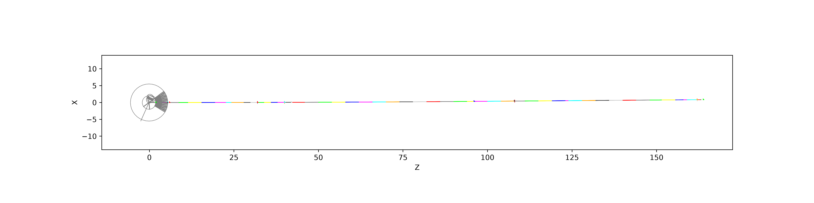
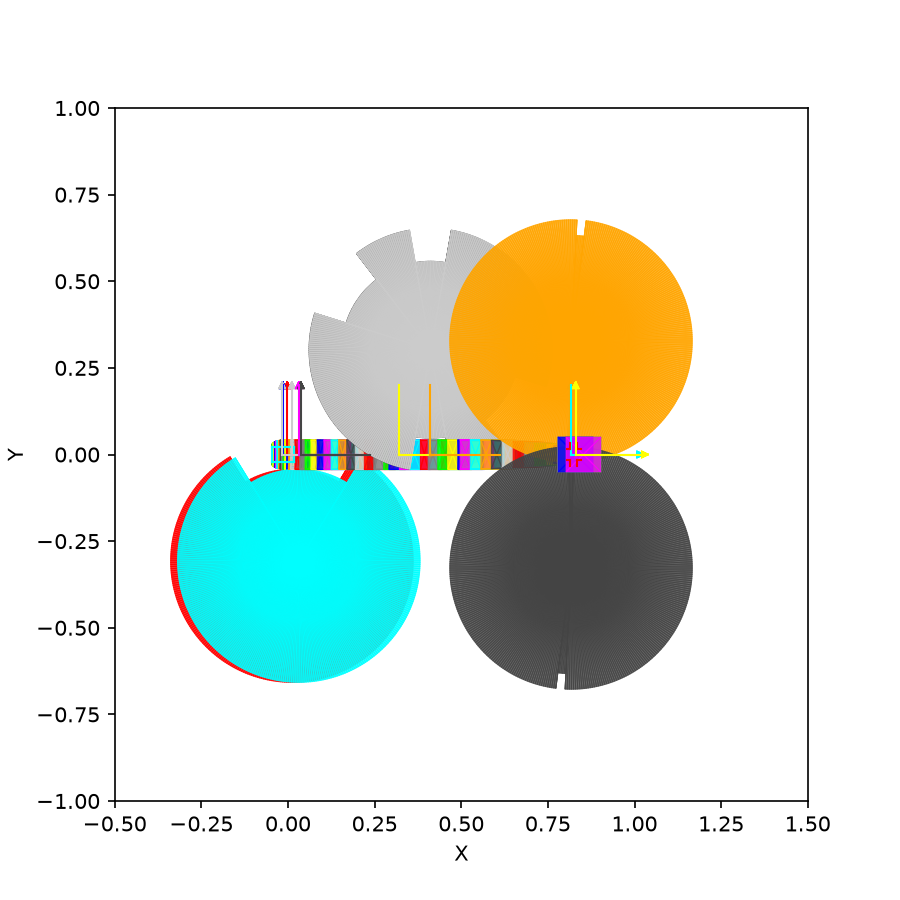

# Overview

The geometry of the T-Rex model as McStas draws it, at the default
[control parameters](index.md#control-parameters).
[`diagnosis/trex/overview.py`](https://github.com/bingli621/mcdgs/blob/main/diagnosis/trex/overview.py)
writes the `.instr` file to `mcstas_input/TRex/`, prints it, and draws both figures with
McStasScript's `show_instrument` (mcdisplay, `matplotlib_2d` backend). It saves them to this page's
`figures/` folder, so running it again updates the page. Both figures have the same scale on
their two axes, in m.

## Seen from above



z is along the beam and x across it (projection `zx`). The circle at the origin is the drawing
of the source. The guides follow it in alternating colors up to `sample_pos`, 163.8 m along the
beam. Over that length the beam axis moves about 0.83 m in x, too little to see at this scale.
The short ticks across the beam are the choppers: `bw1` near 32 m, `bw2` near 40 m, the P-Chopper
near 108 m and the M-Chopper near 162 m.

## Along the beam



x is across the beam and y up (projection `xy`), with every component drawn on top of each other
and the view limited to x from −0.5 to 1.5 m and y from −1 to 1 m. The gray background is the
drawing of the source. The guides are the narrow band at y = 0, running from x ≈ 0 at the source
to x ≈ 0.83 m at the sample.

The chopper disks are 0.7 m across, each to one side of the beam. The two disks of `bw1` and
`bw2`, and of `ps1` and `ps2`, sit on the same side and overlap. `mc1` and `mc2` sit on
opposite sides:

| Disk | Choppers | Position | Side of the beam |
| ---- | -------- | -------- | ---------------- |
| Orange, left | `bw1`, `bw2` | x ≈ 0.01 to 0.03 m | Below |
| Red, middle | `ps1`, `ps2` | x ≈ 0.41 m | Above |
| Dark gray, right | `mc1` | x ≈ 0.82 m | Above |
| Light gray, right | `mc2` | x ≈ 0.82 m | Below |

The notches at the edge of the disks are the slits. The four of the P-Chopper are the clearest: two of 20° and two of 35°.
See [Chopper timing](index.md#chopper-timing) for how the mode puts a narrow or a wide slit on
the beam.

## The .instr file

This is the McStas instrument file the model generates, at the default control parameters. The
chopper timings, `nu_<name>` and `delay_<name>`, are the defaults of its instrument parameters.
[Download it](files/TRex.instr), or expand it here:

??? abstract "TRex.instr"

    ```c
    --8<-- "docs/instruments/trex/files/TRex.instr"
    ```

## The parameters file

This is the same instrument saved as a parameters file, `save(TRex(), PARAMS_FILE)`, the
reference of how a T-Rex file looks. `PARAMS_FILE` is `src/mcdgs/instruments/trex/params.yaml`,
and a test checks that it stays the instrument the code makes.

It holds the control parameters, then the McStas instrument parameters they give, then one
section per component in beam order: its McStas component, its parameters, where it sits (`at`,
`rotated`, `relative`) and its position in the lab frame. The instrument parameters and the
positions are for reading only, and loading the file does not read them. A file you load need
only hold what differs from this one; see [Parameters files](../../reference/io.md).
[View it on GitHub](https://github.com/bingli621/mcdgs/blob/main/src/mcdgs/instruments/trex/params.yaml),
or expand it here:

??? abstract "params.yaml"

    ```yaml
    --8<-- "src/mcdgs/instruments/trex/params.yaml"
    ```
