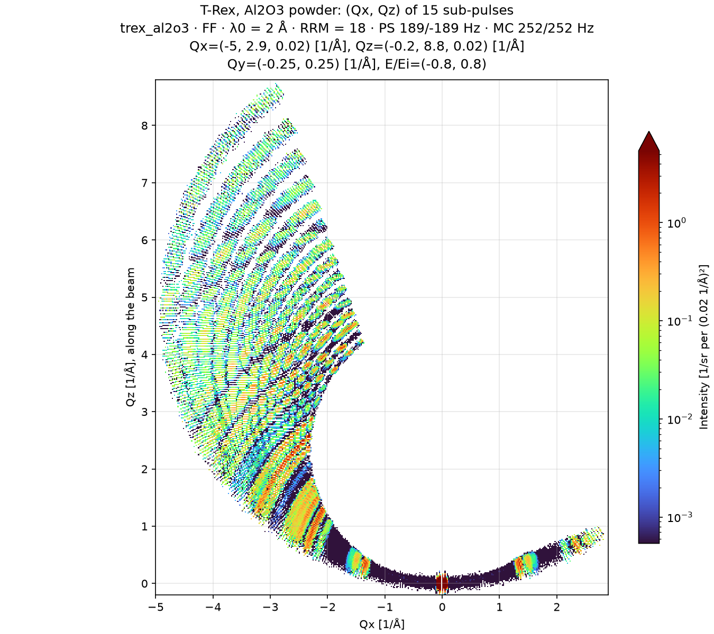
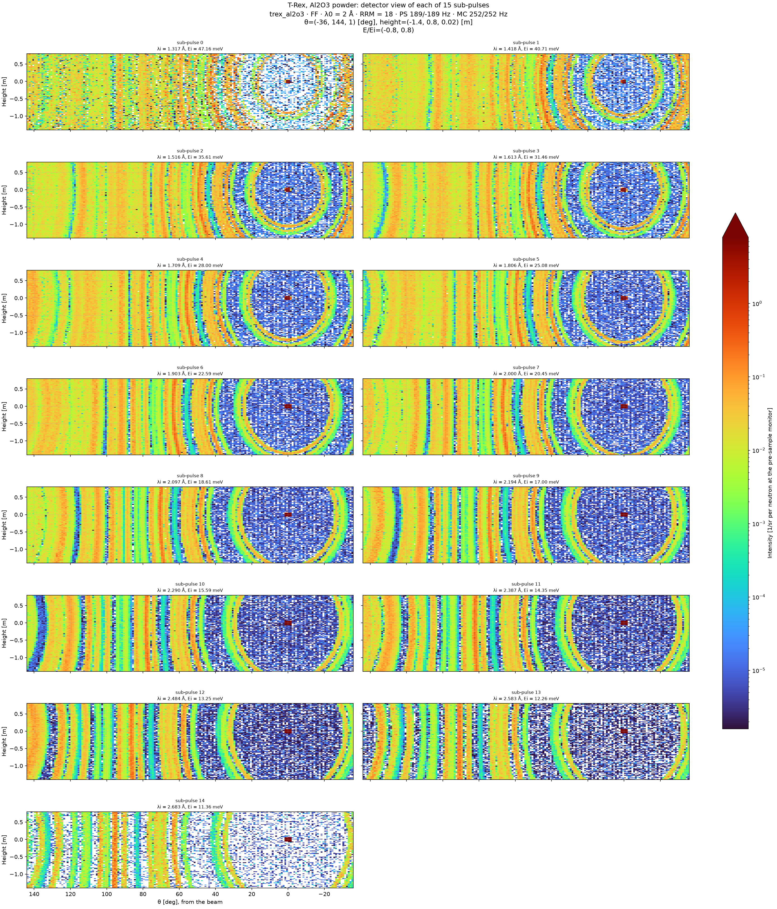
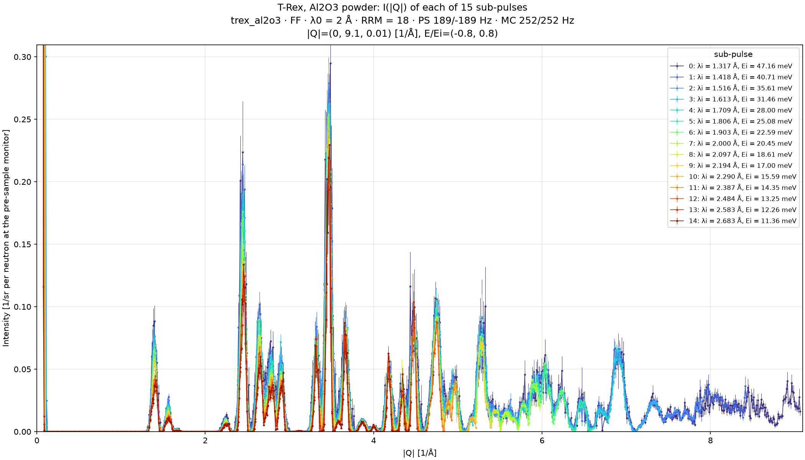

# Diffraction (powder)

`TRexWithAl2O3`, in
[`mcdgs.diagnostics.trex.powder_diffraction`](https://github.com/bingli621/mcdgs/blob/main/src/mcdgs/diagnostics/trex/powder_diffraction.py),
puts an Al2O3 powder on `sample_pos` and reduces every neutron that reaches the banana detector
to its momentum transfer Q. It keeps every neutron in the arrival window of its sub-pulse,
whatever its energy transfer: the powder scatters elastically only. A powder scatters the same
way about the beam, so besides the horizontal plane of Q, as for the
[crystal](diffraction.md), the result is the intensity in |Q| of each of the 15 sub-pulses, drawn
over each other.

## The setup

`TRexWithAl2O3` is `TRex` with the powder of `al2o3` on `sample_pos`, with the beamstop and the
banana detector. Its control parameters are the defaults: mode `"FF"`, `lambda0` = 2 Å and
`rrm` = 18. It has the [masked source](masked-source.md).

| | |
| - | - |
| Powder | Al2O3, McStas `PowderN` with the McStas reflection list `Al2O3_sapphire.laz`, a solid cylinder 20 mm across and 10 mm high |
| Scattering | the Bragg cones of the list, ideal lines, and incoherent scattering, single scattering only |
| Cell and cross-sections | from the header of the list: $V_c$ = 254.52 ų with 6 Al2O3 per cell, $\sigma_{abs}$ = 2.775 b and $\sigma_{inc}$ = 0.113 b per cell |
| `d_phi` | 51.96°: each Bragg cone is spread only over the height of the detector, seen from the sample |
| `SPLIT` | 10 |
| `slit_mc` | closed to the size of the powder: 20 mm wide and 10 mm high, from 20.5 mm by 34.5 mm |
| Detector | the banana detector, 3 m from the sample, 0.625° by 16 mm pixels, 25° below the beam to 15° above |

<!-- fmt:off -->
```python
--8<-- "src/mcdgs/diagnostics/trex/powder_diffraction.py:instrument"
```
<!-- fmt:on -->

`slit_mc`, 0.7 m before the sample, is closed to the size of the powder, so that the pre-sample
monitor, after it, counts the beam that reaches the powder rather than the wider beam of the
guide. The beam still spreads a little over the 0.7 m, so it is somewhat larger than the powder
at the sample.

## Two runs, split at the sample

`simulate` runs McStas in two parts, as for the
[crystal](diffraction.md#two-runs-split-at-the-sample), with 1e9 rays from the masked source:

1. **From the source to `sample_pos`**: 1.2 minutes on 18 cores. Through the closed slit, the
   beam file at `sample_pos` holds 2,211,316 neutrons, a third of the 6,629,716 of the crystal,
   whose slit is open. The beam before the sample goes through the closed slit, so it is not
   that of the crystal.
2. **From that beam through the powder to the detector**: about 4 seconds.

## The reduction

The sub-pulses, the neutrons and the normalization are those of the
[crystal](diffraction.md#the-reduction): each neutron is divided by the solid angle of its pixel
and by the intensity of its sub-pulse at the pre-sample monitor, so the intensity is per
incident neutron at the pre-sample monitor and per steradian.

For the intensity in |Q|, `powder_patterns` puts each neutron at the elastic |Q| of its pixel,

$$|Q| = 2 k_i \sin\theta,$$

with the $k_i$ of its sub-pulse and the $2\theta$ of the center of the pixel. In each bin of
0.01 Å⁻¹, the fraction of the incident neutrons of the sub-pulse scattered into it is divided by
the solid angle of the pixels whose elastic |Q| falls in it,

$$I(|Q|) = \frac{\sum_{n \in \text{bin}} w_n}{\sum_{p \in \text{bin}} \Omega_p},$$

where $w_n$ is the fraction of the incident neutrons that neutron $n$ stands for and $\Omega_p$
the solid angle of pixel $p$. That is the intensity per incident neutron and per steradian,
whatever the part of the detector that sees the bin. Each neutron counts with the variance
$w_n^2$, so a bin has the error $\sqrt{\sum w_n^2} / \sum \Omega_p$.

A neutron and its pixel always fall in the same bin. With the |Q| of the time of flight instead,
which varies continuously, a neutron could fall in a bin between two columns of pixels, which
none of them covers: the columns of the banana detector leave gaps of up to 0.57° in 2θ,
0.024 Å⁻¹ at |Q| = 5 Å⁻¹, wider than two bins. The few pixels at the edge of such a bin then
made spikes far above the pattern. The powder scatters elastically, so the two |Q| differ only
by the resolution.

## The plane



`plot_plane` draws the intensity in (Qx, Qz), as for the [crystal](diffraction.md#the-plane),
summed over |Qy| < 0.25 Å⁻¹. Each sub-pulse draws its arc, of radius $k_i$ through the origin,
and its Bragg neutrons lie where the arc crosses a ring of the powder, of radius $2\pi / d$ about
the origin. With 15 arcs, each ring is a row of peaks across them. Between the peaks, in dark
blue, is the incoherent scattering of the powder.

## The detector view



`detector_views` puts every neutron at the horizontal angle θ and the height of the center of
its pixel, as the detector shows it, unrolled about the vertical through the sample: θ is 0 along
the beam and positive toward +x. In each bin of 1° by 0.02 m, as in `powder_patterns`, the
fraction of the incident neutrons of the sub-pulse scattered into it is divided by the solid
angle of the pixels whose center falls in it,

$$I(\theta, y) = \frac{\sum_{n \in \text{bin}} w_n}{\sum_{p \in \text{bin}} \Omega_p},$$

the intensity per incident neutron and per steradian. A bin is wider than a pixel, so every bin
inside the detector holds at least one pixel, and one or two pixels in it give the same
intensity.

`plot_detector_views` draws the view of each sub-pulse on its own panel, θ from high to low, on one log color scale
from 6 decades below the strongest line past the direct beam, |θ| > 5°, down at the incoherent
scattering, to 5 times that line, so that the strong lines are not all at the red end. A bin without a neutron is white. Each panel is drawn to the scale of the detector:
a degree of θ is as wide as its arc at the radius of the detector, 3 m, is high, so near the
beam, where a cone crosses the detector in a circle of radius $R \cdot 2\theta_B$, the ring is
round. Each Bragg cone of the powder, of half-angle
$2\theta_B$ about the beam, crosses the detector as a Debye-Scherrer ring: closed circles about the beam where $2\theta_B$ is small, curving the other way past
90°, and nearly straight lines in between. The rings move out with λi, as $\sin\theta_B =
\lambda_i / 2d$. The small square at θ = 0 is the direct beam past the beamstop. The banana detector reaches 25°
below the beam and 15° above, so the rings are cut off above.

## The intensity in |Q|



`plot_powder_patterns` draws the intensity in |Q| of every sub-pulse over each other, each bin
as a point with its error, joined to the next. The scale is linear, from 0 to just above the
highest bin past the direct beam, |Q| > 0.2 Å⁻¹: the direct beam past the beamstop runs off the
top. The first sub-pulse reaches |Q| = 9.07 Å⁻¹, the last 4.44 Å⁻¹. Between the lines, the
incoherent scattering is about 8e-6 1/sr, below 1e-4 of the strongest line, 0.29 1/sr.

Every sub-pulse puts each line at the same |Q|, but not with the same height. One strong line,
integrated over |Q| from 3.30 to 3.62 Å⁻¹:

| Sub-pulse | λi | Area | Center | Width |
| --------- | -- | ---- | ------ | ----- |
| 0 | 1.317 Å | 2.90e-2 ± 0.15e-2 | 3.454 Å⁻¹ | 0.098 Å⁻¹ |
| 3 | 1.613 Å | 2.63e-2 ± 0.05e-2 | 3.448 Å⁻¹ | 0.100 Å⁻¹ |
| 7 | 2.000 Å | 2.08e-2 ± 0.03e-2 | 3.446 Å⁻¹ | 0.090 Å⁻¹ |
| 10 | 2.290 Å | 1.76e-2 ± 0.03e-2 | 3.446 Å⁻¹ | 0.083 Å⁻¹ |
| 12 | 2.484 Å | 1.60e-2 ± 0.03e-2 | 3.442 Å⁻¹ | 0.073 Å⁻¹ |

The area is in 1/sr Å⁻¹ per neutron at the pre-sample monitor, and the width is the area over
the height of the line.

- **The center** is the same to 0.4 %.
- **The width** shrinks as λi grows: the spread in wavelength of a sub-pulse is a smaller part of
  a longer wavelength, and at the same |Q| a longer wavelength scatters at a larger 2θ, where an
  error in the angle shifts |Q| less. A line of the same area is then taller: that is most of the
  difference in height between the sub-pulses.
- **The area** falls too, by about 45 % from sub-pulse 0 to 12. With this normalization, per
  steradian and per |Q|, the $\lambda^3$ of the strength of a powder line cancels, so the area
  should be the same in every sub-pulse. It is not explained yet. It is not the beam spilling past
  the powder: with `slit_mc` open, the area fell by about as much, 42 %. The attenuation in the
  powder, whose Bragg cross-section grows with the wavelength, is the likeliest cause, and a
  thinner cylinder would test it.

The lines past sub-pulse 11, at the edge of the coverage of the detector, are left out of the
table: their pixels do not see the whole line.

## The reflection list

The lines are those of `Al2O3_sapphire.laz`, but its d-spacings are not those of the corundum
cell in its own header, a = 4.757 Å and c = 12.9877 Å:

| hkl | d of the list | d of the cell |
| --- | ------------- | ------------- |
| 0 1 2 | 3.797 Å | 3.479 Å |
| 1 0 4 | 2.575 Å | 2.550 Å |
| 1 1 0 | 2.810 Å | 2.379 Å |

So the patterns are not yet those of corundum, whose first strong lines are at |Q| = 1.806,
2.464 and 2.642 Å⁻¹. The instrument and the reduction do not depend on it: every sub-pulse puts
each line where the list has it.

## The sub-pulses

`analyze` prints each sub-pulse: its Ei, its flux at the pre-sample monitor, through the closed
slit, and the fraction of its neutrons that reach the detector within its window, the direct
beam past the beamstop included:

| Sub-pulse | λi | Ei | Flux | On the detector |
| --------- | -- | -- | ---- | --------------- |
| 0 | 1.317 Å | 47.17 meV | 2.8e5 n/s | 5.4 % |
| 3 | 1.613 Å | 31.46 meV | 7.6e5 n/s | 8.2 % |
| 7 | 2.000 Å | 20.45 meV | 5.8e5 n/s | 15.4 % |
| 10 | 2.290 Å | 15.59 meV | 5.7e5 n/s | 24.5 % |
| 14 | 2.683 Å | 11.36 meV | 1.5e5 n/s | 46.0 % |

## Making the figures

The figures need McStas, so they are not made with the site. To run McStas and make them, run:

```bash
pixi run python -c "from mcdgs.diagnostics.trex.powder_diffraction import main; main()"
```

At its defaults, `main` runs both parts, 1e9 rays from the masked source with seed 1, as for the
figures here. It prints the sub-pulses and saves the figures to
`mcdgs_workspace/results/trex_powder_diffraction/`, or to the folder given as `out`. Running the
module, as `pixi run docs-diagnostics` does, only reduces the runs again, without McStas:

```bash
pixi run python -m mcdgs.diagnostics.trex.powder_diffraction
```
