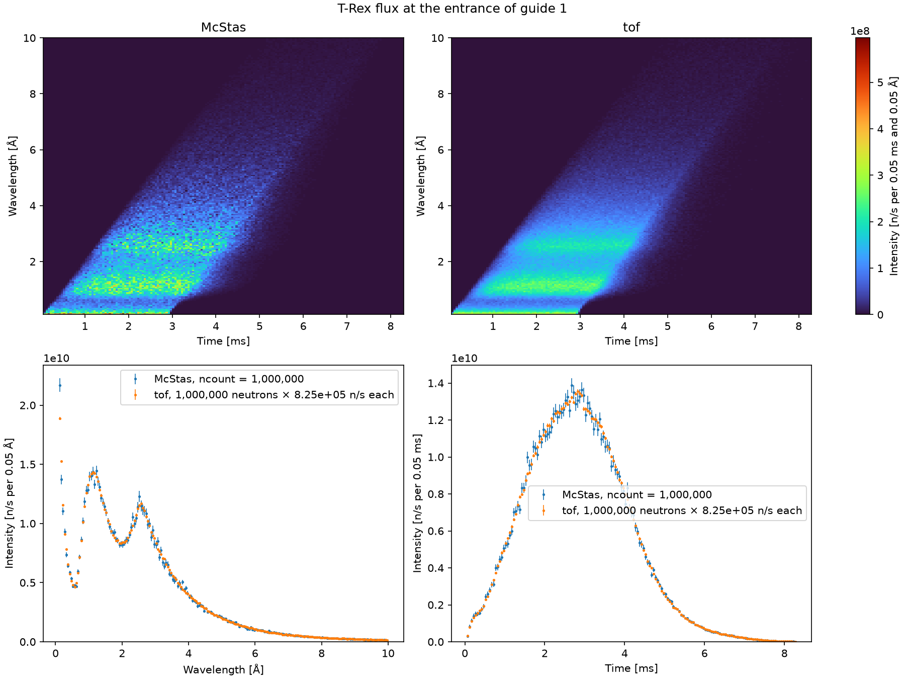
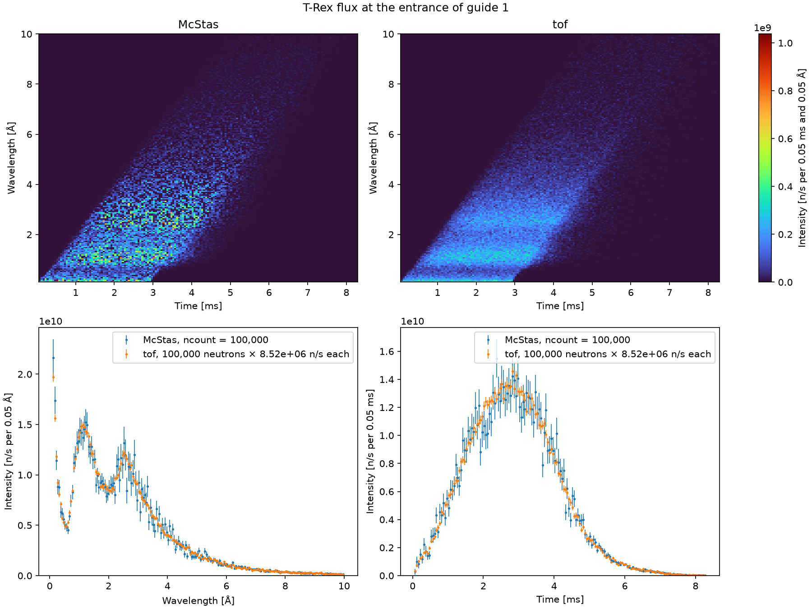
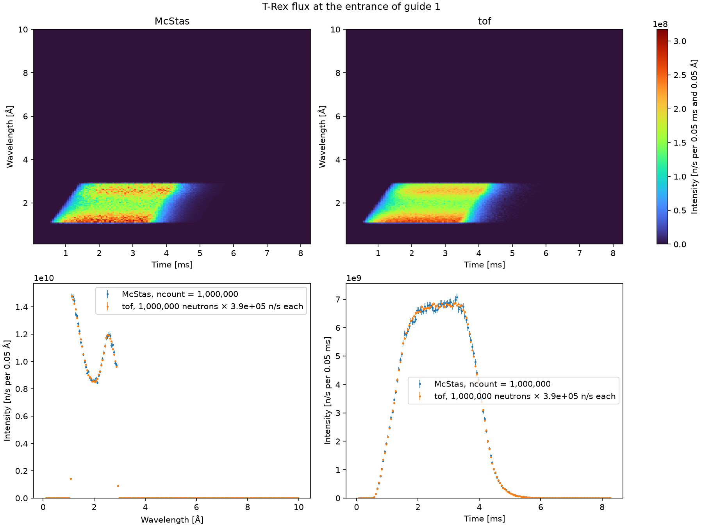

# Source

`TRexSource`, in
[`mcdgs.diagnostics.trex_01_source`](https://github.com/bingli621/mcdgs/blob/main/src/mcdgs/diagnostics/trex_01_source.py),
compares McStas and [tof](../../how-to/simulate-the-choppers-with-tof.md) at the entrance of
guide 1, the first optics of T-Rex. Nothing stands between the source and that point, so the two
should see the same pulse there: what differs is only how each models the ESS moderator.

## The setup

It is the smallest T-Rex: two components and no McStas instrument parameters.

| Component | What it is |
| --------- | ---------- |
| `source` | The T-Rex source, `ESS_butterfly` on beam port W7, one pulse at 2 MW, as in `TRex`. By default it has the widest band, 0.1 to 10 Å; with `lambda0`, the band of `TRex` around it. |
| `source_monitor` | `source_monitor()` of [`mcdgs.instruments.trex.monitors`](../../reference/trex.md), a `Monitor_nD` that is the entrance of guide 1: its opening, 0.089955 m wide and 0.029992 m high, 1.895927 m from the source, 2.0 mm off its axis towards −x and turned by −0.215°, the place and rotation of `arm_nboa` in `TRex`. |

The monitor records one 2D map of time against wavelength:

| Axis | Range | Bins | Bin width |
| ---- | ----- | ---- | --------- |
| Time | 0.048 to 8.30 ms | 165 | 0.05 ms |
| Wavelength | 0.1 to 10 Å | 198 | 0.05 Å |

The wavelength axis is the band of the source. The time axis runs from the fastest neutron of
that band, 0.1 Å leaving at the start of the pulse, to the slowest, 10 Å leaving at its end, so it
holds every neutron of the source. Each axis has the fewest bins of its width that cover it. The
monitor has `restore_neutron=1`, so it does not change the beam.

`TRexSource` has one control parameter, `lambda0`, and no McStas parameters. Left at `None`,
the source has the widest band; set, it has the band of `TRex` around `lambda0`, and the monitor
keeps its window, so the two figures share their axes. It is defined like any instrument of mcdgs: a parameters class, then an `Instrument` subclass that
creates its components in beam order, with their positions.

<!-- fmt:off -->
```python
--8<-- "src/mcdgs/diagnostics/trex_01_source.py:trex_source"
```
<!-- fmt:on -->

## Running both models

The same `TRexSource` object runs in McStas and in tof. McStas writes the instrument file, runs it
and saves the monitor in its run folder, which McStasScript loads back:

<!-- fmt:off -->
```python
--8<-- "src/mcdgs/diagnostics/trex_01_source.py:run_mcstas"
```
<!-- fmt:on -->

tof builds its model from the same components: the `ESS_butterfly` becomes tof's pulse of beam
port W7 and the `Monitor_nD` a detector named `source_monitor`. It gives each neutron's time and
wavelength there. `read_comparison`, in
[`mcdgs.diagnostics.compare`](../../reference/diagnostics.md), reads the map of McStas in n/s per
bin and counts the tof neutrons on the same bins:

<!-- fmt:off -->
```python
--8<-- "src/mcdgs/diagnostics/trex_01_source.py:run_tof"
```
<!-- fmt:on -->

Both runs take the same `seed`. See [Run a McStas simulation](../../how-to/run-a-simulation.md)
and [Simulate the choppers with tof](../../how-to/simulate-the-choppers-with-tof.md) for each.

### Where the tof source sits

The two models place their source differently:

| | Source at | Monitor at | Flight to the monitor |
| --- | --- | --- | --- |
| McStas | 0 m, the moderator | 1.895927 m | 1.895927 m |
| tof | 0.05 m | 1.895927 m | 1.845927 m |

McStas emits each neutron at the moderator, with its time of emission. tof's pulse of beam port
W7, `ess-trex`, was not sampled there. It was sampled 5 cm away, so its times are those of the
neutrons when they pass 0.05 m, and they already include the flight over the first 5 cm. The
builder therefore keeps the tof source at 0.05 m, and the monitor at its distance from the
moderator, 1.895927 m. Both models then have the neutrons reach the monitor at the same time.

With the source at 0 m, tof would add the flight over those 5 cm a second time. That is
25 µs at 2 Å and 126 µs at 10 Å, half a bin to two and a half bins of 0.05 ms in the figure
below.

Every other distance in tof is the straight line from the moderator to the component. For
T-Rex that is within 1 mm of the path along the curved guide. Up to guide 1 the path is straight,
so here they are the same.

## Counts and intensity

Each simulated neutron stands for part of the real flux, its weight. The intensity of a bin is its
counts times the weight, in n/s. The counts depend only on how many neutrons are simulated; the
intensity is the physics, and should not.

- **McStas** sets the weights itself, so that the rays add up to the flux of the moderator. With
  ten times the `ncount`, a bin has ten times the rays, each with a tenth of the weight: the
  intensity stays the same, and only its noise goes down.
- **tof** draws its neutrons from a distribution with no flux: each has weight 1, so its
  intensity would be its counts, and would grow with the number of neutrons drawn. tof therefore
  takes its weight from McStas:

    ```text
    scale = McStas total (n/s) / tof total (counts)
    ```

    is the n/s that each tof neutron stands for. Scaled, tof has the level of McStas, and the shape
    in time and wavelength of its own model.

The comparison is thus of shapes, not of absolute flux: by construction both have the same total.

### What the scale depends on

The two totals behave differently with the number of neutrons. The McStas total is the flux Φ
through the opening of the monitor, in n/s, and does not depend on `ncount`. The tof total is the
number of tof neutrons that land in the bins. tof draws `neutrons` neutrons, each with a time and a
wavelength, but the bins cover only a window, 0.048 to 8.30 ms and 0.1 to 10 Å. A neutron outside
that window lands in no bin and is not counted. Call f the share that lands inside:

```text
f = (tof neutrons in the bins) / neutrons
scale ≈ Φ / (neutrons × f)
```

With f = 1, every neutron drawn lands in a bin, and each tof neutron stands for Φ / `neutrons` n/s.
If 5 % of them fell outside, f would be 0.95: the remaining 95 % carry all of Φ, so each stands for
a little more.

The scale is thus not a constant: with twice the tof neutrons it is half as large. What stays the
same is `scale × neutrons ≈ Φ / f`, the n/s of the whole tof pulse. That depends on:

- **The source model.** The power, 2 MW, the beam port, W7, the band, 0.1 to 10 Å (see
  [With the band of lambda0 = 2 Å](#with-the-band-of-lambda0-2-a)), and how
  `ESS_butterfly` focuses its rays: Φ is proportional to the power, for example.
- **The acceptance of the monitor.** Its opening and its distance from the source set which of
  the rays of McStas pass, so which part of the flux Φ is. tof has no apertures: only its choppers
  remove neutrons, so here every tof neutron reaches the monitor, whatever its size. Move or
  resize the monitor and Φ, so the scale, changes.
- **The window of the bins.** The edges, 0.048 to 8.30 ms and 0.1 to 10 Å, set both which part of Φ is
  counted and f. If tof draws neutrons beyond 10 Å, f is below 1. At the defaults of `main`,
  8.46e11 n/s and 8.46e5 n/s per tof neutron make 1.00e6 neutrons in the bins, as many as were
  drawn: here f is 1, to three figures.
- **The statistics.** Both totals are noisy, so the scale has a relative error of about
  √(1/(neutrons × f) + (σ/Φ)²), with σ the error of the McStas total. The first term is 0.1 % at
  a million tof neutrons, but 1 % at 10,000. The second is larger here: 0.33 % at an `ncount` of
  1e6, so the scale has an error of 0.34 % at the defaults (see
  [With a tenth of the neutrons](#with-a-tenth-of-the-neutrons)). It is not in the error bars of
  tof.

Since tof has no flux, the scale is set where both models see the same beam, here at the
source. Further down, keep that same scale rather than computing a new one at each monitor:
scaled again to the total of McStas there, tof would agree with it by construction, and a
difference in what the guides and choppers let through would not show. Keep it with the same
number of tof neutrons; with another number, keep `scale × neutrons`, as the scale goes as
1/neutrons. `read_comparison` takes it as `scale`; left out, it scales to the McStas total at
that monitor.

## Error bars

A bin of N neutrons has the Poisson error √N, a relative error of 1/√N. In n/s it is √N times the
weight. With a hundred times the neutrons, the error in counts is ten times larger, but the
relative error is a tenth, and so is the error in n/s, as the weight is a hundredth. The error
bars shrink with more neutrons in both models, while the intensity stays the same.

McStas gives the error of each bin itself. For tof it is √N of the counts, scaled by the same
factor as the counts. The bins are independent, so when the maps are summed over one axis their
errors add in quadrature.

## The figure

`main` runs both models with the same seed, reads each monitor on the same bins, prints the mean
time and wavelength of each and the McStas total, scales tof to McStas, and saves
`trex_source.png` next to the `mccode.h5` of the McStas run, or to the folder given with `--out`.
The figure has two rows:

- **Top:** the time and wavelength map of McStas and of tof, side by side on one color scale, in
  n/s per 0.05 ms and 0.05 Å.
- **Bottom:** the wavelength spectrum, summed over time, and the time profile, summed over
  wavelength, of both models on the same axes, with their error bars. The legend gives the
  McStas `ncount`, the number of tof neutrons and the n/s that each of them stands for.



This is `main` at its defaults: 1e6 McStas neutrons, 1e6 tof neutrons and seed 1. The total at
the entrance of guide 1 is 8.46e11 n/s, so each tof neutron stands for 8.46e5 n/s. Both models
have the same means, 2.84 ms and 2.40 Å.

The two models agree within their error bars almost everywhere. The spectrum has the thermal
peak near 1.1 Å, the cold one near 2.6 Å, and a third peak at the shortest wavelengths, below
0.3 Å. Only there do they differ: in the first bins McStas is about 15 % higher than tof. In time,
both rise over the 2.86 ms of the pulse and peak near 2.8 ms; the long wavelengths arrive later,
up to about 8 ms at 10 Å.

### With a tenth of the neutrons

The same run with 1e5 neutrons in both models, McStas `ncount` = 100,000 and 100,000 tof
neutrons, seed 1:



| | 1e6 neutrons | 1e5 neutrons |
| --- | --- | --- |
| McStas total Φ | 8.457e11 n/s | 8.516e11 n/s |
| Its relative error σ/Φ | 0.33 % | 1.07 % |
| tof neutrons in the bins | 999,898 | 99,990 |
| f | 0.9999 | 0.9999 |
| Scale, n/s per tof neutron | 8.458e5 | 8.517e6 |
| `scale × neutrons` | 8.458e11 n/s | 8.517e11 n/s |
| Relative error of the scale | 0.34 % | 1.1 % |

The two scenarios differ in what one neutron stands for, not in the beam:

- **The scale is ten times larger.** The flux through the monitor is the same, about
  8.5e11 n/s, but now 100,000 tof neutrons share it in place of 1,000,000, so each stands for ten
  times as much, 8.5e6 n/s. McStas does the same with its own weights: with a tenth of the rays,
  each ray has about ten times the weight. That is why both models give the same n/s.
- **The beam stays the same.** `scale × neutrons`, the n/s of the whole tof pulse, is 8.46e11
  and 8.52e11 n/s. These differ by 0.7 %, within the errors of 0.34 % and 1.1 %: the difference
  is the noise of the McStas total Φ, which the scale takes over. f stays 0.9999: a tenth of the
  neutrons does not change which part of the pulse lands in the window. The means are the same
  as at 1e6, 2.85 ms and 2.40 Å.
- **The noise grows by √10, about 3.2.** A bin has a tenth of the neutrons, so its relative error
  is √10 times larger. The error bars are longer, and the maps are grainier. In the maps, the
  noise also raises the highest bin: 1.04e9 n/s in McStas at 1e5 against 6.0e8 at 1e6. The color
  scales of the two figures therefore differ, so compare the maps by their shape, not by their
  colors. The sums do not change: the spectrum and the time profile have the same level in both.
- **McStas is noisier than tof at the same number.** At 1e5 the McStas points scatter more than
  the tof points. A tof neutron has weight 1 and its bin the Poisson error √N; McStas rays have
  weights that differ from ray to ray, which adds to the error of each bin. That also makes the
  McStas total, not tof, the larger part of the error of the scale: 1.07 % of the 1.1 %.

So fewer neutrons give the same physics with larger error bars. A scale found at one number of tof
neutrons serves at another only when it is rescaled by the ratio of the numbers, as
`scale × neutrons` stays the same.

The figures need McStas, so they are not made with the site: `pixi run docs-diagnostics` makes
them again, with the other files of the T-Rex pages.

### With the band of lambda0 = 2 Å

`TRex` does not simulate the widest band. Its source sends only the wavelengths that reach the
sample within one period of the source, a band of 1.81 Å around `lambda0`. At its default,
`lambda0` = 2 Å, that is 1.095 to 2.905 Å. The same run with that band, 1e6 neutrons in both
models and seed 1:



| | Widest band | Band of `lambda0` = 2 Å |
| --- | --- | --- |
| Band | 0.1 to 10 Å | 1.095 to 2.905 Å |
| McStas total Φ | 8.457e11 n/s | 3.896e11 n/s |
| Its relative error σ/Φ | 0.33 % | 0.22 % |
| f | 0.9999 | 1.0000 |
| Scale, n/s per tof neutron | 8.458e5 | 3.896e5 |
| `scale × neutrons` | 8.458e11 n/s | 3.896e11 n/s |
| Relative error of the scale | 0.34 % | 0.24 % |
| Mean time, wavelength | 2.84 ms, 2.40 Å | 2.67 ms, 1.96 Å |

What changes is how much of the beam the simulation covers, not the beam itself:

- **The flux per Å is the same.** Inside 1.095 to 2.905 Å the spectrum is that of the widest band,
  with the thermal peak at its short end and the cold peak near 2.6 Å, at the same n/s per bin.
  Outside the band both models are 0. The first and last bins are low because the band ends inside
  them: the bin of 1.05 to 1.10 Å holds only 1.095 to 1.10 Å.
- **Φ is 46 % of that of the widest band.** It is only the flux of the band, so `scale × neutrons`
  is 3.90e11 n/s in place of 8.46e11 n/s. It is a constant of this band, not of T-Rex: every
  `lambda0` has its own.
- **The scale is smaller, 3.90e5 n/s per tof neutron.** Both models now draw all their neutrons in
  the band, so the same 1e6 neutrons cover a narrower part of the beam, and each stands for less.
- **f is 1.** tof draws its neutrons only from the band of the source, `Lmin` to `Lmax`, and the
  window of the monitor holds all of it. With the widest band, the few neutrons above 10 Å or past
  8.30 ms made f 0.9999; here none are lost.
- **The statistics are better.** With the neutrons in the band, a bin in it has about 2.2 times
  as many, so its error bars are about 1.5 times shorter, and the error of the scale drops to
  0.24 %.
- **The pulse is shorter at the monitor.** Without the slow neutrons the time profile rises from
  0.6 ms to a plateau from about 2 to 3.5 ms, and it ends near 6 ms, not 8 ms. The means move to
  2.67 ms and 1.96 Å, the same in both models.
- **The difference below 0.3 Å is gone.** The 15 % excess of McStas at the shortest wavelengths
  is outside the band; inside it the two models agree within their error bars.

So scale the tof run of a `TRex` at a given `lambda0` at the source with that same band, not with
the 8.46e11 n/s of the widest band. That would make it 2.2 times too high at `lambda0` = 2 Å.

To make all three yourself, run:

```bash
pixi run python -m mcdgs.diagnostics.trex_01_source
```

Call `main` with other numbers for a finer figure:

```bash
pixi run python -c "from mcdgs.diagnostics.trex_01_source import main; main(ncount=1e8, neutrons=10_000_000)"
```

## Estimating the count rate of a monitor

The map of a monitor is also what a real monitor at that place would see, so it tells which
monitor can stand there. See [Beam monitor](beam-monitor.md#estimating-the-count-rate-of-a-monitor)
for how to read the average and the peak rate from it, with the example of an efficiency that
grows as the wavelength.
