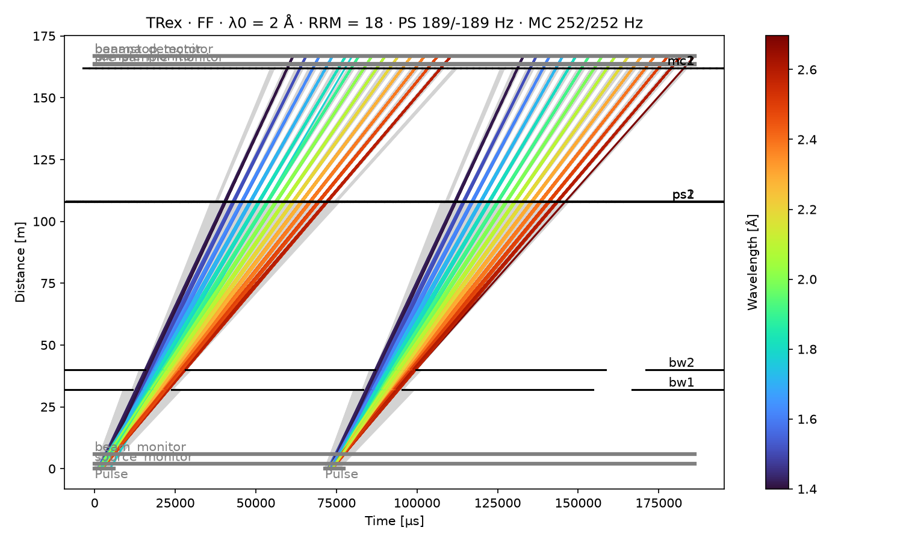

# Time-distance diagram

The time-distance diagram follows neutrons of T-Rex from the moderator, through the
[choppers](choppers.md), to the sample. Time runs across and distance from the source up. Each
neutron is a straight line whose slope is its speed, so the slow, long wavelengths lean further
to the right. It comes from a [tof](../../how-to/simulate-the-choppers-with-tof.md) run. tof
follows each neutron through the choppers, but takes the guides, the bender and the slits as
letting everything through.

## The code

`time_distance_diagram(trex)`, from `mcdgs.tof.time_distance`, builds the tof model of T-Rex at
its current parameters, runs it and draws the diagram. It takes any instrument:

<!-- fmt:off -->
```python
from mcdgs.instruments.trex.model import TRex
from mcdgs.tof.time_distance import time_distance_diagram

--8<-- "src/mcdgs/diagnostics/trex_06_time_distance_diagram.py:time_distance"
```
<!-- fmt:on -->

`N_PULSES`, `VISIBLE_RAYS` and `BLOCKED_RAYS` are set at the top of the module; their values are
below.

## The parameters of the simulation

The diagram below is at the default control parameters, with these settings:

--8<-- "docs/instruments/trex/figures/trex_time_distance_params.txt"

The band of the source follows from `lambda0` and `rrm`. The frequencies and delays of the
choppers follow from the control parameters, as [Choppers](choppers.md) explains.

## The diagram



- **Colored lines** are neutrons that reach the banana detector, colored by wavelength.
- **Gray lines** are neutrons that a chopper stops. Each one ends at the chopper that stops it.
- **Black lines** are the choppers. Each gap in a line is a time when that chopper is open.
- **Thick gray lines** are the pulse at the moderator, 0 to about 6 ms, and the detectors: `beam_monitor` near the bottom, and `pre_sample_monitor`,
  `sample_monitor`, `beamstop_monitor` and `banana_detector` within 3.3 m of each other at
  the top, where their labels overlap.

The second pulse starts 1/14 s, about 71 ms, after the first. Each pulse goes through the
choppers in the same way:

- The bandwidth choppers `bw1` and `bw2`, at 32 and 40 m, open once per pulse. They keep the band
  that reaches the sample before the next pulse does, so the two pulses never overlap there.
- The pulse-shaping choppers `ps1` and `ps2`, at 108 m, cut the band into narrow stripes.
- The monochromatic choppers `mc1` and `mc2`, at 162 m, keep one short piece of each stripe.
  These are the sub-pulses that reach the sample, each of its own wavelength, about 4 ms apart.

The title is `trex.running_conditions()`: the mode, `lambda0`, `rrm` (RRM), and the signed
frequencies of the pulse-shaping (PS) and monochromatic (MC) choppers. tof draws the time in µs.

## Other settings

Change the control parameters with `update_params` and draw again. The other settings are
keyword arguments; `figsize` and `cmap` set the size of the figure and the colormap:

```python
trex.update_params(mode="RR", rrm=12)
time_distance_diagram(trex, 100_000, seed=1, n_pulses=1, blocked_rays=0)  # no gray lines
```

Unlike the [acceptance diagram](choppers.md#acceptance-diagram), the time-distance diagram
follows real neutrons. It shows the shape of the ESS pulse, but with the noise of a Monte Carlo
run: only the drawn rays are a sample of the neutrons.

[`mcdgs.diagnostics.trex_06_time_distance_diagram`](../../reference/diagnostics.md) makes the
diagram and the tables of its parameters, and `pixi run docs-diagnostics` runs it.
